# 云澜汇 · 3D 商业与居住园区

基于 Three.js 的可交互园区模型，包含三期商场、开放街区、公园、地铁、酒店、公寓与住宅。支持整体俯瞰、楼层剖切、昼夜切换和第一人称漫游，可进入商铺、客房与住宅，并乘坐玻璃电梯。

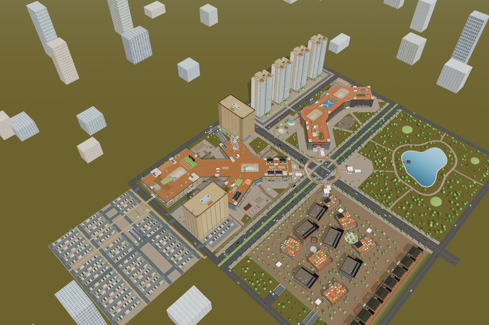

## 2026-10-17 · 真人行人、复式与连续楼梯

- 两套带脸部、服装和头发贴图的 Microsoft Rocketbox 人物，MIT 许可随资源保留；原有建筑增加 PBR 表面与实体窗框。
- 全园 68 座建筑楼梯与 2 座桥塔楼梯均接入连续步行，共 568 条层间线路、1,312 个实体梯段、744 个中间平台；本轮完成其中 51 座，保留三期既有 19 座外挂梯。六部商场玻璃梯通往天台，新增八条屋顶扶梯；二楼天桥门口矮墙已切开。
- 酒店首层 10 套双层套房、公寓顶层 10 套 LOFT，连同原公寓首层共 30 套复式；原模型和 748 户数量不变。酒店西门、公寓东门分别接入既有步道。
- 二期铺位 88 → 107，全园 475。手机新增玻璃画质面板，自动优先流畅，可调清晰度、阴影、泛光和人群。
- 195 项自动测试通过。完整浏览器完成最后 10 座停车小厅、地铁及桥塔楼梯的 32 次双向行走；桌面 10 项、手机模拟 11 项及断网离线回归通过，实体手机性能尚未验收。
- 人物避开实际楼板洞口与边缘，地面下行梯可看到封闭井道及井底；三类模型下载遇短暂中断会自动重试，已验证前两次断开后第三次恢复。最终源码为 `c443b81`；第二阶段正式发布状态见[细节 QA](docs/qa-2026-10-17-details.md)。

[完整验证与进度](docs/qa-2026-10-17-details.md) · [人物来源](docs/people-models.md)

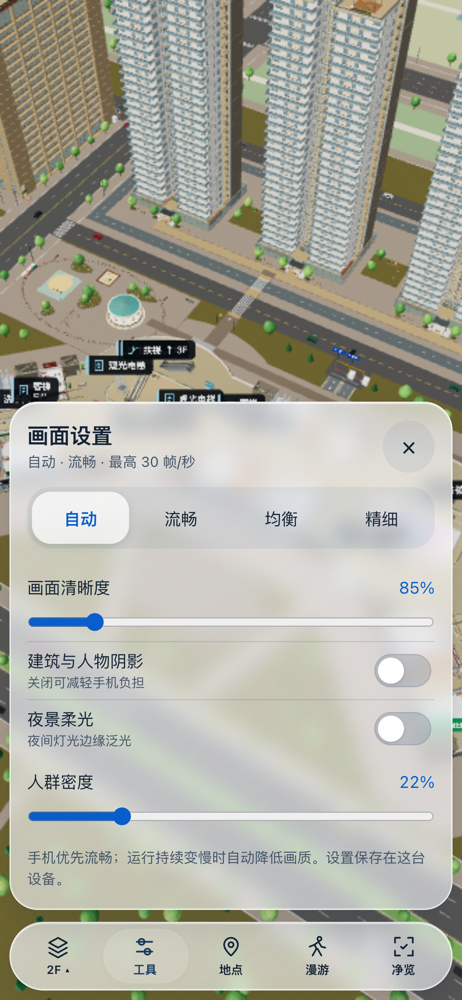

## 手机玻璃界面 · 2026-10-15

手机采用透明悬浮底栏、图标与滑动胶囊高亮，楼层与工具面板统一玻璃质感，支持深色和减少动态效果。点「净览」完全隐藏界面，轻点画面恢复；横屏仍保持紧凑。详见 [本轮检查](docs/qa-2026-10-15-glass-ui.md)。

## 2026-10-14 手机净览与周边城市扩展

- 手机横竖屏、触屏与低高度窗口统一使用紧凑底栏。楼层、工具、地点按需打开且互斥；目录可关闭，选层后自动收起。
- 点击「净览」隐藏所有应用界面与标签，提示在 1.8 秒后消失。轻点画面恢复，拖动不会恢复；桌面 H 切换，Esc 恢复。漫游 HUD 同样可隐藏，切换时释放移动状态。
- 「工具 → 周边」查看扩展路网。新增 24 段道路、43 个街区地块、84 栋外景建筑、绿地、球场、座椅和道路照明；步行范围扩展到 x[-940,940]、z[-850,850]。道路、人行道与斑马线接回原园区，外景建筑有碰撞但不提供室内。
- 保持原酒店、公寓、住宅模型和布局：456 商铺、748 居住单元、778 地面车位。修复镜头动画把阴影距离当作时长的问题，并按镜头高度调整雾距，让城市总览可见。
- 空间数据见 `src/layout/urban.js`，渲染见 `src/render/build/urban.js`，紧凑界面与净览见 `src/render/viewport-ui.js`；修改源文件后构建，不手改生成 HTML。
- 本轮检查与截图见 [手机与城市 QA](docs/qa-2026-10-14-mobile-city.md)。手机采用浏览器触屏模拟，尚未在实体手机验收。

## 快速打开

**在线浏览：** [打开云澜汇 3D 园区](https://yunlan-mall-calvin.netlify.app)。这是已正式发布的 Netlify 站点，公开访问，无需登录。完整模型约 46.4 MiB，首次加载可能需要一两分钟，后续可使用浏览器缓存。

**离线浏览：** 下载仓库 ZIP 并解压，使用新版 Chrome、Edge 或 Safari 打开 [`dist/mall.html`](dist/mall.html)。Three.js、贴图及三套住宅模型已内嵌，打开后无需联网，也不需要安装依赖。住宅模型解压需要浏览器支持 `DecompressionStream`。GitHub 文件页本身不会运行这个 HTML。

**继续开发：** 安装 Node.js（建议 20 或更新版本）、npm 和 Python 3，然后执行：

```sh
git clone https://github.com/calvinzeng123/super-mall-3d.git
cd super-mall-3d
npm ci
npm run build
npm run serve
```

打开 <http://127.0.0.1:5174/>。本仓库为私有仓库，克隆需要对应账号权限；首次安装依赖需要联网。修改源码后重新执行 `npm run build`，再刷新浏览器。

## Netlify 构建与发布

线上专用构建由 [`scripts/build-netlify.mjs`](scripts/build-netlify.mjs) 生成 `dist/netlify/`。本次产物共 27 个文件、约 46.45 MiB：约 1.5 MiB 的应用 JS、18 张 JPEG 贴图、套房 GLB、2 份人物 GLB、3 份住宅 gzip 二进制资源，以及入口 HTML 和资源清单。素材从同站点加载，带内容哈希的资源文件使用长期不可变缓存，首页每次校验更新。`dist/mall.html` 继续作为资源全部内嵌的单文件离线版。

使用已登录的 Netlify CLI，先构建再手动发布：

```sh
npm run build:netlify
netlify deploy --prod --no-build --dir dist/netlify --site 3af33d60-6f93-4be3-a2e2-06f122ed5fc3
```

本次通过 CLI 手动发布，**尚未连接 GitHub 自动构建**；推送代码后仍需执行上述构建与发布步骤。构建目录、Node 版本和缓存规则见 [`netlify.toml`](netlify.toml)，部署与线上验证记录见 [Netlify 交付记录](docs/qa-2026-10-13-netlify.md)。

## 2026-10-13 · 酒店公寓互换、星湾乐园与西侧大型停车场

按用户最新调整，**酒店 H 在一期左下西南内院，公寓 A 在右上北翼旁**；本次位置覆盖此前“左下公寓、右上酒店”的版本。H 中心为 `(-247,-81.1533717)`、朝向 0°，A 中心为 `(-35,-214)`、朝向 90°。两栋各保留 20 层、200 套，地面、2F 和两层地下连廊继续接入商场；北翼公共侧厅随公寓接驳保留，不穿过超市。

亲子乐园和花园食集移至**二期商场与住宅之间的两片空地**，分别位于星湾北门两侧，以步道连接二期和四栋住宅。原西侧活动地块扩为大型地面停车场：**732 位，其中 68 个充电位、10 个无障碍位**；加上酒店南侧 46 位，共 **778 个共享地面车位**。三个地面出入口连接西外环，步行主轴通向一期、酒店和 WPG 地库入口厅。

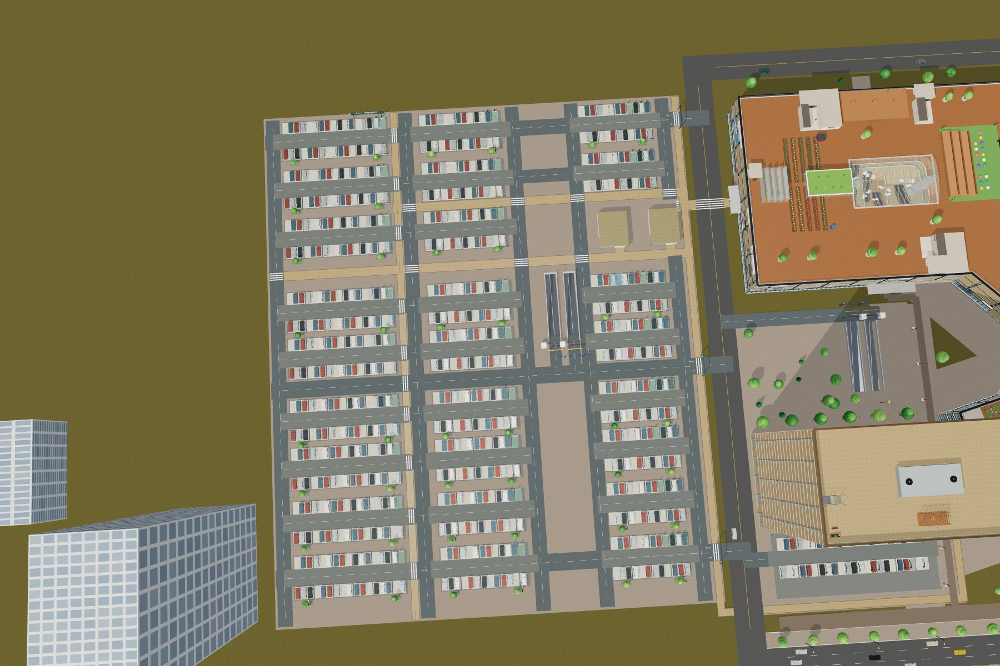

WPG 西侧公共停车附库继续保留 B1/B2 共 36 位，地面两座入口厅各有电梯和楼梯。园区原有 **16 个地下车库地面坡口、28 条总坡道**保留；新增三个地面停车入口不计作地下坡道。H/A 与 WPG 的 B1/B2 仍连通。

[本次验收记录](docs/qa-2026-10-13-west-parking.md) · [历史双侧布局记录](docs/qa-2026-10-13-hotel-apartment-sides.md)

## 地面公共空间与三期街区深化

酒店接一期西翼，公寓接一期北翼；地面迎宾廊、2F 玻璃连廊和地下通道均接入真实门洞。原 400 套精装房（含公寓首层 10 套复式）与 R1–R4 的三种住宅模型继续保留。

- **五片活动空间**：二期北侧的云宝亲子乐园、花园食集，以及一期城市客厅小剧场、方庭阅读花园、星湾街角庭院。61 件主设施包括旋转木马、探险城堡、秋千、沙池、小火车、摊亭、花架、桌椅、自行车位、曲线种植岛和食集遮阴棚。乐园按 90° 旋转迁入西侧空地，原设备尺寸保留；食集在东侧空地。
- **地面及地下停车**：西侧 732 位、酒店 46 位，共享地面共 778 位；另有 WPG 地下 36 位。三个大型地面停车出入口接西外环，停车区之间设步行通道、种植岛、导视和照明。H/A、WPG 以及二期、三期保留 B1/B2 连接。
- **三期**：保留原 11 栋，后侧增建 8 栋三层旧巷，合计 116 间商铺。木构骑楼、青瓦屋面、窗棂、灯笼、货架、外摆和 12 个集市摊位；2F、3F 后廊连续相接。44 组双跑楼梯可逐段走上去。
- **商场内饰**：珠宝、腕表、美妆、潮玩及家居陈设增加实物细节；服务台、休息区、食街桌面和停车候梯厅同步深化。

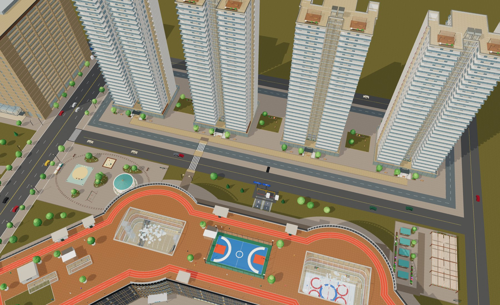

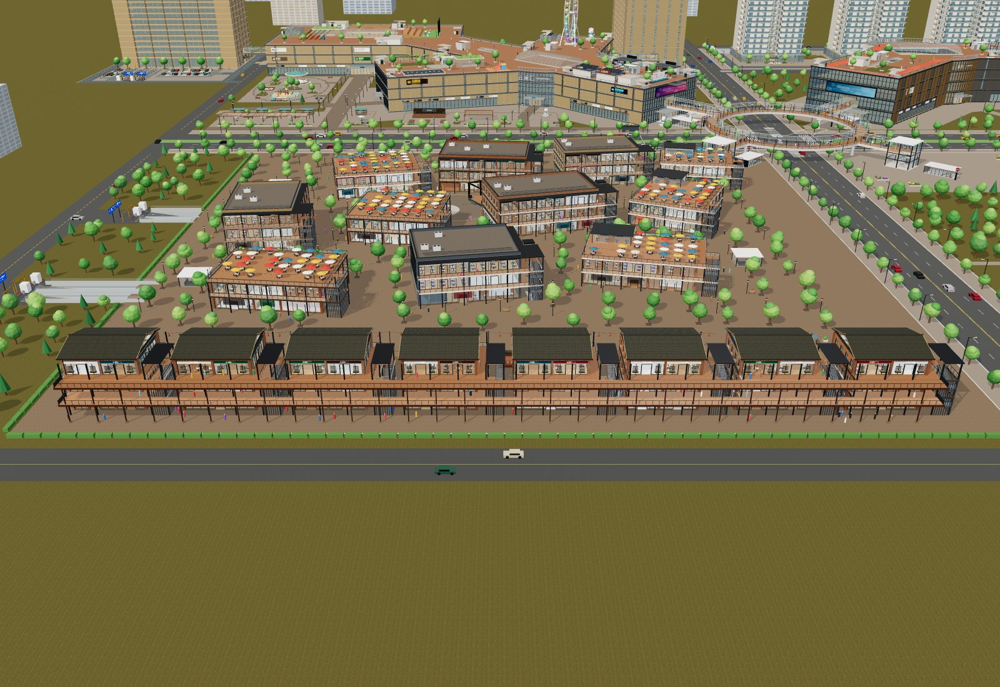

三期和商场细节的原始深化记录见[历史交接与验收](docs/qa-2026-10-13-campus-detail.md)，当前位置以本页顶部为准。乐园是场景设施，旋转木马有展示动画，未制作可驾驶的游乐项目。

## 住宅 01 / 02 / 03 已接入 R1–R4

四栋住宅现已按原模型 **1:1** 接入三套精装户型，重新安排楼板、入户走廊、双电梯和两侧消防楼梯。每栋保持地上 30 层：**1F 为独立大堂，2F–30F 每层 3 户，共 87 户；四栋合计 348 户**。

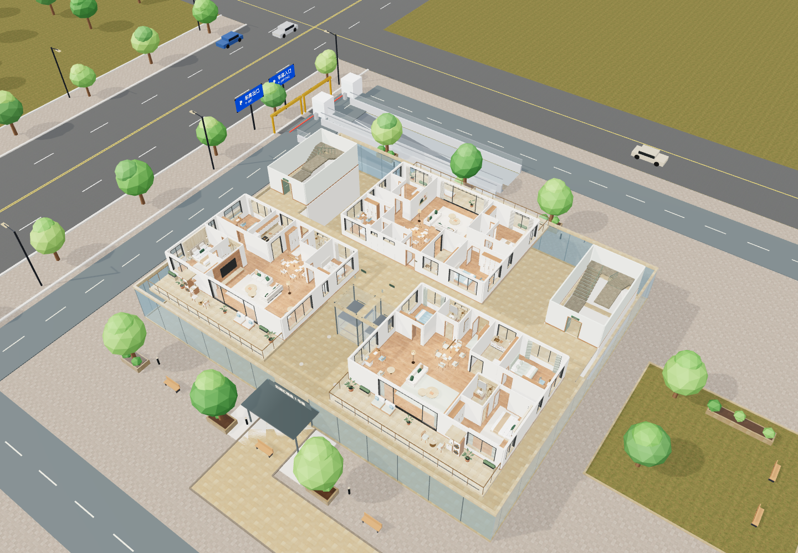

- **01：三房两厅两卫，横厅家庭型。02：三房两厅两卫，镜像阅读型。03：四房两厅三卫。** 每户保留源家具、厨卫、床品、门窗和通长大阳台。
- 标准层以 3.2 米公共走廊连接三户、双电梯及两部消防楼梯；楼板按三户和核心筒实际形状拼接，保留采光空隙与井道。
- 1F 单独布置入口门厅、礼宾接待、等候会客、信报快递、物业、阅读和卫生间；B1 保留共享地库及独立进出坡道，出口车道避开电梯井。
- 住宅墙体、家具和淋浴隔断使用实际 Blender 网格生成的碰撞；玻璃电梯连续升降，消防楼梯沿实体踏步和中间平台连续上下；门口互动选层仍可使用。

打开园区后选择「住宅1」→「2F」查看标准层，选择「1F」查看大堂，进入「漫游」后可到访各户。建筑尺寸、模型接入、资源管理和重建方法见[住宅接入说明](docs/residential-integration.md)，本轮验证见[验收记录](docs/qa-2026-10-09-residential-integration.md)。以下独立样板文件继续保留，便于编辑和单独查看。

## 住宅 01 / 02 · 两套三房源模型

01、02 均已制作成独立 Blender 三房两厅两卫模型，含 **15.6×2.8 米通长阳台**，延续03的精细床品、源家具、厨卫、柜体、材质和灯光。每套提供`.blend`、内嵌贴图GLB、离线查看器、12张1600×1100效果图及中文平面图。

| 01 · 横厅家庭型 | 02 · 镜像阅读型 |
|---|---|
| 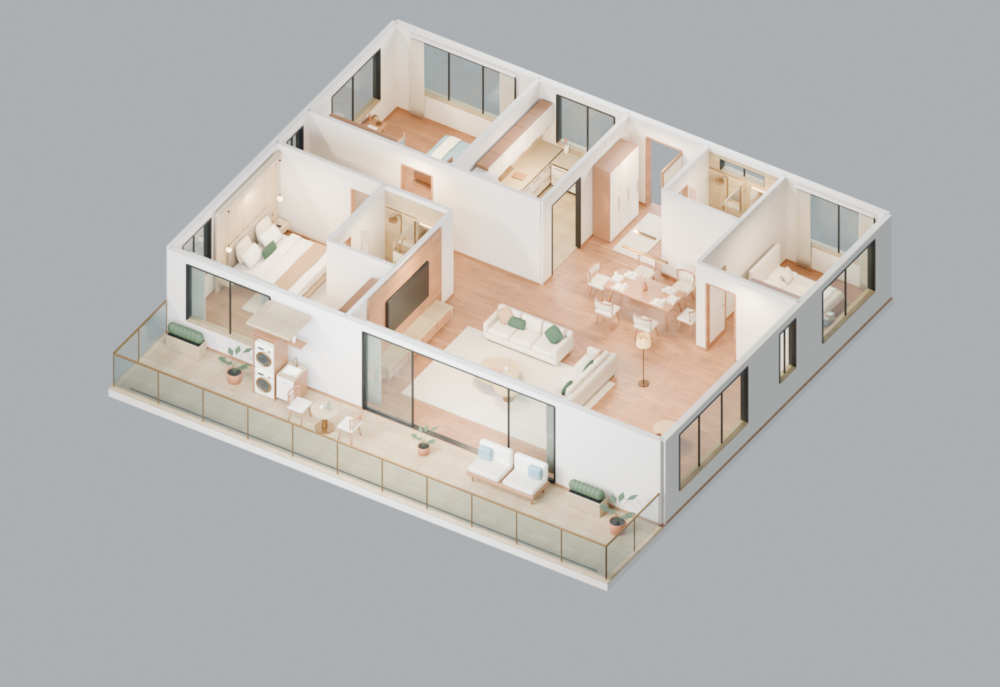 | 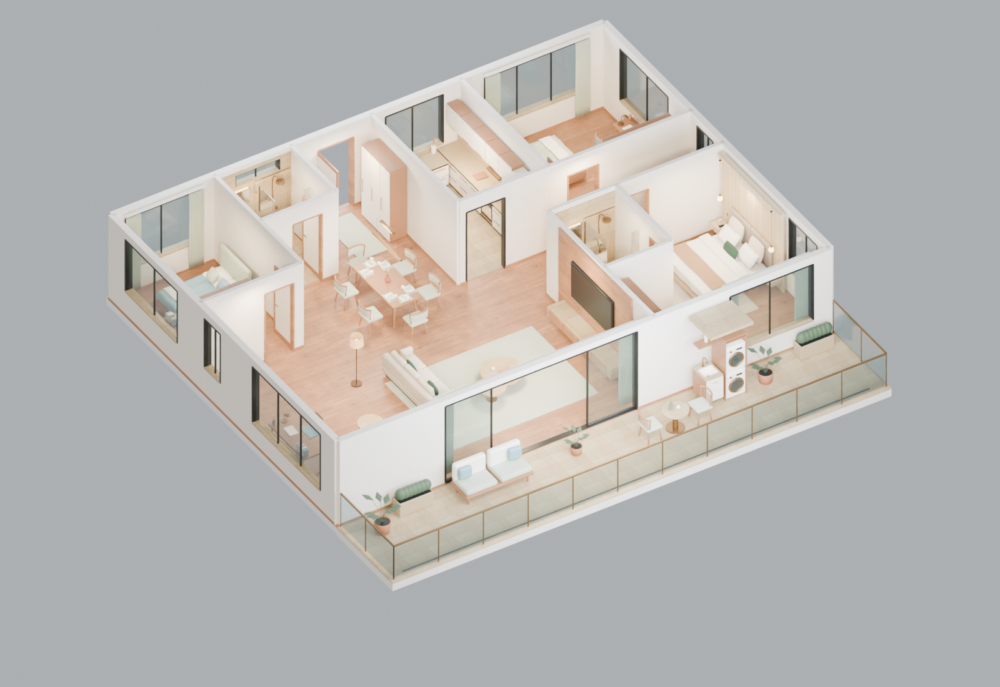 |
| 西南主卧、双沙发会客、东西向六人餐桌；厨房从餐厅侧面进入 | 东南主卧、单沙发加窗边书桌；餐桌改南北向，厨房与公卫分别改为南向入口 |
| [01全部文件](prototypes/residential01/) · [01离线页](prototypes/residential01/住宅01_离线漫游.html) | [02全部文件](prototypes/residential02/) · [02离线页](prototypes/residential02/住宅02_离线漫游.html) |

02在东西镜像基础上重排了门洞、餐桌、次卧用途和阅读区。每套含墙平面179.40㎡、阳台43.68㎡单列，不是净使用或销售面积。详细区别见[布局说明](docs/residential-01-02-plan.md)，文件、重建及验证见[01/02交付说明](docs/residential-01-02-delivery.md)。HTML需下载到本地浏览器打开，GitHub文件页不执行它。

**楼栋接入状态：三套样板已用于 R1–R4 的全部 348 户住宅。** 独立查看器仍是可自由穿墙的模型展示；园区版另有房间碰撞、公共交通核与乘梯系统。

## 住宅 03 · Blender 四房源模型

新建的 **03 四房两厅三卫**独立样板已单独建模：主卧、南次卧、儿童房、青年房，客餐厅、L形厨房、洗衣间与 **17.6×2.8 米通长阳台**。主卧床组、客厅沙发及部分陈设保留用户自制套房的真实模型；其余家庭家具和厨卫重新制作。

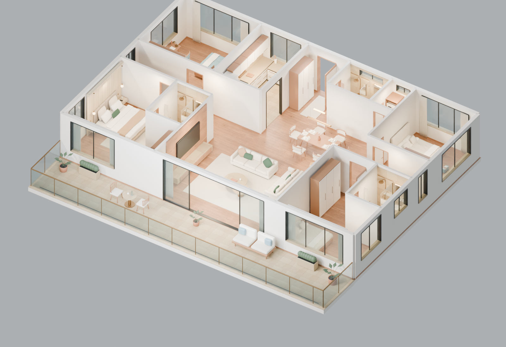

下载 [`prototypes/residential03/`](prototypes/residential03/) 中的 `.blend`、`.glb` 或 `住宅03_离线漫游.html`；HTML 需下载后用浏览器打开，含日夜、各房视角、剖顶与自由移动。Blender 文件已打包贴图，可继续编辑和渲染。说明见 [住宅原型布局](docs/residential-prototype-plan.md) 和 [模型交付与验证](docs/residential-prototype-delivery.md)。

**接入状态：R1–R4 的 2F–30F 每层 03 户均使用此四房模型。** 原始 `.blend`、GLB 与独立 HTML 保持不变，园区运行时统一管理结构楼板、灯光和按层加载。

## 园区内容

| 区域 | 内容 |
|---|---|
| 一期 P1 · 云澜汇 | Y 形商场与方庭，地下商业、停车和屋顶空间 |
| 二期 P2 · 星湾 | 新月形商场、冰场、影院与天空跑道 |
| 三期 P3 · 云澜里 | 19 栋街区建筑、116 间商铺、后侧旧巷、可步行楼梯与 B1/B2 |
| 地铁与公共空间 | 地铁站厅、站台与列车，云环天桥、中央公园 |
| H · 云澜酒店 | 一期西南内院（左下），20 个居住层，每层 10 间，共 200 间 |
| A · 云澜服务公寓 | 一期北翼旁（右上），20 个居住层，每层 10 间，共 200 间 |
| 西侧地面公共停车 | 732 位，3 个出入口接西外环；另有酒店共享地面 46 位 |
| WPG · 西侧公共停车附库 | 一期西侧停车场下方，B1/B2 共 36 位，地面双入口厅 |
| R1–R4 · 云澜汇楼盘 | 二期后侧，4 栋各 30 层；1F 大堂，2F–30F 每层 3 户，共 348 户 |

现有 475 家商铺；酒店、公寓与住宅合计 **748 个单元**，均有床铺和独立卫浴。住宅标准层为两套不同的三房两厅与一套四房两厅，均含厨房和大阳台。六栋塔楼可进入普通层、地下层与屋顶，配备 12 部连续升降的玻璃电梯。

酒店与公寓的 **400 套房间已接入用户提供的自制套房 GLB**，保留原模型的卧室、客厅、独卫、家具和贴图，以 1:1 尺寸落入现有单元。公寓右侧附翼补充厨房、洗烘及储物；酒店附翼设茶水台和行李收纳。H 栋 1F、A 栋 1F 与 A 栋 20F 各 10 套，共 30 套双层房间，使用 6.5 米层高、3.05 米夹层与可步行的 18 级套内楼梯；园区目录楼层与住户总数不变。模型处理、碰撞和资源管理见[套房接入说明](docs/suite-integration.md)。

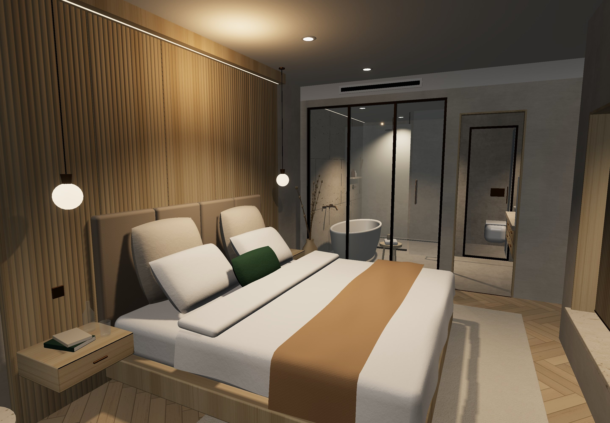

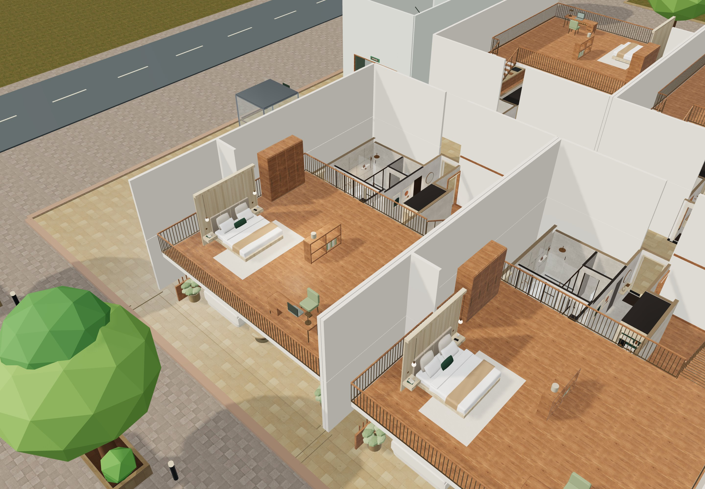

更多近景见[套房接入说明](docs/suite-integration.md)。

## 漫游操作

| 操作 | 方式 |
|---|---|
| 选择建筑、楼层 | 顶部楼栋栏与楼层栏；「全楼」恢复外观 |
| 第一人称 | 点击「漫游」，点击画面控制视角，或按住画面拖动 |
| 行走 / 加速 / 跳跃 | WASD 或方向键 / Shift / 空格 |
| 飞行 | F 或双击空格切换；空格上升、C 下降 |
| 乘坐电梯 | 步行到电梯门前，按 E 或点击楼层提示选层 |
| 使用楼梯 | 商场、酒店、公寓、住宅、地库小厅、地铁和桥塔均可沿实体踏步连续上下；门口按 E 仍可快速选层 |
| 快速定位 | 「地点」目录选择建筑、楼层或房间 |
| 退出 | Esc 释放鼠标，点击「退出」回到俯瞰 |

触屏模式支持左侧浮动摇杆、右侧拖动视角和飞行按钮。完整操作见[使用说明](docs/expansion-guide.md)。

地下步行主线为 **住宅 B1 → 二期 B1 → 地铁站厅 → 一期 B1M → 酒店 B1 / 公寓 B1 / WPG B1**。酒店 2F 接一期西翼末端公共廊，公寓 2F 接北翼公共侧廊；H/A 与 WPG 的 B2（−8.4m）接一期 B1（−8.4m），再通过一期双坡到其 B2（−12m）。二期 B1/B2 为 −4.2/−8.4m，三期为 −4.5/−9m；各栋同名楼层不一定同标高。住宅共享地下车库，并设独立进出坡道。

## 源码与交接

接手开发先读 [HANDOFF.md](HANDOFF.md) 顶部的最新状态，再查看对应模块。后半部分保留的旧交接仅用于追溯。

| 路径 | 用途 |
|---|---|
| `src/layout/` | 楼栋、楼层、房间、连接通道、导航与乘梯数据 |
| `src/render/` | Three.js 场景、交互、材质与建筑构建器 |
| `src/shell.html` | 页面模板；修改界面应编辑此文件 |
| `assets/textures/` | 本地 PBR 图片、来源与校验清单 |
| `assets/models/` | 用户套房原始 GLB、处理后 GLB 与模型校验清单 |
| `prototypes/residential01/02/03/` | 三套住宅的 Blender、GLB、独立查看器与原模型验收资料 |
| `src/layout/residential-plan.js` | 三户定位与住宅计划数据入口 |
| `src/layout/west-parking.js` | 西侧停车场车位、出入口、车道、步行轴与种植岛数据 |
| `src/render/build/west-parking.js` | 西侧停车场门架、导视、种植及照明；车位车辆复用共享停车构建器 |
| `scripts/prepare-residential-plans.py` | 从实际模型审计数据生成住宅碰撞、房间与开口数据 |
| `scripts/prepare-suite-asset.mjs` | 保留原件，重建套房门洞、窗外视线、接触阴影及 GLB 灯光 |
| `tests/` | 布局、通行、房间、电梯与素材验证 |
| `build.mjs` | 生成开发入口及离线页面 |
| `scripts/build-netlify.mjs` | 生成线上入口、哈希资源文件与资源清单 |
| `netlify.toml` | Netlify 构建目录、Node 版本及缓存规则 |
| `dist/mall.html` | 可直接打开的完整离线页面 |
| `dist/artifact.html` | 供 Artifact 包装使用的页面片段 |
| `dist/netlify/` | Netlify 线上专用构建产物，运行 `npm run build:netlify` 生成 |

`index.html`、`dist/`、`src/render/pbr-data.js`、`src/render/suite-data.js` 和 `src/render/residential-data.js` 由构建生成；不要直接修改生成文件。三个渲染数据模块不纳入 Git，首次启动开发服务前必须先构建。普通源码修改只需运行 `npm run build`；修改套房预处理规则时，先运行 `node scripts/prepare-suite-asset.mjs`。住宅源模型或实际审计结果变化时，先重新审计，再运行 `uv run --with shapely scripts/prepare-residential-plans.py` 更新纳入 Git 的 `src/layout/residential-plan-data.js`，最后构建。

## 验证与当前边界

```sh
npm test
npm run build
```

当前 `c443b81` 源码已通过 **195/195 项自动化测试**，完整园区浏览器、手机模拟、离线及短暂断网恢复验证见[最新细节 QA](docs/qa-2026-10-17-details.md)。正式发布分阶段进行，最新部署结果与线上校验记录均以该 QA 为准。

历史记录：2026-10-13 Netlify 发布轮次的 **142/142 项自动化测试通过**，正式站点首页公开访问返回 HTTP 200。线上场景与浏览器操作的验证结果见 [Netlify 交付记录](docs/qa-2026-10-13-netlify.md)。

酒店公寓互换、乐园迁移和西侧停车扩建的自动测试、构建、浏览器与离线验收结果见[布局验收](docs/qa-2026-10-13-west-parking.md)。

历史记录：2026-10-13 上一版双侧整合通过 **131/131 项自动化测试**，覆盖当时的酒店/公寓四层连廊、公共车库与地面入口、停车坡道、活动区和实际树冠/灯具避让；见[历史验收](docs/qa-2026-10-13-hotel-apartment-sides.md)。

此前商场配套深化通过 **119/119 项自动化测试**，新增检查覆盖配套迁移、五片活动区与通路、二期 B1/B2 及三期 44 组真实楼梯。最终画面、输入操作与离线检查见[本轮验收记录](docs/qa-2026-10-13-campus-detail.md)。

历史记录：2026-10-09 住宅接入通过 **102/102 项自动化测试**，覆盖 748 个单元门口、三套模型的 46 条双向室内路线、四栋大堂、上下层公共核心筒、真实楼板洞口和地库路线。浏览器与离线产物的最终结果见[本轮验收记录](docs/qa-2026-10-09-residential-integration.md)。

历史记录：2026-10-07 套房接入通过 **95 项自动化测试**，并完成高层切换、复式上下楼、灯光跟随与缓存检查。桌面及 iPhone 浏览器模拟均以 `file://` 断网打开当时的离线页，页面错误和 HTTP 请求均为 0。详情见[套房验收记录](docs/qa-2026-10-07-suite.md)。

2026-10-06 的上一版扩建已有 **83 项测试通过**，并做过高层乘梯、偏轴登梯、地下通道、桌面及手机尺寸的离线加载检查。该记录属于套房模型接入前版本，见[历史验收记录](docs/qa-2026-10-06.md)及[变更记录](docs/revisions/2026-10-06-material-detail.md)。

- 客房及住宅采用可复用房型模板，共 748 个单元；各标准层重复 01/02/03 的三套布局。
- 周边 84 栋城市背景楼具有实体窗框与凹入玻璃，仍只提供外观，不能进入。
- 全园 70 座公共楼梯和 30 套复式的套内梯均连续可步行。六栋塔楼的 12 部玻璃电梯与商场 6 部屋顶玻璃电梯使用连续轿厢；其余普通电梯仍保留互动选层。
- 酒店、公寓的大件家具、隔墙、复式护栏和楼梯，以及住宅实际模型的墙体、家具、淋浴玻璃和大堂陈设参与人物碰撞；新增乐园主要设施、三期集市摊位和地面共享停车中的可见车辆也参与碰撞；既有商铺小陈设、树木和地下车辆沿用原规则。
- 套房灯光使用固定近景灯池（桌面 10 盏、移动端 8 盏），随当前房间移动；未同时点亮 400 套独立灯组。
- 住宅使用固定灯池（桌面 12 盏、移动端 8 盏），塔楼精装楼层共用最多 3 层的访问缓存。三套 GLB 使用 gzip 压缩：离线版内嵌，线上版加载同站点二进制文件；均顺序解压并共享材质、几何和贴图。人物、套房及住宅模型下载支持最多 3 次总尝试，短暂失败后分别等待 500 / 1,000 ms；永久错误或主动取消不会反复重试。
- 手机仅做浏览器模拟，尚未验证实体 iPhone 的性能与兼容性。
- 仓库保存源码与离线页面；正式在线站点通过 Netlify CLI 手动更新，GitHub 推送不会自动部署。

## 材质与许可

本轮使用 Poly Haven 的 6 套 CC0 材质：石材、铺装、橡木、砖墙、沥青和草地，共 18 张本地图片。作者、来源、用途和校验值见[贴图来源](docs/texture-sources.md)与[素材清单](assets/textures/manifest.json)。Three.js 的 MIT 许可保存在[许可文件](docs/licenses/three-MIT.txt)，也内嵌于离线页面。第三方素材许可不代表本项目全部源码采用相同许可。

新增套房模型来自用户自制文件 `酒店套房_改造后.glb`，**不属于 CC0 素材**。原始模型、内嵌的 23 张图片及处理版本的来源与校验值单独记录在[模型清单](assets/models/manifest.json)，不可套用上述 Poly Haven 许可。
