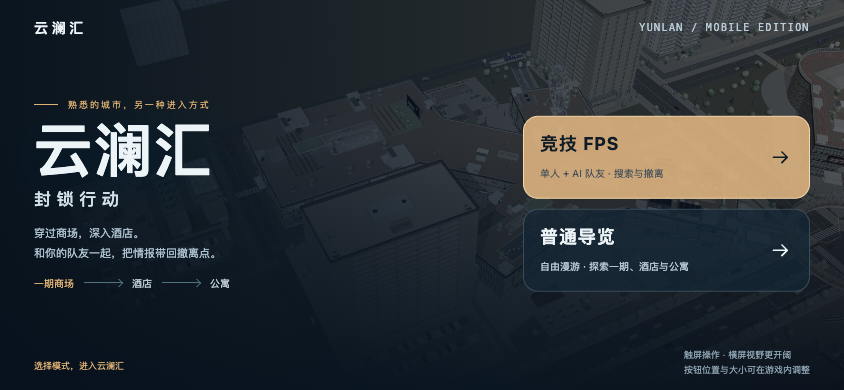

# 云澜汇 · 园区导览与封锁行动

面向手机的 Three.js 小样，同一封面提供 **普通导览** 与 **竞技 FPS** 两种入口。

[在线体验](https://yunlan-mall-calvin.netlify.app/) · [最新交接](HANDOFF.md) · [FPS 说明](docs/fps-sample.md) · [免费模型来源](docs/fps-asset-sources.md)



## 当前可玩内容

| 模式 | 内容 |
| --- | --- |
| 普通导览 | 一期商场 P1、酒店 H、公寓 A；53 个目录楼层，保留两栋 20 层、400 套原精装房、复式、玻璃电梯与连续楼梯 |
| 竞技 FPS | 单人 + AI 队友的 PvE 搜索撤离；同一建筑布局中保留 15 个可行走楼层和 3 个封闭顶盖，商场地上两层、塔楼地上三层及相连地下区域 |

两种模式均已移除二期、三期、住宅小区、地铁、远景城市、旧公园与西侧大型停车区的运行时场景、导航和下载；原始住宅 Blender、GLB 和完整园区建模源码仍保存在仓库，方便后续继续制作。

### 封锁行动

1. 与队友「回声」从一期商场出发，接入终端取得密钥。
2. 穿过既有连廊与实体楼梯，到酒店 2F 取回情报。
3. 经商场地下连廊前往公寓 B1，清理接应区并守住 8 秒撤离。

包含 5 名巡逻/警戒敌人、有限弹药、换弹、两把枪切换、瞄准、蹲伏、冲刺、急救、队友救援，以及成功/失败结算和重新开始。回声支持跟随、守点、掩护；本地 AI 自行移动和交战，无需 API Key。敌人和队友的射击受墙体与楼层遮挡约束，移动使用原园区碰撞与连续楼梯。

SMG-45、Desert Eagle、手套与衣袖均来自免费可再分发的带贴图模型。SMG 保留源骨骼换弹动画，手枪使用真实分件制作弹匣、套筒动作；切枪先收起旧枪再拔出新枪。作者、许可和修改说明可在游戏暂停菜单查看，完整记录见[素材来源](docs/fps-asset-sources.md)。

### 手机操作

- 左摇杆移动，右侧空白区域拖动视角；按住开火/冲刺，轻点瞄准、蹲伏、换弹、切枪和急救。
- 靠近金色任务点后点击「读取情报」。撤离区自动计时，离开会重置，附近威胁会阻止撤离。
- 点击队友状态选择指令；暂停菜单也能输入「跟我走」「守住这里」「掩护我」。
- 暂停 → 操作设置：调整按钮大小、透明度、瞄准灵敏度、反转 Y 轴与音效。自定义布局可拖动按钮，横屏和竖屏分别保存。
- 暂停或切换到后台会停止游戏输入；返回封面后再选模式会释放原页面的 3D 场景。
- 普通导览保留玻璃底栏和「净览」隐藏界面。

桌面兼容 WASD / 方向键移动、鼠标视角与开火、R 换弹、Q 切枪、E 交互、H 急救、C 蹲伏、Shift 冲刺、Esc 暂停。

## 手机负载控制

在线封面只有二维图片和小型入口脚本，选择模式之前不创建 WebGL，也不下载枪械和建筑模型。进入 FPS 后按需载入战斗模块与 5.75 MiB 枪械资产；导览不会加载枪械。

FPS 固定使用流畅画质，关闭动态阴影、泛光、普通人群与交通，限制清晰度及 30 fps 渲染频率；只保留任务所需楼层，客房按访问楼层缓存。两种模式共用原套房和 PBR 贴图，三套住宅模型不进入发布包。第一人称枪械与世界共用一个 WebGLRenderer。

浏览器的 iPhone 尺寸、触屏模拟、完整任务及构建检查见[本轮 QA](docs/qa-2026-10-19-fps.md)。这些检查不等同于实体 iPhone 的帧率、温升和长时间内存验收。

## 本地开发与离线版

建议 Node.js 20+、npm、Python 3：

```sh
npm ci
npm run build
npm run serve
```

打开 http://127.0.0.1:5174/。修改源码后重新构建；不要手改 `index.html` 或 `dist/`。

`dist/mall.html` 是资源内嵌的双模式离线版，可下载后在新版桌面浏览器中直接打开。手机优先使用 HTTPS 在线站点；iOS 文件预览不能代替 Safari 网页运行环境。离线版的本地 AI、枪械和任务不需要模型 API。

## GitHub 与 Netlify

GitHub 保存源码、模型许可和离线产物；线上仍为 **手动部署**，推送不会自动发布。

```sh
npm test
npm run build:netlify
netlify deploy --prod --no-build --dir dist/netlify --site 3af33d60-6f93-4be3-a2e2-06f122ed5fc3
```

发布目录只用 `dist/netlify/`；`netlify.toml` 声明可选的 `netlify/functions/`。线上资源使用内容哈希和长期缓存，首页校验更新。部署 ID、文件校验和最终检查结果见[本轮 QA](docs/qa-2026-10-19-fps.md)。

可选语言模型接入只把一句自然语言转换为跟随、守点、掩护三个已有动作；战斗规则仍由本地游戏执行。默认不启用云端模型。环境变量与边界见 [FPS 接入说明](docs/fps-sample.md#可选模型-api)。

## 源码入口

| 路径 | 用途 |
| --- | --- |
| `src/main.js`、`src/launcher.js` | 不初始化 3D 的封面和模式选择 |
| `src/runtime.js` | 选择模式后加载布局、渲染及玩法 |
| `src/layout/playable.js` | P1 / H / A 运行时裁剪、FPS 楼层封顶、连接过滤 |
| `src/fps/game.js`、`rules.js` | 游戏循环、任务、生命弹药、AI、胜负 |
| `src/fps/pathfinding.js` | 用原碰撞求解器验证路径、引导与视线 |
| `src/fps/hud.js` | iPhone 横竖屏控制、设置、自定义布局、结算 |
| `src/fps/viewmodel.js`、`world.js` | 真实手臂/枪械动画、队友/敌人、任务道具 |
| `src/render/`、`src/shell.html` | 原建筑渲染、精装套房、导览与页面模板 |
| `assets/models/fps/`、`scripts/fps-assets/` | 枪械模型、许可、源校验和可复现预处理 |
| `netlify/functions/squad-order.mjs` | 默认关闭的可选模型指令接口 |
| `build.mjs`、`scripts/build-netlify.mjs` | 开发/离线与线上拆包构建 |

`src/render/*-data.js` 为构建生成文件；首次本地运行先 `npm run build`。先阅读 `HANDOFF.md` 最新一节再继续开发。

## 原建模资料

本轮手机版本缩小了运行范围，未删除历史源模型。原三期园区、748 个居住单元及住宅 01/02/03 的记录见 [历史交接](HANDOFF.md)、[套房接入](docs/suite-integration.md)、[住宅接入](docs/residential-integration.md)和[三套独立住宅](docs/residential-01-02-delivery.md)。历史全园数量不代表本轮可进入范围。

## 素材许可

- 枪械与手臂：DJMaesen / ELIZION，**CC BY 4.0**，署名及修改声明随发布包保留。
- 园区 PBR：Poly Haven，**CC0**，[来源清单](docs/texture-sources.md)。
- 贴图人物：Microsoft Rocketbox，**MIT**，[来源说明](docs/people-models.md)。
- Three.js：**MIT**，[许可](docs/licenses/three-MIT.txt)。
- 用户自制套房及住宅不属于 CC0；保留原作者文件和[模型清单](assets/models/manifest.json)。第三方素材许可不等同于整个项目的代码许可。
