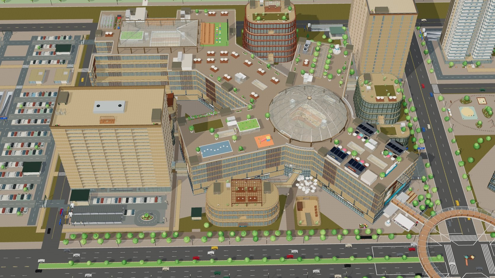

# 云澜汇 · 园区导览与封锁行动

面向手机的 Three.js 小样，同一封面提供 **完整园区探索**、**竞技 FPS** 和 **小游戏合集**（雏形）三个入口。

[在线体验（Netlify）](https://yunlan-mall-calvin.netlify.app/) · [滨江社区新站](https://yunlan-mall-calvin-v2.netlify.app/) · [最新交接](HANDOFF.md) · [FPS 说明](docs/fps-sample.md) · [免费模型来源](docs/fps-asset-sources.md)



## 当前可玩内容

| 模式 | 内容 |
| --- | --- |
| 完整园区探索 | 扩建一期、二期、三期、酒店、公寓、四栋住宅、云澜·西苑与云澜·北苑、地铁、西停车场、云澜江和周边城市；338 个楼层，664 个商铺，380 间酒店/公寓客房、348 套住宅及 318 户云澜社区住宅（西苑 270 户、北苑 48 户） |
| 竞技 FPS | 单人 + AI 队友的 PvE 搜索撤离；仅一期、酒店、公寓，共 17 个可行走楼层及 1 个封闭顶盖；地下车辆和酒店屋顶直升机两种撤离 |
| 小游戏合集（雏形） | 裁小的地图（一期、酒店、公寓、住宅楼、地铁站，不含二期和三期）加一套共用外壳；现在能玩「无人机送外卖」和「夜间潜入」两个粗糙原型，另有四个占位。见 [小游戏合集](docs/arcade.md) |

**贴图模型**（2026-11-10）：探索和小游戏里的桌椅、沙发、绿植、摆件换成了 101 个带贴图的模型（Poly Haven，CC0），树换成带树叶贴图的树冠，保安和无人机也重做了。同一天的第二轮把每一件模型的摆放按规则核对了一遍（朝向、通道、落地、不穿墙），并给商场加了贴地阴影和天花分格。说明、出处和性能数字见 [贴图模型](docs/props.md)。FPS 不受影响。

**HDR 光影和画面设置**（2026-11-11）：探索和小游戏里多了「HDR 光影」——真实天空的反射和环境光、更通透的色彩、亮面的石材和金属；画面设置拆成十三个可以单独调的细项，多了「极致」档（环境光遮蔽、高光柔光、室内灯光）。商场灯下有光斑，社区住宅加了吊顶、吸顶灯、落地阴影、窗边天光，客厅沙发和阳台盆栽换成了模型。手机默认还是「流畅」，新加的效果一个都不开。这里的 HDR 是渲染上的，不是让屏幕输出 HDR 信号。说明、各档的花费和已知限制见 [HDR 光影说明](docs/hdr.md)。

**只有 FPS 裁剪地图。** 探索模式恢复原完整园区与 01/02/03 住宅模型，并保留上层原套房。酒店、公寓 1F 改为挑高大堂、接待、餐厅、健身及配套服务区；公寓顶层仍有 10 套复式。

一期按获批[概念 A](docs/planning/2026-10-28-p1-expansion/PLAN.md)扩建：保留原圈地、Y 形主楼及西北方庭，主商业从 3 层升至 6 层，3–6F 设置可步行退台，RF 标高 34m。新增 7 层艺文馆、3 层南庭餐饮曲廊、两座 3–4 层花园馆，以及四座 2–3 层创意里巷小楼。10 条二层连廊接入原楼，8 部新观光梯与 10 座连续楼梯服务附楼和屋顶；下沉艺术庭院接 B1M。材质复用已有 CC0 石材、木纹与砖面，分区采用陶土、玻璃、石廊、木构和折板屋顶。酒店、公寓的位置与其它期完整布局保持。

完整探索中的一期再按效果图逐项对图深化（[方案](docs/planning/2026-10-29-p1-concept-fidelity/DESIGN.md) · [验收](docs/qa-2026-10-29-p1-concept-fidelity.md)）：圆厅升起 Ø60m 网格玻璃光穹，方庭加 66×36m 四坡玻璃天幕，北翼摩天轮换成采光峡谷与林荫；主楼屋面改浅色石材，配花池和伞座外摆；附楼有玻璃亭、木构棚架、屋顶花园和西里坡屋顶；立面加铜木格栅与三块画屏；地面有两处喷泉雕塑、东南大台阶、行道树带、下沉院“云伞”雕塑和酒店落客环岛。看得见的构件都是实际碰撞。FPS 地图不受影响。本轮尚未发布到线上站点。

一期共享地库贯通酒店、公寓与西侧停车场地下区域，车辆通道不接二期。四个主停车楼面共 4,125 个划线车位，另保留塔楼原停车区域；西地面 427 位（北排让给云澜·西苑，西门步行轴穿过停车场）、酒店地面 22 位（落客环岛保留的短停位）。共享地库对外有 6 对街道坡道，其中方庭北口（北外环）和星湾东口（星湾路）直落一期 B1；西侧地面停车场有北、南、西三面 6 个车行口。共享库连续楼梯 10 组（WPG-SHARED-ST1 让给云澜·西苑，由西苑 1 号楼地下楼梯经门洞服务车库西北角）。地库和地铁连接区提前显示，坡口、电梯井及道路铺装使用真实开洞。全园 76 部电梯采用可见的进舱、关门、升降和出舱流程。文化馆与东庭吸纳原地库小厅，西停车场保留大巴、的士及无障碍接驳区。二期星湾广场门前的云澜大道两侧设星湾广场站（港湾式，每向两个泊位，信号灯人行横道与安全岛），12 路、36 路公交按时刻进站停靠。

云澜物业的两个小区和云澜江（[验收与截图](docs/qa-2026-11-04-riverside-communities.md) · [门扇与天台空中大堂](docs/qa-2026-11-05-doors-sky-lobby.md)）：
- **云澜·西苑**：在西停车场北排，两栋 28 层板楼，3梯5户，共 270 户。两房、三房、四房共 10 种户型，带围栏花园、北门门楼、消防车道和登高场地。南面仍是地面停车和地下车库。
- **云澜·北苑**：立在一期屋面北缘，两栋塔楼，一梯一户。
  - 7F 是空中大堂（与商场天台同层，天台可进出、刷卡闸机后乘住户电梯）与住户会所，8F–13F 是江景大平层，14F–24F 是东西两户交错的错层复式（14–15、15–16、16–17……）。
  - 共 48 户、68 个层单元，户型各不相同。
  - **天台空中大堂**：两栋塔楼朝中间的一翼各有一座空中大堂，隔着「空中大堂前庭」相对，中间有玻璃连廊雨棚。从商场天台花园进南门、从前庭进侧门，不刷卡也能穿堂而过；礼宾台、江景休息区对公众开放。刷卡过速通闸机就是住户候梯厅，紧挨塔楼中间的核心筒，住户电梯直达 8F–24F 和屋顶。商场 1F–6F 在塔楼下面，所以住户电梯从 1F 上来下一站就是 7F。天台各电梯、扶梯出口有指向空中大堂的导视牌；塔楼楼层栏最下面一行写着「1–6F 一期商场 · 住户电梯直达 7F」。
- **住户电梯和刷卡门禁**：住户电梯在独立核心筒里，从一期 B2 直上塔顶，商场楼层不停。商场 1F 方庭北侧和天台 7F 空中大堂都有刷卡闸机住户通道，街门、地库电梯厅也都是刷卡门。漫游时走到读卡器前按 E（手机点「刷卡」）。全园 16 道刷卡门。
- **云澜江**：在一期、二期住宅北面，水面宽 112 m。
  - 中间是 146 m 系杆拱的星湾桥，跨中有玻璃挑台，东西另有四座梁桥。
  - 对岸是滨江公园和观景亭。
  - 一期 3F 北缘是约 1,475 m² 的云澜江景台，有玻璃栏板和两处玻璃挑台。
- **户内门扇**：两个小区 78 个户型层共 707 扇室内门，每扇开进它服务的房间、贴墙停放（695 扇贴墙；其余 12 扇背后没有墙，多数靠在门后高柜的端头），有门套、门头和执手；入户门向内折贴玄关墙。门扇和衣柜、书架、冰箱等高柜漫游时是实体，家具不挡门洞；俯视剖切时门洞是墙上的缺口。
- **户型目录**：西苑 10 个户型和北苑 48 户，每户一张平面图 + 俯视剖切 + 室内实景，见[户型目录](docs/unit-catalog-2026-11-05.md)。

### 封锁行动

1. 与队友「回声」从一期商场出发，接入终端取得密钥。
2. 穿过既有连廊与实体楼梯，到酒店 2F 取回情报。
3. 选择公寓 B1 车辆接应，或沿实体楼梯/电梯前往酒店屋顶直升机接应；清理威胁并守住撤离区，随后登车驶离或登机起飞。

包含 7 名侦察、突击和装甲敌人，具有视野、听声调查、警戒追击、弹匣换弹及战术移动；玩家可切换两把枪及连发模式，瞄准、蹲伏、冲刺、跳跃、搜集补给和急救。冲刺有耐力、压低持枪姿态与明显手臂摆动，跳跃有起跳、下落和落地反馈。回声支持跟随、守点、掩护和救援；本地 AI 自行移动和交战，无需 API Key。敌我射击受墙体与楼层遮挡约束，移动使用原园区碰撞与连续楼梯。

SMG-45、Desert Eagle、手套与衣袖均来自免费可再分发的带贴图模型。SMG 保留源骨骼换弹动画，手枪使用真实分件制作弹匣、套筒动作；切枪先收起旧枪再拔出新枪。作者、许可和修改说明可在游戏暂停菜单查看，完整记录见[素材来源](docs/fps-asset-sources.md)。

### 手机操作

- 左摇杆移动，右侧空白区域拖动视角；按住开火/冲刺，轻点跳跃、瞄准、蹲伏、换弹、切枪和急救。
- 靠近任务点后交互；取得情报后可切换车辆/直升机目标。撤离区自动计时，离开会重置，附近威胁会阻止撤离。靠近电梯可选择楼层并观看乘梯过程。
- 点击队友状态选择指令；暂停菜单也能输入「跟我走」「守住这里」「掩护我」。
- 暂停 → 操作设置：调整按钮大小、透明度、瞄准灵敏度、反转 Y 轴与音效。自定义布局可拖动按钮，横屏和竖屏分别保存。
- 暂停或切换到后台会停止游戏输入；返回封面后再选模式会释放原页面的 3D 场景。
- 普通导览保留玻璃底栏和「净览」隐藏界面。

桌面兼容 WASD / 方向键移动、鼠标视角与开火、R 换弹、Q 切枪、E 交互、H 急救、C 蹲伏、Shift 冲刺、Space 跳跃、F 射击模式、T 撤离路线、Esc 暂停。

## 手机负载控制

在线封面只有二维图片和小型入口脚本，选择模式之前不创建 WebGL，也不下载枪械和建筑模型。进入 FPS 后按需载入战斗模块与 5.75 MiB 枪械资产；导览不会加载枪械。

FPS 固定使用流畅画质，关闭动态阴影、泛光、普通人群与交通，限制清晰度及 30 fps 渲染频率；只保留任务所需楼层，客房按访问楼层缓存。两种模式共用原套房和 PBR 贴图；三套住宅模型仅由探索模式下载，FPS 不请求这些模型。第一人称枪械与世界共用一个 WebGLRenderer。

浏览器的 iPhone 尺寸、触屏模拟、完整任务及构建检查见[本轮 QA](docs/qa-2026-10-20-campus-fps.md)及 [FPS 实走](docs/fps-expansion-qa.md)。这些检查不等同于实体 iPhone 的帧率、温升和长时间内存验收。

2026-10-28 导览启动修复：完整地图保持，套房和三套住宅改为访问客房层时加载，失败可重试；释放临时画布并减少几何缓冲复制峰值。排查、265 项测试及手机浏览器模拟结果见[最新启动修复报告](docs/qa-2026-10-28-tour-recovery.md)。

一期扩建同时接入商业楼层流式构建：总览不建立 40 个地上商业楼层的室内；手机最多缓存 4 层，桌面常规 6 层、爆炸视图最多 8 层。接近连廊提前构建对应目的地，旧层的私有几何、贴图、动态回调和灯光回调实际释放。楼板、立面、连续楼梯、地库及地铁结构保持，精装住宅继续使用独立的 3 层缓存。[扩建实施与验收](docs/qa-2026-10-28-p1-expansion.md)记录本地与线上结果。

## 本地开发与离线版

建议 Node.js 20+、npm、Python 3：

```sh
npm ci
npm run build
npm run serve
```

打开 http://127.0.0.1:5174/。修改源码后重新构建；不要手改 `index.html` 或 `dist/`。

`dist/mall.html` 是资源内嵌的双模式离线版，可下载后在新版桌面浏览器中直接打开。手机优先使用 HTTPS 在线站点；iOS 文件预览不能代替 Safari 网页运行环境。离线版的本地 AI、枪械和任务不需要模型 API。

## GitHub 与部署

GitHub 保存源码、模型许可和离线产物。按用户指定，后续默认发布到 [Netlify 正式站](https://yunlan-mall-calvin.netlify.app/)，站点 ID 为 `3af33d60-6f93-4be3-a2e2-06f122ed5fc3`。线上仍为 **手动部署**，推送不会自动发布。

```sh
npm install
npm run build
npm test
npm run build:netlify
netlify deploy --prod --no-build --dir dist/netlify --site 3af33d60-6f93-4be3-a2e2-06f122ed5fc3
```

必须先构建再执行 `--no-build` 部署（`netlify-cli` 17 版没有这个选项，默认就不构建，去掉即可）。

2026-11-05 起，滨江社区版本另外发布在新站 [yunlan-mall-calvin-v2](https://yunlan-mall-calvin-v2.netlify.app/)（site ID `b9d32e8f-84f0-4958-b426-fd2e491c3676`）。它在另一个 Netlify 账号下，原站暂未更新，详见 HANDOFF 最上节。

旧 Cloudflare Pages 站点独立存在，不会自动同步；后续验收以以上 Netlify 地址为准。

发布目录只用 `dist/netlify/`；`netlify.toml` 声明可选的 `netlify/functions/`。线上资源使用内容哈希和长期缓存，首页校验更新。部署 ID、文件校验和最终检查结果见[扩建 QA](docs/qa-2026-10-28-p1-expansion.md)。

可选语言模型接入只把一句自然语言转换为跟随、守点、掩护三个已有动作；战斗规则仍由本地游戏执行。默认不启用云端模型。环境变量与边界见 [FPS 接入说明](docs/fps-sample.md#可选模型-api)。

## 源码入口

| 路径 | 用途 |
| --- | --- |
| `src/main.js`、`src/launcher.js` | 不初始化 3D 的封面和模式选择 |
| `src/runtime.js` | 选择模式后加载布局、渲染及玩法 |
| `src/layout/playable.js` | P1 / H / A 运行时裁剪、FPS 楼层封顶、连接过滤 |
| `src/layout/p1-expansion*.js` | 探索模式一期楼层、退台、附楼、连廊、下沉院及公共陈设 |
| `src/render/build/p1-expansion.js`、`expansion-connections.js` | 新建筑表皮、公共空间与真实多边形连廊 |
| `src/render/floor-detail-*.js` | 商业楼层预载、缓存与私有资源释放 |
| `src/layout/community*.js`、`north-*.js`、`residential-access.js`、`access-records.js` | 云澜·西苑 / 北苑塔楼、户型数据、一期改造与刷卡门禁记录 |
| `src/layout/river*.js`、`urban.js` | 云澜江、星湾桥、江景台与北移的城市路网 |
| `src/render/build/community*.js`、`residential-cores.js`、`access-gates.js`、`river*.js` | 社区塔楼、住户核心筒、闸机动画、江与桥的渲染 |
| `src/fps/game.js`、`rules.js` | 游戏循环、任务、生命弹药、AI、胜负 |
| `src/fps/pathfinding.js` | 用原碰撞求解器验证路径、引导与视线 |
| `src/fps/hud.js` | iPhone 横竖屏控制、设置、自定义布局、结算 |
| `src/fps/viewmodel.js`、`world.js` | 真实手臂/枪械动画、队友/敌人、任务道具 |
| `src/render/`、`src/shell.html` | 原建筑渲染、精装套房、导览与页面模板 |
| `src/render/env.js`、`post.js`、`sky.js`、`quality*.js`、`indoor-lighting.js` | 天空与灯光、HDR 光影和后处理、画面设置、跟着人走的室内灯光 |
| `scripts/sky/`、`assets/sky/` | 天空 HDR 素材的加工脚本、成品和出处清单 |
| `assets/models/fps/`、`scripts/fps-assets/` | 枪械模型、许可、源校验和可复现预处理 |
| `netlify/functions/squad-order.mjs` | 默认关闭的可选模型指令接口 |
| `build.mjs`、`scripts/build-netlify.mjs` | 开发/离线与线上拆包构建 |

`src/render/*-data.js` 为构建生成文件；首次本地运行先 `npm run build`。先阅读 `HANDOFF.md` 最新一节再继续开发。

## 原建模资料

探索模式已恢复完整园区和原住宅模型；FPS 单独裁剪运行范围。原建模、曾有 748 个居住单元时的记录及住宅 01/02/03 详情见 [历史交接](HANDOFF.md)、[套房接入](docs/suite-integration.md)、[住宅接入](docs/residential-integration.md)和[三套独立住宅](docs/residential-01-02-delivery.md)。首层大堂改建后的当前数量以本文顶部和最新交接为准。

## 素材许可

- 枪械与手臂：DJMaesen / ELIZION，**CC BY 4.0**，署名及修改声明随发布包保留。
- 园区 PBR：Poly Haven，**CC0**，[来源清单](docs/texture-sources.md)。
- 天空 HDR 图：Poly Haven「Kloofendal 48d Partly Cloudy (Pure Sky)」，Greg Zaal、Jarod Guest，**CC0**，出处和校验值见 [assets/sky/manifest.json](assets/sky/manifest.json)。
- 贴图人物：Microsoft Rocketbox，**MIT**，[来源说明](docs/people-models.md)。
- Three.js：**MIT**，[许可](docs/licenses/three-MIT.txt)。
- 几何裁切：polygon-clipping、splaytree（MIT）及 robust-predicates（Unlicense），[随包许可](docs/licenses/geometry-libraries.txt)。
- 用户自制套房及住宅不属于 CC0；保留原作者文件和[模型清单](assets/models/manifest.json)。第三方素材许可不等同于整个项目的代码许可。
