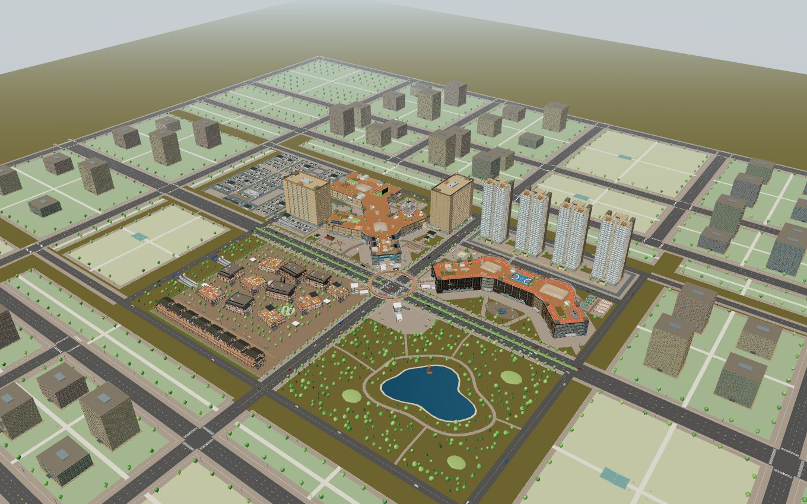

# 云澜汇 · 园区导览与封锁行动

面向手机的 Three.js 小样，同一封面提供 **完整园区探索** 与 **竞技 FPS** 两种入口。

[在线体验](https://yunlan-mall-calvin.netlify.app/) · [最新交接](HANDOFF.md) · [FPS 说明](docs/fps-sample.md) · [免费模型来源](docs/fps-asset-sources.md)



## 当前可玩内容

| 模式 | 内容 |
| --- | --- |
| 完整园区探索 | 一期、二期、三期、酒店、公寓、四栋住宅、地铁、西停车场和周边城市；198 个楼层，380 间酒店/公寓客房及 348 套住宅 |
| 竞技 FPS | 单人 + AI 队友的 PvE 搜索撤离；仅一期、酒店、公寓，共 17 个可行走楼层及 1 个封闭顶盖；地下车辆和酒店屋顶直升机两种撤离 |

**只有 FPS 裁剪地图。** 探索模式恢复原完整园区与 01/02/03 住宅模型，并保留上层原套房。酒店、公寓 1F 改为挑高大堂、接待、餐厅、健身及配套服务区；公寓顶层仍有 10 套复式。

一期新增大面积共享地库，贯通酒店、公寓与西侧停车场地下区域，车辆通道不接二期。四个主停车楼面共 4,149 个划线车位，另保留塔楼原停车区域；西地面 576 位、酒店地面 29 位。出入口分布于不同方位，新增 6 部电梯、11 组连续楼梯。地库和地铁连接区提前显示，坡口、电梯井及道路铺装使用真实开洞。全园 52 部电梯采用可见的进舱、关门、升降和出舱流程。西停车场设大巴、的士及无障碍接驳区。

### 封锁行动

1. 与队友「回声」从一期商场出发，接入终端取得密钥。
2. 穿过既有连廊与实体楼梯，到酒店 2F 取回情报。
3. 选择公寓 B1 车辆接应，或沿实体楼梯/电梯前往酒店屋顶直升机接应；清理威胁并守住撤离区，随后登车驶离或登机起飞。

包含 9 名侦察、突击、装甲和狙击敌人，具有视野、听声调查、警戒追击、弹匣换弹及战术移动；玩家可切换两把枪及连发模式，瞄准、蹲伏、冲刺、滑铲、跳跃、近战刀、手雷、搜集补给、护甲和急救。冲刺有耐力、压低持枪姿态与明显手臂摆动，滑铲压低镜头并快速转移，跳跃有起跳、下落和落地反馈；近战对未察觉敌人可无声处决。地图散落 5 枚情报碎片、护甲板、手雷与医疗补给，另有可选目标「切断监控」削弱敌人视野。击杀、爆头、无声处决与连杀计入行动得分，结算给出 S–D 评级；敌人死亡倒地淡出、受击闪白。回声支持跟随、守点、掩护和救援；本地 AI 自行移动和交战，无需 API Key。敌我射击受墙体与楼层遮挡约束，移动使用原园区碰撞与连续楼梯。

SMG-45、Desert Eagle、手套与衣袖均来自免费可再分发的带贴图模型。SMG 保留源骨骼换弹动画，手枪使用真实分件制作弹匣、套筒动作；切枪先收起旧枪再拔出新枪。作者、许可和修改说明可在游戏暂停菜单查看，完整记录见[素材来源](docs/fps-asset-sources.md)。

### 手机操作

- 左摇杆移动，右侧空白区域拖动视角；按住开火/冲刺，轻点跳跃、瞄准、蹲伏、换弹、切枪、急救、近战和手雷；冲刺中按蹲伏会滑铲。
- 靠近任务点后交互；取得情报后可切换车辆/直升机目标。撤离区自动计时，离开会重置，附近威胁会阻止撤离。靠近电梯可选择楼层并观看乘梯过程。
- 点击队友状态选择指令；暂停菜单也能输入「跟我走」「守住这里」「掩护我」。
- 暂停 → 设置：操作/界面/显示/音频/辅助五个分页，可调整按钮大小、透明度、瞄准灵敏度与预设、反转 Y 轴、摇杆死区、瞄准辅助、准星样式/颜色/大小、HUD 缩放、镜头抖动、音量与信息流开关。自定义布局可拖动 12 个按钮，含 2.5% 网格吸附，横屏和竖屏分别保存。
- FPS 首页先进入行动简报，可选择标准/老兵难度再出发；老兵敌人伤害与命中更高、撤离倒计时更长、初始补给更少。
- 暂停或切换到后台会停止游戏输入；返回封面后再选模式会释放原页面的 3D 场景。
- 普通导览保留玻璃底栏和「净览」隐藏界面。

桌面兼容 WASD / 方向键移动、鼠标视角与开火、R 换弹、Q 切枪、E 交互、H 急救、C 蹲伏 / 冲刺中滑铲、X 近战、G 手雷、Shift 冲刺、Space 跳跃、F 射击模式、T 撤离路线、Esc 暂停。

## 手机负载控制

在线封面只有二维图片和小型入口脚本，选择模式之前不创建 WebGL，也不下载枪械和建筑模型。进入 FPS 后按需载入战斗模块与 5.75 MiB 枪械资产；导览不会加载枪械。

FPS 固定使用流畅画质，关闭动态阴影、泛光、普通人群与交通，限制清晰度及 30 fps 渲染频率；只保留任务所需楼层，客房按访问楼层缓存。两种模式共用原套房和 PBR 贴图；三套住宅模型仅由探索模式下载，FPS 不请求这些模型。第一人称枪械与世界共用一个 WebGLRenderer。

浏览器的 iPhone 尺寸、触屏模拟、完整任务及构建检查见[本轮 QA](docs/qa-2026-10-20-campus-fps.md)及 [FPS 实走](docs/fps-expansion-qa.md)。FPS v5 的玩法、动画、首页与设置升级见 [FPS v5 说明](docs/fps-v5.md)，截图在 `docs/images/fps-v5-*.png`。这些检查不等同于实体 iPhone 的帧率、温升和长时间内存验收。

## 本地开发与离线版

建议 Node.js 20+、npm、Python 3：

```sh
npm ci
npm run build
npm run serve
```

打开 http://127.0.0.1:5174/。修改源码后重新构建；不要手改 `index.html` 或 `dist/`。

`dist/mall.html` 是资源内嵌的双模式离线版，可下载后在新版桌面浏览器中直接打开。手机优先使用 HTTPS 在线站点；iOS 文件预览不能代替 Safari 网页运行环境。离线版的本地 AI、枪械和任务不需要模型 API。

## GitHub 与 Netlify

GitHub 保存源码、模型许可和离线产物；线上仍为 **手动部署**，推送不会自动发布。

```sh
npm test
npm run build:netlify
netlify deploy --prod --no-build --dir dist/netlify --site 3af33d60-6f93-4be3-a2e2-06f122ed5fc3
```

发布目录只用 `dist/netlify/`；`netlify.toml` 声明可选的 `netlify/functions/`。线上资源使用内容哈希和长期缓存，首页校验更新。部署 ID、文件校验和最终检查结果见[本轮 QA](docs/qa-2026-10-20-campus-fps.md)。

可选语言模型接入只把一句自然语言转换为跟随、守点、掩护三个已有动作；战斗规则仍由本地游戏执行。默认不启用云端模型。环境变量与边界见 [FPS 接入说明](docs/fps-sample.md#可选模型-api)。

## 源码入口

| 路径 | 用途 |
| --- | --- |
| `src/main.js`、`src/launcher.js` | 不初始化 3D 的封面和模式选择 |
| `src/runtime.js` | 选择模式后加载布局、渲染及玩法 |
| `src/layout/playable.js` | P1 / H / A 运行时裁剪、FPS 楼层封顶、连接过滤 |
| `src/fps/game.js`、`rules.js` | 游戏循环、任务、生命弹药、AI、胜负 |
| `src/fps/pathfinding.js` | 用原碰撞求解器验证路径、引导与视线 |
| `src/fps/hud.js` | iPhone 横竖屏控制、设置、自定义布局、结算 |
| `src/fps/viewmodel.js`、`world.js` | 真实手臂/枪械动画、队友/敌人、任务道具 |
| `src/render/`、`src/shell.html` | 原建筑渲染、精装套房、导览与页面模板 |
| `assets/models/fps/`、`scripts/fps-assets/` | 枪械模型、许可、源校验和可复现预处理 |
| `netlify/functions/squad-order.mjs` | 默认关闭的可选模型指令接口 |
| `build.mjs`、`scripts/build-netlify.mjs` | 开发/离线与线上拆包构建 |

`src/render/*-data.js` 为构建生成文件；首次本地运行先 `npm run build`。先阅读 `HANDOFF.md` 最新一节再继续开发。

## 原建模资料

探索模式已恢复完整园区和原住宅模型；FPS 单独裁剪运行范围。原建模、曾有 748 个居住单元时的记录及住宅 01/02/03 详情见 [历史交接](HANDOFF.md)、[套房接入](docs/suite-integration.md)、[住宅接入](docs/residential-integration.md)和[三套独立住宅](docs/residential-01-02-delivery.md)。首层大堂改建后的当前数量以本文顶部和最新交接为准。

## 素材许可

- 枪械与手臂：DJMaesen / ELIZION，**CC BY 4.0**，署名及修改声明随发布包保留。
- 园区 PBR：Poly Haven，**CC0**，[来源清单](docs/texture-sources.md)。
- 贴图人物：Microsoft Rocketbox，**MIT**，[来源说明](docs/people-models.md)。
- Three.js：**MIT**，[许可](docs/licenses/three-MIT.txt)。
- 几何裁切：polygon-clipping、splaytree（MIT）及 robust-predicates（Unlicense），[随包许可](docs/licenses/geometry-libraries.txt)。
- 用户自制套房及住宅不属于 CC0；保留原作者文件和[模型清单](assets/models/manifest.json)。第三方素材许可不等同于整个项目的代码许可。
