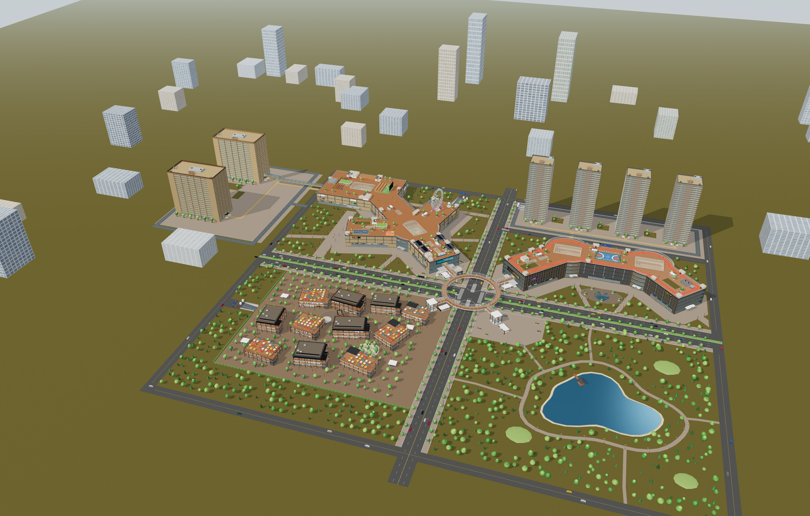
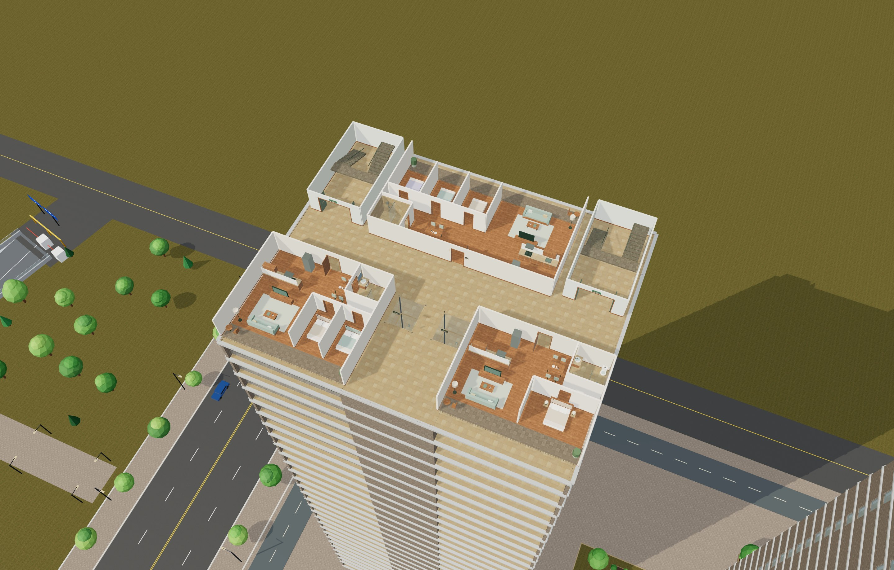

# 云澜汇 · 3D 商业与居住园区

基于 Three.js 的可交互园区模型，包含三期商场、开放街区、公园、地铁、酒店、公寓与住宅。支持整体俯瞰、楼层剖切、昼夜切换和第一人称漫游，可进入商铺、客房与住宅，并乘坐玻璃电梯。



## 快速打开

**只想浏览：** 下载仓库 ZIP 并解压，使用桌面浏览器打开 [`dist/mall.html`](dist/mall.html)。Three.js 和贴图已内嵌，打开后无需联网，也不需要安装依赖。GitHub 文件页本身不会运行这个 HTML。

**继续开发：** 安装 Node.js（建议 20 或更新版本）、npm 和 Python 3，然后执行：

```sh
git clone https://github.com/calvinzeng123/super-mall-3d.git
cd super-mall-3d
npm ci
npm run build
npm run serve
```

打开 <http://127.0.0.1:5174/>。本仓库为私有仓库，克隆需要对应账号权限；首次安装依赖需要联网。修改源码后重新执行 `npm run build`，再刷新浏览器。

## 园区内容

| 区域 | 内容 |
|---|---|
| 一期 P1 · 云澜汇 | Y 形商场与方庭，地下商业、停车和屋顶空间 |
| 二期 P2 · 星湾 | 新月形商场、冰场、影院与天空跑道 |
| 三期 P3 · 云澜里 | 开放街区、餐饮露台与地下车库 |
| 地铁与公共空间 | 地铁站厅、站台与列车，云环天桥、中央公园 |
| H · 云澜酒店 | 一期西侧，20 个居住层，每层 10 间，共 200 间 |
| A · 云澜服务公寓 | 酒店南侧，20 个居住层，每层 10 间，共 200 间 |
| R1–R4 · 云澜汇楼盘 | 二期后侧，4 栋各 30 个居住层，每层 3 户，共 360 户 |

保留原有 407 家商铺；新增 760 个客房及住宅单元，均有床铺和独立卫浴。住宅每层有一居、两居、三居三种户型，含厨房、客厅及阳台。新增六栋楼可进入普通层、地下层与屋顶，配备 12 部连续升降的玻璃电梯。

酒店与公寓的 **400 套房间已接入用户提供的自制套房 GLB**，保留原模型的卧室、客厅、独卫、家具和贴图，以 1:1 尺寸落入现有单元。公寓右侧附翼补充厨房、洗烘及储物；酒店附翼设茶水台和行李收纳。A 栋 1F 的 10 套在原有 6.5 米层高内增加 3.05 米夹层和可步行的 18 级楼梯，园区楼层与住户总数不变。模型处理、碰撞和资源管理见[套房接入说明](docs/suite-integration.md)。


更多近景见[套房接入说明](docs/suite-integration.md)。



## 漫游操作

| 操作 | 方式 |
|---|---|
| 选择建筑、楼层 | 顶部楼栋栏与楼层栏；「全楼」恢复外观 |
| 第一人称 | 点击「漫游」，点击画面控制视角，或按住画面拖动 |
| 行走 / 加速 / 跳跃 | WASD 或方向键 / Shift / 空格 |
| 飞行 | F 或双击空格切换；空格上升、C 下降 |
| 乘坐电梯 | 步行到电梯门前，按 E 或点击楼层提示选层 |
| 快速定位 | 「地点」目录选择建筑、楼层或房间 |
| 退出 | Esc 释放鼠标，点击「退出」回到俯瞰 |

触屏模式支持左侧浮动摇杆、右侧拖动视角和飞行按钮。完整操作见[使用说明](docs/expansion-guide.md)。

地下步行主线为 **住宅 B1 → 二期 B1 → 地铁站厅 → 一期 B1M → 酒店 B1 → 公寓 B1**。酒店 2F 另有连廊接方庭；酒店、公寓 B2 车库连接一期 B1。住宅共享地下车库，并设独立进出坡道。

## 源码与交接

接手开发先读 [HANDOFF.md](HANDOFF.md) 顶部的最新状态，再查看对应模块。后半部分保留的旧交接仅用于追溯。

| 路径 | 用途 |
|---|---|
| `src/layout/` | 楼栋、楼层、房间、连接通道、导航与乘梯数据 |
| `src/render/` | Three.js 场景、交互、材质与建筑构建器 |
| `src/shell.html` | 页面模板；修改界面应编辑此文件 |
| `assets/textures/` | 本地 PBR 图片、来源与校验清单 |
| `assets/models/` | 用户套房原始 GLB、处理后 GLB 与模型校验清单 |
| `scripts/prepare-suite-asset.mjs` | 保留原件，重建套房门洞、窗外视线、接触阴影及 GLB 灯光 |
| `tests/` | 布局、通行、房间、电梯与素材验证 |
| `build.mjs` | 生成开发入口及离线页面 |
| `dist/mall.html` | 可直接打开的完整离线页面 |
| `dist/artifact.html` | 供 Artifact 包装使用的页面片段 |

`index.html`、`dist/`、`src/render/pbr-data.js` 和 `src/render/suite-data.js` 由构建生成；不要直接修改生成文件。两个数据模块不纳入 Git，首次启动开发服务前必须先构建。普通源码修改只需运行 `npm run build`；修改套房预处理规则时，先运行 `node scripts/prepare-suite-asset.mjs`，再构建。

## 验证与当前边界

```sh
npm test
npm run build
```

2026-10-07 套房接入通过 **95 项自动化测试**，并完成高层切换、复式上下楼、灯光跟随与缓存检查。桌面及 iPhone 浏览器模拟均以 `file://` 断网打开新版离线页，页面错误和 HTTP 请求均为 0。详情见[本轮验收记录](docs/qa-2026-10-07-suite.md)。

2026-10-06 的上一版扩建已有 **83 项测试通过**，并做过高层乘梯、偏轴登梯、地下通道、桌面及手机尺寸的离线加载检查。该记录属于套房模型接入前版本，见[历史验收记录](docs/qa-2026-10-06.md)及[变更记录](docs/revisions/2026-10-06-material-detail.md)。

- 客房及住宅采用可复用房型模板，并非 760 套独立设计。
- 远处的白色城市楼群是背景装饰，不能进入。
- 新塔楼电梯连续升降；原商场电梯与楼梯沿用互动换层。
- 酒店、公寓套房的大件家具、隔墙、复式护栏和楼梯参与人物碰撞；其余商铺与住宅家具、树木和车辆仍沿用原有规则。
- 套房灯光使用固定近景灯池（桌面 10 盏、移动端 8 盏），随当前房间移动；未同时点亮 400 套独立灯组。
- 手机仅做浏览器模拟，尚未验证实体 iPhone 的性能与兼容性。
- 仓库保存源码与离线页面；上传 GitHub 不等同于部署在线体验站点。

## 材质与许可

本轮使用 Poly Haven 的 6 套 CC0 材质：石材、铺装、橡木、砖墙、沥青和草地，共 18 张本地图片。作者、来源、用途和校验值见[贴图来源](docs/texture-sources.md)与[素材清单](assets/textures/manifest.json)。Three.js 的 MIT 许可保存在[许可文件](docs/licenses/three-MIT.txt)，也内嵌于离线页面。第三方素材许可不代表本项目全部源码采用相同许可。

新增套房模型来自用户自制文件 `酒店套房_改造后.glb`，**不属于 CC0 素材**。原始模型、内嵌的 23 张图片及处理版本的来源与校验值单独记录在[模型清单](assets/models/manifest.json)，不可套用上述 Poly Haven 许可。
