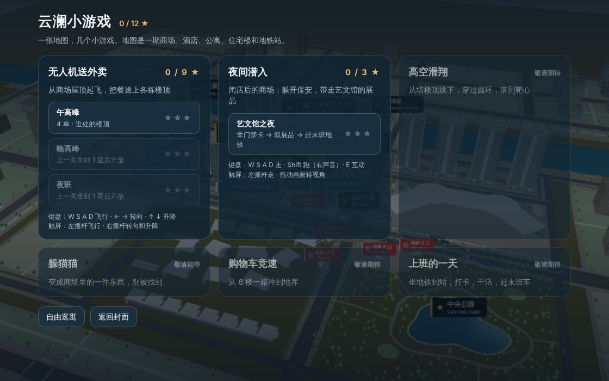
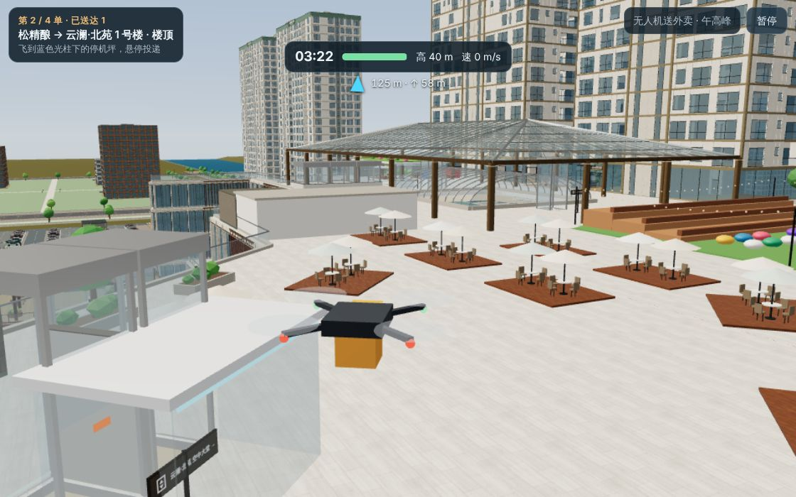
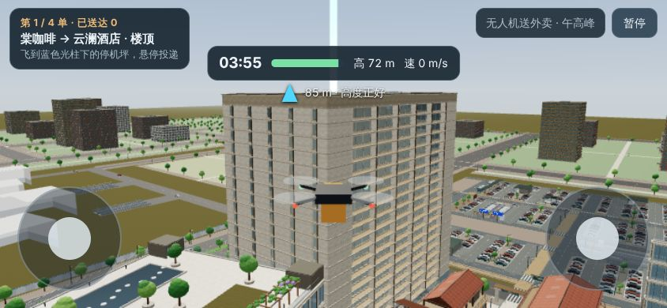
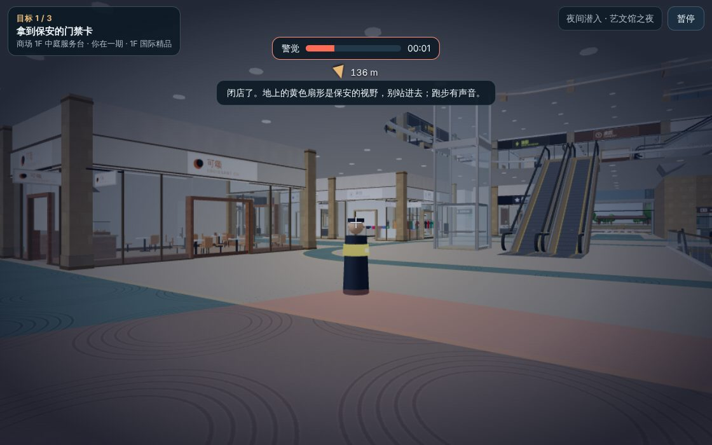
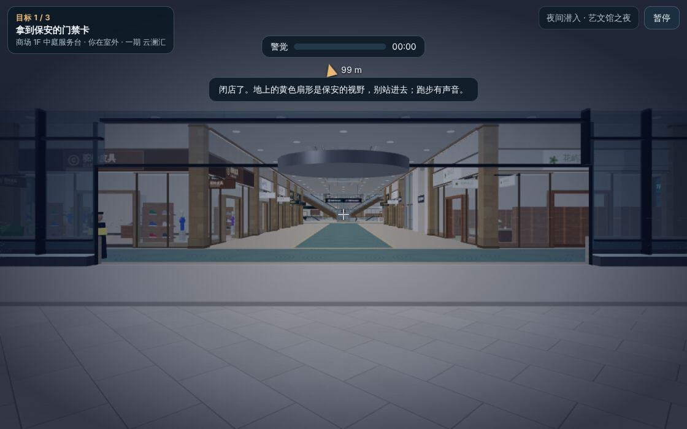

# 小游戏合集（雏形）· 2026-11-10

封面上的第三个入口「小游戏合集」：一张裁小的地图，一套共用的外壳，里面装小游戏。现在有两个能玩的粗糙原型，另外四个只在列表里占位。

这是雏形：没有音效，数值只用自动驾驶和快进跑通过，还没有人上手调过。保安、无人机、展品和场景里的家具绿植在 11-10 换成了贴图模型，见 [贴图模型](props.md)；本页的截图是换之前拍的。



## 怎么进

- 开发：`python3 serve.py 5174`，打开 `/index.html`，在封面点「小游戏合集」。
- 自动化：页面里有 `window.__arcade`（`start(gameId, levelId)`、`quit()`、`session`、`progress`）。

## 地图范围

保留一期商场和 8 座附楼、酒店、公寓、R1–R4、西苑、北苑、地铁站、共享地库。二期和三期整栋裁掉，原地放低细节的体块。场地（道路、广场、江、周边城市）不动。

裁剪在 `src/layout/arcade-scope.js`，只有这个模式经过它。完整园区探索和 FPS 的地图不变。

| | 完整园区 | 小游戏地图 |
|---|---:|---:|
| 楼栋 / 楼层 | 23 / 338 | 21 / 326 |
| 加载完成时的顶点数 | 14.5 M | 11.1 M（少 24%） |
| 场景里的网格数 | 10,842 | 9,871 |

测法：开发页，无头 Chromium，软件渲染，各一次。加载时间两次测量相差很大（16–26 秒），没有可靠的对比。

已知的边角：云环天桥通往二期的那一臂还在，尽头是体块的墙。地铁站厅通往二期、三期的通道留着，走到头是死路。

## 两个能玩的小游戏

### 无人机送外卖

从商场天台的取餐点起飞，把餐送到各栋楼顶的停机坪，再回来取下一单。



- **操作**：键盘 `W S A D` 飞行，`← →` 转向，`↑ ↓` 升降。触屏是左摇杆飞行，右摇杆转向和升降。
- **取餐和投递**：在停机坪上方悬停约 1 秒。取餐时自动换满电。
- **电量**：悬停、速度、爬升都耗电。耗尽会自动返航换电，扣 12 秒。
- **碰撞**：撞到楼会弹回并扣 8% 电量。
- **风**：55 m 以上开始有风，100 m 吹满。午高峰没有风。
- **三关**：午高峰 4 单（只送近处），晚高峰 5 单，夜班 6 单（夜里，风更大）。前一关拿到 1 星才开下一关。
- **评星**：送到一半 1 星；全部送到 2 星；全部送到、最多碰一次、还剩两成时间 3 星。
- **投递点**：10 栋塔楼的楼顶、艺文馆屋顶、对岸滨江公园、星湾桥桥面，共 13 个。

数值都在 `src/arcade/games/drone-rules.js` 顶上的 `DRONE` 和 `DRONE_LEVELS`。



### 夜间潜入

闭店后的商场。从东南主入口外出发，依次完成三件事：到 1F 中庭拿门禁卡，到艺文馆 4F 取展品，到地铁站厅赶末班车。



- **操作**：用漫游模式本身的走路、楼梯、电梯。这一局不能飞，也不能用地点目录传送。
- **保安**：7 名，分布在商场 1F、2F、B1M，艺文馆 1F、4F 和地铁站厅，各走一条往返巡逻线。
- **闭店**：这些楼层的店铺门面拉下卷帘门；门禁卡放在边几上，展品是玻璃罩里的大理石胸像。
- **视野**：地上的扇形，20 m、100 度。扇形是黄色时没看见你，变红就是看见了。隔着中庭也看得见。贴到 1.8 m 以内不管朝向都会被发现。
- **警觉条**：被看见时上涨，越近越快；没人看见时回落。涨满就失败。
- **声音**：跑步时 10 m 内的保安会过来查看。
- **躲藏**：在楼梯、扶梯、电梯里不会被看见。保安只管自己那一层。
- **评星**：逃出去 1 星；全程警觉没过六成 2 星；再加上 6 分钟内完成 3 星。

数值在 `src/arcade/games/heist-rules.js` 顶上的 `HEIST` 和 `HEIST_LEVELS`。



## 结构

```
src/layout/arcade-scope.js          地图范围：裁掉哪些楼，体块放哪
src/render/build/arcade-massing.js  体块的网格
src/arcade/
  shell.js      外壳：列表、开始、暂停、结算、存档
  registry.js   游戏目录
  progress.js   进度（纯数据）
  input.js      键盘和触屏双摇杆 → 四个轴
  airspace.js   飞行用的简化三维碰撞
  rng.js        可复现的随机数
  games/
    drone-rules.js  drone.js    规则 / 画面
    heist-rules.js  heist.js
```

每个游戏分两个文件。`*-rules.js` 是纯逻辑，不碰 three.js 和 DOM，可以在 Node 里直接测。另一个文件负责画面、相机和 HUD。

### 加一个小游戏

1. 在 `registry.js` 加一条：`id`、标题、关卡列表、`load`。
2. 新建 `games/<id>.js`，导出：

   ```js
   export async function createGame({ app, layout, level, hud, input, rng, toast, finish }) {
     return { update(dt) {}, dispose() {} };
   }
   ```

3. 一局结束时调用 `finish({ success, stars, score, seconds, title, lines })`。记录成绩和显示结果由外壳负责。
4. 游戏改动过的全局状态（相机、夜景、漫游模式）要在 `dispose()` 里还原。

几个现成的东西：

- **自己摆相机**：把 `app.state.arcadeCamera` 设为 `true`，轨道控制器就让开。
- **走路类游戏**：`app.enterExplore()` 之后读 `app.explore.state`。`app.explore.setRules({ fly: false, teleport: false })` 可以禁止飞行和传送。
- **飞行类游戏**：`buildAirspace(layout)` 给出 `hit`、`surfaceBelow`、`move`。
- **同一关每次的布置相同**：外壳按「游戏:关卡」给出固定种子的 `rng`。

## 测试和验证

- `tests/arcade-scope.test.js`：裁剪后没有记录指向被裁的楼；每个保留的楼层和完整园区里一样走得到。
- `tests/arcade-progress.test.js`：进度、目录、输入换算。
- `tests/arcade-drone.test.js`：空域碰撞、停机坪、订单、飞行。自动驾驶能在限时内打完三关，说明关卡按现在的数值是能过的。
- `tests/arcade-heist.test.js`：巡逻线在真实地图上走得通，视野、听觉、警觉条。
- 全套 631 项通过，其中新增 27 项。`fps-frozen` 没动。
- 无头 Chromium 里各完整跑了一局，没有页面报错。桌面 1120 × 700，手机横屏 844 × 390。完整园区探索和 FPS 两个模式也各加载了一次，正常。
- 构建后的线上包（`npm run build:netlify`，97 个文件 57.8 MiB）里也各跑了一局。

无头浏览器是软件渲染，约 1 帧/秒，所以自动化时直接调用 `update(dt)` 快进游戏时间。

## 已知限制

- **没有人上手玩过。** 手感、难度、时间限制都是估的。
- **潜入开局慢，而且时快时慢。** 开始时要算每层的巡逻图，还要加载保安的模型。无头浏览器里从点击到开始，在线包测了五次：8、26、21、9、29 秒；换模型之前测的一次约 7 秒。多出来的等待大概来自软件渲染：等模型加载的空当里会插进很慢的画面帧。真机上没有量过。
- **潜入里暂停不冻结玩家。** 暂停时保安不动，但人还能走。
- **潜入的「昏暗」是一层半透明遮罩。** 室内灯光没有真的关。
- **保安看不到别的楼层。** 站在 2F 栏杆边，1F 的保安不会发现你。
- **无人机的碰撞是简化的。** 商场 3F–6F 的露台上空算实体，不能降落。桥拱、树、路灯没有碰撞。相机偶尔会穿进楼里。
- **体块仍然简单。** 二期、三期是贴了幕墙贴图的柱体，没有细节。
- **没有部署。** `dist/` 的两个单文件已按这一版重建，但两个 Netlify 站点都没有更新。

## 接下来可以做的

列表里占位的四个：高空滑翔（和无人机共用飞行和空域）、躲猫猫（和潜入共用视野）、购物车竞速、上班的一天。超高层延伸已搁置，见 [supertall/STATUS.md](supertall/STATUS.md)。
