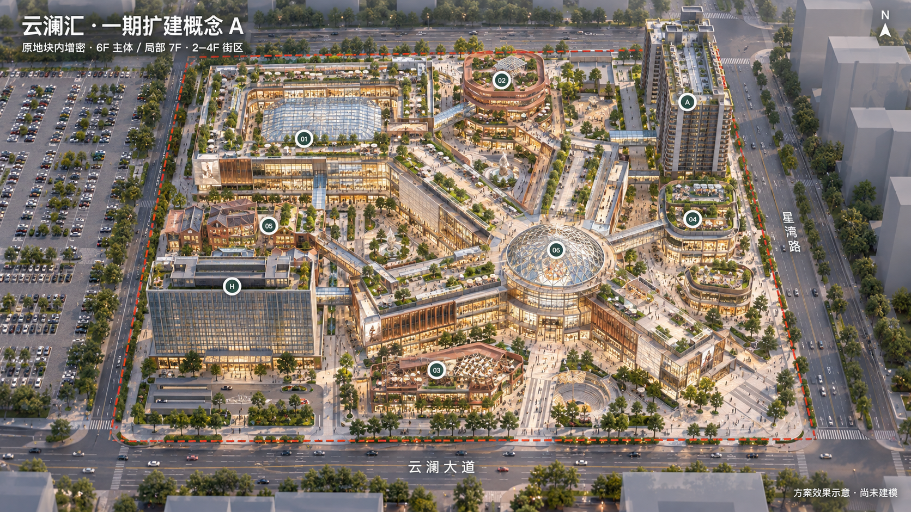
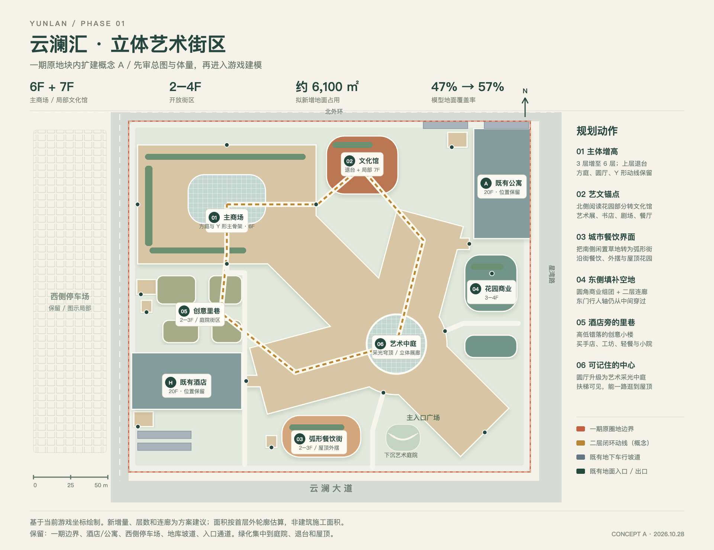

# 云澜汇一期扩建概念 A：立体艺术街区

日期：2026-10-28
状态：**用户已批准概念 A；本文件保留原评审方案，实施结果见 [扩建 QA](../../qa-2026-10-28-p1-expansion.md)**
基础版本：`96511d6b76c8b1e44833455c6d70dfc3ef6335f1`
原规划授权范围：用户要求“先规划给我看鸟瞰图再开工”。随后用户明确批准“就按你这个来做”，并允许多代理并行实施。下方概念图和初步面积保留原稿，尺寸与实装数量以实施 QA 为准。

## 推荐方向

在原有圈地内，将一期改为“6 层主商场 + 局部 7 层文化馆 + 2–4 层开放街区”。保留原圆厅、Y 形主骨架和西北方庭，把新的商业楼与旧楼层真正接通；通过退台、弧线、庭院和不同高低的屋顶增强辨识度。

现有空地有一部分用于新增营业空间，另一部分继续承担当入口、通行、车库出入口、到达广场和活动庭院。绿化从零散草地转为可到达的屋顶花园、餐饮露台、树荫小院与沿街绿带。

## 既有条件与数量口径

- 当前一期地块：x [-286, -16]、z [-256, -20]，270 × 236 m，63,720 模型平方米；北为负 Z。
- 主商场当前为地上 1F–3F，RF 标高 17.5m；B1M 为美食层，B1/B2 为停车层。
- H 酒店在西南，中心 (-247, -81.1533717)，74×38m、20 层；A 公寓在东北，中心 (-35, -214)，38×74m、20 层。均保留位置和客房尺度。
- 按一期主商场、酒店、公寓首层 slab 外轮廓并集统计，忽略中庭洞口，现有地面占用约 30,182 ㎡（47.4%）。
- 概念新轮廓并集约 36,296 ㎡（57.0%），净增加地面占用约 6,115 ㎡。包含部分已有地库小厅的吸纳，不是净出租面积、总楼面面积或施工面积。
- 面积仅是几何规划量；新增上层退台、挑空及服务空间尚未深化，不先承诺具体新增店数或总建筑面积。
- 精确数据见 [plan-data.json](plan-data.json)。鸟瞰为 AI 生成的体量和材质示意，局部窗格、楼层视觉计数、绿化和连桥宽度不作为尺寸依据；坐标关系看总图，目标层数看下表。

## 六个改造区域

| 标号 | 位置 / 改造对象 | 建议层数 | 形态与用途 |
| --- | --- | --- | --- |
| 01 | 原商场主楼与西北方庭 | 主体 6F，部分端部可降到 4–5F | 方庭保留内部环线和天窗，外立面转圆角；圆厅与 Y 形翼楼连续。4–6F 逐级退台，形成能走、能坐、能开店的露台。 |
| 02 | 北侧阅读花园 | 6F，局部 7F | 圆角文化馆、陶土色竖向构件、阶梯式屋顶；书店、展览、设计商店、小剧场、文化餐厅。把原地库电梯小厅纳入新楼核心，保留上下交通。 |
| 03 | 南侧城市客厅 / 草地 | 2–3F | 弧形餐饮街，首层通透店面、二层有顶外摆、三层小型屋顶餐吧；活动舞台融入旁边下沉艺术庭院。 |
| 04 | 东侧空地 / 花园 | 3–4F 主体 + 较低附楼 | 两组圆角花园商业，以绿色陶板、玻璃与连廊为识别；精品生活、咖啡、展售。东门步行轴从两组楼中间穿过。 |
| 05 | 酒店与西北方庭之间 | 2–3F | 四个小体量围成创意里巷；坡屋顶、折板顶、退台混合，统一材料色系。买手店、工坊、烘焙、独立餐饮。 |
| 06 | 既有圆厅 | 主体中的通高中庭 | 玻璃采光穹顶、可见扶梯、跨层艺术装置和环形展廊；保持主方向通透，让玩家一眼看懂去各翼楼的路。 |

“不同模式”具体是：全天候室内 Mall、半开放连廊街区、独立小店庭院、文化展馆、餐饮露台、下沉活动广场、可达的屋顶公园。材料使用暖白石材、香槟金属、陶土与少量绿色构件，控制在统一色系内。

## 楼层用途建议

| 楼层 | 主要体验 |
| --- | --- |
| B2 / B1 | 原共享地库与西附库连通关系保留；新楼核心接入，保持车行/步行分流。 |
| B1M | 美食、精品超市、生活服务、地铁步行连接；下沉庭院拟接这一层。 |
| 1F | 精品、美妆、珠宝、旗舰店、公共到达与首层艺术展示。 |
| 2F | 潮流、运动、买手店、生活方式；新旧楼的主连廊环线设在此层。 |
| 3F | 亲子、体验、数码、互动展；街区屋顶开始向主商场露台接入。 |
| 4F | 设计家居、书店、运动体验、社区社交与花园平台。 |
| 5F | 影城、小剧场、沉浸娱乐；大空间集中设置，避免每层复制小铺。 |
| 6F | 主题餐厅、城市观景、屋顶花园和餐吧。 |
| 局部 7F | 只在文化馆设置少量展厅 / 观景空间与设备，不让整片商场齐平到七层。 |

主商场参考层高：1F 6.5m、其余约 5.5m，六层屋顶约 34m；局部七层约 39m。均为概念标高，仍明显低于原酒店 / 公寓。影厅与展厅的挑高在下轮楼层方案中协调，不承诺当前标高已经通过几何检查。

## 交通与游戏可走性

1. **地面**：保留东南主入口、圆厅南门 / 东门、方庭出入口和酒店公寓到达路线。主方向留出约 8–12m 可读的通道作为方案目标；局部已有窄通路需在深化时扩宽或调整。
2. **二层**：形成“方庭 → 北侧文化馆 → 北翼 → 圆厅 → 西翼 → 创意里巷 → 方庭”的完整闭环。图上虚线是关系示意，不是已生成的可走廊道；要核定每座桥的宽度、落点与楼板标高。酒店和公寓保留原短接驳。
3. **三至六层**：各组团内部成环，4F/6F 有选择地连接露台。每个屋顶平台有实际到达路径，不做只有外观的屋顶。
4. **电梯 / 扶梯 / 楼梯**：原主商场核心向新增楼层延伸；文化馆和东西新增组团设置自己的竖向交通、疏散路径与服务空间。新旧扶梯逐层对齐，所有楼板开口与碰撞由同一份数据生成。数量在店铺分区后核定。
5. **地下**：延续原共享地库，既有坡道、B1/B2 连通及酒店公寓地下标高不变。文化馆与东侧花园商业吸纳已有地库电梯，入口继续对公众可达。
6. **下沉庭院**：连接的是现有 B1M 食物与地铁步行系统；庭院开口和连接段需要专项调整，避让更低的 B1/B2 车道，不能直接穿透地库楼板。
7. **后勤与场地通行**：每个新增区在下轮规划图明确送货门、设备区、卫生间、楼梯和服务通路，避免把所有地面缝隙封闭。
8. **原设施处理**：西侧停车场与交通接驳继续保留；原阅读花园、街角花园转移到新楼露台与庭院；小剧场并入下沉庭院。现有摩天轮列为北翼屋顶保留 / 平台重排项目，鸟瞰图未展开，不据此删除。

## 建筑案例依据

- [KPF：K11 MUSEA](https://www.kpf.com/project/k11-musea)：参考“从下部市场、展廊和商业峡谷向上到餐饮与屋顶花园”的游逛序列，以及绿化退台和公共艺术。采用这类空间组织，立面为云澜汇原创方案。
- [K11 MUSEA 官方建筑介绍](https://www.k11musea.com/art-and-culture/architecture/)：参考艺术装置、拱廊、绿墙与花园共同构成场所。
- [深圳南山区：万象天地](https://www.szns.gov.cn/mlns/nsgk_113865/lg/content/post_9364223.html)：其“街区 + Mall”和独栋旗舰店组织，适合本地块的创意里巷与主商场混合。
- [深圳湾万象城](https://www.sz.gov.cn/en_szgov/news/infocus/SZCitywalk/Explore/Shopping/content/post_11857105.html)：借鉴商业、开放绿地、休闲活动与周边综合体结合的思路。
- “六层主体、北侧文化馆、南侧餐饮街”等均为本项目设计建议，不是上述案例的原样复制。

## 手机运行方案

此项必须随扩建一起做：上一轮只是延后精装模型加载，完整园区的主体几何仍会在启动时建立。再增大一倍楼面会带来新的压力，不能仅依赖隐藏物件。

建议改为：
- 入口总览保留完整园区低细节外壳；主商场按组团和楼层构建/释放室内细节，只保留当前层与必要邻层。
- 重复窗框、栏杆、灯、树、招牌优先共享几何与贴图；只在接近时展开细节。
- 艺术中庭可见的扶梯和邻层提前加载，保持远近过渡；地库和地铁通道依照门口相邻关系预载，延续本轮修复规则。
- 导览与 FPS 范围独立。该提案默认用于探索模式；竞技地图先维持当前一期/酒店/公寓范围与已验收任务，之后再单独决定是否引入某个新街区。
- 真机内存和长期稳定性仍待验证，不用效果图或桌面帧率替代。

## 审图与实施顺序

以下为原评审时拟定的实施顺序；方案已获用户批准，当前进度见实施 QA。

确认后依次：
1. 灰盒体量与楼层数据：先接道路、入口、楼梯、电梯、连廊、地库；每个新平台都有可走路径。
2. 分区加载与手机基线：尽早验证扩容后的内存，不等全部精装完成才检查。
3. 商铺分区与设施：逐层业态、卫生间、后勤、扶梯和店铺入口。
4. 外立面、艺术中庭、室内细节与材质。
5. 完整导览 / FPS 隔离回归，真机测试，再根据既有授权更新 GitHub 与部署。

## 文件与生成方式

- [aerial-concept-a.png](aerial-concept-a.png)：使用内置 imagegen、以当前坐标总图为参考生成。
- [masterplan.png](masterplan.png) / [masterplan.svg](masterplan.svg)：基于当前布局数据的北向上概念总图。
- [masterplan.html](masterplan.html)：可在本地浏览器查看完整总图。
- [plan-data.json](plan-data.json)：既有轮廓、新增概念轮廓与面积计算结果。
- [image-prompt.txt](image-prompt.txt)：完整生图提示词。
- [draw-masterplan.py](draw-masterplan.py)：从规划数据重新生成 SVG / HTML 的脚本。

本方案未改动 `src/`、运行产物或线上站点。
