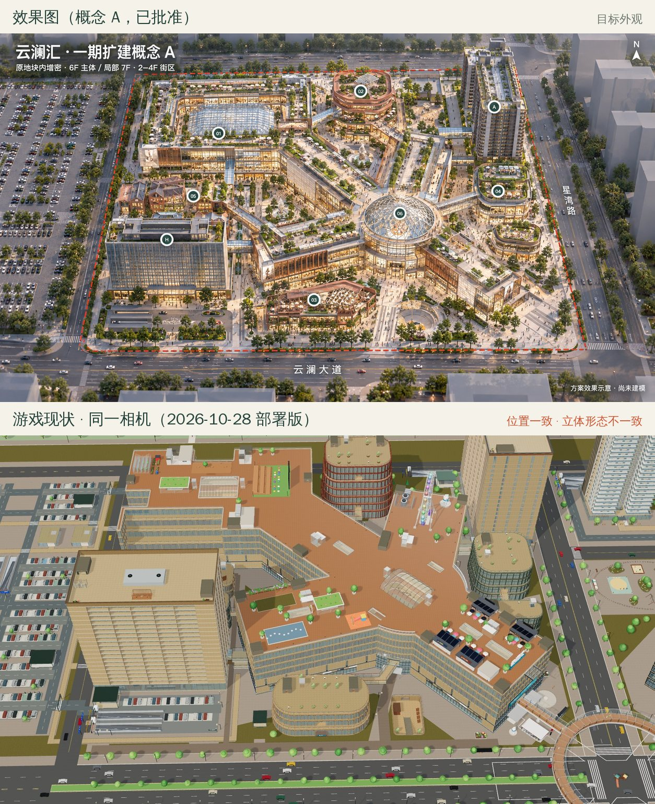
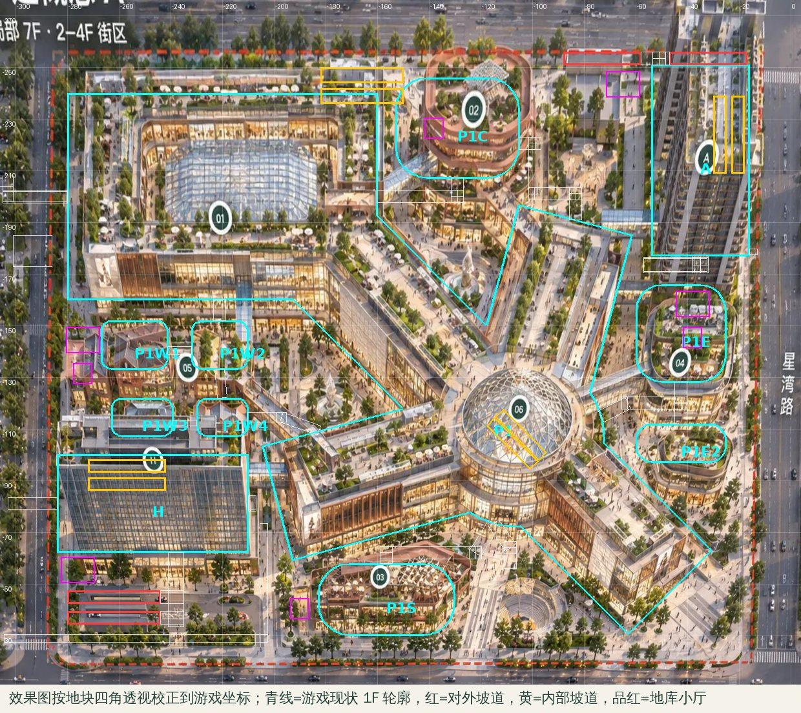
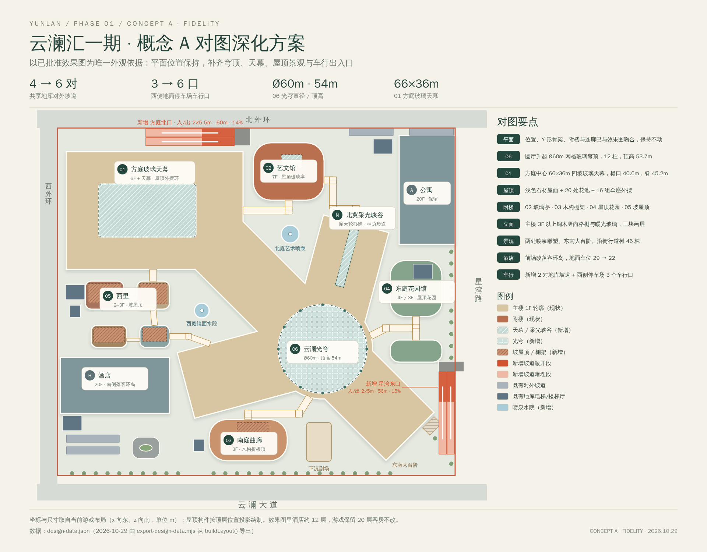
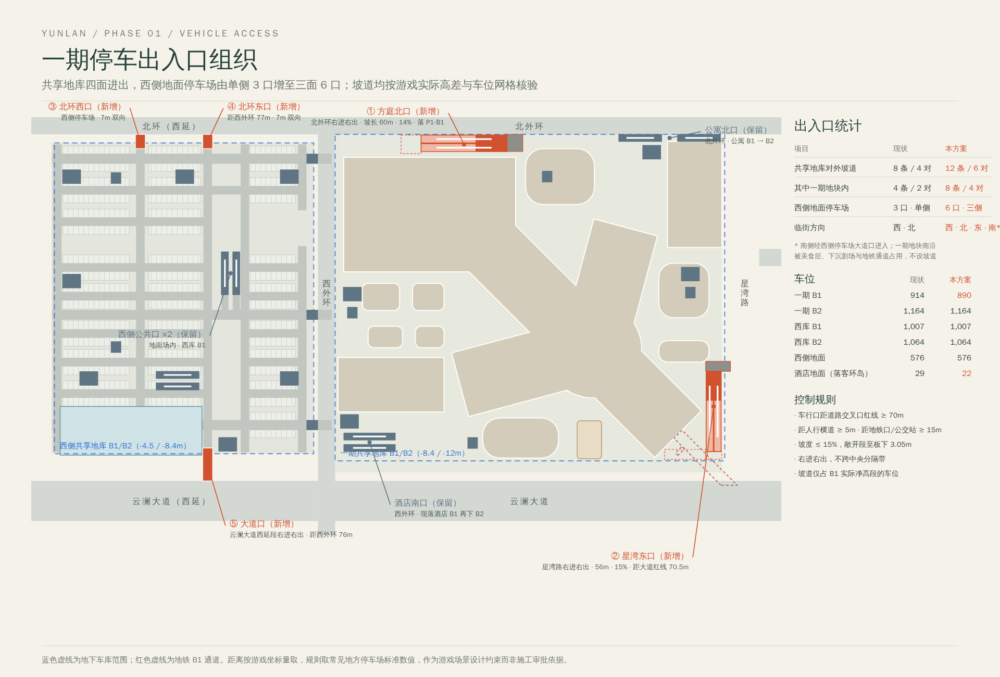

# 云澜汇一期 · 概念 A 对图深化设计方案

日期：2026-10-29
状态：**已在 `claude/loving-galileo-3u22m4` 分支实施，正文尺寸与数量已按实施结果更新**；验收与发布记录见 [QA](../../qa-2026-10-29-p1-concept-fidelity.md)
依据：已批准的[概念 A 鸟瞰](../2026-10-28-p1-expansion/aerial-concept-a.png)。用户要求“完全按照这个”出方案，并指出原场景一期停车场出入口不够多。
基础版本：`1408c49`（当前线上应用为 `0d61f0a`）

## 1. 结论

**平面已经对上，立体没有对上。** 效果图按地块四角透视校正后，叠上游戏 1F 轮廓：Y 形主楼、方庭、02–05 附楼、酒店、公寓和下沉院的位置都只差几米（第 2 节）。上一轮是照总平面图建模的，所以平面准；不贴合的地方在三维：游戏主楼是一整片 34m 高的橙色木板平屋面，效果图则是浅色石材屋面加层层绿化，有 06 网格玻璃穹顶、01 大玻璃天幕、暖光通高店面和铜色竖向格栅。

本方案**不挪楼、不改层数**：主楼 6F/RF 34m、艺文馆 7F、酒店与公寓 20F 都保持，商铺、客房和住户数量不变。外观按效果图逐项补齐。停车出入口两头都加：共享地库对外坡道从 4 对加到 6 对，西侧地面停车场车行口从 3 个加到 6 个。

| 指标 | 现状 | 本方案 |
| --- | --- | --- |
| 共享地库对外坡道 | 8 条 / 4 对（一期地块内 2 对） | **12 条 / 6 对**（一期地块内 4 对） |
| 地库临街方向 | 西外环、北外环 | 西外环、北外环、**星湾路**；云澜大道经西侧停车场大道口进入 |
| 西侧地面停车场车行口 | 3 个，全在西外环一侧 | **6 个**，西、北、南三面 |
| 06 圆厅屋顶 | 中庭小玻璃拱 | **Ø60m 网格玻璃穹顶，顶高 53.7m** |
| 01 方庭屋顶 | 24×20m 天窗 | **66×36m 四坡玻璃天幕** |
| 主楼屋面 | 橙色木板满铺 | 浅色石材 + 木平台 + 花池 + 伞座外摆 |
| 酒店前场 | 29 个地面车位 | 落客环岛，保留 22 个短停车位 |

## 2. 对图：哪里不贴合

上图把效果图按红色地块线的四个角做单应性校正，再叠上游戏实际的 1F 轮廓（青线）。校正只对地面准确，屋顶和高楼会顺着视线往北偏，所以楼位看底边：酒店南边、方庭南立面、02/03/04 的底边都对得上。效果图是 AI 生成的，它的层数和高度只当体量参考，比例尺寸以游戏坐标为准。

| # | 效果图 | 游戏现状 | 本方案处理 |
| --- | --- | --- | --- |
| 1 | 06：大型网格玻璃穹顶，底部环形露台 | 平屋面中央一个小玻璃拱 | 新建 Ø60m 光穹（4.1） |
| 2 | 01：中心大面积玻璃屋面，四周屋顶餐饮外摆 | 农园、露天影院、观景台，加 24×20m 天窗 | 66×36m 玻璃天幕，影院与观景台让位（4.2） |
| 3 | 屋面：浅色石材、木平台、花池、绿篱 | 整片橙色木板 | 换浅石材面层，补木平台、花池和伞座（4.3） |
| 4 | 北翼：中间一条带树的“商业峡谷” | 平屋面上一座摩天轮 | 北翼采光峡谷 + 两侧林荫；移除摩天轮（效果图里没有）（4.3） |
| 5 | 立面：暖光通高店面、铜/木竖向格栅、翼端巨幅画屏 | 浅石材横向带窗 | 3F 以上分段铜色格栅，三块翼端画屏，玻璃偏暖（4.4） |
| 6 | 02：陶土色层叠环带，屋顶玻璃亭和花园 | 陶土竖肋，屋顶空着 | 屋顶玻璃亭、屋顶花园、各层花池环带（4.5） |
| 7 | 03：屋顶大面积木构网格棚架和屋顶餐厅 | 平屋顶 | 木构网格棚架加餐桌（4.5） |
| 8 | 04：两馆屋顶花园、伞座 | 平屋顶 | 草坪、树、伞座（4.5） |
| 9 | 05：红砖坡屋顶小楼 | 屋顶只有小坡顶构件 | 坡屋顶加大到屋面约 60%（4.5） |
| 10 | 北庭白色雕塑喷泉、西庭水院、东南大台阶、沿街成排行道树 | 铺装为主，树木零散 | 两处喷泉雕塑、大台阶、两条行道树带（4.6） |
| 11 | 下沉院：圆形阶梯剧场，旁边有大型树形雕塑 | 圆角矩形下沉院，位置一致 | 保留台阶和美食层通道，加树形雕塑棚（4.6） |
| 12 | 酒店前场：落客环岛、椭圆花坛，两条坡道上有长雨棚 | 29 个地面车位，坡道敞口 | 改落客环岛，坡道加雨棚（4.6） |
| 13 | 酒店：约 12 层玻璃幕墙 | 20 层石材窗墙 | **保持**：190 间客房和精装模型依附现有窗墙，列为可选项（第 6 节） |
| 14 | 车行口只看得到酒店南口、公寓北口 | 一期地块内只有这两对 | 四面进出（第 5 节） |

## 3. 总平面

坐标与游戏一致：x 向东、z 向南，单位 m；一期地块为 x[-286,-16]、z[-256,-20]。屋顶构件画在其所在楼层的平面位置上。

## 4. 分区设计

### 4.1 06 云澜光穹

- 与圆厅同心，中心 (-106,-106)。底圈半径 30m，比圆厅外缘（34m）退进 4m，留出效果图里那圈可走的环形露台。
- 起拱高度 RF+4.2m（38.2m），矢高 15.5m，顶点 53.7m；仍低于酒店（71.1m）和公寓（74.2m）。
- 12 根钢柱位于 0°、30° … 330°。四条翼楼屋面接口各落在两柱之间，6F→RF 两组扶梯（距中心约 26m）在穹顶内。
- 网壳：24 条经向肋、7 道环梁，加三角化斜杆；玻璃用现有 glass 材质。起拱环一圈暖光灯带，夜景就是效果图里那种发光穹顶。
- 下方保留中庭洞口和两部玻璃梯。原中庭玻璃拱被穹顶覆盖，拆除；中庭悬挂的铜色云环艺术装置保留。
- 导航：12 根柱子作实体障碍，柱与柱之间都能走。

### 4.2 01 方庭玻璃天幕

- 范围 x[-258,-192]、z[-218,-182]，66×36m，盖住原 24×20m 中庭天窗和两部玻璃梯。檐口 40.6m，屋脊 45.2m，四坡，屋脊沿东西向。东缘收在 x=-192，给迁来的露天影院留出位置。
- 18 根周边柱。南边柱子落在 RF 退台切口（z=-180）以内 2m；西柱避开扶梯亭；东柱避开影院新位置。
- 星空露天影院移到 x[-190,-166]、z[-222,-190]（天幕东侧，露天）；方庭观景台北移到 x[-239,-213]、z[-228,-219.5]；屋顶农园原位不动。
- 方庭南侧原有 6F/5F 退台（16m / 12m）保留，就是效果图里天幕外那圈外摆；补伞座和花池。

### 4.3 主楼屋面与北翼采光峡谷

- 一期主楼 RF 面层从橙色木板（`deck-garden`）换成浅暖灰石材，木平台只铺在餐吧、外摆和休息区下面。
- 各翼楼屋面沿两侧边（距轴线约 ±19m）每 9m 设一组 4×1.4m 花池，隔一组种小乔木；避开楼梯、电梯、天窗、设备和既有要素。西翼、东南翼、方庭外摆补伞座餐桌。
- 北翼沿轴线（翼楼局部 u 44–84m）设 40×6m 抬高玻璃采光脊，两侧每 7m 一株树，从效果图视角看就是一条林荫商业峡谷。摩天轮及登乘台在完整探索模式移除；IP「云宝」和设备区保留。FPS 地图本来就没有屋顶，不受影响。
- 西翼的天空之镜、草坪、儿童乐园、花架，东南翼的餐吧、观景悬挑和立体字都保留，它们正好就是效果图里的屋顶花园内容。

### 4.4 主楼立面

- 3F 及以上：每 4 组开间里的 1 组改成通高铜木竖向格栅（0.6m 间距、0.3m 深，离玻璃不超过 0.4m，LED 屏和画屏都挂在格栅外），其余开间保持通高玻璃，石材框收窄；玻璃色调偏暖。1F–2F 沿用现有店面，只调柱和窗框颜色。
- 三块画屏，各宽 10m，外挂立面 0.6m，铜框：西翼西端 3F–5F（高 13.8m，避开 2F 酒店连廊 v±4m）；东南翼东南端 4F–6F（高 13.2m，在 3F LED 屏之上）；方庭南立面西端 1F–3F（高 12m）。翼端平直立面只有 v±17m，画屏都落在这一段内。画面用程序生成的抽象人像海报，不引入外部图片。
- 露台栏杆沿用现有玻璃栏杆，补花池。

### 4.5 附楼

| 附楼 | 效果图特征 | 本方案 |
| --- | --- | --- |
| 02 艺文馆 P1C（7F） | 陶土环带、退台种植、屋顶玻璃亭 | RF 中部设 14×9m 玻璃亭，南面向草坪敞开、另三面玻璃（导航墙），亭内两桌一吧台；南侧 32×10m 草坪和 4 株树，避开楼梯和观光梯 |
| 03 南庭曲廊 P1S（3F） | 屋顶木构网格棚架、屋顶餐厅 | RF 设 21×21m 双层木格栅棚架，6 柱落点避开楼梯与观光梯；棚下 4 组餐桌（不撑伞），柱和桌都是导航障碍 |
| 04 东庭花园馆 P1E / 玻璃花房 P1E2 | 屋顶花园、伞座 | RF 草坪、树、伞座；退台花池 |
| 05 西里 P1W1–W4 | 红砖坡屋顶小楼 | 柱承坡屋顶盖住屋面 56–64%：W1/W3 砖红瓦双坡加砖砌山墙，W2/W4 北向锯齿天窗；檐口 4.2m，高过 3.8m 的楼梯间；南侧留 3.6m 露天平台，柱为导航障碍 |

楼层、铺位、楼梯和电梯都不改。

### 4.6 景观与酒店前场

- **北庭艺术喷泉**：在北翼与西北翼之间的庭院，(-128,-184)，水池半径 6m，配 10m 高的白色晶体雕塑。离艺文馆南门轴线和二层连廊都超过 15m。
- **西庭镜面水院**：在西翼与西北翼之间，(-188,-132)，水池半径 5m，配 8m 雕塑。避开西里回廊和方庭南门步道。
- **东南大台阶**：平行于东南翼端立面、外推 2–9m，三级座阶加树阵。原东南角喷泉移除（效果图这里是台阶和树阵），立牌和云宝保留。
- **下沉剧场**：台阶、舞台和美食层通道都不动，北侧加一座树形雕塑棚，效果图里那个大型“树冠”就在这里。
- **行道树带**：云澜大道一侧沿 z=-21.4（种在南侧长廊内，长廊仍留 3.5m 通行）、星湾路一侧沿 x=-18.6，每 8m 一株；车行口、坡道敞开段、斑马线和地铁口处空出。实施结果 26 + 16 株，另在东南广场种 4 株树阵。
- **酒店落客环岛**：原有测试要求酒店保留 ≥20 个地面短停车位，所以只让出南排东段：北排 19 个和南排西段 3 个保留（29 → 22）。环路以现有停车通道为北段，18.5×14.5m 圆角环路围绕 8.5×4.5m 椭圆花坛（中心 (-226,-38.8)），东端离停车场标牌和灯杆 3m，经西外环接入道进出。酒店两条坡道的敞开段加长条雨棚。

## 5. 停车出入口

### 5.1 现状

| 系统 | 车行口 | 位置 |
| --- | --- | --- |
| 一期共享地库（P1 B1/B2 + 酒店 + 公寓 + 西库，4,149 个划线车位） | 4 对 8 条坡道 | 酒店南口（西外环，先落酒店 B1 -4.5m 再下 B2）；公寓北口（北外环，公寓 B1 → B2）；西侧公共口、西南公共口（都在地面停车场内） |
| 西侧地面停车场（576 位） | 3 个车行口 | 北口、中央口、南口，全在西外环一侧 |

一期地块南面临 6 车道的云澜大道，东面临星湾路，两面都没有地库口；地面停车场北面和南面都临城市道路，也没有开口。

### 5.2 新增

| 编号 | 名称 | 接入道路 | 几何（游戏坐标） | 坡长 / 坡度 | 落点 |
| --- | --- | --- | --- | --- | --- |
| ① | 方庭北口 入/出 | 北外环，右进右出 | 两条 5.5m 车道，z=-252（入）/-246（出），x 从 -166（地面）到 -226 | 60m / 14% | P1-B1 北环通道，接 x=-237 纵向车道 |
| ② | 星湾东口 入/出 | 星湾路，右进右出 | 两条 5m 车道，x=-19（入）/-24.5（出），z 从 -90.5（地面）到 -34.5 | 56m / 15% | P1-B1 南缘新增到达车道 x[-64,-16]、z[-35,-29] |
| ③ | 北环西口 | 北环西延段 | 7m 双向，x=-422，接停车场纵向车道 | — | 西侧地面停车场 |
| ④ | 北环东口 | 北环西延段 | 7m 双向，x=-375 | — | 西侧地面停车场 |
| ⑤ | 大道口 | 云澜大道西延段，右进右出 | 7m 双向，x=-375，z[-37,-14] | — | 西侧地面停车场，可直达交通中心 |

- ① 地面接入口 x[-167,-155]，离北外环两端路口 119m 和 145m；坡道敞开段 x[-187.8,-166]，其余暗埋；方庭北门在暗埋段上方，照常可达。
- ② 地面接入口 z[-97.5,-90.5]，离云澜大道红线 70.5m，离星湾路对面星湾北街丁字口 66.5m（支路口），离东庭玻璃花房圆角至少 0.6m；敞开段 z[-90.5,-70.2]。坡底与地铁 A 口 B1 通道平面上擦边，但剖面上坡道顶在 -5.7m 左右，通道楼板底约 -4.95m，不相交。
- 新坡道在 B1 只占实际净高段（坡面低于 -4.5m 的部分）和到达车道的车位，不在 B1→B2 内部坡道开洞上铺通道。
- 地面停车场三口都离路口 ≥76m（③ 离西外环 130m），不穿越行人脊、交通中心和西库楼梯厅。

### 5.3 一期南沿和西沿为什么不再加坡道

- 南沿（云澜大道一侧）：地库外缘在 z=-28，再往南没有车库层；坡道从 0 落到 -8.4m 至少要 56m，沿线会碰到下沉剧场（B1M -4.5m）、美食层通道、酒店 B1 汇流车道，还要切断南侧步行长廊。所以大道方向的车改走 ② 星湾东口（离大道 70m）和 ⑤ 大道口。
- 西沿（西外环一侧）：方庭外墙离地块边只有 6m；西里一带有两座地库电梯/楼梯厅，56m 坡长放不下。西外环一侧已有酒店南口，还有经地下隧道连通的西库两对坡道。

### 5.4 控制规则与核验

- 车行口离道路交叉口红线 ≥70m，离人行横道 ≥5m，离地铁口和公交站 ≥15m。这些按常见地方停车场标准取值，是游戏场景的设计约束，不是施工审批依据。
- 坡度 ≤15%；地面敞开段一直开到坡面低于地面 3.05m（与现有坡道规则一致）；均为右进右出，不跨中央分隔带。
- 已用当前布局逐项检验：新坡道和接入口不压任何建筑首层、美食层、地库核心筒、电梯井、楼梯、地库电梯/楼梯厅和既有坡道；北口与 B1→B2 坡道开洞只在地面以下 2.4m 内上下重叠。
- 实施结果：新坡道板下和到达车道占掉 24 个 B1 车位（914 → 890），四个主楼面合计 4,149 → 4,125。

## 6. 保持不变与已知差异

- **酒店高度与立面**：效果图里酒店约 12 层玻璃幕墙，游戏是 20 层，190 间客房、复式和精装模型都依附现有窗墙，本轮不改。若要贴图，可以另做“上部幕墙化 + 顶部收分”，客房不减。
- **主楼层数**：效果图看起来像 4 层街墙加退台。游戏按已批准的 6F 实现；本方案用格栅分段、花池和屋面绿化让体量读起来更轻，不削减 5F/6F 的商铺。
- **艺文馆 7F**、**云环天桥**（连接二三期和公园的全园设施，效果图范围外）保持。
- **摩天轮**：效果图里没有，完整探索模式移除。若想保留，可以挪到二期屋顶，那要另外确认。
- **FPS**：继续用 `buildLayout({expansion:false})` 的紧凑地图，本方案不改任务路线和撤离点。

## 7. 实施拆分与验收

| 步骤 | 内容 | 主要文件 |
| --- | --- | --- |
| 1 | 地库新增两对坡道、B1 到达车道、车位重算；地面停车场三口，闸口支持南北朝向 | `layout/p1-access.js`、`render/build/parking.js`、`render/build/site.js`、`render/build/west-parking.js` |
| 2 | 光穹、方庭天幕、北翼峡谷；导航柱障碍 | `layout/p1-fidelity.js`、`render/build/p1-fidelity.js`、`layout/nav.js` |
| 3 | 屋面材质、花池、伞座；影院和观景台迁移；摩天轮移除 | `layout/p1-fidelity.js`、`layout/p1-roofscape.js`、`render/build/p1-roofscape.js`、纹理/PBR 映射 |
| 4 | 铜木格栅、暖色玻璃、三块画屏 | `render/build/p1-expansion.js`、`render/build/p1-fidelity.js` |
| 5 | 附楼屋顶：玻璃亭、网格棚架、屋顶花园、坡屋顶 | `layout/p1-roofscape.js`、`render/build/p1-roofscape.js` |
| 6 | 喷泉雕塑、大台阶、行道树、下沉院雕塑、酒店落客环岛与坡道雨棚 | `layout/p1-landscape.js`、`render/build/p1-landscape.js`、`render/build/parking.js` |
| 7 | 验收 | 测试、构建、同相机截图（昼/夜）、FPS 回归、手机模拟 |

验收标准：

1. 用本目录记录的同一相机截图，和效果图并排比较：06 穹顶、01 天幕、浅色绿化屋面、北翼峡谷、铜色格栅与画屏、行道树、酒店环岛都能对上。
2. 新坡道在漫游中能从地面走到 B1，地面开洞、B1 到达车道、车库入口/出口标牌齐全；车位统计更新。
3. 西侧地面停车场 6 个车行口都有闸架和标识，车道接到场内路网。
4. FPS 仍为 P1/H/A 18 层，任务与撤离不变；全部自动测试通过。
5. 新增构件按材质合批，不新增贴图文件和外部依赖；手机模拟启动和流式缓存上限不变。

## 8. 文件

- [compare-concept-vs-current.jpg](compare-concept-vs-current.jpg)：效果图与游戏现状，同一相机（拟合得到：位置 (-158.3, 386.1, 230.7)，目标 (-151.5, 0, -114.4)，垂直视角 24.5°；四角重投影误差约 6.5px）。
- [concept-rectified-overlay.jpg](concept-rectified-overlay.jpg)：效果图校正到游戏坐标，叠加现状轮廓。
- [masterplan.png](masterplan.png) / [masterplan.svg](masterplan.svg)：对图深化总平面。
- [parking-plan.png](parking-plan.png) / [parking-plan.svg](parking-plan.svg)：一期停车出入口组织。
- [design-data.json](design-data.json)：现状几何和本方案新增几何；由 [export-design-data.mjs](export-design-data.mjs) 从 `buildLayout()` 导出，[draw-design.py](draw-design.py) 绘图。
- [capture-concept-view.cjs](capture-concept-view.cjs)：用上述相机截取游戏鸟瞰（昼/夜）；[rectify-concept.py](rectify-concept.py)：效果图透视校正与轮廓叠图。
