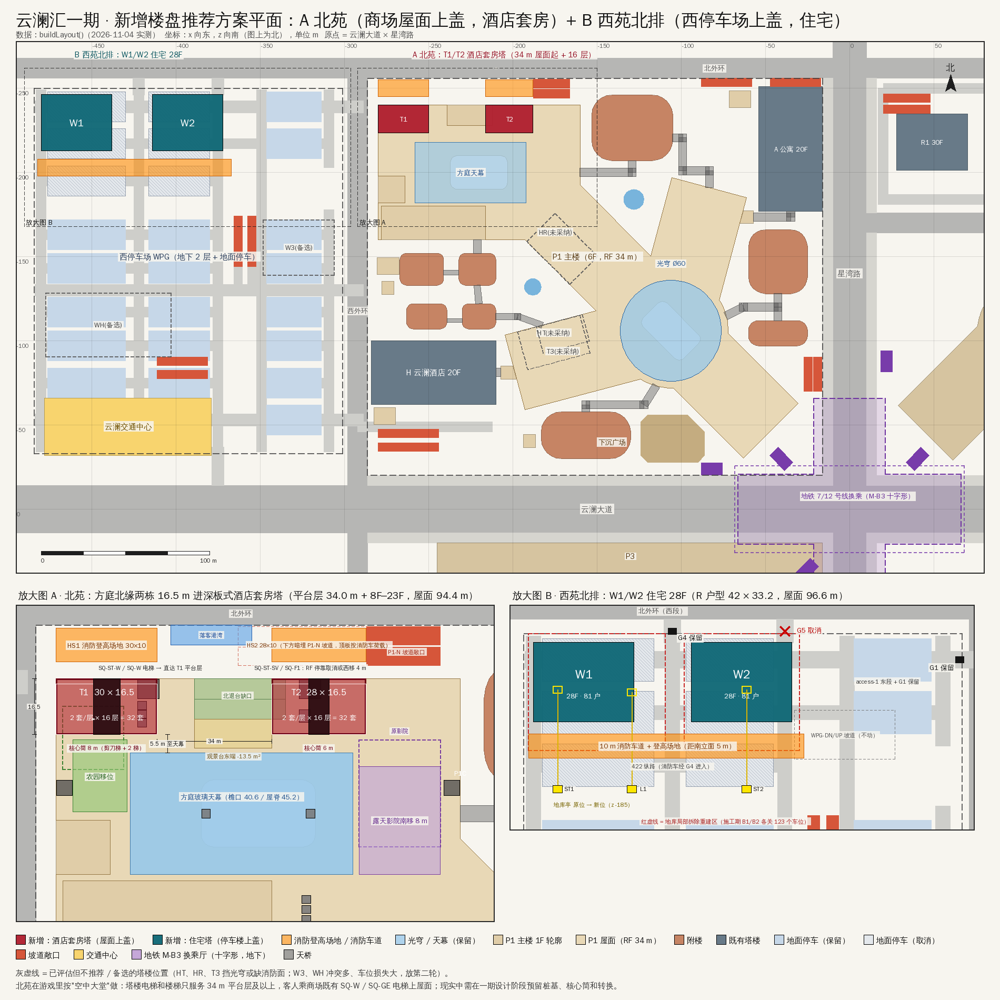

# 云澜汇一期 · 新增楼盘与上盖物业决策文件

- 日期：2026-11-04
- 依据：
  - 现场布局：在 Node 里运行 `buildLayout()` 实测，仓库未改动。
  - 三个候选方案：住宅·云台、酒店·天际双塔、混合·西苑。
  - 两份评审：中国规范可行性审查、引擎实现审查。
  - 本文复核：`final/verify.mjs`、`check2.mjs`、`export2.mjs`。
- 范围：本文只回答"一期还能不能加楼、能不能做上盖"。同一条消息里的其他问题（其他出入口检查、一期停车场西口通道延长、二期公交站）另行分析。
- 平面图：`plan.png`，放在本文同目录。

> **2026-11-04 同日更新**：本文测算时西停车场地面是 576 位。同一批改动里，西门步行轴已经穿过停车场（拆 C6/B6 北排 25 位），现状为 **551 位**（EV 57、无障碍 10 不变）。按本文 B 方案再取消北侧一排后，地面约为 **431 位**。B 方案本身仍是 −232 个；连同西门步行轴拆的 25 位，一期合计比 10-31 版本少约 257 个（−5.4 %）。西门步行轴在 z = −123.5，和 W1/W2 所在的北侧条带（z −250…−198）不冲突。

---

## 0. 结论

1. **一期地面确实没地方了。**
   - 地块面积 63,720 m²。建筑占地 56.9 %，加上坡道、下沉广场、落客区，占用率为 63.1 %。
   - 剩下的 23,542 m² 是连成一片的广场和通道。离开建筑 13 m 以后，最大的空矩形只有 25 × 19 m。
   - 无论是 H/A 那种 74 × 38 m 的板楼，还是 R 楼那种 42 × 33.2 m 的塔楼，在地面上都放不下。
2. **上盖物业能做，但商场屋面上只能做"瘦板楼"，做不成小区。**
   - 屋面上能真正落塔的位置受四条硬约束：
     - 消防登高场地必须沿塔楼一整条长边布置，塔楼与场地之间的裙房进深不超过 4 m；
     - 每个翼中间都有 5 m 宽的中庭缝；
     - 光穹（Ø60 m）和方庭天幕不能压；
     - H、A 离商场只有 6–7 m。
   - 四条同时满足的地方只有方庭北缘。那里能放两栋 16.5 m 进深的板楼，合计 64 套。
   - 真正能做"小区"的上盖位置在西停车场（WPG）：在停车楼上盖住宅塔。
3. **推荐组合方案：A 北苑 + B 西苑北排。** 两期合计新增约 6.75 万 m²，共 64 套酒店套房和 162 户住宅。
   - **A 北苑**：在方庭北缘盖两栋酒店套房塔 T1、T2。从 34 m 的屋面平台层起盖 16 层，屋面高 94.4 m，共 64 套 165 m² 的套房，面积约 1.57 万 m²。它就是用户问的"商场上盖酒店楼"。
   - **B 西苑北排**：在西停车场北侧盖一排两栋 28 层住宅 W1、W2，屋面高 96.6 m，共 162 户，面积 5.18 万 m²。它就是用户问的"继续盖小区"。
4. **推荐理由**
   - A 的位置正对北外环，有 92 m 连续的消防登高面。它不挡光穹的主视角，不搬商场核心筒，直接复用现有 11 × 15 m 套房模块。用途定为酒店，就不用改用地性质。
   - B 直接用现有的 R 户型模板，不需要转换层。它只动停车场北侧一条带：地面车位从 576 降到约 456，全一期车位净减 232 个（−4.8 %），交通中心不受影响。
5. **不推荐的方案**
   - **不推荐**：T3、HT、HR 三个屋面塔位，以及 SE 翼。原因是挡光穹的主视角、消防车道是尽端路、要搬商场核心筒和影城。
   - **放第二轮备选**：W3、WH。原因是会切断 WPG 与 P1 之间的隧道口、和 H 的产品重复、车位损失大。
   - **前提**：A 只有在"一期在设计阶段就预留了上盖条件"的设定下才成立。如果按"一期已建成运营"来讲故事，屋面上最多加 2–3 层轻钢楼阁，新增楼盘只能做 B。

---

## 1. 现状条件（关键数字）

| 项目 | 数值 | 对加楼的意义 |
|---|---|---|
| P1 地块 | x[−286,−16] × z[−256,−20]，63,720 m² | — |
| 地面占用 | 建筑 36,283 m²（56.9 %），总占用 40,178 m²（63.1 %） | 剩余 23,542 m² 全部是通道和广场 |
| 最大空地 | 贴建筑：50.5 × 42 m（北庭，紧贴 A 的 20 层西立面）；离开建筑 13 m：25 × 19 m | 放不下任何一种塔楼模板 |
| 主楼屋面 RF | 标高 34.0 m；毛面积 21,869 m²，扣除洞口后 19,796 m²；尚未占用约 11,800 m² | 唯一的储备空间，但被中庭缝切碎 |
| 光穹 / 天幕 | 光穹 Ø60 m，顶点 53.7 m；方庭天幕 66 × 36 m，檐口 40.6 m，屋脊 45.2 m | 塔楼不能压上去；光穹是主入口镜头的主角 |
| 翼内可用条带 | 每翼两侧各有一条 20.5 m 深、50–65 m 长的实心条带，中间是 5 m 中庭缝 | 只能做板楼；74 × 38 m 的板放不下 |
| H / A 间距 | H 距 W 翼端 6.0 m；A 距 N 翼 7.0 m | W 翼、N 翼的候选位置都离 H/A 太近 |
| 地铁 | M-B3 换乘厅在 x[−66,66]×z[−21,21] ∪ x[−21,21]×z[−66,66] | **更正**：事实底稿说"SE 翼压在地铁上 733 m²"，那是按外接框算的，实际为 0。SE 翼在 50 m 地铁保护区内，要做评估，但不是禁建 |
| 消防登高面 | 方庭北立面 z = −240：连续 92 m（x −280→−188），直接接北外环 | 整个商场唯一一段合格的长边 |
| 西停车场 WPG | 39,711 m²：地面 576 个车位，B1 1,007 个，B2 1,064 个；西南角是交通中心 | 一期唯一成片的"可上盖"用地 |
| 引擎现状 | 238 个楼层（README/HANDOFF 里写的 236 已过时）；塔楼层 174 个；728 套住宅/套房；680 个商铺；64 部电梯；99 部楼梯 | — |
| 手机端性能基线 | 1,558 次绘制调用，2.82 M 三角形，JS 堆 184 MB；R1–R4 每栋 131 次调用、20 万三角形 | R 户型塔楼是最贵的部分 |

---

## 2. 方案对比

| | 住宅·云台（原方案） | 酒店·天际双塔（原方案） | 西苑全量（原方案） | **推荐 A：北苑** | **推荐 B：西苑北排** |
|---|---|---|---|---|---|
| 位置 | 方庭北缘 T1/T2 + W 翼北带 T3 | W 翼 HT + NW 翼 HR | WPG：W1/W2/W3 + WH | 方庭北缘 T1/T2 | WPG 北排 W1/W2 |
| 楼栋 | 3 | 2 | 4 | 2 | 2 |
| 层数 | 平台层 + 17 层 | HT 7F–24F；HR 7F–21F | 住宅 28F；酒店 18F | 平台层 + 16 层（8F–23F） | 28F |
| 高度（屋面） | 97.8 m | 97.8 / 87.6 m | 96.6 / 64.3 m | **94.4 m**（距 100 m 线留 5.6 m） | 96.6 m |
| 新增面积 | 28,083 m² | 28,542 m² | 126,633 m² | **≈ 15,700 m²** | **51,766 m²** |
| 户数 / 间数 | 119 户 | 144 间 + 98 套 | 243 户 + 170 套 | **64 套**（165 m²） | **162 户**（179–202 m²） |
| 容积率 | P1：4.39 → 4.83 | 4.39 → 4.83 | WPG：0 → 3.19 | P1：4.39 → 4.63 | WPG：0 → 1.30 |
| 车位影响 | 改划 179 个 | 划出 140 个，损失约 22 个 | 一期 −704 个（−14.7 %） | 不减；分时划出约 30 个 | 一期 **−232 个**（−4.8 %）；地面仍有约 456 个 |
| 消防登高 | HS1/HS2 合格；HS3 通道画错 | 西庭 76 m 尽端路 | 地面合格 | HS1 30 × 10、HS2 28 × 10，都直接接北外环 | 一条 10 m 连续消防车道，从 G4 进入 |
| 日照 | 合格；但单朝向户型不满足住宅规范 | HR 西南面 1.4–3.5 h；A 西立面减少 0.3–1.2 h | 南立面 ≥ 3.9 h；03 户朝北 0 h | 酒店无强制要求；8F 起约 8 h | 南立面 ≥ 7.1 h；03 户朝北 0 h（与 R1–R4 相同） |
| 结构 | 必须预留；局部转换；超限审查 | 必须预留；悬挑 7.5 m；超限审查 | 地面落地塔，局部拆除重建地库 | 必须预留；可以不做转换；大底盘双塔需超限审查 | 地面落地塔，无转换 |
| 光穹主视角 | T3 压住光穹左肩 | HR 高出穹顶 | 不挡 | **藏在光穹后面** | 不挡（在 H 左侧，比 H 低） |
| 引擎新增楼层 | +57 | +35 | +114 | +36 | +62 |
| 渲染新增（最坏情况） | +54 次调用 / +74 k 三角形 | +36 / +56 k | +400 / +0.65 M | **+36 / +46 k** | +254 / +0.39 M（先做 M0 后约 +16 次调用） |
| 现实可行性 | 3/10 | 5/10 | 6/10 | 5/10（本文评估，前提是设计阶段预留） | 7/10（本文评估） |
| 引擎可行性 | 5/10（只做 T1+T2 时 6/10） | 4/10 | 7/10（先做实例化后 8/10） | 6/10（本文评估） | 7/10（做 M0 后 8/10） |
| 主要问题 | 住宅转性要重新招拍挂；同楼的商场餐饮受《大气污染防治法》第 81 条约束 | 要搬核心筒和影城；新的客房模板；挡光穹 | 公共停车用地转性；隧道口被切；WH 和 H 产品重复 | 体量小；T2 压住北退台缺口东侧 4 m | 改变 10-13 定下的"大型地面停车"决定，需业主同意 |

前三列的分数来自两份评审，后两列是本文综合评估。

**推荐方案为什么这样改**
- 原 T1 长 41 m，布 3 户/层时放不下规范要求的第二部楼梯。
- 现在改成"套房—核心筒—套房"的对称布置：
  - 两户的门都在核心筒 5 m 以内，可以用剪刀楼梯（规范要求不超过 10 m）；
  - 层数降到 16 层，给 100 m 高度线留出余量；
  - 用途改为酒店，同时避开住宅转性、第 81 条和住宅规范第 7 章（采光通风）三道坎。
- 西苑只做北排两栋，可以绕开 W3 对隧道口的切断和 WH 对 SHARED 坡道的占压，车位损失从 −704 降到 −232。

---

## 3. 推荐方案详述

### 3.1 A 北苑：方庭北缘酒店套房双塔（商场屋面上盖）

**位置**

坐标为世界坐标 [x, z]，单位 m，x 向东，z 向南。

| | 塔楼平面 | 核心筒 | 消防登高场地 | 其他 |
|---|---|---|---|---|
| **T1** | x[−280,−250] × z[−240,−223.5]，30 × 16.5 = 495 m²/层 | x[−269,−261]，8 m 宽 | HS1：x[−280,−250] × z[−255,−245]，场地内无障碍 | 西套 x[−280,−269]，东套 x[−261,−250] |
| **T2** | x[−216,−188] × z[−240,−223.5]，28 × 16.5 = 462 m²/层 | x[−205,−199]，6 m 宽 | HS2：x[−216,−188] × z[−255,−245] | 西套 x[−216,−205]，东套 x[−199,−188] |
| 落客港湾 | x[−246,−222] × z[−256,−250]，可停 3 辆车，在北外环一侧 | | | |

**间距**

| 对象 | 距离 |
|---|---|
| 方庭天幕 | 5.5 m |
| 光穹 | 156 / 113 m |
| H | 123 m |
| A | 196 / 134 m |
| P1C | 97 / 35 m |
| T1 ↔ T2 | 34 m |

除天幕外，所有间距都大于 13 m 的高层防火间距。

**剖面**

| 标高 | 层 | 用途 |
|---|---|---|
| 34.0–40.0 m | 平台层（7F，与商场 RF 同标高） | 空中大堂、酒廊、半开敞的屋顶花园 |
| 40.0 m | 8F | 第一个客房层（与天幕檐口 40.6 m 同高） |
| 91.0 m | 23F | 顶层客房 |
| **94.4 m** | RF | 消防计算高度 < 100 m，不设避难层 |
| 97.6 m | 女儿墙 / 屋顶 | — |

高度梯队：P1 34 < 天幕 45.2 < 光穹 53.7 < H 71.1 < A 74.2 < **北苑 94.4** < W1/W2 96.6 < R1–R4 103.4。

**平面与面积**
- 两栋都是单廊板楼：北侧 1.5 m 走廊，南侧 15 m 进深的套房。
- 套房直接复用现有 11 × 15 m（165 m²）套房模块，游戏里不需要新模型，也没有新增下载。
- 核心筒内设剪刀楼梯和 2 部电梯，其中 1 部是消防电梯。
- 每层 2 套，16 层：T1 32 套，T2 32 套，合计 64 套。
- 面积：T1 7,920 m² + T2 7,392 m² + 平台层围合部分约 430 m² ≈ **15,700 m²**。
- 一期容积率从 4.39 升到 4.63。

**屋面上改什么**（全部已用布局数据核对）

| 项目 | 现状 | 改动 |
|---|---|---|
| 方庭屋顶农园（342 m²） | x[−278,−260] × z[−232,−213]，被 T1 压掉 153 m² | 移到 x[−275,−259] × z[−222,−200.5]，344 m²，全部落在 RF 上，避开 SQ-ST-S4 楼梯；原地一处咖啡外摆并入，做成"农园餐桌" |
| 方庭退台观景台 | x[−239,−213] × z[−228,−219.5] | 东端截短到 x −216，减少 13.5 m² |
| 星空露天影院（768 m²） | x[−190,−166] × z[−222,−190]，距 T2 只有 1.5 m | 整体南移 8 m，到 z[−214,−182]，距 T2 9.5 m；改成耳机静音影院，22:00 后停映 |
| 北侧退台缺口（3F/4F） | x[−239,−212] × z[−240,−228] | T2 西端 4 m 压在缺口上：5F–RF 每层 48 m²，3F/4F 各 24 m²。缺口其余 23 m 宽保留 |
| 商场 SQ-ST-W 楼梯、SQ-W-L1..3 电梯 | 在 T1 东套正下方，到 RF | 保留，直接通进 T1 平台层空中大堂，成为客人上楼的主通道 |
| 商场 SQ-ST-SV 楼梯、SQ-F1 货梯 | 在 T2 核心筒正下方（重叠 20.6 m² / 1.5 m²） | 二选一：①取消这两部在 RF 的停靠，顶站改为 6F；②整体西移约 4 m |
| P1-RF 楼板 | — | 两塔脚下切洞，由塔楼平台层接管；给 SQ-W 电梯门保留一条步行带 |

**保留不动的**
- 光穹、天幕、下沉广场；
- 南侧和西侧退台；
- SE 翼的 4 个屋顶酒吧和悬挑观景台；
- W 翼的天空之镜、草坪、儿童乐园，N 翼的采光峡谷；
- 所有附楼、H、A；
- 680 个商铺：游戏版的 RF 以下不动。

**到达方式**
- **游戏版（空中大堂）**：
  - 开车：北外环 → P1-N 坡道（方庭北口）→ P1-B1，坡道落点在两塔之间，约 x −226 → 乘 SQ-W 电梯直达 T1 平台层。
  - 去 T2：乘 SQ-GE 观光梯或 SQ-E 电梯到 RF，再沿天幕东侧屋顶花园走 20–50 m。
  - 步行：从北外环落客港湾进方庭北门，乘 SQ-W 电梯上楼。
- **现实版**：每栋在 1F 北立面设独立门厅（各占约 300 m² 商铺），消防电梯和楼梯直通室外登高场地一侧。客梯停 B2、B1、1F、平台层和 8F–23F，2F–6F 不开门。

**结构与消防**（现实版，前提是一期设计时已预留）
- **结构**
  - 塔楼长墙在 z ≈ −240 / −223.5，正好落在车库柱网的 z = −239 / −223 线上；T1 核心筒落在柱网 x = −269 / −261 线上。
  - 南侧长墙做成非承重墙，楼板由横墙和核心筒承担，可以免去转换层。
  - 大底盘双塔仍然需要做超限审查。
  - 高宽比 (94.4 − 34) / 16.5 = 3.7，小于 6。
  - 桩基约 55 根：Ø1.0 m，长 45–55 m，T1 约 29 根、T2 约 27 根，承台 2.2 m 厚，设在 B2。
- **消防**
  - 每层两个出口用剪刀楼梯解决（GB 50016 §5.5.10），房门到楼梯间入口不超过 5 m。
  - 每层 1 个防火分区，配 1 部消防电梯。
  - 北立面每层至少 2 个救援窗。
  - 8F–10F 靠天幕一侧的窗用防火玻璃。
  - 方庭中庭的排烟口不能放在天幕下，要改道或改为机械排烟。
  - HS2 下面是暗埋的 P1-N 坡道（重叠 266 m²），坡道顶板要按消防车（含支腿）荷载设计。
- **规划与环保**
  - 酒店仍是商业用地（B14），只需调整控规、补缴地价。
  - 酒店不属于"居住层"，所以不触发《大气污染防治法》第 81 条，商场餐饮不受影响。
  - 如果改做服务式公寓，各地口径不一，存在风险。

**日照与阴影**
- 新塔对 H、A 没有任何遮挡。
- 游戏的固定西南向太阳下，影子投向东北，落在北外环和地块外，不碰 P1C。
- 真实冬季正午，影子向北越过北外环约 117 m；如果地块外北侧有住宅，需要做日照分析。

**光穹主视角**（主入口镜头）

| 对象 | 方位 | 塔顶仰角 |
|---|---|---|
| 光穹 | ±13.3° | 12.7–19.0° |
| T1 | −4.1° | 14.9° |
| T2 | +4.2° | 17.1° |

两栋塔都落在光穹背后，没有高出穹顶。从北面看天幕的视线会被挡住。

### 3.2 B 西苑北排：西停车场上盖住宅（W1/W2）

**位置**

| | 塔楼平面 | 消防 | 地库局部拆除重建区 |
|---|---|---|---|
| **W1** | x[−480,−438] × z[−246.2,−213]，中心 (−459, −229.6) | 登高场地 x[−480,−438] × z[−208,−198]，距南立面 5 m | x[−482,−425] × z[−250,−201] |
| **W2** | x[−414,−372] × z[−246.2,−213]，中心 (−393, −229.6) | 登高场地 x[−414,−372] × z[−208,−198] | x[−417,−369] × z[−250,−201] |

- 两塔之间 24 m，与 R1–R4 的楼间距相同。
- 一条 10 m 宽的连续消防车道 x[−482,−367] × z[−208,−198]：消防车从 G4（北环西口）经 422 号纵路进入，西接 480 号纵路，东接 375 号纵路，形成环路。
- W2 距 P1 92 m，距 H 143 m。

**楼栋参数**
- R 户型 42 × 33.2 m，28 层，1F 层高 4.8 m，标准层 3.4 m。
- 屋面 96.6 m，女儿墙 99.8 m，属一类高层住宅，低于 100 m，不设避难层。
- 每栋 81 户（01、02 户型 179.4 m²，03 户型 202.4 m²），地上面积 25,883 m²。
- 地下 B2（−8.4 m）和 B1（−4.5 m）与 WPG 车库同标高，平接。
- 不需要转换层；距地铁 240 m 以上，不涉及地铁保护区审批。

**停车场的变化**（实测）

| 车位 | 现状 | 改后 | 变化 |
|---|---|---|---|
| WPG 地面 | 576（EV 57，无障碍 10） | ≈ 456（EV 49，无障碍 9） | −120：A1、A2、B1、B2 四块取消，A3、B3 削去北排 |
| WPG-B1 / B2 | 1,007 / 1,064 | 919 / 976 | 各 −88（塔楼地下室占用） |
| 新塔地下室 | 0 | ≈ 64 | +64（每层约 16 个，与 R1-B1 相同） |
| **一期合计** | **4,786** | **≈ 4,554** | **−232（−4.8 %）** |

- 住宅按约 1.2 个/户配 195 个：塔楼地下室 64 个，加上 WPG 北区门禁区约 131 个。北区改后还剩 246 个。
- 剩余公共车位约 4,270 个，远高于商场需求（约 1,525–1,907 个）。
- 施工期间，B1/B2 在拆除重建区内各临时关闭 123 个车位。

**道路和设施的改动**
- 取消：G5（北环东口，正对 W2）；access-1 西段；W1/W2 下方的车道；375 号纵路在 z −208 以北的一段；north-link 截到 x −372。
- 保留：G1、G2、G3、G4、G6，access-1 东段，WPG-DN/UP 坡道，SHARED-DN/UP 坡道，通往 P1 的隧道，交通中心。
- 地库楼梯电梯亭 SH-ST1、SH-L1、SH-ST2 从塔楼脚下移到 z ≈ −185 一带。

**日照**
- 盒体模型：大寒日，2F 窗台，计入北苑两塔。W1、W2 南立面最少 7.48 h 和 7.15 h，满足不少于 2 h 的要求。
- 03 户纯朝北，大寒日 0 h。这是 R 户型模板本身的问题，R1–R4 也一样，现实报批需要换户型（见 §6）。

**光穹主视角**：W1 在 −19.2°，W2 在 −15.4°，塔顶仰角 10–12°，在光穹左侧，比 H 低。

---

## 4. 风险与对策

| # | 风险 | 影响 | 对策 |
|---|---|---|---|
| 1 | 一期被当作"已建成运营" | A 现实中不可行：要在运营中的 B2 打桩、9 层楼板开洞 | 游戏叙事定为"设计阶段已预留桩基、核心筒和平台层"；否则只做 B，屋面最多加 2–3 层轻钢楼阁 |
| 2 | 控规调整、补地价 | A：容积率 4.39 → 4.63，高度不超过 100 m；B：公共停车用地地上部分转住宅，可能要分层出让甚至招拍挂 | A 保持商业性质；B 需提前和规划部门沟通，必要时在 W1/W2 下加 B3，约补 60 个车位 |
| 3 | 超限审查（A） | 大底盘双塔，审批周期增加 | 南墙非承重、取消转换，设抗震缝，高宽比 3.7 |
| 4 | HS2 压在暗埋坡道上 | 消防验收 | 坡道顶板按消防车荷载设计；或 T2 整体西移（会多占北退台缺口） |
| 5 | 天幕排烟、露天影院噪声 | 酒店客房的安全和舒适 | 排烟改道或改机械；影院南移 8 m，改耳机，22:00 后停映 |
| 6 | T2 压住退台缺口 4 m；SQ-ST-SV / SQ-F1 在 T2 核心筒下 | 屋面和商场核心局部调整 | 缺口东侧 4 m 补板或做 4 m 悬挑；两部梯的 RF 停靠取消或西移 4 m |
| 7 | W1/W2 北立面距 WPG 用地线 3.8 m、距道路边线 9.8 m | 部分城市高层退界要求 8–15 m | 必要时两塔整体南移 4–6 m（日照余量足够） |
| 8 | R 户型 03 户朝北 | 现实中不满足 GB 50180 日照要求（R1–R4 同样） | 游戏保持一致；现实版或后续统一改户型 |
| 9 | 手机端三角形 +15 %（A+B） | 低端 iPhone 可能卡顿 | 先做 M0 实例化：R1–R4 的 524 次调用降到约 30；按 HANDOFF §8 实测，超预算就给 R 外立面做远景简化 |
| 10 | 酒店供给 | H 190 套 + 北苑 64 套，都是 165 m² 大套房 | 北苑可改为酒店管理的长住或行政公寓，几何不变 |
| 11 | 与 2026-10-13 的"大型地面停车"决定冲突 | 用户此前亲自要的 | B 保留 79 % 的地面车位和整个交通中心；需业主明确同意 |
| 12 | 施工期车位 | 每栋施工时 B1/B2 各关约 60 个车位 | W1 先建，W2 后建，错开约 8 个月 |

---

## 5. 游戏实施计划

原则：
- 所有新增内容都只在 tour 模式生效，FPS（`expansion:false` + `playable.js`）不受影响，`playable.test` 必须保持通过。
- H、A、R1–R4 的生成结果要保持逐字节一致。

| 里程碑 | 内容 | 涉及文件 / 模块 | 测试 |
|---|---|---|---|
| **M0 准备**（不改玩法） | ① R 户型外立面每层的 LOD 组合并为每栋每材质一个 InstancedMesh；② 按 HANDOFF §8 实测手机端的调用次数、三角形和堆内存；③ README/HANDOFF 计数 236 → 238；④ 顺带修一个现有问题：屋顶镜头"一期天台 · 云澜光穹与方庭玻璃天幕"相机在 y = 28，位于 5F 体量内，应抬到 RF 以上 | `src/render/build/residential-shell.js`（`buildResidentialLevelShells`），`src/render/tour.js` 第 86 行 | 渲染快照 / QA 记录 |
| **M1 屋面塔楼基础能力** | `tower()` 导出，新增 `baseElev`、`host:'P1'`、`basement:false` 选项，楼层编号从 7F 起；新增"套房—核心筒—套房"单廊平面（复用 11 × 15 套房，核心筒内并排两部 4.0 × 9.4 m 楼梯，梯段 1.4 m，两部电梯都标为 passenger）；渲染端为 `landscape()`、招牌、1F 门厅、电梯外壳、走廊灯加 `baseElev` 分支；P1 剖切或聚焦时同步剖切塔楼（`setHospitalityCut`），P1 爆炸视图中隐藏塔楼 | `src/layout/hospitality.js`，`src/render/build/hospitality.js`（第 391–407 行等），`src/render/app.js`（`towerVisibility`、`applyVisibility`） | H/A/R 快照不变 |
| **M2 北苑 T1 → T2** | 新模块 `applyP1PodiumTowers()`，在 `applyP1Fidelity` 之后调用；P1-RF 在塔楼脚下切洞、裁掉步行面，给 SQ-W 电梯门留步行带；平台层与 P1-RF 用 `connect()` 对接；T2 处理 SQ-ST-SV / SQ-F1（在 expanded spec 里改顶站或平移）；屋面调整农园、观景台、影院、咖啡外摆；场地加 HS1/HS2 和落客港湾 | 新建 `src/layout/p1-podium-towers.js`，`src/layout/p1-roofscape.js`，`src/layout/p1-landscape.js`，`src/layout/p1-expansion-spec.js`（`buildExpandedP1Spec`），`design-data.json` / `draw-design.py` | 新建 `tests/p1-podium-towers.test.js`：平面落在 RF 上且避开洞口、光穹、天幕；距天幕 ≥ 5 m；与 H/A 及两塔之间 ≥ 13 m；RF ≤ 100 m；HS 无障碍；每层 2 部梯 2 部楼梯；平台层 ↔ P1-RF 连通 |
| **M3 西苑 W1/W2** | `tower()` 新增 `basement` 覆盖（R 户型改为 B2 −8.4 / B1 −4.5）和 `plot` 覆盖；新模块 `WEST_VILLAGE`；`buildLayout` 把 `westVillage` 开关传给 `buildHospitality`，塔楼必须在 `applySharedGarages` 之前生成，才能把轮廓交给 `expandDeck` 排除；每栋 B1/B2 各一个 `pairedPortal`；在 `buildWestParking` 内取消地块、取消 G5、截断道路、加消防车道、迁移地库亭 | 新建 `src/layout/west-village.js`，`src/layout/hospitality.js`，`src/layout/shared-garages.js`（第 316–319 行），`src/layout/west-parking.js`，`src/layout/layout.js` | 新建 `tests/west-village.test.js`：平面在 WPG 内且避开坡道、亭、交通中心；登高场地 ≥ 20 × 10 m 且距立面 5–10 m；入口连通地库；日照盒体模型 ≥ 2 h |
| **M4 文档与 QA** | README/HANDOFF 计数；PLAN/DESIGN 附录；手机端 QA（调用次数、三角形、堆，主入口镜头和屋顶镜头截图）；FPS 回归 | `README.md`，`HANDOFF.md`，`docs/planning/…` | 全量测试 |
| M5（可选） | 现实版全高核心筒：穿过 P1 B2–6F，T1 影响 14 个商铺 914 m²，T2 影响 7 个商铺 112 m²，加 1F 门厅；`elevator-shafts.js` 支持跨楼栋井道；第二轮 W3/WH | `src/layout/elevator-shafts.js`，`p1.js` 的 expanded spec | `rules.test` 中 45 m 疏散距离复核 |

**需要调整的现有测试**

新增的塔楼统一打标签，例如 `b.addition = 'p1-podium' | 'west-village'`。原有断言过滤掉这些标签，H/A/R1–R4 的断言保持精确。

| 测试 | 现状 | 调整 |
|---|---|---|
| `tests/hospitality.test.js` | 第 13 行：塔楼 id 必须是 H/A/R1–R4；第 16–18 行：楼层号 = i+1；第 33 行：塔楼不得在商场轮廓内；第 36 行：合计 728 套；第 153 行：12 部塔楼电梯 | 过滤新标签，或改为 954 套、20 部电梯 |
| `tests/campus.test.js` 第 27–35 行 | 地上建筑轮廓不得重叠 | 竖向区间不重叠的叠建（`stackedOn:'P1'`）豁免 |
| `tests/tower-stairs.test.js` 第 22–23 行 | 6 栋，336 条路线，672 段梯段 | 重算 |
| `residence-access` 第 24 行 | 728 | 改为 954 |
| `suite-nav` 第 28 行 | 380 | 改为 444 |
| `residential-integration` 第 31 行 | 只有 R1–R4 | 改为 R1–R4 + W1/W2 |
| `tests/west-parking.test.js` 第 19–21 行 | 地面 > 500；24 个地块；EV ≥ 40；无障碍 ≥ 8 | 改为地面 ≥ 450、20 个地块；EV 49、无障碍 9 仍然通过 |
| `tests/hospitality-relocation.test.js` 第 54 行 | 地面 > 500 | 改为 ≥ 450 |
| `tests/shared-garages.test.js` 第 112–114 行 | WPG-B1 > 800 | 改后 919，不用改 |
| `tests/rules.test.js` | — | 两部电梯都标为 passenger 时可通过 |

**计数变化（A + B）**

| 项目 | 现在 | 改后 |
|---|---|---|
| 楼层 | 238 | **336** |
| 其中塔楼层 | 174 | 272 |
| 套房 / 住宅 | 728（套房 380 + 住宅 348） | **954**（套房 444 + 住宅 510） |
| 电梯 | 64 | 72 |
| 楼梯 | 99 | 107 |
| 商铺 | 680 | 680 |
| 新增下载 | — | 0（复用套房 GLB 和 R 户型 GLB） |

---

## 6. 需要业主拍板的问题

1. **一期的叙事设定**：按"设计阶段已预留上盖条件"讲（A 成立），还是按"已建成运营"讲（只做 B，屋面只加轻钢楼阁）？
2. **北苑的用途**：
   - 酒店套房（推荐：不改用地性质、不受第 81 条约束、模型直接复用）；
   - 酒店管理的长住 / 服务式公寓（几何相同，现实中有第 81 条口径风险）；
   - 商品住宅（不推荐：要重新招拍挂，户型也不满足住宅规范）。
3. **西停车场北侧一排**：是否同意改建？地面车位 576 → 约 456，地库净减 112 个，交通中心不动。这相当于部分修改 10-13 定下的"大型地面停车"。
4. **第二轮**：是否继续加 W3（需保护 WPG↔P1 隧道口、复核退界）和 WH（与 H 产品同质，车位还要再减约 290 个）？
5. **光穹视线**：是否把"屋面不得出现高于光穹、或压在光穹左右肩上的塔楼"定为规则？定了的话，HT、HR、T3 永久排除。
6. **方庭北侧的变化**：两塔会挡住从北面看天幕的视线，露天影院南移并改耳机，农园挪位。可以接受吗？
7. **北苑塔高**：16 层、94.4 m（推荐，留 5.6 m 余量），还是 17 层、97.8 m（多 4 套，只留 2.2 m）？
8. **R 户型 03 户朝北**：要不要连 R1–R4 一起改成每户都有朝南房间？这样更真实，但要动已上线的模板和测试。
9. **性能底线**：手机端三角形增加约 15 % 能否接受？还是要求先做远景简化再上 B？

---

## 附：数据与文件

平面图 `plan.png` 与本文同目录。下表的核算脚本是本次分析在临时工作区运行的，没有提交进仓库；所有数字都可以用 `buildLayout()` 重新测出。

| 文件 | 内容 |
|---|---|
| `plan.png` | 平面图（1900 × 1900）：总平面，加北苑、西苑两张放大图 |
| `verify.mjs` | 北苑：楼板覆盖、屋面设施和洞口冲突、核心筒冲突、间距、登高场地障碍、光穹镜头角度、游戏太阳阴影。西苑：设施冲突、车位、日照。同时导出 `geo.json` |
| `check2.mjs` | 农园新位置、WPG 北区的地块和道路 |
| `export2.mjs` | 放大图数据 `geo2.json`：方庭核心筒、退台、坡道、门、备选塔位 |
| `draw.py` | 出图脚本（PIL + 文泉驿正黑） |

上游资料：
- 事实底稿：`plan/data/facts.md`
- 三个方案：`plan/residential/`、`plan/hotel/`、`plan/mixed/`
- 两份评审：`plan/review/`、`plan/engine/`

数据口径：
- 所有面积、距离、车位、日照数字都来自 `buildLayout()` 实测，或沿用上游方案的盒体日照模型（纬度 30.3°N，大寒日）。
- 桩数、荷载、造价比例是量级估算。
- 渲染成本是按现有塔楼实测数据推算的最坏值，没有在真机上测过。
