# 贴图模型（家具、绿植、摆件）· 2026-11-10

园区里原来用方块和圆柱拼的桌椅、沙发、花坛绿植，换成了带贴图的真实模型；另外新摆了雕塑、货架、咖啡车、灯具、街边小件。树换成了带树叶贴图的树冠。小游戏里的保安、无人机、展品也换了。

只有「完整园区探索」和「小游戏合集」用这些模型。竞技 FPS 不用，它的地图和开场流程没有变。

同一天做了第二轮：用户指出外摆的椅子全都背对着桌子，要求把其他模型的摆放也查一遍，并让商场里的细节更立体。这一轮改了什么，见下面的[第二轮：摆放核对](#第二轮摆放核对)和[第二轮：立体感](#第二轮立体感)。


## 数字

| | 加模型之前 | 第一轮 | 第二轮（现在） |
|---|---:|---:|---:|
| 贴图小模型 | 0 | 102 个 | 101 个，全部摆进了场景 |
| 模型素材包 | — | 3.23 MiB | 3.20 MiB（每个模型一份精细版、一份远景版） |
| 所有模型的三角形总数 | — | 精细版 85,118，远景版 20,324 | 精细版 84,233，远景版 20,058 |
| 单文件版（`dist/mall.html`） | 79.8 MB | 84.4 MB | 84.4 MB |
| 在线包（`dist/netlify/`） | 97 个文件，57.77 MiB | 99 个文件，61.08 MiB | 99 个文件，61.06 MiB |
| 自动测试 | 631 项 | 642 项 | 653 项 |

第一轮写的「102 个，全部摆进了场景」是错的，我当时只查了代码里有没有用到，没有数场景里到底有几件。实际上有 9 个一件都没有摆出来：

- 书桌：没有任何地方摆它。这次删掉了。
- 挂画两幅、镜子、挂钟、飞镖盘、尤克里里、哥特石雕：它们所在的 4 组口袋陈设一次也没有被选中。
- 空调外机：摆放的循环写错了，一台也没摆出来。

后两条这次改了，见下面「查出来并改掉的」。现在 101 个里，99 个在完整园区里，卷帘门和周转筐只在小游戏里。

单文件版要留在 100 MB 以内（代码托管平台单个文件的上限），所以整包控制在 6 MiB 以内，有测试守着。

第一轮量过的加载数字（开发页，无头 Chromium，软件渲染，加模型前后各一次）：场景里的网格数 10,842 → 13,745，加载完成时的顶点数 14.5 M → 13.7 M，脚本内存 468 MB → 441 MB，加载时间 18.2 秒 → 21.0 秒。顶点数变少，是因为原来用方块拼的桌椅换成了共用一份几何的模型，树冠也比原来的多面体省。

第二轮在同一台机器上量的（无头 Chromium，软件渲染；单文件版是上一个提交和这一轮交替各量两次，最后的成品再量一次）：

| | 上一个提交 | 这一轮 |
|---|---:|---:|
| 单文件版：完整园区加载完成 | 14.4 秒、15.0 秒 | 14.6 秒、15.0 秒、14.0 秒 |
| 单文件版：脚本内存 | 527 MB | 561 MB |
| 在线包：完整园区加载完成 | 15.7 秒 | 18.6 秒、16.6 秒 |
| 在线包：脚本内存 | 415 MB | 415 MB |
| 顶点数 | 13.69 M | 13.76 M |
| 网格数 | 13,745 | 13,716 |

加载时间没有明显变化。单文件版的脚本内存多了 34 MB，在线包没有变；为什么只有单文件版多，没有查清。

## 素材从哪来

- **家具、绿植、摆件**：[Poly Haven](https://polyhaven.com) 的模型，全部是 CC0（可以随意使用、修改、商用，不要求署名）。下载一次、加工后放在仓库里，运行时不访问 Poly Haven。
- **逐项出处**：`assets/models/props/manifest.json`。每个模型记了 Poly Haven 的页面、作者、原始文件的地址和校验值、加工参数、成品的校验值。
- **保安**：园区行人用的 Microsoft Rocketbox 人物（MIT 许可，仓库里已有）。
- **树叶、树皮、无人机涂装、停机坪标识、体块的幕墙**：程序在画布上现画的，没有外部图片。

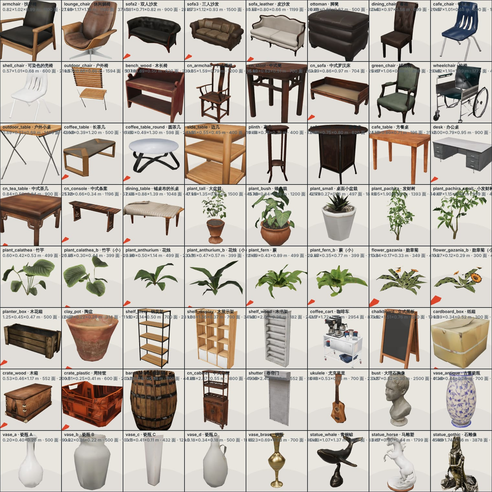
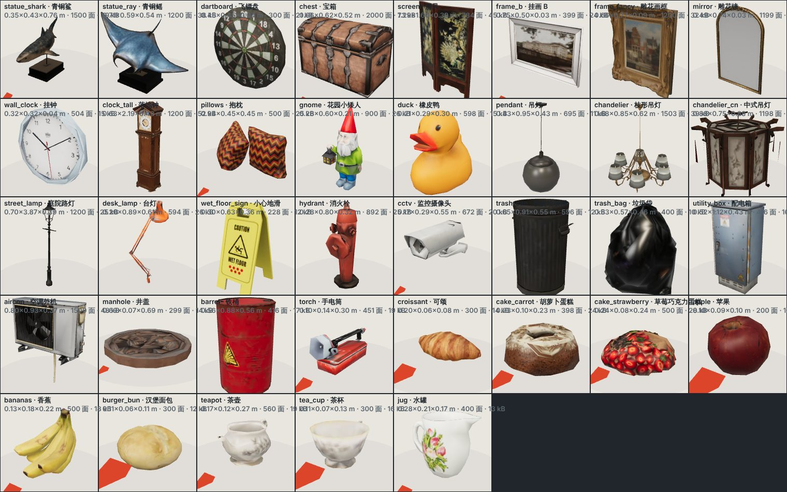

## 摆在哪

| 地方 | 换了什么 |
|---|---|
| 美食广场、餐厅、咖啡店、天台和街边外摆 | 木方桌、折叠小桌；壳椅（按每个档口的颜色染色）、皮餐椅、折叠椅 |
| 所有花坛（商场内、天台、广场、社区） | 蕨、竹芋、花烛、发财树、勋章菊，代替原来的绿色圆球 |
| 商场各层的休息区 | 三人沙发、圆茶几、扶手椅、大盆栽、枝形吊灯 |
| 商场各层的口袋休息区（90 处） | 皮脚凳、大盆栽，加一组陈设。共 18 组，每层轮着取：带台座的胸像和青铜雕塑、瓷瓶、屏风和圈椅、落地钟、货架和橡木桶、展墙上的画和镜子、宝箱……美食层的口袋挨着用餐区，只有脚凳和盆栽 |
| 家居店（31 家） | 四种样板间：现代、中式、古典、餐厅。每家按铺位号取一种；太窄的店摆不下，不摆 |
| 咖啡店、茶饮店、面包店 | 台面上的蛋糕、可颂、茶壶；门口的立式黑板；货架上的面包 |
| 1F 圆厅 | 咖啡车、黑板、「小心地滑」立牌、服务台旁的轮椅 |
| 商场走道天花 | 吊牌旁的监控摄像头 |
| 酒店、公寓大堂 | 沙发、扶手椅、餐椅、茶几 |
| 天台 | 花园里的庭院路灯，设备区的一排空调外机 |
| 路边 | 隔几根灯杆一个垃圾桶、消火栓或配电箱；斑马线旁的井盖 |
| 全园的树 | 树冠换成叶片簇（带树叶贴图），树干贴树皮，针叶树换成四层针叶裙边 |
| 二期、三期的体块（小游戏地图） | 贴幕墙贴图，夜里随机亮窗 |

这一节的图都是第二轮改完以后重新拍的。

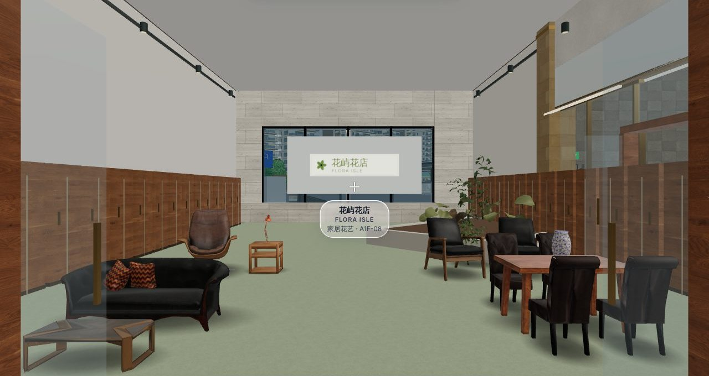
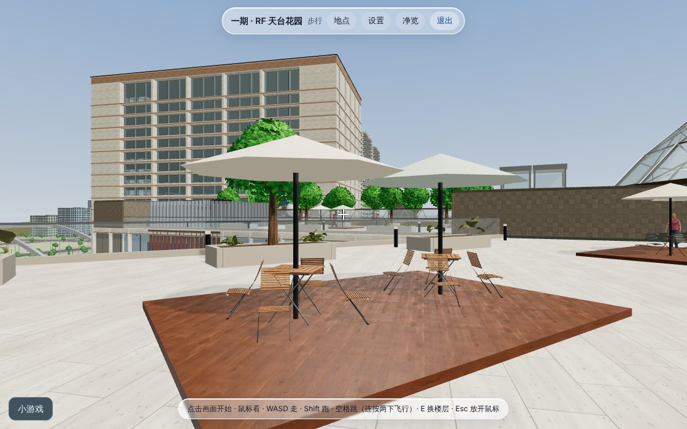
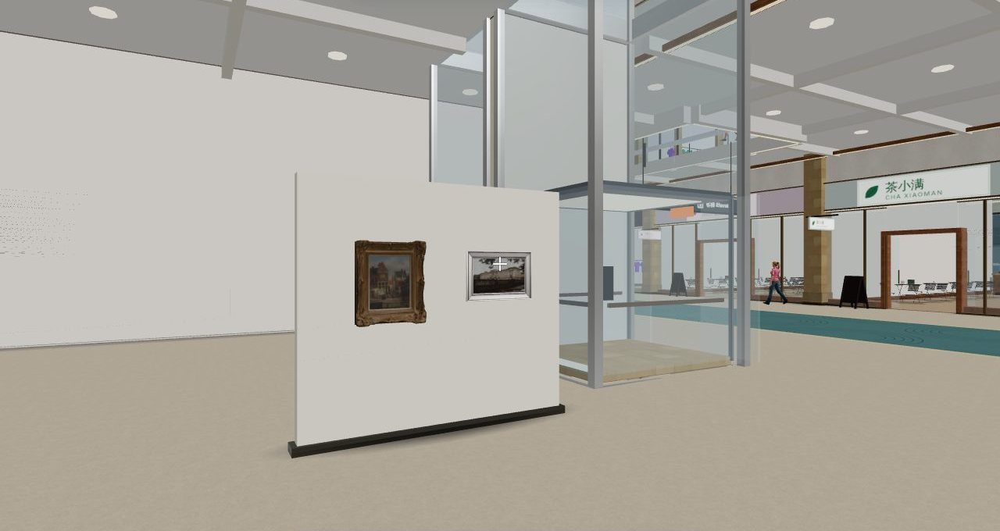
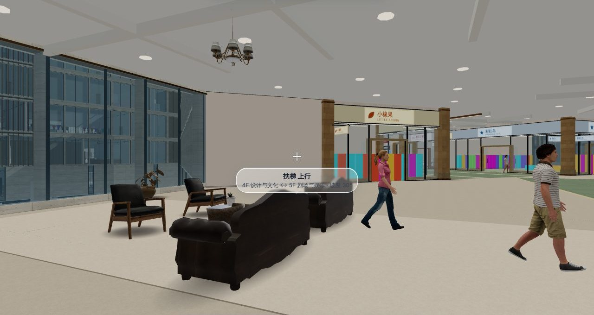
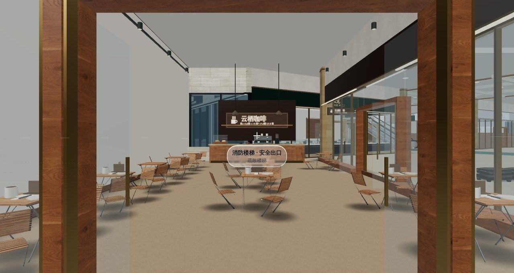

### 小游戏里

- **夜间潜入**
  - 保安换成贴图人物：在行人的贴图上把上衣、长裤、鞋涂成制服，加帽子和一束手电光，走路有步态。
  - 闭店的店铺门面拉下卷帘门。
  - 门禁卡放在边几上；展品是玻璃罩里的大理石胸像，拿走后消失。
- **无人机送外卖**
  - 无人机重做：白色机壳带涂装、碳纤维机臂、电机、桨盘残影、起落架、云台相机，机腹下挂印着「云澜外卖」的保温箱。
  - 停机坪有了实体甲板，取餐点写「取」，投递点写「送」。
  - 取餐点旁有一摞周转筐和纸箱。

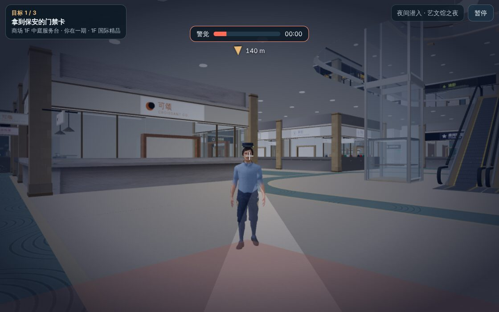
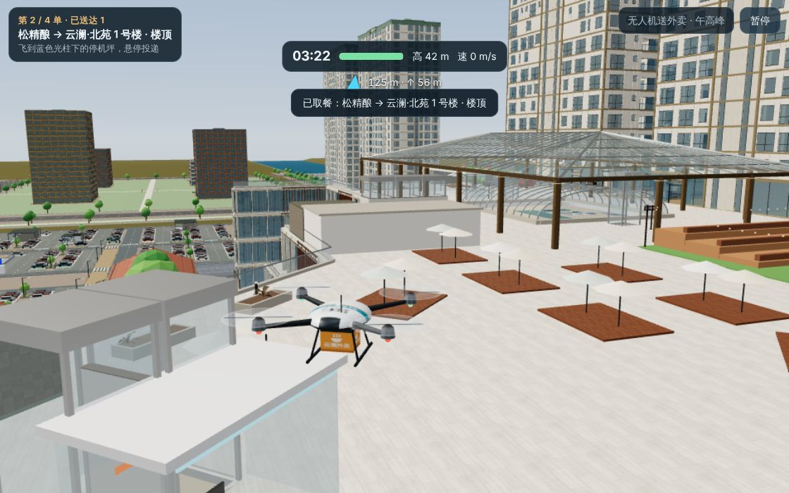

## 第二轮：摆放核对

### 起因：椅子背对着桌子

第一轮的截图里，天台和店里的户外椅全都背对着桌子。这是我的错，而且我自己看截图时没有看出来。

- **原因**：摆放的代码约定「模型的正面朝 +Z」。户外椅是从一组桌椅里单独切出来的，在原始素材里它面朝桌子，正面其实朝 −Z。全园 5,600 多把户外椅因此全部转反。轮椅也是反的。
- **为什么测试没拦住**：原来的测试只检查「代码以为的正面」有没有对着桌子，没有检查模型本身的正面在哪。
- **改法**：在加工清单里把这两个模型转 180°，从源头改掉，摆放的代码不用动。

### 怎么查的

用户要求把其他模型也查一遍。靠眼睛看一万多件看不过来，所以写了三个核对工具，按规则逐件检查：

| 工具 | 查什么 | 怎么查 |
|---|---|---|
| `scripts/props/audit-placements.mjs` | 场景里每一件模型 | 在真实页面里逐层把楼层建出来，取出每件模型的位置和朝向，对照楼板、洞口、墙、店门、扶梯口、电梯门和其他模型 |
| `scripts/props/audit-sets.mjs` | 52 组成套陈设（口袋休息区 18 组 × 两端，家居店 4 种风格 × 4 个位置） | 每组单独摆一遍；摆在桌面、条案上的东西，读模型量出台面的真实高度 |
| `scripts/props/audit-fronts.mjs` | 每把椅子、每张沙发的正面 | 读模型，看靠背是不是在座面后方 |

规则：

- **朝向**：椅子、沙发旁边有桌子就要朝着桌子；有靠背的家具不能背对着看的人。
- **通道**：店门内外、扶梯口、电梯门前、出入口要留空。
- **落地**：要在楼板上，不能悬在中庭和扶梯洞口上方。
- **不穿墙**：墙不能从模型中间穿过。
- **不穿插**：模型之间不能互相穿进去（椅子塞进桌下不算）。
- **高度**：不贴地的东西下面要有承托；挂墙的要贴着墙；吊顶的要挂在天花上。

### 查出来并改掉的

第一次全场核对：20,391 件模型，829 处问题。

改的过程中全场又查了两遍。最后一遍把全园 338 个楼层和室外场地都过了一遍，其中 51 个楼层和场地上有模型：18,752 件，99 种，没有查出问题。那一遍里有一层（P1W3-1F，2 件）没等到加载完成被跳过，单独补查了，也没有问题。件数比第一次少，是因为挡门的、悬空的、挤不下的不再摆了。

| 问题 | 数量 | 原因和改法 |
|---|---:|---|
| 户外椅背对桌子 | 5,600 多把 | 模型正面朝反。在加工清单里转 180° |
| 轮椅朝反 | 3 辆 | 同上 |
| 桌椅、盆栽挡在店门里外 | 577 处 | 摆的时候没有避开门洞。现在门洞内 1.6 m、门洞外 1.2 m 不摆东西 |
| 模型互相穿插 | 168 处 | 立式黑板摆进了椅子里（改到门外门洞旁）；扶手椅和发财树、沙发和盆栽、几组样板间的家具挤在一起（重排） |
| 被墙穿过 | 47 处 | 休息区的沙发比凹进去的位置还宽（按进深选沙发）；大堂的扶手椅伸进隔墙（按平面图上的矩形缩放）；天台的桌椅摆在格栅立柱上（不摆） |
| 悬在楼板外或洞口上 | 18 处 | 天台路灯、6F 的桌椅摆到了洞口或板边之外（不摆） |
| 沙发背对茶几 | 19 处 | 酒店、公寓大堂平面图里的朝向就是反的。改成朝向最近的茶几 |
| 四家 L 形店铺的陈设全挤在一条 1 m 宽的边条里 | 4 家店 | 一期 3F–6F 的 SQ-N2。铺位由两块矩形拼成，程序取错了主体。这个问题在加模型之前就有 |
| 侧放的椅子转反 | 查到三期 2F 的一家家居店 | 有些店的局部坐标是镜像的（看门面在哪一侧），角度直接相加会转反。改成按方向换算，四个朝向都有测试 |
| 窄店里几组样板间叠在一起 | 3 家店 | 原来不管店多宽都摆两列。现在按店宽决定摆一列还是两列，太窄的不摆 |
| 挂画、镜子、挂钟、飞镖盘离墙 8 cm 悬空 | 口袋休息区 3 组 | 位置算错。改成贴着展墙 |
| 东西陷进桌子里或悬在桌面上方 | 9 件 | 高度是估的，没有量。水壶和台灯陷进边几 10 cm；花瓶悬在条案上方 5–6 cm（条案两头翘起，中间的台面比最高点低）；水壶和蛋糕悬在餐桌上方 6 cm。改成按量出来的台面高度摆 |
| 样板间的家具伸出自己的格子 | 3 件 | 会和旁边一组撞上。挪回格子里 |
| 重复的井盖 | 1 处 | 两条挨着的斑马线各摆了一个，叠在一起 |
| 18 组口袋陈设里有 7 组一次也没摆出来 | 7 种模型全园一件都没有 | 原来按坐标取组，有 7 组轮不到；后来加了「挡门的一端不摆」，摆出陈设的口袋又少了一半多。改成每层轮着取，并且只有一端能摆时先摆陈设。现在 90 个口袋里 83 个有陈设，18 组都出现 3–7 次 |
| 天台设备区的空调外机一台也没摆出来 | 应有 15 台 | 循环的起点写在了围挡之外 |
| 展墙的背面是一块白板，对着中庭 | 3 组 | 陈设原来固定摆在靠中庭的一端、背对中庭。改成优先摆在另一端、面朝中庭；展墙的背面做成题头墙 |

小游戏里另外查出三处（核对工具只跑完整园区，这三处是对着模型数据逐个核对出来的）：

- **「夜间潜入」的卷帘门只拉到半腰。** 卷帘门模型的原点在门的正中，我把它放在了地面标高，下半截埋在地里。第一轮的截图里就是这样，我没有看出来。
- **「夜间潜入」的门禁卡和手电陷在边几里面**，从外面看不见。边几的台面比我以为的高 10 cm。
- **「无人机送外卖」取餐点最上面那只纸箱有一半悬空。**

### 现在怎么防

- **加工时检查正面**：`build-props.mjs` 加工每把椅子、每张沙发时量靠背的位置，靠背在座面前方就报错、不出成品。量出的数值记在 `manifest.json` 里，测试会核对。
- **摆放时的保险**（`src/layout/access-zones.js`，`BatchSet.prop()`）：落地的模型如果挡了门、脚下没有楼板、或者有墙从中间穿过，就不摆。全园这样拦下 23 件（挡通道 15，脚下没有楼板 7，被墙穿过 1）。大多数不合适的位置在这之前就被整组跳过了：摆桌椅和成套陈设的代码先看这一组要占的那块地方，挡了门、贴了墙或出了楼板，就整组不摆，免得留下没有桌子的椅子、空着的台座。
- **测试**（`tests/props-placement.test.js`，11 项）：每把椅子的正面；四个朝向的店面里朝向都对；留空区域、楼板、墙的判断；52 组陈设逐组检查；把挂画挪离墙、把椅子转过去，规则要能查出来；小游戏里卷帘门的高度、门禁卡的高度、纸箱叠得稳不稳。
- **正面总览图**：`contact-sheet.mjs` 加了 `front` 模式，从正前方看每个模型。

保险只管落地的模型。摆在柜台、货架上的小东西（面包、蛋糕、茶具），高度是和柜台的几何一起写死的，没有自动检查。

## 第二轮：立体感

用户觉得商场里的细节不够立体。原来的问题主要在三处：家具和柱子像浮在地上，墙和地面的交接是一条硬线，天花是一整块平板加一排排发光的圆片。

| 加了什么 | 在哪 | 做法 |
|---|---|---|
| 脚下的软阴影 | 所有落地的模型、柱脚、长椅、花池、服务台、快闪亭、台座 | 一张贴在地上的渐变图，不是实时阴影 |
| 墙根的渐暗带 | 店面玻璃脚下、隔墙两侧、中庭和回廊栏板脚下 | 同上，一条沿墙的渐变 |
| 天花分格 | 商场各层的主街、回廊、通道、休息区、电梯厅 | 每条走道沿自己的方向分成约 4 m × 4.5 m 的格子，格与格之间一道 0.3 m 高的梁，每格正中一盏灯 |
| 洞口边梁和灯带 | 中庭、街谷、扶梯口四周，楼板的下沿 | 楼板在洞口边往下翻 0.5 m，底下一条暖色灯带 |

梁只画在头顶真有楼板的地方：1F 主街中间是挑空的街谷，梁停在两侧回廊的边梁上，不会伸到空中。

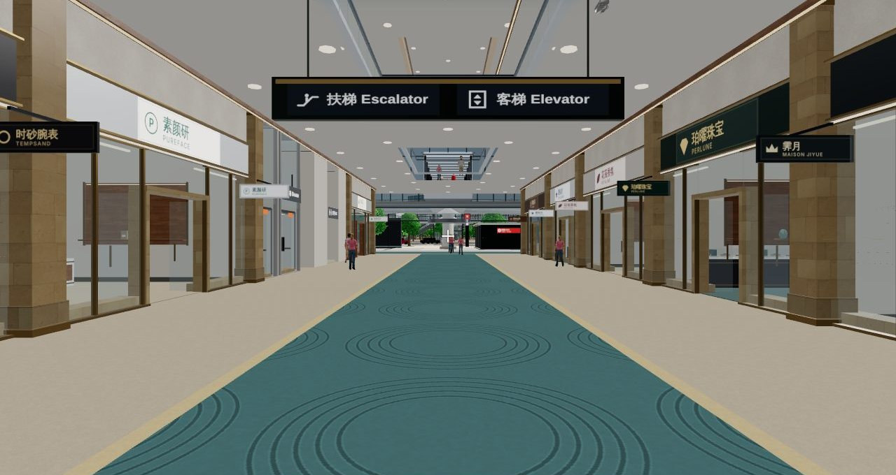
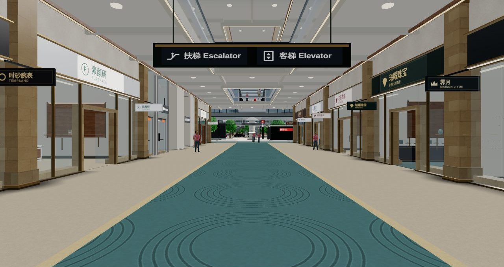
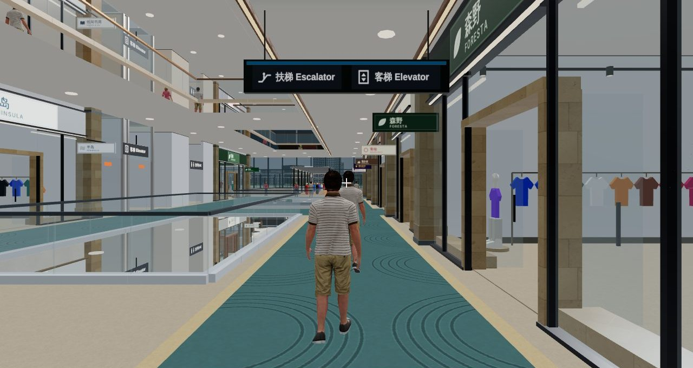
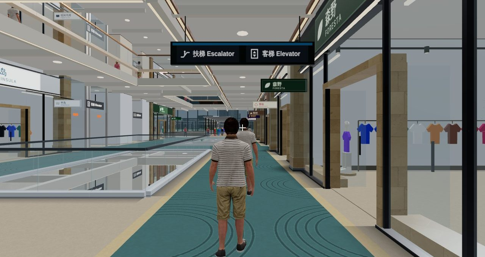
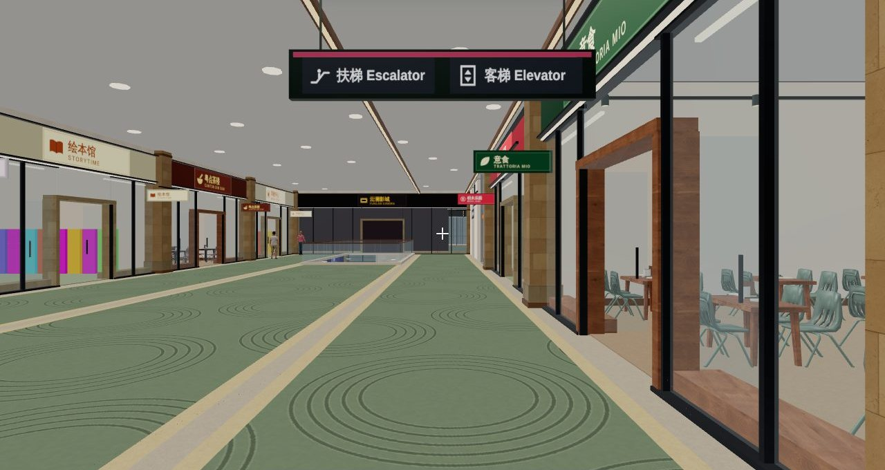
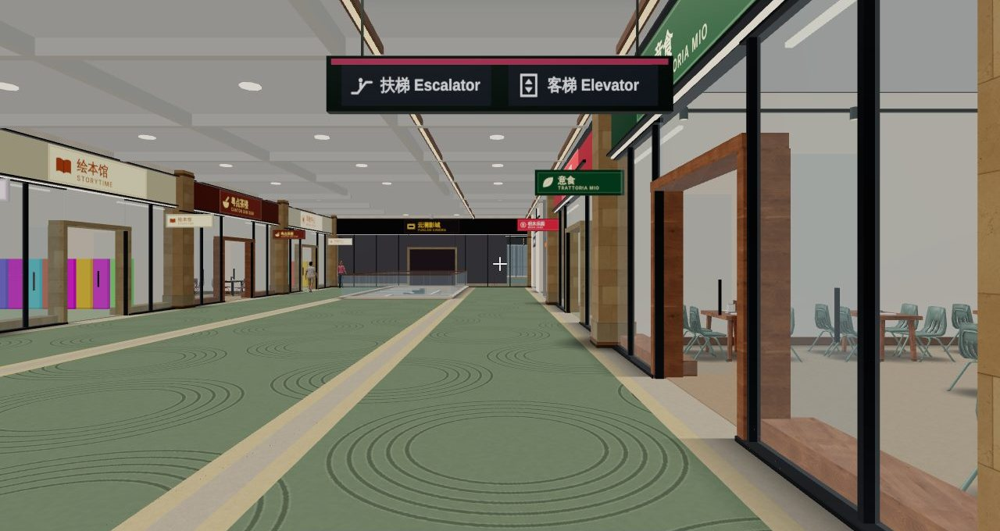
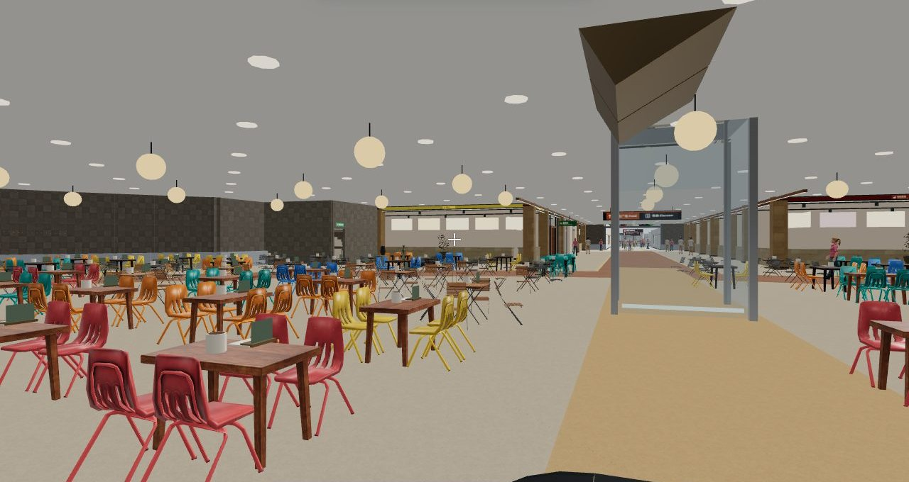
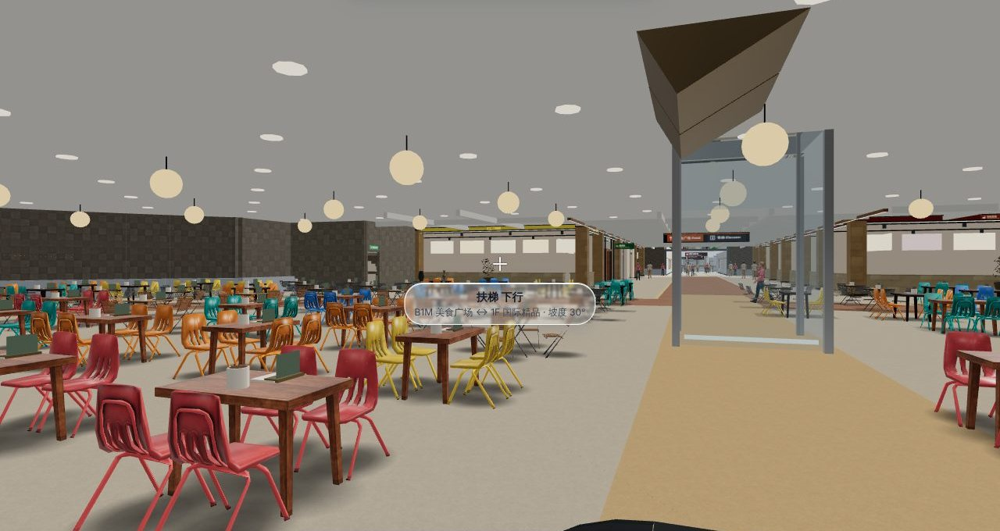

开销（开发页，无头 Chromium，软件渲染，精细档，和第一轮同样的几个位置各量一次）：

| 位置 | 绘制调用（第一轮 → 现在） | 三角形（第一轮 → 现在） |
|---|---:|---:|
| 俯瞰全园 | 1,928 → 1,947 | 2.403 M → 2.409 M |
| B1M 美食广场 | 1,205 → 1,227 | 6.283 M → 6.306 M |
| 1F 圆厅 | 1,092 → 1,104 | 5.563 M → 5.587 M |
| 3F | 1,416 → 1,474 | 5.540 M → 5.556 M |
| 天台 | 1,067 → 1,096 | 4.826 M → 4.825 M |

绘制调用多 1%–4%，三角形多不到 0.5%。两次站的位置不完全一样，数字只能看个大概。

这些只在「完整园区探索」和「小游戏合集」里有。竞技 FPS 的画面没有变。

## 怎么不拖慢手机

开场时摆了约 4,900 件，逛过几层后有一万两千多件（离开的楼层会释放）。靠下面几条控制开销：

- **实例化**：同一种模型在一块区域里只占一次绘制调用。
- **分块**：按 12 m 的格子分块，镜头外的块不画。
- **两级精度**：块离相机近（流畅档 5 m、均衡档 7 m、精细档 9 m 以内）画精细版，远一些画面数约三成的远景版。
- **远了不画**：小东西 22–38 m 外就收起来，大件最远 140–260 m。俯瞰全园时一件都不画。
- **按需解析**：模型第一次被用到才解包、解码贴图。
- **手机上贴图边长减半**，上传显卡后释放内存里的那份。
- **跟着楼层细节走**：商场内的模型属于各层的室内细节，离开那一层就一起释放。

下面这张表是第一轮量的。第二轮加的假阴影和天花梁的开销见上面[第二轮：立体感](#第二轮立体感)。

实测（开发页，无头 Chromium，软件渲染，1120 × 700）：

| 位置 | 整个画面的三角形 | 其中贴图模型（精细档 / 流畅档） | 多出的绘制调用（精细档 / 流畅档） |
|---|---:|---:|---:|
| 俯瞰全园 | 2.40 M | 0 / 0 | 0 / 0 |
| B1M 美食广场 | 6.28 M | 240 k / 129 k | 86 / 48 |
| 1F 圆厅 | 5.56 M | 309 k / 160 k | 131 / 63 |
| 3F | 5.54 M | 102 k / 22 k | 131 / 59 |
| 天台 | 4.83 M | 208 k / 118 k | 68 / 41 |

贴图模型占画面三角形的 2%–6%。

## 结构

```
scripts/props/
  catalog.mjs           清单：园区里的名字 ← Poly Haven 的哪个模型，加工参数
  polyhaven.mjs         下载和校验
  build-props.mjs       加工：合并成一个网格一张贴图、烘环境光遮蔽、减面、压缩，出精细版和远景版；检查坐具的正面
  inspect-props.mjs     看一个 Poly Haven 模型的节点、材质、尺寸（定清单时用）
  contact-sheet.mjs     渲染总览图（检查外观；front 模式从正前方看，检查朝向）
  pack.mjs              发布构建时把所有模型打成一个文件
  audit-fronts.mjs      核对：每把椅子、每张沙发的正面
  audit-placements.mjs  核对：场景里每一件模型的位置和朝向（要开发服务和浏览器）
  audit-sets.mjs        核对：成套陈设，量台面高度
  set-rules.mjs         成套陈设的检查规则（测试和 audit-sets.mjs 共用）
assets/models/props/    加工好的模型和 manifest.json（出处、靠背位置）
src/layout/
  access-zones.js       要留空的区域、楼板、墙：摆放时的保险和核对工具共用
src/render/props/
  prop-data.js          运行时目录（由 build-props.mjs 生成），含每个模型是落地、吊顶还是挂墙
  library.js            模型库：按需解析、实例化、分块、两级精度
src/render/batch.js     BatchSet.prop()：各个搭建函数摆模型的入口；blob() / edge()：贴地假阴影
src/render/build/
  props.js              桌椅、花坛、树、路灯等公用小品（有模型库时摆模型，没有时画原来的几何）
  prop-sets.js          口袋休息区的 18 组陈设、家居店的四种样板间
  ceiling.js            商场走道的天花分格梁、洞口边梁
  tree-kit.js           贴图树
src/arcade/
  guard-model.js        保安
  drone-model.js        无人机和停机坪
```

### 加一个模型

1. 在 Poly Haven 找到模型，记下它的 id。跑 `node scripts/props/inspect-props.mjs <缓存目录> <id>` 看节点、材质和尺寸。
2. 在 `scripts/props/catalog.mjs` 加一行：名字、`src`、目标面数。一个资产里摆了好几件的用 `nodes` 挑一件。
3. 装加工工具（不进 `package.json`）：

   ```bash
   npm i --no-save @gltf-transform/core@4 @gltf-transform/extensions@4 @gltf-transform/functions@4 meshoptimizer sharp
   ```

4. 加工并看总览图：

   ```bash
   node scripts/props/build-props.mjs <缓存目录> <名字>
   ```

   ```bash
   node scripts/props/contact-sheet.mjs <输出目录>
   ```

5. 在搭建函数里摆放：`B.prop('名字', x, y, z, 朝向, 缩放)`。它在没有模型库时返回 `false`，这时画原来的几何。模型的正面朝 +Z。
6. 摆完跑一遍核对（先起开发服务 `python3 serve.py 5174`）：

   ```bash
   node scripts/props/audit-sets.mjs
   ```

   ```bash
   NODE_PATH=<Playwright 所在的 node_modules> node scripts/props/audit-placements.mjs
   ```

   第二条在无头浏览器里把各层的室内细节逐层建出来，软件渲染下要跑 20–40 分钟。只查几层可以在后面加楼层号，逗号分隔（室外场地写 `site`）。

摆在别的模型上的东西，高度按 `audit-sets.mjs` 量出来的台面高度写，不要按包围盒估。

## 验证

第一轮：

- 无头 Chromium 里看过：美食广场、圆厅、口袋休息区、家居店、咖啡店、面包店、天台、俯瞰。
- 两个小游戏在开发页和打包后的在线包里各跑了一局，「无人机送外卖」另在手机横屏尺寸（844 × 390）跑了一局。没有页面报错。
- 打包后的在线包里，完整园区探索和竞技 FPS 各加载了一次，正常。FPS 仍是 3 栋楼 18 层，不加载模型库。

第二轮：

- 全套 653 项测试通过。其中 `tests/props-library.test.js` 11 项（素材和清单、预算、打包、摆放接口、分块、细节范围、树冠、制服），`tests/props-placement.test.js` 11 项（见上面「现在怎么防」）。
- `audit-placements.mjs` 在开发页上把全场查了三遍，最后一遍没有问题，结果见上面。
- `audit-sets.mjs` 查 52 组陈设，没有问题。
- 立体感的前后对比图是同一位置、同一朝向拍的：「原来」用上一个提交的在线包，「现在」用开发页。
- 「夜间潜入」在开发页开了一局，卷帘门拉到了门楣，门禁卡和手电在边几的台面上，没有页面报错。

  
  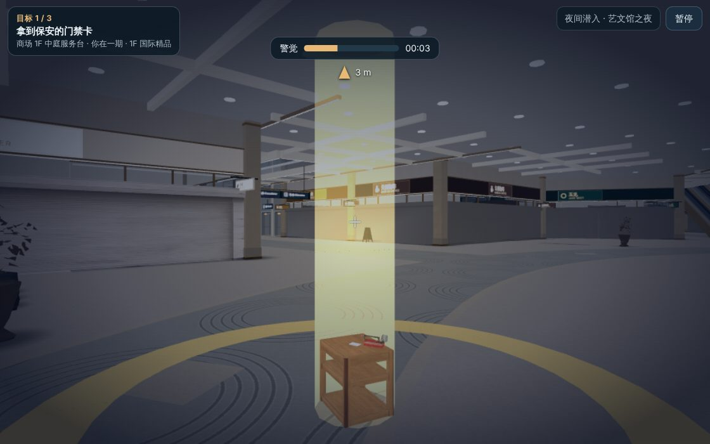

- 最后打包的在线包里，三种模式各加载了一次，都没有页面报错：竞技 FPS 10.8 秒，仍是 3 栋楼 18 层，不加载模型库，没有假阴影和天花梁；完整园区探索 16.6 秒，23 栋楼 338 层；小游戏合集 14.2 秒，21 栋楼 326 层。「夜间潜入」在在线包里开了一局，10 秒进入游戏，没有报错。

## 还没做到的

- **没有在真手机上跑过。** 帧率和内存只有上面的无头浏览器数字。
- **摆放核对有管不到的地方。**
  - 只跑完整园区，不跑小游戏。小游戏里临时摆的东西（卷帘门、门禁卡、纸箱）靠一项单元测试守着。
  - 摆在柜台、货架上的小东西（面包、蛋糕、茶具）不检查高度，只目视看过。
  - 贴图模型和程序画的东西（柜台、货架、扶梯）之间穿不穿插，不检查。
  - 「合不合常理」只能查写得出规则的那部分。摆得难看、风格不搭，规则查不出来。
- **假阴影是贴图，不跟着灯光变。** 白天夜里一个样；人走过去，脚下没有阴影。
- **天花分格只在有局部矩形的走道上有。** 圆厅、B1M 圆厅用餐区这些不规则的区域还是平板加灯。店铺里面的天花没有动。
- **「夜间潜入」的开局在无头浏览器里时快时慢**（第一轮在线包五次：8、26、21、9、29 秒；加模型之前约 7 秒）。大概是软件渲染造成的，真机上要再量。
- **模型没有碰撞**，人可以穿过去。原来的桌椅沙发也是这样。
- **家具偏复古。** Poly Haven 的现代家具不多，沙发、柜子、灯多是老式的。
- **还是老样子的东西**：汽车、公交、云环天桥上的行人（胶囊）、长椅、遮阳伞、楼的外立面。
- **树叶是画的，不是照片。** 凑近看是一片片的叶片卡。
- **保安的制服是涂在贴图上的**，袖口和裤脚的边缘有锯齿；帽子不跟着头的起伏动。
- **花坛比原来素。** 原来有彩色花球，现在是绿植加少量小花。
- **有几个模型减面后近看很粗。** 周转筐镂空的侧面糊成了条纹，橡木桶的桶板有缺口。第一轮加工时就这样，这次没有动。
- **远景版近看会变形。** 它只在几米之外才用。
- **贴图是 WebP 格式**，需要 2020 年以后的浏览器（iOS 14 起）。
- **没有部署。** 两个 Netlify 站点都没有更新。

## 2026-11-11 补充：社区住宅里也用上了模型

云澜·西苑、北苑的户内原来全是程序化的方块家具。这一轮把其中三样换成了模型，占地（碰撞）没有变：

- 客厅的沙发：长 2.2 米以上的用三人沙发（`sofa3`），短的用双人沙发（`sofa2`），拉伸到原来那张沙发的长和深，正面朝电视墙；颜色在模型本色上带一点各户的色调。
- L 形沙发转角的那一段换成脚凳（`ottoman`）。
- 阳台另一头的盆栽（`plant_tall` / `plant_pachira_small`）。

模型包没下载下来、或者在单元测试里，照旧画方块。这些摆放不在 `audit-placements.mjs` 的检查范围内（它查的是商场各层和场地）；朝向是在三套户型里看图核对的。其余的光影和材质改动见 [HDR 光影说明](hdr.md)。
