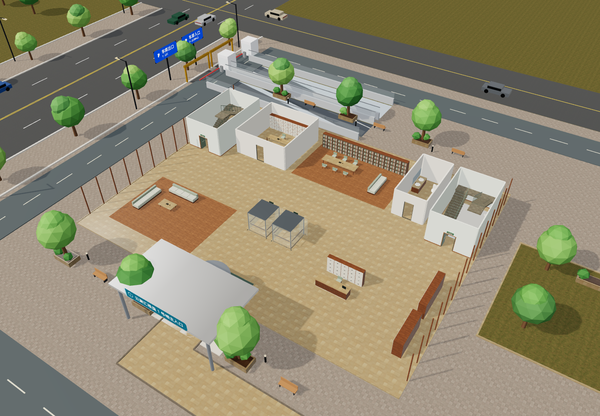
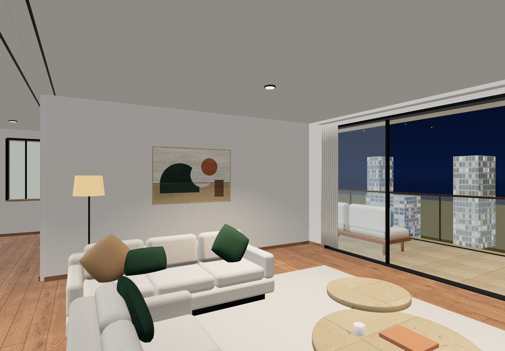

# 住宅 01 / 02 / 03 园区接入验收

日期：2026-10-09（America/New_York）。对象为当前完整园区 `dist/mall.html`，包括四栋住宅、原商场、酒店、公寓与地下连接。独立样板查看器的旧验收不替代本次检查。

## 结果

- `npm test`：**102/102 通过，0 失败**；最终运行约 4.34 秒。
- `npm run build`：成功；完整离线页约 **57.2 MiB**，Three.js、模型和贴图内嵌。
- 桌面 Chrome 1440×1000 与 iPhone UA 的 Chromium 模拟：设置离线后以 `file://` 打开最终 HTML，**页面异常 0，HTTP/HTTPS 请求 0**。手机不是实体 iPhone / Safari 测试。
- 原 `prototypes/residential01/02/03/`、用户套房 GLB 与 Blender 源成品未修改。本轮没有重新导出整个园区 GLB。

浏览器原始数值与路径记录见 [`qa/residential-integration-browser.json`](qa/residential-integration-browser.json)，自动测试输出见 [`qa/residential-integration-tests.txt`](qa/residential-integration-tests.txt)。

## 空间与通行

| 检查 | 证据与结果 |
|---|---|
| 三套模型嵌入 | 四塔共 116 个住宅层、348 户；01/02 三房，03 四房，原尺寸 1:1。首层无住宅 |
| 实际室内碰撞 | 三套实测模型的 46 条路线双向小步行走，含每个卧室、厨房、卫浴、阳台及 7 个真实淋浴入口 |
| 公共交通核 | 4 塔的 2F/30F，共 96 条入户门至双电梯/双楼梯路线通过；每层井洞、平台、采光井、楼板不重叠检查通过 |
| 独立首层 | 四栋 1F 的入口、礼宾、等候、信报快递、物业、阅读、卫生间七区从入口可达；23 件家具障碍参与碰撞 |
| 地下连接 | 四栋 B1 六米车道绕双电梯，内部至地下干道双向通过；原住宅→二期→地铁→一期→酒店公寓连接测试保留 |
| 酒店、公寓回归 | 全体 748 单元入户及内门回归、400 套 H/A 与首层复式检查通过 |

## 整页浏览器操作

1. 分别使用园区目录定位逻辑到 R1-2F 的 01、02、03 户门外，再用键盘前进。三户都越过实际门洞到室内；灯池分别识别 `R1-2F-U1/U2/U3`。入户门不再使用整段门面中点，正确处理 01/02 不同的偏置入口。酒店 H-2F 与公寓 A-1F 的门口同步通过键盘进入回归。
2. 在 R1-2F 有效候梯点启动 `R1-L1`，实际进入轿厢、关门、连续上升、开门，到 R1-30F 并键盘走出。采样标高从 **4.8m** 经过 7.58、15.86、28.15、42.89、58.57、73.65、86.59、95.86、99.93m 到 **100m**。终点状态 `riding:null`，落地和视线标高正常。
3. 楼梯门口按 E 打开真实选层面板，再按数字选择：R1-ST1 从 2F 到 3F；R4-ST2 从 30F 到 RF，标高 103.4m。楼梯仍是**互动换层**，未声明逐级连续跨层。
4. 核对 R1 的标准层、大堂、屋顶、地库与 R4-30F，及高层三户室内、03 阳台、03 夜景。未见户型重复外壳叠窗或屋顶机房挡住出梯口。大堂吊顶已分组：俯视 `visible:false`，1F 室内 `true`。
5. 乘梯期间动态访问多层后缓存为 `R1-28F/29F/30F`，最多三层；创建 30 个住宅详情层、淘汰 27 个，共享几何/材质/贴图销毁次数均为 0。
6. 手机模拟执行 `R1-2F → R1-3F → R2-2F → R4-30F → R1-2F`，最终缓存 `R2-2F/R4-30F/R1-2F`。重新访问已淘汰楼层后模型正常；创建 5、淘汰 2、活跃 3，共享资源销毁次数均为 0。

7. 手机模拟调整到 390×844 后，通过 DOM pointer 事件驱动真实摇杆处理器，从 01 门外向前约 3.00m 到室内；页面宽度与视口均为 390，无横向溢出。截图保留触屏 HUD。

## 灯光与资源

三套共有 **169 个共享几何、116 个材质对象、17 个纹理/图像源**。原 GLB 总 77,308,884 字节，gzip 后 28,884,578 字节。合批属性与索引 71,668,220 字节；手机完成本次可见模型和天花上传后，统计的 CPU 几何数组为 0，此值不是浏览器总内存或 GPU 占用。

住宅灯池桌面 12 盏、手机 8 盏。01/02/03 室内分别跟随当前户；标准层分配至三户；住宅与酒店灯池互斥。总览两组均隐藏，只保留环境灯。手机住宅贴图最大边长为 512。低帧率时仍保留原有降低像素比、关闭阴影/泛光的策略，没有作实体手机帧率承诺。

## 实际画面

以下均来自本次完整园区的 WebGL 渲染或浏览器截图，不是独立样板效果图。纯场景图直接从实际画布导出；带操作栏的图为整页截图。早期后台窗口导致动画和合成器截图节流，切到前台或独立无头会话后完成操作与截图，不以早期超时作为通过依据。

其他画面：[01 客厅](images/residential-integration-01-living.png)、[02 客厅](images/residential-integration-02-living.png)、[03 客厅](images/residential-integration-03-living.png)、[03 大阳台](images/residential-integration-03-balcony.png)、[大堂室内](images/residential-integration-lobby-inside.png)、[屋顶](images/residential-integration-roof.png)、[楼栋](images/residential-integration-towers.png)、[B1](images/residential-integration-parking.png)、[乘梯抵达30F](images/residential-integration-lift-30f.png)、[楼梯到RF](images/residential-integration-stair-rf.png)、[桌面离线页](images/residential-integration-offline-desktop.png)、[手机离线页](images/residential-integration-offline-mobile-ui.png)。

## 交付范围

GitHub 包含接入源码、运行时布局数据、测试、离线页、README、HANDOFF、验收记录与以上实景图。原模型仍在 `prototypes/`，相关免费材质许可与用户模型来源保持原记录。各标准层复用三套不同户型；未为每个楼层重新设计独立户型。源码上传不等于在线网站部署。

交付包校验见 [`qa/residential-integration-package.json`](qa/residential-integration-package.json)：ZIP 11 个文件，CRC 与清单 SHA256 全部通过；包内 HTML 与仓库 `dist/mall.html` 字节一致。
