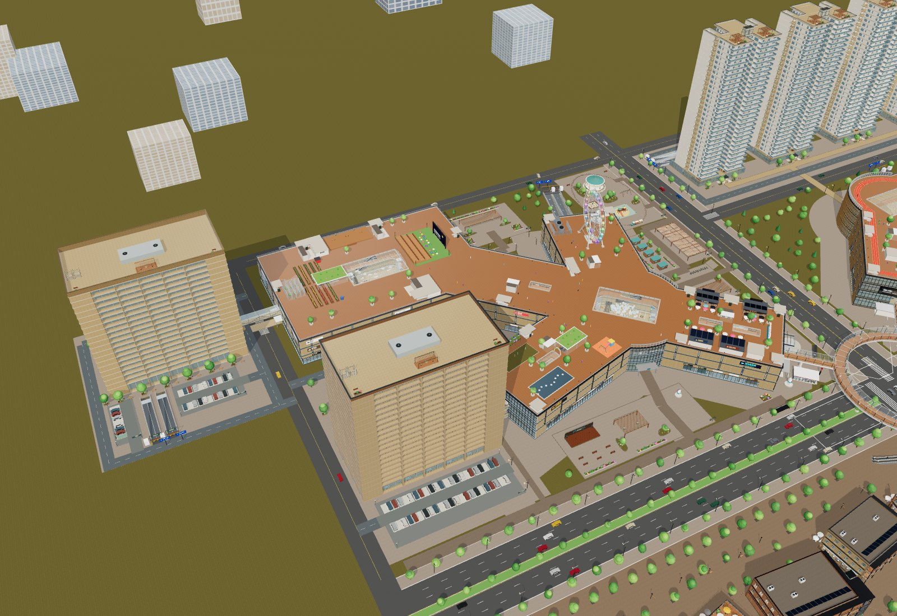
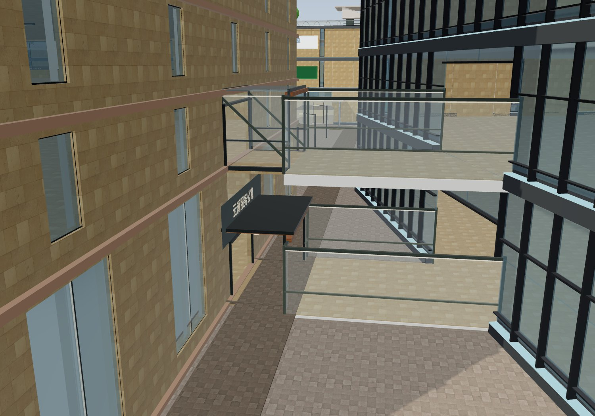
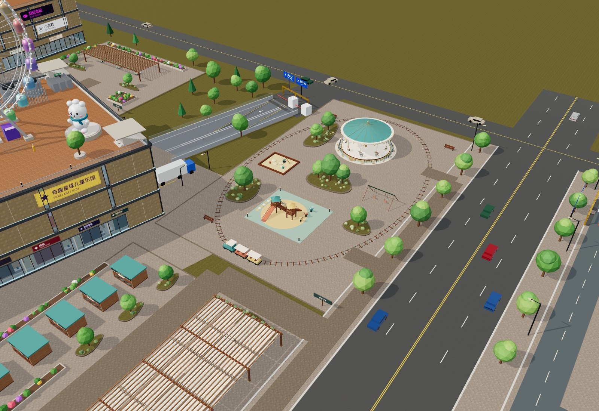

# 公寓按红框迁入一期内院 · 验收

日期：2026-10-13（America/New_York）。用户纠正上一版公寓地块位置，本轮以其红框为位置依据，不再采用北翼东侧方案。

## 结果与空间

A公寓中心 `(-247,-81.1533717)`、旋转0°，外包络 x[-284,-210]、z[-100.1533717,-62.1533717]，位于一期原乐园与食集所在的内院。东门朝向一期西翼，约11.27m连接由短廊和梯形接驳厅构成；首层整个连接范围不跨道路。H酒店保持原位。

- 原74×38m塔楼、20层200套和10套首层复式保留，用户套房和住宅模型未改。
- 四层连接：A1F→P1-1F、A2F→P1-2F、A-B1→P1-B1M、A-B2→P1-B1；标高0、6.5、−4.5、−8.4m。
- A北侧两条地面坡道，B1/B2双坡在楼内；南侧46车位，落客/停车道路接西外环，避免穿越东侧商场连接。
- 乐园所有游具1:1移到A旧址；食集位于其南侧，保留5摊位、4桌、花岛，遮阴棚改15×34m。五片活动区、61主设施、10条主路线。
- 旧北翼桥头和接廊已撤回，恢复原北翼市场及铺位切分。当前452商铺、748居住单元、195目录楼层；共享地面停车77位。数据见[布局统计](qa/apartment-courtyard-layout.json)。

## 验证

`npm test`：**122/122通过，0失败、0跳过**，约5.70秒。包括全748户入户/室内通行、400套尺寸与复式回归，新增公寓位于标注地块、首层连接全宽不跨道路、五个真实入口出入、东门→食集→乐园串联；见[测试日志](qa/apartment-courtyard-tests.txt)。

最终离线页中通过DOM指针转向、键盘输入与真实漫游更新器固定时间步进行实走：四条公寓↔商场连接各双向，共8条；A的四条坡道各双向，共8条。只在路线起点测试定位，中途没有传送；逐段记录真实楼面与标高。全部通过，见[浏览器通行记录](qa/apartment-courtyard-navigation.json)。

入口铺装自动按所有塔楼真实轮廓相减；路灯避让楼体、设施、车位和坡口。两端接驳入口设置coveredConnection，跳过会插进对楼的通用大雨棚与旋转门。实际同机位总览、短连廊近景及原址乐园已重拍检查。

## 最终实际画面

## 交付范围

源码、构建后离线HTML、README、HANDOFF、以上画面与QA随GitHub更新；新离线包与上一版区分，保留旧包。原Blender/GLB资产未改，没有重新导出整个园区GLB，没有部署网站。乐园仍为展示设施，手机检查是Chromium触屏模拟，不是实体iPhone验证。

最终HTML：60049653字节；SHA256：`1fb381eca6a18865d806c500d97a40d48d83d8ec718b48ae4144f675c0330f83`。

## 离线与资源回归

最终HTML以file://打开并设置断网。桌面Chrome1440×1000与iPhone13触屏模拟390×844均为页面异常0、HTTP请求0，无横向溢出。桌面键盘入户1.68m，手机摇杆入户1.05m；访问H/A/R六个层次并返回已淘汰的A1F后，缓存保持≤3层，共享几何/材质/纹理误释放均为0。

[桌面原始记录](qa/apartment-courtyard-offline-desktop.json) · [手机原始记录](qa/apartment-courtyard-offline-mobile.json) · [桌面截图](images/apartment-courtyard-offline-desktop.png) · [手机截图](images/apartment-courtyard-offline-mobile.png)

## 交付包校验

新交付为`/Users/calvin/Downloads/相册去图标/云澜汇_公寓位置修正版_2026-10-13/`及同名ZIP，旧包保留。21个文件；ZIP CRC和清单SHA256均通过，包内HTML与本轮dist逐字节相同；本轮README/HANDOFF/QA的本地链接检查无缺失。详情见[包校验](qa/apartment-courtyard-package.json)。
