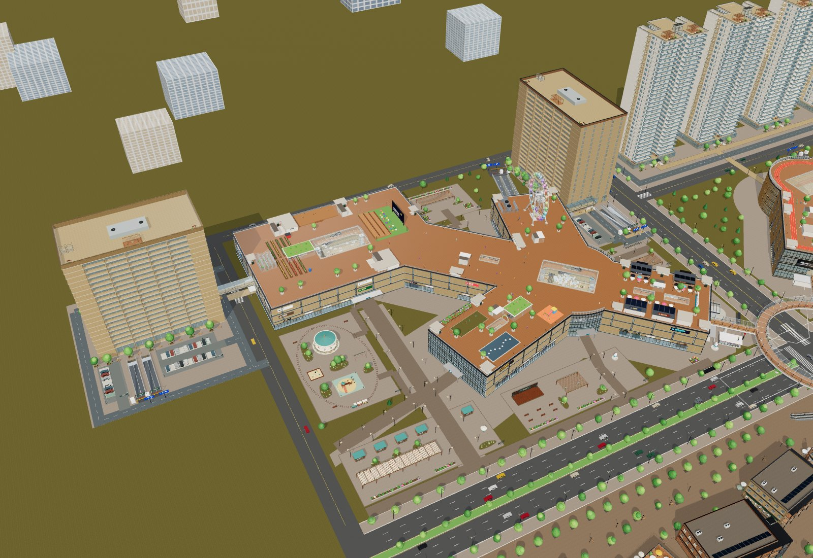
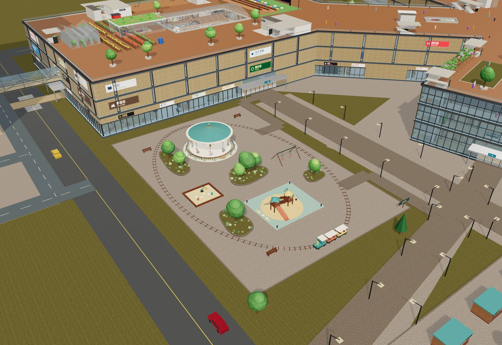
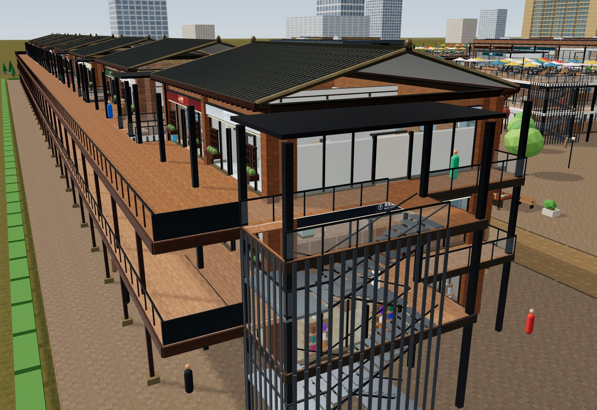

# 商场配套、首层活动区与三期旧巷验收

日期：2026-10-13（America/New_York）。基于原园区继续深化；对象为本轮构建的完整 `dist/mall.html`。

## 内容与通行

| 区域 | 本轮变化 |
|---|---|
| 一期两侧 | 酒店 H 放在西侧方庭旁，公寓 A 放在北翼东侧并旋转90°；地面、2F与地下通道接入真实门洞。原400套、10套复式保留 |
| 首层空地 | 五片活动区、61件主设施：亲子游乐、花园食集、小剧场、阅读花园、共享庭院；14个曲线种植岛、45m食集遮阴棚、8条连续主路径 |
| 停车 | 新增41个共享地面车位；园区共24条坡道，其中14条接地面。H/A各有地面进出口与B1/B2双坡；P2/P3新增B2与双坡 |
| 三期 | 原11栋加后侧8栋旧巷，共19栋、116商铺；12个集市摊位、木构骑楼、瓦垄、窗棂、灯笼和外摆。2F/3F连续后廊201.5m |
| 三期上楼 | 44组双跑实体楼梯、88梯段与44半层平台；全部19栋接1F→2F→3F，3栋另接B2→B1→1F |
| 商场内饰 | 珠宝、腕表、瓶罐、潮玩、软包、餐具、报刊、导视、护墙与壁龛；沿现有店面、家具、服务台和候梯厅深化 |

布局汇总为 **456商铺、748居住单元、195目录楼层**，详见[布局统计](qa/campus-detail-layout.json)。地面车辆、主要乐园设施与三期摊位碰撞和渲染使用同源记录。

H/A B1（−4.5m）接P1-B1M；H/A B2（−8.4m）接P1-B1，再通过一期坡道接P1-B2（−12m）。P2 B1/B2是−4.2/−8.4m，P3是−4.5/−9m。同名楼层不代表相同标高。

## 自动化与实际输入

`npm test`：**119/119通过，0失败、0跳过**，最终运行约6.32秒。包括原748户与住宅/套房回归，新增五片活动区及八条双向路径、酒店公寓迁移、二期停车上下层、三期全部楼梯与平台。完整输出见[测试日志](qa/campus-detail-tests.txt)。

浏览器通过真实DOM指针转向及键盘事件驱动漫游更新器，用固定时间步完成三期后街1F↔2F、2F↔3F和一组B2↔B1，共6条双向实走路线；逐平台核对floor、标高、parentFloor显示与当前楼板可见。公寓A旋转后从真实门口向前走入1.68m。起点使用测试定位，路线中间没有传送。原始证据见[通行记录](qa/campus-detail-browser-navigation.json)。

## 画面修正

- 公寓接驳大厅围护挂在同层shell组，避免从公寓侧观看时被隐藏。
- 场地树阵避让所有地上楼体并留3m树冠净距，移除两棵穿入新公寓的旧树。
- 酒店落客环路东腿避开楼体，雨棚悬挑不在车道立柱；三期南坡口的绿篱断开。
- 三期后廊底板内退、檐板外挑，分离共面侧边；食街交叉铺装也消除共面。
- 乐园采用已有CC0铺装与石材，加入曲面种植边、树木花丛和长棚，增加场地层次。
- 乐园火车旁长椅移离轨道边缘，家具与碰撞同步移动。
- 小陈设减少不可见端盖和过密细分，保留物件数量；不以重复高面数小物件填充场景。

## 最终离线浏览器验证

`npm run build` 成功，最终HTML为 60,048,038 字节（约 57.27 MiB），SHA256：`bd2e5e8eb2a93db01cf17c2e0709391be2789deb98fae0b35d712c54ea6ac701`。

| 检查 | 桌面Chrome | iPhone 13触屏模拟（Chromium） |
|---|---|---|
| `file://` 且设置断网 | 通过 | 通过 |
| 页面异常 / HTTP请求 | 0 / 0 | 0 / 0 |
| 视口 / 文档宽度 | 1440×1000 / 1440 | 390×844 / 390 |
| 公寓旋转后的实际入户 | 键盘前进1.68m | 摇杆前进1.05m |
| H/A/R跨层切换 | 6次访问，缓存≤3层 | 6次访问，缓存≤3层 |
| 共享几何/材质/纹理误释放 | 均为0 | 均为0 |

两端依次访问 `H-2F → A-1F → R1-2F → R1-3F → R4-30F → A-1F`，末次重新创建已淘汰的公寓层，再从真实门口走进。手机保留512px纹理上限；不以本机模拟结果推断实体手机帧率。三期键盘路径已在此最终离线页重跑通过。

原始记录：[桌面离线](qa/campus-detail-offline-desktop.json)、[手机离线](qa/campus-detail-offline-mobile.json)。纯场景图由实际WebGL画布导出，操作栏截图由浏览器捕获；没有使用外部生成图替代实现。

## 最终画面

其他实际画面：[酒店连廊](images/campus-detail-hotel-link.jpg)、[公寓连廊](images/campus-detail-apartment-link.jpg)、[珠宝店](images/campus-detail-jewelry.jpg)、[美妆店](images/campus-detail-cosmetics.jpg)、[二期B2完整朝北俯视](images/campus-detail-p2-b2.jpg)、[桌面漫游](images/campus-detail-offline-desktop.png)、[手机摇杆漫游](images/campus-detail-offline-mobile.png)。

## 边界与原资产

原 `prototypes/` 与 `assets/models/` 无变更，三套住宅和用户套房仍按原尺寸接入。继续复用6套Poly Haven CC0材质、18张本地图片；用户模型及其贴图不属于CC0。没有本轮整园GLB导出。

乐园为展示场景，旋转木马有动画，小火车停在站内；没有制作可驾驶或可乘坐项目。三期新增楼梯连续可步行，原住宅消防梯仍采用门口互动换层。手机验证只代表浏览器模拟，未测实体iPhone。本轮上传GitHub源码和离线页，没有部署在线站点。

## 交付包校验

离线交付目录：`/Users/calvin/Downloads/相册去图标/云澜汇_商场配套深化版_2026-10-13/`，同名ZIP位于上一级。共26个文件；ZIP CRC、清单SHA256全部通过，包内HTML与仓库最终`dist/mall.html`逐字节一致。包内README/HANDOFF的未携带源码与历史链接指向GitHub，当前离线页和本轮图/记录仍使用本地相对链接。仓库及包内的本轮Markdown链接存在性检查通过。详细路径、大小与校验值见[打包记录](qa/campus-detail-package.json)。
