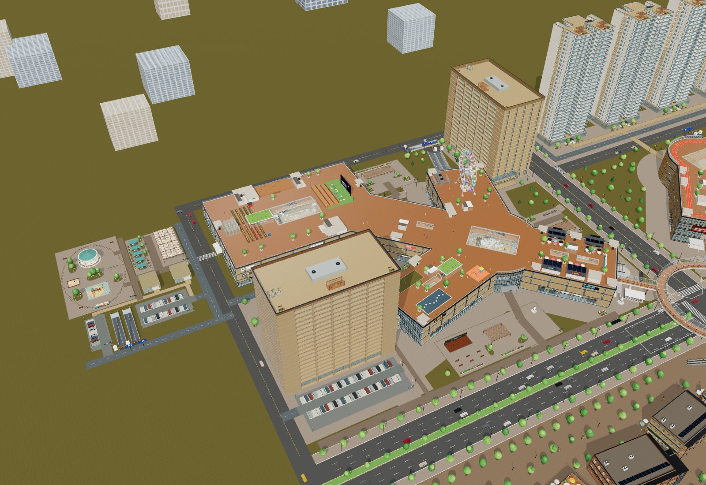
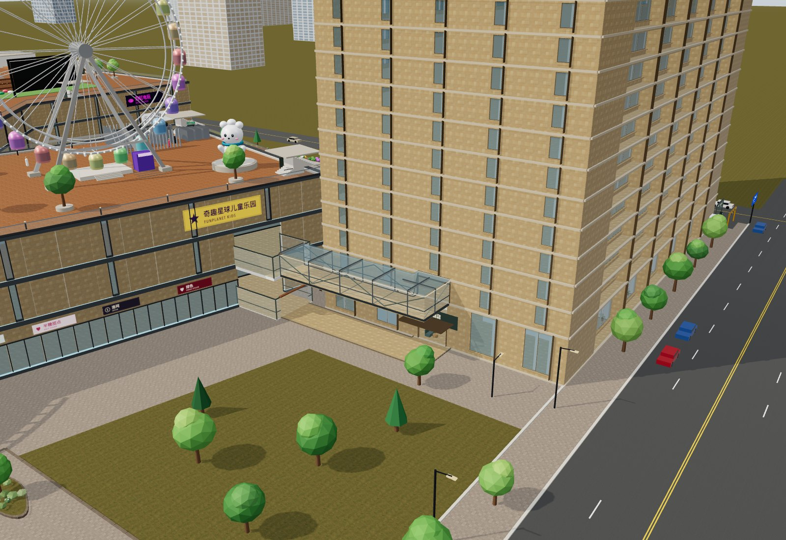
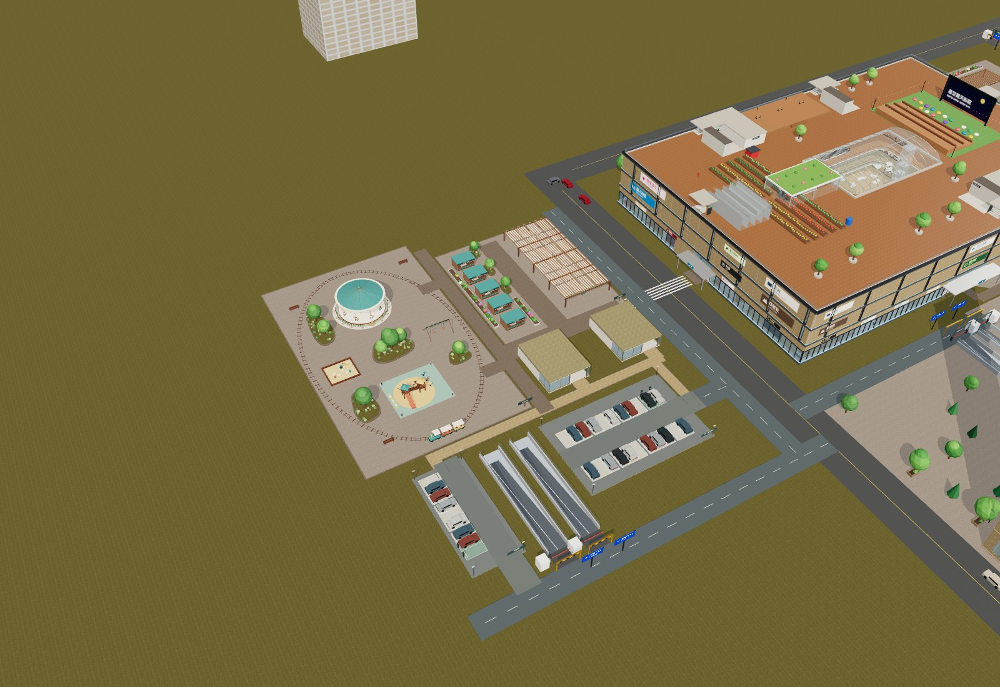
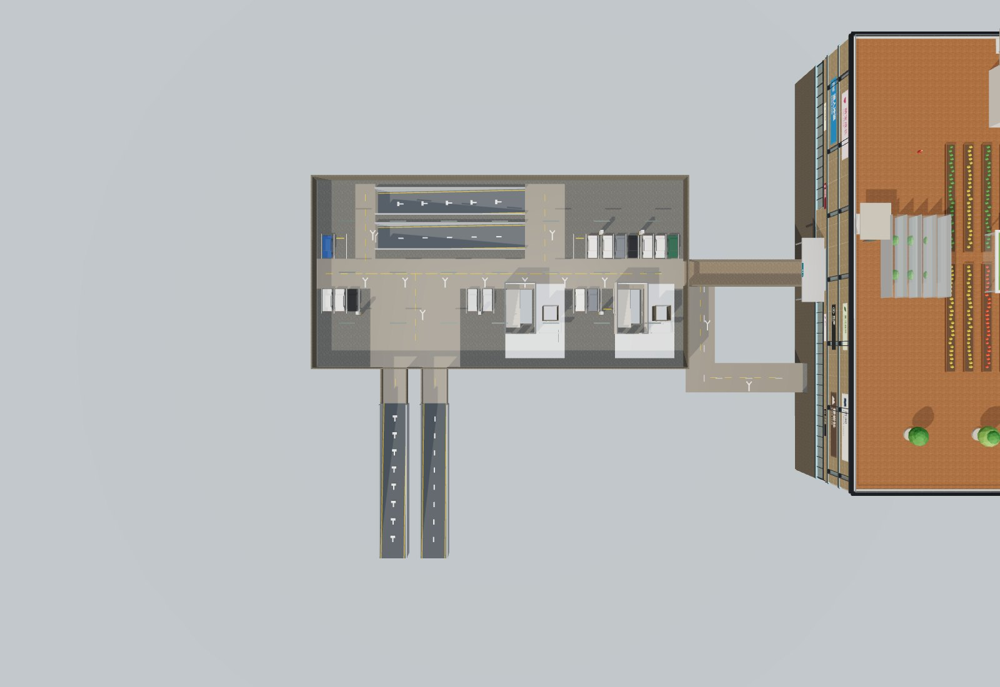
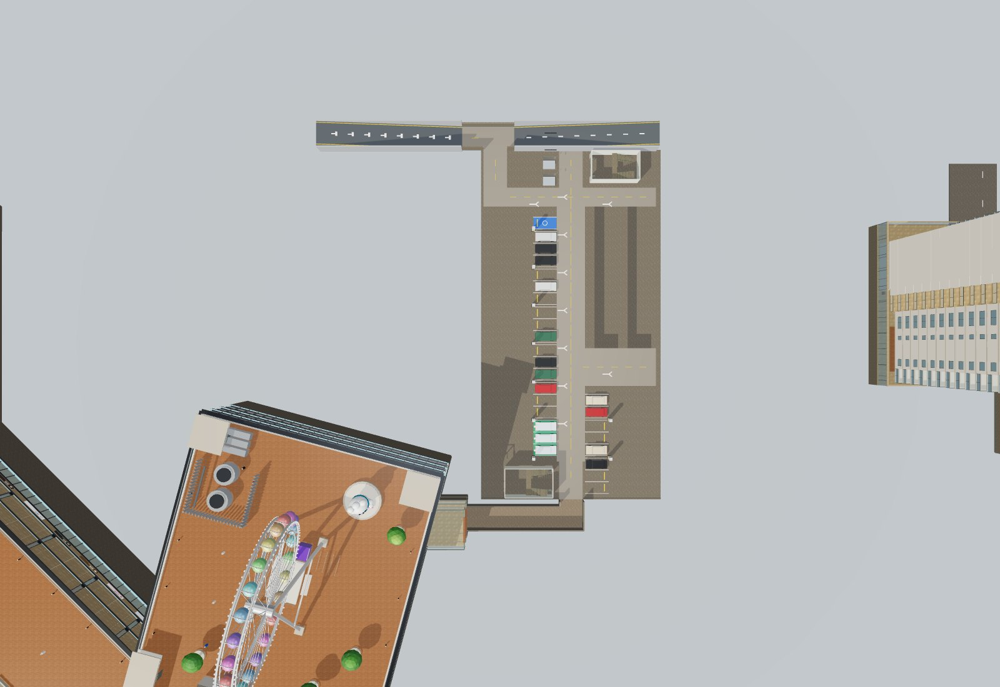

# 酒店公寓按两个红框整合 · 验收

日期：2026-10-13。以用户最新两个红框为位置依据：左下公寓保留，酒店搬到右上贴住一期北翼。

## 空间与连接

- A：中心(-247,-81.1533717)、0°，原西翼11.27m接驳保持。H：中心(-35,-214)、90°，外包络x[-54,-16]、z[-251,-177]。两栋74×38m及400套真实模型保持1:1。
- H/A分别从1F、2F、B1、B2接P1-1F、2F、B1M、B1，标高0、6.5、-4.5、-8.4m。H北翼侧廊预留，超市调整至另一侧；首层连接不跨道路。
- 原酒店下方改为WPG公共车库：地下两层各18位，G层仅两座行人小厅，各有电梯和楼梯。电梯和楼梯用互动选层连接G/B1/B2；原六栋12部玻璃电梯仍连续升降。
- H另设北侧独立进出口，WPG保留原酒店坡道。总坡道28条，其中16条地面进出（上一版24/14），H/A/WPG各有B1/B2双坡。地面共享77位，包含西侧31位和公寓46位。
- 乐园移至西侧x[-391,-347]、z[-253,-181]，食集x[-342,-305]、z[-244,-201]；5区61设施、11路径。保留原尺寸游具、5摊4桌、花岛与长棚；一期西门用23×6m斑马线接入，停车经步道接回。
- 当前456商铺、748住户、198目录层，见[布局数据](qa/hotel-apartment-sides-layout.json)。原住宅与套房资产、Blender/GLB成品未改。

## 自动与浏览器验证

`npm test`：131/131通过，0失败、0跳过；`npm run build`成功。包括原748户通行、400套模型尺寸、三期上下楼、H/A四层连接、公共附库出入与坡道、61设施碰撞、实际灯臂/树冠和地面网格避让。完整[测试日志](qa/hotel-apartment-sides-tests.txt)。

最终离线页用DOM指针转向、键盘和真实漫游更新器固定时间步实走，中途不传送：H/A八条接驳各往返16次、WPG两条地下连接往返4次、H坡脚入库往返2次、两座WPG地面入口往返4次，合计26条路线；H/A/WPG十二条坡道往返24次。均到达正确楼层与标高，见[浏览器路径记录](qa/hotel-apartment-sides-navigation.json)。

WPG默认B1、总览/爆炸返回B1、地下连廊显示、G小厅显示及地上拾取避让另做浏览器操作回归；H玻璃电梯从1F连续运行至20F，WPG双电梯/双楼梯以界面选层到达目标层。记录见[控件与电梯](qa/hotel-apartment-sides-controls.json)。

## 最终实际画面

## 离线、资源与交付

最终dist以file://断网加载。桌面Chrome1440×1000、iPhone13触屏模拟390×844均页面异常0、HTTP请求0、无横向溢出；公寓键盘入户1.68m、摇杆1.05m。遍历酒店20F、公寓及住宅等7个访问层，LRU保持≤3层，共享几何/材质/纹理误释放为0。手机贴图最大512，CPU几何释放为0残留。是Chromium模拟，不是实体iPhone验证。

[桌面原始记录](qa/hotel-apartment-sides-offline-desktop.json) · [手机原始记录](qa/hotel-apartment-sides-offline-mobile.json)

资源继续使用已收录的Poly Haven CC0贴图与用户自制模型，用户模型没有标记为CC0。本轮更新源码、离线HTML、README、HANDOFF、QA和实际画面；未重新导出整个园区GLB，未部署网站。乐园保留展示动画，不支持驾驶游具。

新交付目录：`/Users/calvin/Downloads/相册去图标/云澜汇_酒店公寓双侧整合版_2026-10-13/`与同名ZIP。旧包保留；校验ZIP CRC、清单SHA256、包内HTML与dist字节一致，见[包校验](qa/hotel-apartment-sides-package.json)。

最终HTML：60059358字节，SHA256：`33f20cc93f6322ed26e420f933eb4e8e9eb4caf6ceffb575ebb34f90b071fe4f`。
