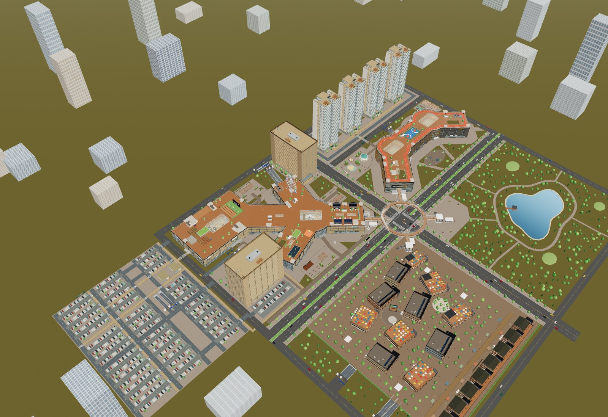
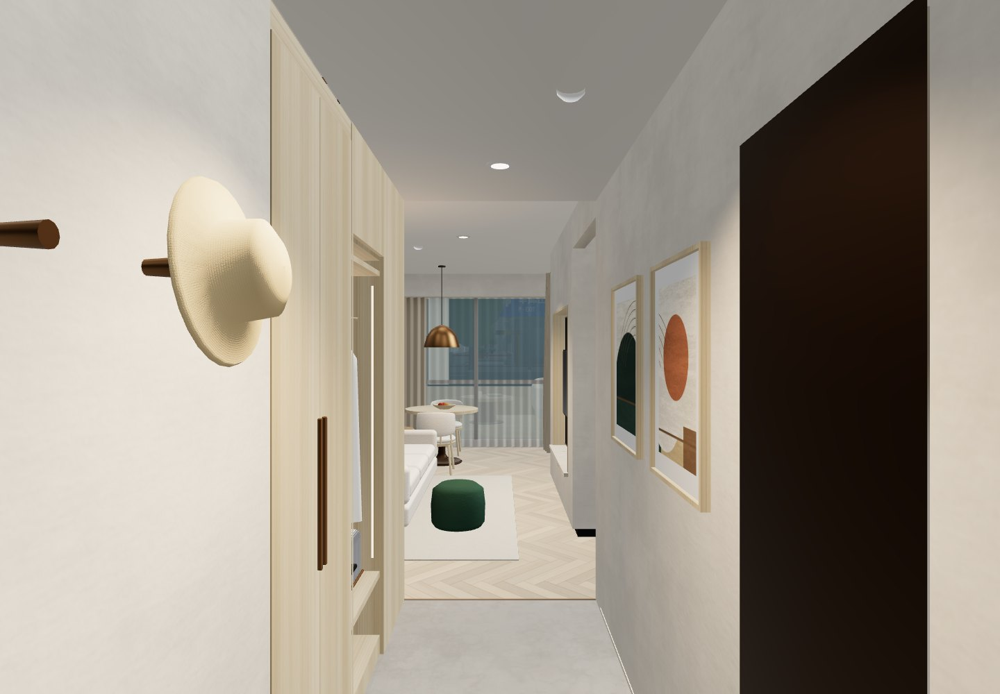
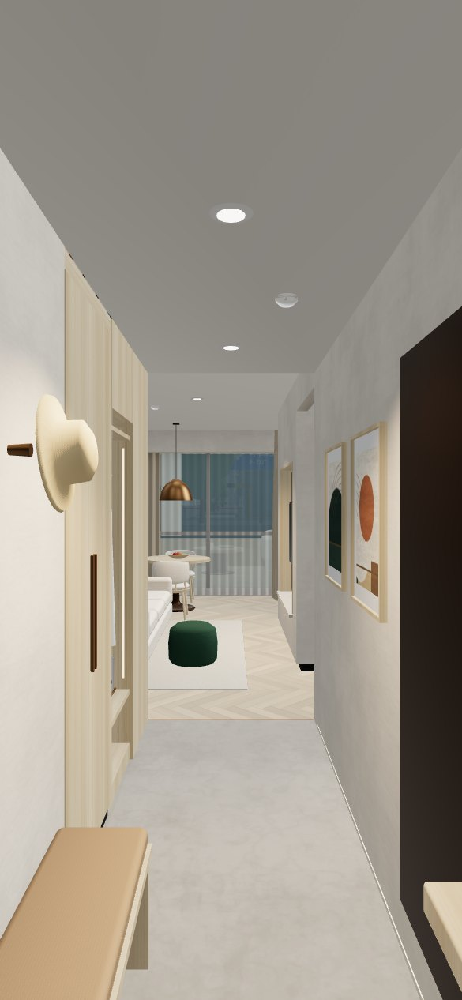

# 2026-10-13 · Netlify 正式发布验收

本轮将酒店公寓互换、二期乐园食集与西侧大型停车场版本发布到 Netlify。布局基线为 `0d5b886`；发布所需的资源加载与构建代码在本轮提交。原 `assets/models/`、`assets/textures/` 和 `prototypes/` 无变更。

## 正式站点

- 公开入口：[云澜汇 3D 园区](https://yunlan-mall-calvin.netlify.app/)
- 固定版本：[本次部署](https://6acded0c4ee1a3d97508ceb0--yunlan-mall-calvin.netlify.app/)
- 站点 ID：`3af33d60-6f93-4be3-a2e2-06f122ed5fc3`
- Production deploy ID：`6acded0c4ee1a3d97508ceb0`
- API 终态：`ready`，`production`，发布于 `2026-10-13T08:36:07.412Z`，无发布错误。
- 新站初始继承登录保护，公开检查返回 401；已仅对本新站点关闭 `sso_login`，首页和资源均公开返回 200，无需 Netlify 登录。
- 本轮使用 CLI 手动部署，未连接 GitHub 自动构建。API 状态留存见 [部署记录](qa/netlify-deployment.json)。

## 构建与资源

执行 `npm run build:netlify`。`scripts/build-netlify.mjs` 先运行原离线构建，再从相同生成数据拆分线上资源，通过 esbuild 替换三份数据模块的内嵌内容。

- 发布目录仅为 `dist/netlify/`：25 文件，24 个载荷约 43.34 MiB，另含资源清单。
- HTML 为 25,878 字节；JS 为约 1502 KiB；18 张 JPEG、1 个套房 GLB、3 个住宅 gzip 二进制资源使用内容哈希名称。
- 两次构建的 24 个载荷哈希一致。三个住宅二进制解压后与原 GLB 逐字节一致。
- 哈希资源缓存一年并设置 `immutable`，首页 `must-revalidate`；住宅 `.bin` 没有 `Content-Encoding`，由客户端自行解压一次。
- [公网文件校验](qa/netlify-production-files.json)：24/24 文件 HTTP 200，SHA256 与本地清单全部相同，共 45,440,205 字节。未将原 Blender 文件、开发源目录或账号凭证发布到站点。
- 根 `index.html` 是开发入口，`dist/artifact.html` 是片段，均不是本次 Netlify 首页。

## 自动化与浏览器验收

`npm test`：**142/142 通过**，无失败、跳过或取消。新增测试覆盖住宅下载失败、截断/错误 gzip、错误 GLB、离线分支不发网络请求，以及三套原模型的解码一致性。独立只读代码审查未发现实际问题。

[本地线上构建](qa/netlify-local-desktop.json)：24 个资源请求成功，约 7.57 秒完成场景加载，页面错误与失败请求均为 0。

[正式站桌面检查](qa/netlify-production-desktop.json)：

- 冷启动约 115.72 秒；这是当前网络的单次测量，不作为普遍性能承诺。初始化仍会下载全部模型模板，总资源约 43 MiB；后续可复用浏览器缓存。
- 25 个请求成功（包括平台附加内容），页面错误与失败请求均为 0。
- H 中心 `(-247,-81.1533717)`，A 中心 `(-35,-214)`；西侧 732 位、共享地面合计 778 位。
- 三套住宅模板均加载，访问 H-20F、A-1F、R1-2F、R4-30F 成功。
- 层缓存最多 3 层，共享几何、材质、贴图误释放计数均为 0。



[新离线页检查](qa/netlify-offline-desktop.json)：在 Chrome 以 `file://` 打开本轮生成的 `dist/mall.html`，浏览器置为离线，约 3.14 秒加载完成，HTTP 请求与页面错误均为 0。访问酒店、公寓与住宅高层并切换七次，缓存不超过三层；使用键盘从公寓首层入口行走约 1.68m，无水平溢出、无共享资源误释放。



[正式站触屏检查](qa/netlify-production-mobile.json)：使用 Chrome 模拟 iPhone 15，390×844 视口，冷启动约 93.90 秒。25 个网络请求，无页面错误、请求失败或 HTTP 错误；三套住宅模板全部加载，移动端贴图上限 512px。连续切换酒店、公寓、住宅楼层后缓存不超过三层，触屏摇杆从 A-1F 入口行走约 1.05m，无水平溢出或共享资源误释放。本次是浏览器模拟，未做实体 iPhone 验证。



## 重建与再次发布

```sh
npm ci
npm test
npm run build:netlify
netlify deploy --prod --no-build --dir dist/netlify --site 3af33d60-6f93-4be3-a2e2-06f122ed5fc3
```

发布前确认 CLI 登录与站点 ID。上传成功后重新检查公开首页、资源响应和实际模型加载。`--no-build` 不会代替前面的构建步骤。`.netlify/` 和 `dist/netlify/` 已忽略；配置和构建脚本纳入 Git。

本轮未另行导出园区 GLB 或覆盖旧交付 ZIP；`云澜汇_配套换位与西侧停车版_2026-10-13.zip` 是此前布局交付快照，最新构建代码、README、HANDOFF 和离线页以仓库为准。原布局的 26 条连接、24 个坡道方向和 94 条室外路线验收见[上一轮 QA](qa-2026-10-13-west-parking.md)，本次资源发布检查不冒称重跑全部空间路线。
