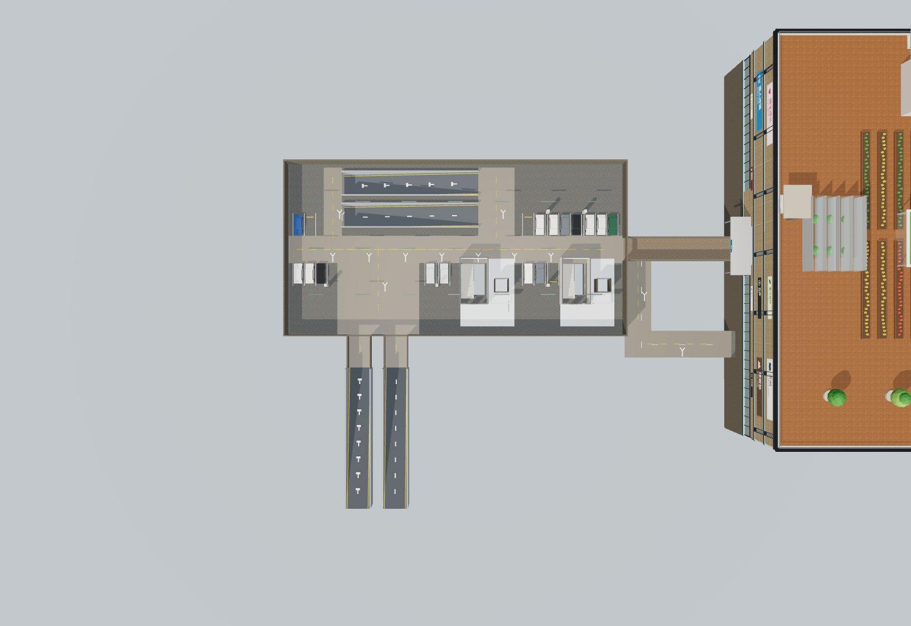

# 2026-10-13 · 配套换位、二期活动区与西侧停车验收

## 当前结果

H 酒店在一期西翼左下，中心(-247,-81.1533717)、0°；A 公寓在北翼右上，中心(-35,-214)、90°。两栋74×38m、各20层200套，400套及A首层10套复式跟随建筑迁移，用户源模型保持1:1；三套住宅模型与原Blender/GLB未改。

乐园和食集位于二期北面与四栋住宅之间的两块空地。乐园避让圆厅，保留原尺寸设备及旋转90°的小火车轨道；市集以南端入口绕开摊亭和花池。P2真实北门、住宅前庭、过街线与两区贯通。

西侧地块183×217m，26组共732个地面车位，含68充电标识位、10无障碍标识位；酒店旁46位保留，地面共778位。三个车场入口接西外环，保留WPG双街坡、两个行人厅及B1/B2共36位。全园16个地下车库地面坡口、28条总坡道仍在；地面停车入口与地下坡口分别统计。

## 源码与几何验证

`npm test`：**138/138通过**，见[完整日志](qa/west-parking-tests.txt)。`npm run build`及`git diff --check`通过。

- 全部732车位不压车道、步道、塔楼、坡口或WPG行人厅；26组车位两端均接车道。三外环入口、原地库坡口、停车步行主轴、一期西门和两厅路线双向通过。
- 5片活动区/61件主设施/13条路径，P2和R1–R4至两区的10组完整往返通过。旋转轨道含轨枕外包67.2×43.2m，与P2外墙最小净距4.8087m。
- H/A四层接驳、电梯候梯净空、20层套房、A复式和住宅回归保持。连接标高0/+6.5/−4.5/−8.4m分别接P1-1F/2F/B1M/B1。
- 树岛参与地面碰撞；专用灯从树心移开，西侧车场不使用原小车场角点灯。51栋背景城市楼均按完整足迹加2m避让。
- 人行铺装在道路边截断；斑马线和西侧车道标线高于实际路面，不再被道路或停车通道板遮住。附库上方地面不挖整块洞。

## 最终离线页实际浏览器检查

对最终 `dist/mall.html` 以 file:// 打开并设离线，页面异常0、HTTP请求0。

| 项目 | 结果 | 证据 |
|---|---|---|
| 桌面离线、七个层访问、键盘入户 | 通过；1440×1000无横向溢出 | [桌面JSON](qa/west-parking-offline-desktop.json) |
| iPhone 15参数的Chrome触屏模拟、摇杆入户 | 通过；390×844无横向溢出，纹理≤512 | [触屏JSON](qa/west-parking-offline-mobile.json) |
| H/A四层连廊、WPG地下连接及入口厅 | 26个方向性路线通过 | [连廊JSON](qa/west-parking-navigation.json) |
| H/A/WPG十二坡道双向连续步行 | 24个方向通过 | [坡道JSON](qa/west-parking-navigation.json) |
| 停车通道、三入口、主步道、一期门、两厅、二期/住宅至活动区 | 94个方向性路线通过 | [室外JSON](qa/west-parking-outdoor.json) |
| H玻璃电梯1F→20F连续升降 | 320次高度采样，正常到达 | [操作JSON](qa/west-parking-controls.json) |
| WPG双梯双楼梯四次实际选层 | 通过；默认B1、退出爆炸、地面小厅与地下显示正常 | [操作JSON](qa/west-parking-controls.json) |

按层缓存始终≤3，模型共享几何/材质/贴图误释放计数均为0。合并浏览器脚本首轮在WPG选层等待时超时；重新加载最终页单独复测四个选层均通过，操作JSON记录通过轮。无为此修改程序逻辑。截图取自最终构建，已人工查看总图、整个西侧停车及二期活动区。

## 交付与边界

本地交付为 `云澜汇_配套换位与西侧停车版_2026-10-13` 文件夹及同名ZIP，含最终离线HTML、README/HANDOFF、材质许可与模型来源清单、图片及本轮QA。源码与原模型保留在GitHub；没有新在线站点或本轮整园GLB导出。

最终离线HTML SHA256：`91caf81b99c17fca6db7b0e72cff7940568803ff6c8551fde3514e55c7eac024`。包内HTML与仓库dist逐字节一致，ZIP CRC和各文件SHA256核对记录见[包校验](qa/west-parking-package.json)。未随包复制的历史文档/源模型链接转向GitHub，不影响离线HTML。

手机验收为浏览器模拟，未测试实体手机。乐园仍为展示设施，木马有动画、小火车停站，不提供驾驶。WPG与住宅消防楼梯保持互动换层；塔楼玻璃电梯保持连续升降。
