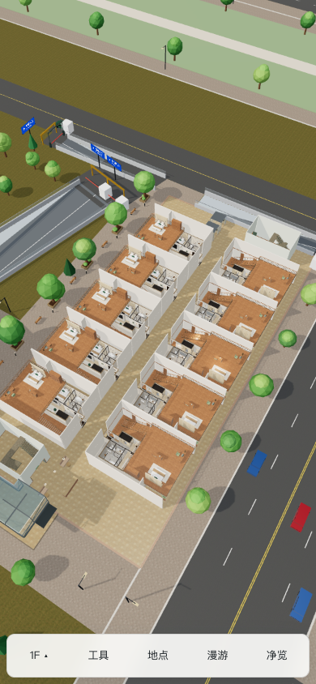
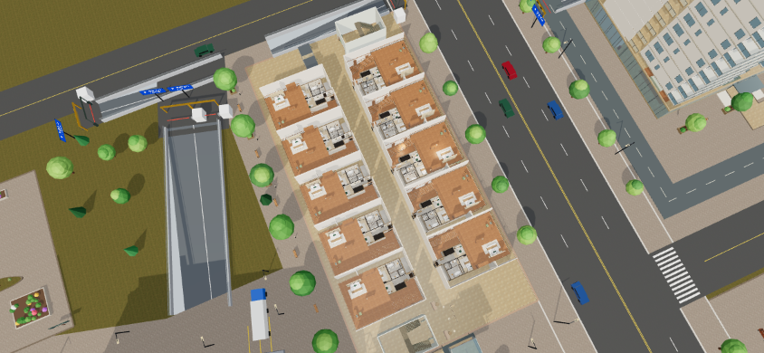
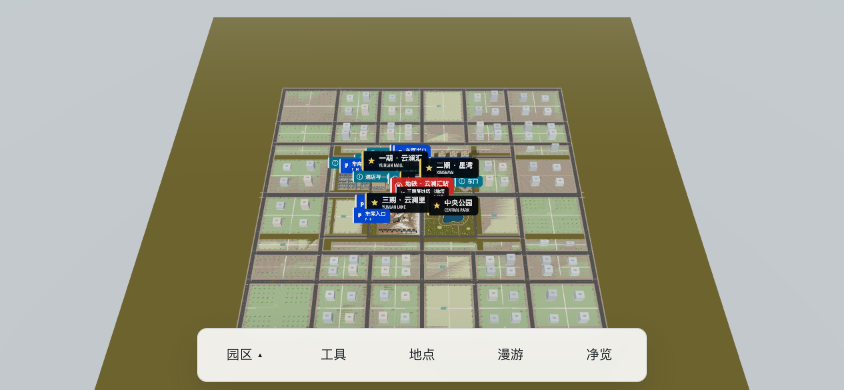
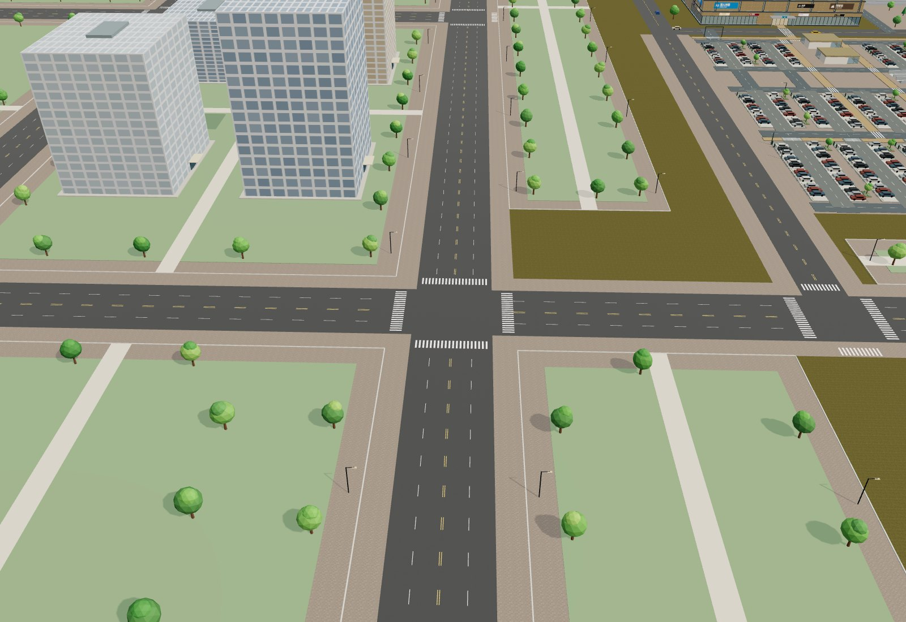

# 2026-10-14 手机界面与周边城市 QA

## 实现

紧凑界面同时覆盖窄屏、粗指针和低高度窗口；底栏按需打开楼层、工具、地点，目录可关闭。净览在横竖屏和漫游状态下隐藏应用控件、标签以及 Netlify 角标，轻点恢复，拖动不恢复。净览提示 1.8 秒后消失；H 切换、Esc 恢复。Netlify 角标在普通手机模式上移避开底栏。

城市地面拓展新增 24 段道路、43 个地块、84 栋外景建筑、1430 棵树和 366 盏路灯，并增加步道、过街线、球场与座椅。外景建筑有碰撞，但没有新增室内。原 456 商铺、748 住户、778 地面车位及用户模型保持。镜头飞行动画参数修复，高空视角雾距随高度调整。

## 检查

- `npm test`：145/145 通过；覆盖实际路网连通、占地避让、四向步行及碰撞。
- `npm run build:netlify`：成功，25 文件、约 43.35 MiB；同时重新生成离线版与 Artifact。
- [本地手机模拟](qa/mobile-ui-urban.json)：30 项检查通过，390×844 / 844×390、楼层切换、面板互斥、净览拖动与恢复、漫游 HUD、无横向溢出。
- [离线桌面](qa/urban-offline-desktop.json)：9 项检查通过，断网加载、本地 H/A/R1/R4 楼层切换、旧边界外实走、城市镜头；零 HTTP 请求和页面错误。首次 8 秒镜头等待在桌面高负载下超时，30 秒上限复测通过。
- 最终构建本地手机 30 项检查再次通过。按线上实际 iframe ID 与 inline 定位构造本地 Netlify 角标验证：普通状态 bottom=64px，净览 display=none；这项不等同于线上完整加载验收。
- 手机为 Chrome 触屏模拟，尚未做实体手机 GPU、Safari 或真机帧率验收。线上冷加载曾出现住宅03资源 `ERR_CONNECTION_CLOSED` 和套房资源 `ERR_NETWORK_IO_SUSPENDED`，公网资源哈希独立校验正常，三次线上浏览器尝试仍被下载连接中断或网络暂停打断，因此本轮不宣称线上完整交互通过；最终发布资源哈希与本地构建一致。本地最新构建重新检查手机交互。

## 画面

## 发布

正式地址：https://yunlan-mall-calvin.netlify.app/

Netlify site：`3af33d60-6f93-4be3-a2e2-06f122ed5fc3`。本地构建后 CLI 手动部署，GitHub 推送不自动发布。

最终 Production deploy：`6acf53f32f389084458079d4`，API 状态 `ready`。见[发布记录](qa/urban-deploy.json)。[公网哈希校验](qa/urban-production-files.json)核对 24 个页面及资源文件，全部 HTTP 200，SHA-256 与本地相同。
