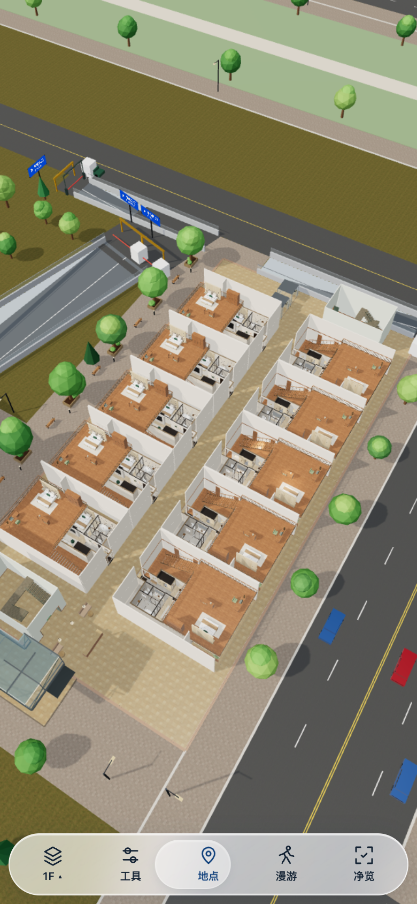

# 2026-10-15 手机玻璃 UI

按用户指定的透明滑块风格改造已有界面：圆角悬浮底栏、五个线性图标、滑动选中胶囊、玻璃面板、搜索及漫游按钮。保留原净览、面板互斥与横竖屏适配。未改场景、户型或模型。

## 验证

- `npm test`：145/145 通过。
- `npm run build:netlify`：成功；同步生成离线 HTML。
- [手机交互回归](qa/glass-regression.json)：30 项通过，净览零应用控件、点击恢复、拖动保持、选层、面板关闭、横竖屏无溢出、漫游与周边视角，无页面错误和失败请求。
- [样式检查](qa/glass-style.json)：6 项通过，图标保留、滑动胶囊移动、深色背景与文字、减少动画、横屏底栏 56px。
- Chrome iPhone 15 模拟，390×844 / 844×390；不等同于实体 iPhone / Safari 验收。
- 初次批量截图下载卡住，关闭该测试会话后重开，以无截图的交互检查完成验证。已保存实际截图。

## 发布

继续使用 Netlify CLI 手动发布到 https://yunlan-mall-calvin.netlify.app/ ，GitHub 分支 `feat/explore-v4`。

Production deploy：`6ad0765916babff05ebe420e`，API 状态 `ready`；[发布状态](qa/glass-deploy.json)及[公网资源哈希](qa/glass-production-files.json)已保存，24 文件全部 HTTP 200 且 SHA-256 一致。线上完整模型交互未重复真机验收。
