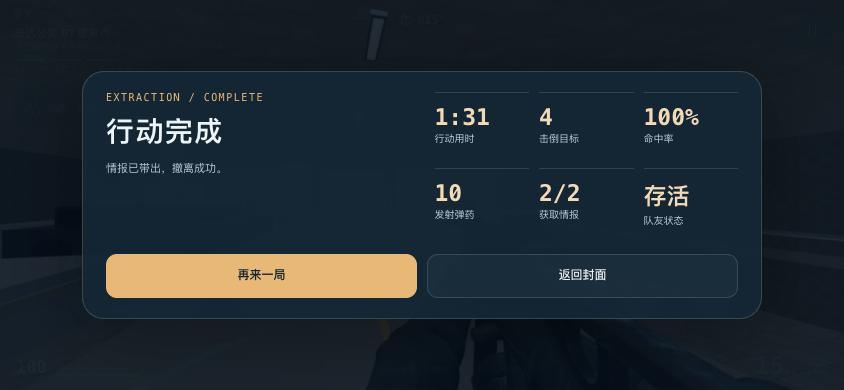
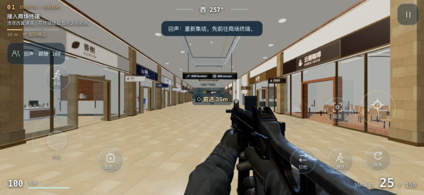
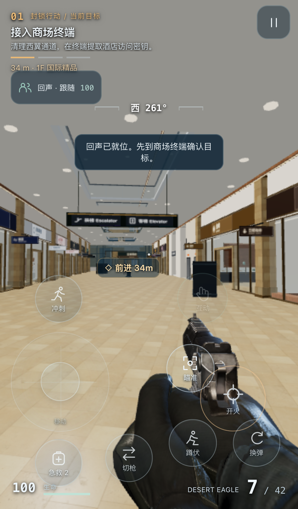

# 手机双模式与 FPS 小样验收 · 2026-10-19

## 当前发布

- 正式站点：https://yunlan-mall-calvin.netlify.app/
- Netlify deploy：`6ad5f9fae6f970c5110ecda2`，API 状态 **ready**，发布时间 `2026-10-19T11:07:41.808Z`。
- 固定版本：https://6ad5f9fae6f970c5110ecda2--yunlan-mall-calvin.netlify.app/
- 44 个线上文件（含资源清单）的字节数与 SHA-256 全部和本地构建一致。证据：[发布状态](qa/fps-deploy.json)、[公网逐文件核验](qa/fps-production-files.json)。
- 最终公网 WebKit 双模式 **9 项检查通过**：FPS 加载/切枪/返回封面、导览 53 层、模式资源隔离均正常，无页面异常；FPS 隐藏托管平台注入角标，已实查不会拦截菜单触控。
- 公网队友接口已发布：跟随指令返回 200/local；未知指令返回 503/未配置模型。当前完整游戏使用本地 AI，无需 Key，未启用云端模型付费调用。

## 自动验证

`npm test`：**219 / 219 通过**。覆盖原布局回归及本轮游戏规则、任务门槛、弹药/治疗、API 输入、移动端配置、物理地图裁剪、HUD 引导路线、射击遮挡和队友跟随。

`npm run build:netlify` 成功。最终单文件离线版 **34,515,229 字节**，SHA-256 `1beef83015f0fff5c63b027a8123d2b3e7a4a9fbf45a6d819352931d1d9d64d1`。离线与线上来自相同源码。

引导修复用玩家真实碰撞求解器验证新引导点，消除酒店楼梯、商场扶梯入口过早跳点。队友改为记录每个碰撞子步、按距离预算消费路径，20/30/60fps 模拟均完整走过约 480m 任务路线；没有传送或直接修改角色坐标。

## 完整玩法验证

浏览器驱动只调用和用户操作相同的 `input/look/action`，方向来自实际 HUD guide。未修改生命值、位置、阶段或胜负。

- 商场密钥 → 酒店 2F 情报 → 公寓 B1 撤离完整成功。
- 本次记录用时 91 秒，2/2 情报，击倒 4 个目标，发射 10 发，队友存活。
- 最终玩家与队友同在 A-B1，相距约 2.68m；全程最大距离约 6.51m。
- 控制台 0 error / 0 warning。证据：[任务实走轨迹](qa/fps-playthrough.json)。

## 手机与 WebKit

- UI 独立模拟 **34 项**通过，包括三指移动/瞄准/开火、暂停、横竖屏布局、拖动保存/取消、140% 按钮边界、结果数值及离线素材署名。另有 5 项配置持久化/边界 Node 测试，已计入 219 项总数。
- Chrome iPhone 13 设备模拟＋实际 3D：**10 项**通过。真实三指输入使位置、视角和弹药一起变化；松开后移动与射击停止；换枪、暂停、布局保存及旋屏后边界正常。
- WebKit 26.6 / iPhone 13 设备模拟：**8 项**通过。WebGL2、真实贴图枪械、切枪、按住射击、换弹、横屏布局、返回封面均正常，无页面异常。
- 实体 iPhone 帧率、温升、后台长时间恢复和长期内存稳定性尚未验收。这些模拟不能作为真机性能结论。

证据：[UI](qa/fps-ui-controls.json)、[真实场景触屏](qa/fps-mobile-runtime.json)、[WebKit](qa/fps-webkit-runtime.json)、[线上双模式检查](qa/fps-production-browser.json)。

## 地图、模型和导览

两种模式只生成 P1/H/A。导览 53 目录层、400 套原客房；FPS 15 可行走楼层＋3 个封闭顶盖、60 套客房。二期、三期、住宅小区、地铁、城市外景及原西侧大停车区从运行数据中移除。原建模源码和模型仍保存。

导览酒店 20F 10 套精装房、8 个代表楼面/屋顶、A20F 实际进门和手机净览已检查，楼层缓存不超过 3 层。细节见 [地图 QA](fps-map.md)。

SMG-45 与手臂、Desert Eagle 采用 CC BY 4.0 原模型网格和贴图。双向切枪在动画中点更换可见武器；SMG 原换弹及手枪弹匣/套筒动作正常。60/100ms 模拟帧下枪口闪光至少实际渲染一帧。模型加载、三角形与释放检查见 [素材 QA](../assets/models/fps/qa-viewmodel.json)。

## 离线与负载

Chrome 在 `file://` 且 CDP 断网时验证：封面 0 WebGL / 0 fetch；进入后真实枪械、换弹、切枪和本地游戏正常；导览不创建 FPS 实例或加载枪械；素材署名内置可读，无运行错误。证据：[离线记录](qa/fps-offline.json)。

线上包约 **25.12 MiB**；封面 HTML＋入口脚本＋背景图片共 **409,245 字节**，入口脚本约 10 KiB。进入前不创建 WebGL、不下载 GLB；导览不下载枪械，两模式都不下载住宅模型。枪械资源合计 **6,026,600 字节**。详见 [构建统计](qa/fps-build.json)。

FPS 采用 low 画质、0.9 像素比和 30fps 上限，关闭动态阴影、泛光、普通人群和交通；这是一项配置上限，不是承诺实体手机持续达到的帧率。主地图与手臂共用一个 WebGLRenderer；统计 draw call 时合计两次 render。

## 当前边界

- 这是完成可玩流程的单人 PvE 小样，没有多人联网、排位、复杂背包/战利品经济。
- 本地 AI 提供巡逻、可见目标交战、沿玩家路径跟随及三个队友指令；模型 API 适配已提供，但线上未配置模型服务。
- 跨导航楼层射击保守禁用，避免穿楼板命中；当前没有中庭跨层火力或可破坏建筑。
- 为手机负载，竞技模式塔楼只开放到 3F、商场地上开放到 2F；普通导览保留原 20 层酒店和公寓。
- GitHub 推送与 Netlify 手动发布是两个步骤，后续修改需重新构建部署。
