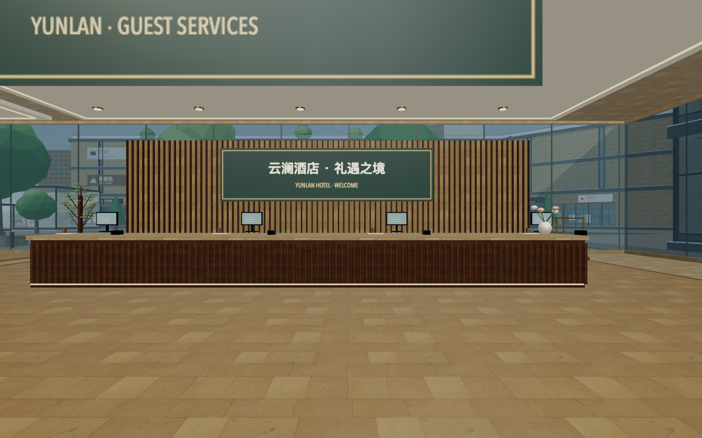
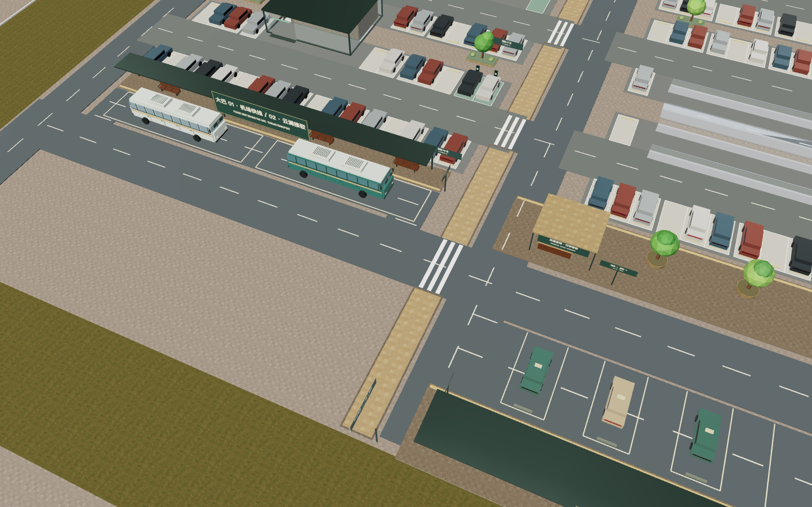
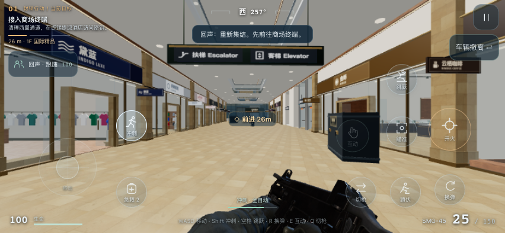
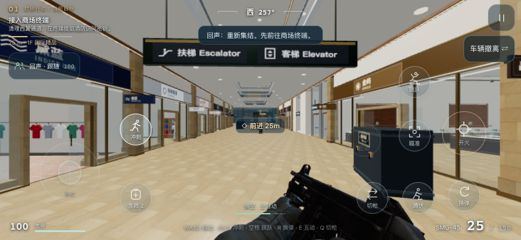

# 完整探索、共享地库与 FPS 双撤离验收 · 2026-10-20

## 本轮范围

用户澄清后，仅 FPS 裁剪地图。探索恢复 P1/P2/P3、H/A、R1–R4、地铁 M、西停车 WPG 与外围城市，共 198 个楼层。酒店、公寓首层改为大堂，上层原套房及三套住宅资产保留。

一期大盘地库接酒店、公寓与西停车场，新增车辆连接不接二期。P1 B1/B2 和 WPG B1/B2 共 4,149 位；西地面 576 位、酒店地面 29 位。新增 6 部电梯、11 组连续楼梯，全园 52 部电梯使用实体轿厢动画。首层到地下的楼板、道路铺装及井道均真实开洞。

## 功能及几何验证

- 布局、导航、楼板三角化、车位避让、门口通行、地下提前显示、电梯开洞、大堂与交通中心均有自动检查；最终命令和结果见下方发布记录及 [完整日志](qa/campus-fps-20261020-tests.log)。
- 全园 32 条车库坡道，中线及左右偏移、上下双方向共 192 次连续通行；新地面小厅 17 个入口双向可走，11 组楼梯均有真实路线。
- 所有停车楼面实际三角网格经过 5,000 余点射线支撑对照；停车漆面、地表和路面不填回坡口及电梯井。
- 浏览器保留 CPU 顶点的临时 QA 会话，检查 P1/H/A/WPG/P2/P3 的 30 条坡道、450 个水平封板净空采样，无意外地板封堵；此 hook 仅用于测试，正式版仍释放已上传的静态顶点数组。证据：[地库浏览器记录](qa/shared-garage-browser.json)。
- 额外发现并修复二期坡口的挡土墙封堵：原墙体仅扣人行门，现按实际车辆坡道与墙厚交集开口。二三期 6 个街道坡口、5 个横向位置、5 个身体高度、双方向共 300 次真实墙体网格射线通过，并保留非门口墙体的遮挡对照。坡道箭头也改为顺坡贴地。
- 地库可见性按区域预先启用；坡口接近、地下门口、地铁连接和电梯目标楼层均提前显示。正常顶板保持存在，不以隐藏整个楼板来伪装修复。
- 重复 FPS 实走暴露出斜向踏入首阶后未接入楼梯的问题，已在通用 `nav.step` 修复端部捕获，覆盖正向上楼、反向下楼及禁止坡段中部吸附三种情况。

## 大堂、接驳和电梯

酒店和公寓首层有接待、休息、餐厅、健身及服务空间，家具障碍同源。酒店接待、主轴、餐厅、健身区、公寓共享办公与交通中心均已查看真实渲染；服务区域以实际导航步行验证。

探索 H-L1 从 1F 到 B1、FPS 从酒店 2F 到 B2 已验证真实进舱、关门、升降、开门和出舱；FPS 队友可同舱到达。电梯每个途经楼板均切开井道，首层到地下不穿实心楼板。

## FPS 与移动端

商场终端→酒店 2F 情报→公寓 B1 车辆或酒店 RF 直升机两条路线，均使用普通移动、视角及交互输入完成。没有直接修改玩家位置、血量、任务阶段或胜负。冲刺有耐力及持枪姿态；跳跃有重力与落地；三类敌人有视野、听声调查、有限弹匣及换弹。

六种尺寸（375×667、667×375、393×852、852×393、430×932、932×430）在 140% 按钮大小下完成边界、互不覆盖、至少 44px 触控和中心命中检查。拖动跳跃键后横竖屏布局独立保存、刷新恢复。过程和最终整局记录见 [FPS 详细验收](fps-expansion-qa.md)。

探索模式手机默认收起地图悬浮标注，可从工具开启；返回封面按钮移至右上角，避免盖住底栏。净览仍可隐藏全部控件。

最终公网检查另修复两处界面问题：Netlify 注入的角标 iframe 会截获小竖屏探索入口点击，现对整个游戏页面隐藏；FPS 竖屏耐力状态移至罗盘下方，避开切枪键。七组尺寸（另含 Safari 可用区域 393×659）在 140% 按钮大小下检查状态条与按键、罗盘、提示、生命和弹药区无覆盖，见 [状态条检查](qa/fps-footer-mobile.json)。

最终公网手机尺寸截图：[完整园区](images/mobile-explore-20261020.png)、[FPS 界面](images/mobile-fps-20261020.png)。

WebKit / iPhone 15 尺寸模拟已从线上构建包进入 FPS：P1/H/A 三栋，真实枪械、手臂、人物和套房资产正常，未请求住宅 `.bin`；封面仅请求入口脚本、共享小模块与封面图。证据：[WebKit 资源记录](qa/campus-fps-webkit.json)。

这些是浏览器引擎及尺寸模拟检查；尚未作实体 iPhone 帧率、温升和长时内存验收。云端模型 API 未启用，游戏使用本地 AI；仍是单人 PvE 小样。

## 发布记录

正式站点：[云澜汇](https://yunlan-mall-calvin.netlify.app/)。

- **正式部署**：`6ad7402730a839b9e6987c70`，2026-10-20 10:20:12 UTC 发布，API 状态 `ready`。[固定部署地址](https://6ad7402730a839b9e6987c70--yunlan-mall-calvin.netlify.app)；[部署记录](qa/campus-fps-deploy.json)。
- **测试**：`node --test --test-concurrency=4 tests/*.test.js`，257/257 通过，0 失败；末次竖屏状态条及角标修正后重新运行。完整日志在 [测试记录](qa/campus-fps-20261020-tests.log)。
- **线上资源**：49 项全部通过应用内容校验。其中 47 项原始字节数与 SHA-256 一致；`index.html`、`credits.html` 被 Netlify 加入托管注释或角标加载脚本，明确剔除这两类已观察到的托管注入后与本地产物逐字节一致。没有把带托管注入的 HTML 记为原始哈希一致。[逐文件记录](qa/campus-fps-production-files.json)。
- **公开网址浏览器**：WebKit / iPhone 15 尺寸进入两种模式，探索为 198 层、三套住宅模板；FPS 为 P1/H/A、18 场景层，不请求住宅。跳跃、冲刺持枪、暂停/继续、入口命中、返回封面位置、净览隐藏及轻点恢复均检查；[线上浏览器记录](qa/campus-fps-production-browser.json)。
- **构建**：在线包 49 文件；最终离线 `dist/mall.html` 为 73,151,989 字节，SHA-256 `df5920cd92382b0dccab6e5efcff02c656f18128f872846f9d0763bd9cd96769`。源码无晚于构建的运行时改动。[构建清单](qa/campus-fps-build.json)；恢复住宅后的 [离线内嵌资源检查](qa/campus-fps-offline.json)。
- **GitHub**：本轮源码、生成的离线页、README、HANDOFF 与验收记录一并提交到 `feat/explore-v4`；以本文件所在提交追溯对应源码。GitHub 推送与 Netlify 手动发布分别执行。
