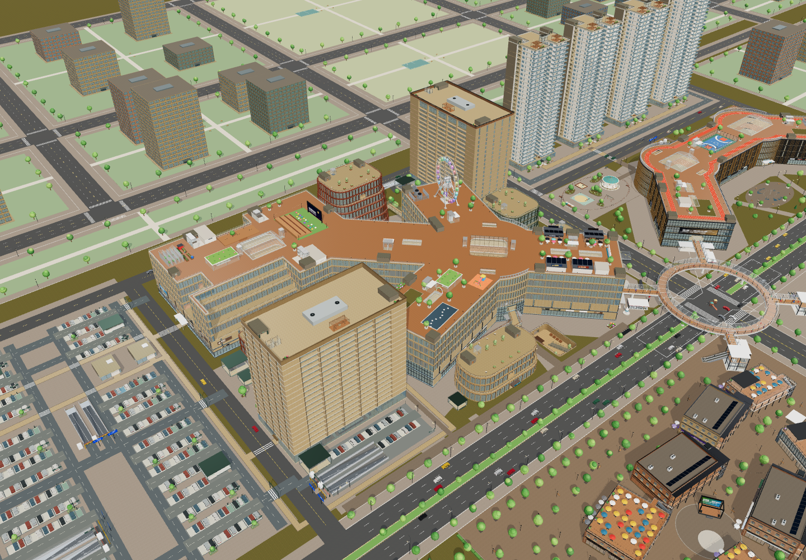
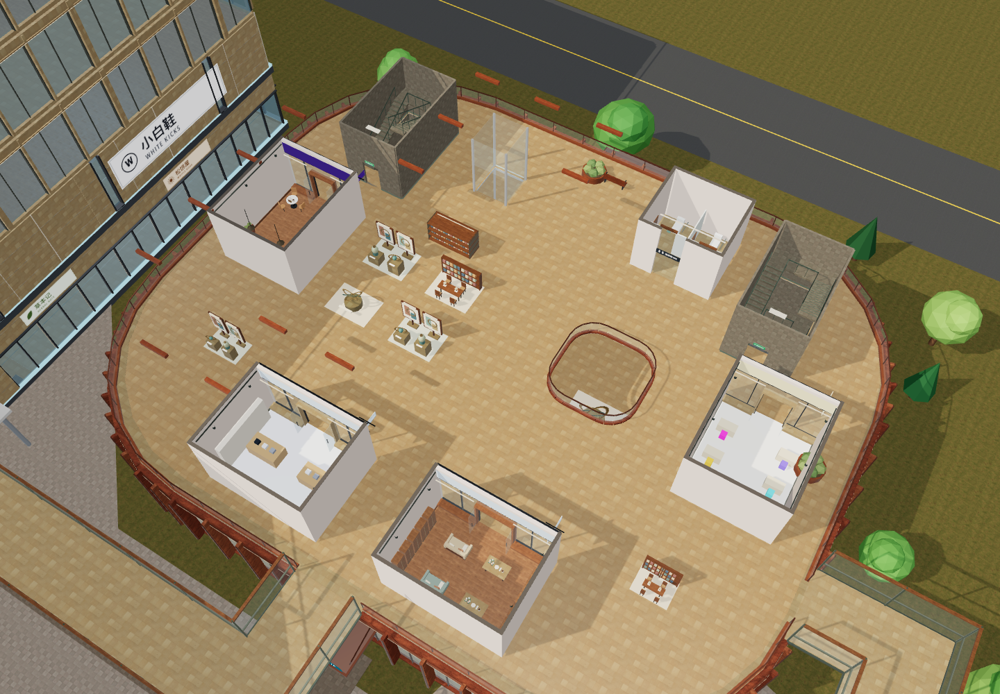
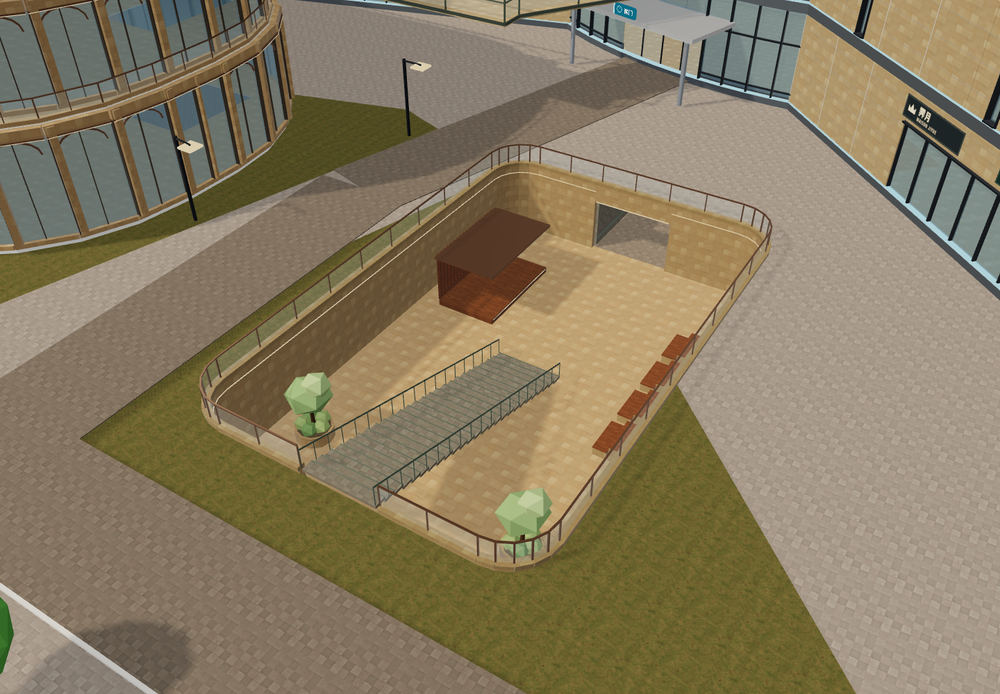

# 一期艺术街区扩建 · 实施与验收

日期：2026-10-28。用户在审阅鸟瞰与总平面后批准概念 A，并授权多代理并行实施。本次扩建仅用于完整园区探索，竞技 FPS 使用原有紧凑地图。

## 实施范围

原一期边界 x[-286,-16]、z[-256,-20] 保持，酒店仍在西南、公寓仍在东北。原 Y 形主楼、西北方庭、共享地库、西停车场、二三期、地铁与四栋住宅继续保留。

| 组团 | 地上使用层数 | 已接入内容 |
| --- | --- | --- |
| 一期主楼 | 6 层，RF=34m | 增加设计文化、娱乐、云端餐饮；3–6F 真实退台、露台门与栏杆；原扶梯、电梯与连续楼梯延伸 |
| 云澜艺文馆 P1C | 7 层，RF=39.5m | 陶土色圆角立面、收分露台、艺术书店/展厅/工坊/沙龙、双楼梯、观光梯 |
| 南庭曲廊 P1S | 3 层 | 圆弧餐饮立面、烘焙/餐厅/茶室/餐吧、共享餐桌、屋顶平台 |
| 东庭 P1E / P1E2 | 4 / 3 层 | 绿色构件与玻璃花房、展售/植物/生活方式空间，保留两楼之间的东门轴线 |
| 西里 P1W1–W4 | 3 / 2 / 2 / 3 层 | 红砖工坊、石廊书屋、木构茶舍、玻璃艺廊；坡顶和折板顶、露台及可达屋顶 |
| 下沉艺术庭院 | B1M=-4.5m | 真实地面开口、连续台阶、舞台、阶梯座椅与美食层通道，B1/B2 停车楼板保持 |

8 座附楼新增 72 个铺位、8 部观光梯、10 座连续楼梯；附楼共 35 个目录楼层（含屋顶）。10 条二层桥把新组团接回主楼，保留原酒店/公寓接驳。文化馆和东庭内部接入已有共享库小厅，井道不被新板封住。

27 个新增商业楼层共 98 组公共陈设岛，按用途配置展台/画屏、书架阅读桌、咖啡与共享餐桌、工坊桌、种植休息区。每组实体与导航碰撞使用同一 `publicFixtures` 数据，预留桥门、店门、候梯厅、卫生间和贯穿走道。

全园为 **19 个建筑 ID、236 层、680 商铺、728 居住单元、60 部电梯、82 部扶梯**。680 是商铺数量，不包括住宅和客房；728 住户与旧版一致。FPS 仍为 P1/H/A、18 个场景楼层（17 个可走层与 1 个封闭顶盖）。[数量记录](qa/p1-expansion-layout-stats-20261028.json)。

按一期主楼、酒店、公寓及新附楼 1F 楼板外轮廓并集、不扣洞口的模型几何口径：地面占用从约 30,182 ㎡（47.37%）增至 36,283 ㎡（56.94%），增加约 6,101 ㎡。此值不是总楼面或净出租面积。与原概念稿的约 6,115 ㎡差异来自圆角采样、井道和最终接驳调整。

## 实现与资源

- `buildLayout({expansion:true})` 默认生成完整扩建；`buildPlayableLayout({mode:'fps'})` 明确调用 `expansion:false`，避免任务路线随新建筑变化。
- 立面、门洞、退台板、栏杆、连廊边界与导航共用几何。折线桥使用多边形并集，不使用包围矩形替代真实桥面；交汇处不生成横挡栏杆。
- 文化馆与东庭公共洗手间使用紧凑陈设，独立门口保留；原有大型卫生间模板不受影响。方庭原采光顶、RF 农园、露天影院、观景台与北翼摩天轮保留。
- 新建筑复用已有 Poly Haven CC0 贴图及共享材质，没有新增商业模型或外部运行时 CDN。既有模型/贴图署名随构建保留。
- 修复品牌队列在重复构建间污染 import 规格的问题。回归按完整数据比较 P2/P3/M/H/A/R1–R4/WPG，确保楼层、商铺与原精装单元不因一期新增楼层而变化。

## 手机加载

40 个地上商业楼层进入流式构建。总览仅有外壳与结构，不分配这些层的店内墙体、招牌、家具和新公共陈设；进入楼层才构建。

- 手机实际最多保留 4 层商业室内，桌面常规 6 层、爆炸视图最多 8 层。先释放旧层再构建新层。
- 当前层与上下邻层优先；接近连廊时只预载最近目的地，桥上和过门后保留两端。每移动 3m 重新检查，避免短桥落在原 24m 刷新区内而加载过迟。
- 电梯仅保留当前邻层和明确目的地，不一次建立全部停靠层。
- 私有几何、材质、贴图、实例缓冲、动态及夜间回调随淘汰释放；永久共享资源继续复用。
- 地下结构、地铁、楼板和实体楼梯不随商业室内缓存被删除。套房/住宅依然延迟下载并使用独立三层实例缓存；“4 层”不是整个场景的总楼层上限。

桌面 Chromium 手机模拟冷启动 JS heap 约 363 MB；重复切换后一组样本约 192–211 MB，受 GC 时点影响，不包含全部 GPU/Canvas/进程内存。重复三轮相同路线后几何、纹理和夜间回调数量稳定。WebKit 不提供对应 heap 数字。上述结果均为桌面浏览器手机模拟，实体 iPhone 内存、温升、长期稳定性仍未实测。

## 验收证据

- `node --test --test-concurrency=4 tests/*.test.js`：**302/302 通过**。`npm run build:netlify` 成功，线上目录 49 个文件约 52.84 MiB，入口 `main.743SDAXW.js`；两份离线 HTML 均同步生成。[测试和构建记录](qa/p1-expansion-release-checks-20261028.json)。
- 浏览器通过实际漫游控制器，使用键盘/触屏视角事件和固定模拟时间步，完成全部 10 条新桥双向步行，另测三条屋顶楼梯双向与下沉院台阶双向，共 28 段。[控制器记录](qa/p1-expansion-browser-walk-20261028.json)。这些是脚本控制器验收，不是真人现场试玩。
- 艺文馆玻璃电梯从 1F 到 7F，记录进舱、关门、逐步上升、开门和到达；轿厢与视点从 0m 连续升至 34m。[升降记录](qa/p1-expansion-browser-lift-20261028.json)。
- 实际三角网格验收覆盖附楼 10 座楼梯、100 个梯段、37 条层间路线的 1,244 个人体位置；另检桥头/转角、WC、露台门、RF 出口及穹顶附近净空。
- Chromium 与 WebKit 手机尺寸冷启动、楼层切换、缓存淘汰、横竖屏、净览及返回通过；首屏套房/住宅不请求，FPS 保持原 18 层。[手机报告](qa/p1-expansion-mobile-20261028.json)。

## 发布

沿用 [原 Netlify 入口](https://yunlan-mall-calvin.netlify.app/) 与 GitHub `feat/explore-v4`。部署应用源码为 [`0d61f0a`](https://github.com/calvinzeng123/super-mall-3d/commit/0d61f0a0c46edbb368394accb6dbf37497bb9492)，已推送远端；后续补充验收记录的提交只改文档，不改变本次应用产物。

- Netlify 生产部署 `6ae1abe7328708a824482cc8` 于 **2026-10-28 08:01:56 UTC** 发布，API 状态为 `ready`，站点的 `published_deploy` 与该 ID 一致。
- 从原正式域名下载验证全部 49 个文件：**47 个文件原始字节数及 SHA-256 一致**；两份 HTML 去除已逐段识别的 Netlify 托管注释、HUD 脚本及其尾随换行后与本地产物一致。入口为 `main.743SDAXW.js`，SHA-256 为 `182613a0d6517d30f5074f25e66506724e7d2f99b7a01d3e4ca06a3837b4ee00`。[正式资源记录](qa/p1-expansion-production-files-20261028.json)。
- 三份既有住宅 `.bin` 首轮下载在 60 秒后超时，并出现 curl HTTP/2 framing error；改用 HTTP/1.1 重试后均完整取得且哈希一致。初次网络下载速度仍可能波动，不能把重试成功写成任意网络下都快速加载。
- 正式原网址的 WebKit 手机模拟通过封面 → 完整探索：236 层、98 组陈设、40 个延迟商业层；冷启动商业室内缓存为 0。文化馆 2F/7F、小馆、三期、P1-B2 与地铁 M-B1 切层和漫游可用，实际室内组及缓存均不超过 4 层。横竖屏无横向溢出，净览隐藏全部按钮，触摸可恢复。
- 同一正式网址返回封面后进入 FPS 成功：18 层，仅 P1/H/A，套房资源 ready、住宅 idle，住宅请求为 0。检查期间没有页面异常、失败请求、HTTP 400 及以上响应或 WebGL 上下文丢失。[生产浏览器记录](qa/p1-expansion-production-browser-20261028.json)。这些结果仍是桌面 WebKit 手机模拟，未替代实体 iPhone 验收。
