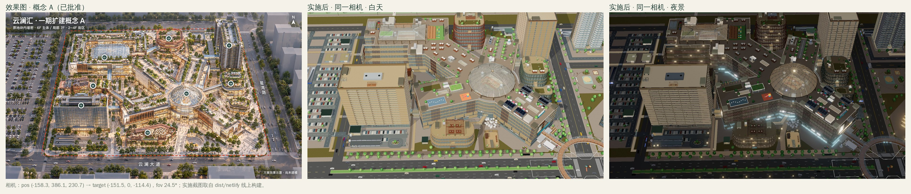
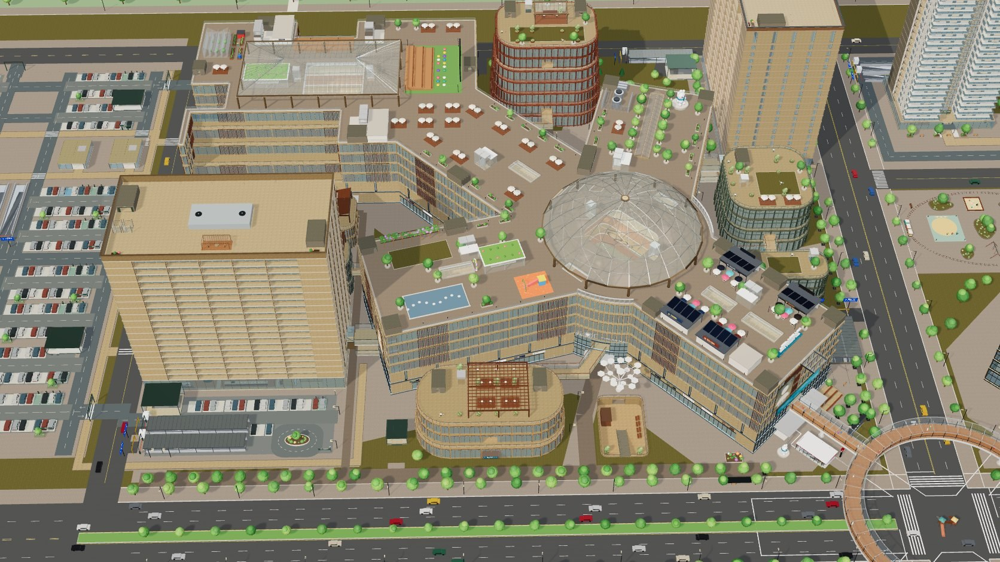
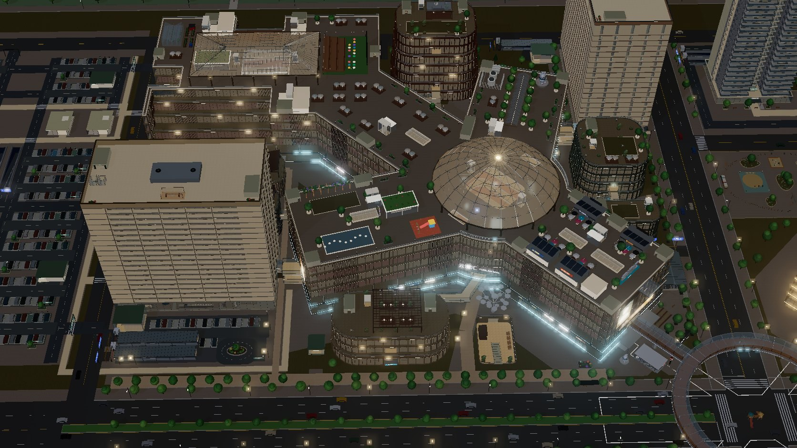

# 一期概念 A 对图深化 · 实施与验收

日期：2026-10-29。用户要求一期“完全按照”已批准的概念 A 鸟瞰出方案，并指出原场景一期停车场出入口不够多；随后要求做好后重构并部署。设计依据与逐项取舍见 [设计方案](planning/2026-10-29-p1-concept-fidelity/DESIGN.md)。本轮只改完整探索（tour）；竞技 FPS 仍用 `buildLayout({expansion:false})` 的紧凑地图，路线、撤离点和 18 个场景楼层不变。



## 实施范围

| 项目 | 方案前 | 实施后 |
| --- | --- | --- |
| 共享地库对外坡道 | 4 对 8 条（全园坡道 32，街道坡道 16） | 6 对 12 条：新增方庭北口（北外环，60m · 14%）、星湾东口（星湾路，56m · 15%，距大道红线 70.5m），均直落 P1-B1；全园坡道 36，街道坡道 20 |
| 西侧地面停车场车行口 | 3 口，全在西外环 | 6 口：新增北环西口、北环东口、大道口，闸架朝向城市道路 |
| 06 圆厅 | 平屋面 | Ø60m 网格玻璃光穹，12 柱，顶高 53.7m（低于酒店 71.1m） |
| 01 方庭 | 24×20m 天窗 | 66×36m 四坡玻璃天幕，18 柱，檐口 40.6m、脊 45.2m；露天影院与观景台让位 |
| 北翼屋面 | 摩天轮 | 40×6m 采光峡谷 + 12 株林荫；摩天轮只在完整探索中移除 |
| 主楼屋面 | 橙色木板 | 浅色石材 + 20 处花池 + 16 组伞座外摆 |
| 附楼屋顶 | 小坡顶构件 / 空屋面 | 02 玻璃亭与草坪、03 木格栅棚架餐座、04 屋顶花园、05 柱承坡屋顶（覆盖 56–64%） |
| 立面 | 浅石材带窗 | 3F 以上每 4 组开间 1 组铜木竖向格栅；西翼、东南翼、方庭南立面三块画屏 |
| 地面景观 | 铺装为主、东南角喷泉 | 北庭/西庭喷泉雕塑、东南大台阶（替代原角部喷泉）、云澜大道 26 株 + 星湾路 16 株行道树 + 东南树阵 4 株、下沉院“云伞”雕塑 |
| 酒店前场 | 29 个地面车位 | 落客环岛，保留 22 个短停车位（原有测试要求 ≥20） |
| 车位 | 主楼四层 4,149 | 4,125（新坡道板下与 B1 到达车道占 24 个，P1-B1 914 → 890） |

全园仍为 **19 个建筑 ID、236 层、680 商铺、728 居住单元、60 部电梯、82 部扶梯**，与方案前一致；酒店 20F 和客房、复式、精装模型不改。看得见的实体都做成导航障碍或导航墙：光穹与天幕柱、花池、餐桌、棚架柱、坡屋顶柱、玻璃亭三面墙、喷泉、台阶、行道树、雕塑底座、环岛花坛。地面前场障碍从 38 个增至 89 个。

## 代码与重构

- 布局：`src/layout/p1-access.js`（坡道、到达车道、地面车行口）、`p1-fidelity.js`（屋面造型、画屏与总入口）、`p1-roofscape.js`（主楼屋面花园、附楼屋顶、西里坡屋顶）、`p1-landscape.js`（地面景观与酒店环岛）。
- 渲染：`src/render/build/p1-fidelity.js`（入口、光穹、天幕、峡谷、画屏）、`p1-roofscape.js`、`p1-landscape.js`，另在 `parking.js` 加坡道雨棚/洞口头，`site.js`、`west-parking.js` 支持新闸口朝向，`p1-expansion.js` 加格栅。
- 重构前后对整套方案写出的布局记录、以及每个渲染分组的顶点数与包围盒做了快照比较，结果完全一致（容差 1e-5）。重构内容：按职责拆模块；渲染入口改名 `buildP1Fidelity`；共用色值进 `COLORS`；手写的圆、椭圆、圆角矩形、外扩包围盒统一用 `geom`（新增 `ellipsePoly`、`boundsPoly`、凹多边形相交 `polysOverlap`）；删除未用导出。
- 新增 `buildLayout({ fidelity: false })`：完整探索但不含本方案，用作文档基线和对比。设计目录的 `export-design-data.mjs` 改为从这两份布局读取全部数值，总图与车行图不再手写坐标。

## 验收证据

- `node --test --test-concurrency=4 tests/*.test.js`：**322/322 通过**（方案前 302）。新增覆盖：坡道坡度与开洞、暗埋段可走/敞开段不可横穿、板下无车位、闸口朝向；光穹/天幕柱落点；屋面家具在真实屋面上且挡人；玻璃亭南面可进、北/西墙挡住；西里坡屋顶覆盖率、檐口高度、柱落点和楼梯口到露台；画屏贴实际立面；地面景观不压坡口/路口/建筑；FPS 不含任何改造。另有渲染测试检查坡屋顶下 3.8m、棚架下 2.6–3.7m 净空（这项抓到并修正了一条悬在半空的灯带）、玻璃亭南面敞开、喷泉水面未被池顶盖住。
- `npm run build:netlify`：线上目录 **49 个文件，53.35 MiB**，入口 `assets/main.JQ4BQZND.js`；两份离线 HTML 同步重建。全部文件 SHA-256 见 [发布检查记录](qa/p1-concept-fidelity-release-checks-20261029.json)。同一容器内重复构建 48/49 个文件字节一致，`asset-manifest.json` 只是条目顺序不同；换一台机器构建时入口哈希可能变化（`0d61f0a` 在本容器重建得到 `main.ALWRCP4V.js`，线上为 `main.743SDAXW.js`），部署后应以部署机自己的 `dist/netlify` 为准核对。
- 浏览器（Playwright Chromium，本地 HTTP 提供 `dist/netlify`）：用实际漫游控制器（按住 W，经 `debugShot` 以 50ms 固定步长推进）走 10 段，全部符合预期：北口入口坡道地面 → B1、东口出口坡道 B1 → 地面、北口暗埋段上方可走、敞开段被挡、西翼屋面穿过光穹柱间、从草坪进入玻璃亭、玻璃亭北墙挡住、西里 W1 楼梯口经坡屋顶下到南露台、北庭喷泉和酒店环岛花坛挡住。期间无页面异常、控制台错误、失败请求或 ≥400 响应。[浏览器记录](qa/p1-concept-fidelity-browser-20261029.json)。
- FPS：同一构建封面进入 FPS 成功，18 层、仅 P1/H/A，不含改造，无错误。
- 性能（同一构建流程重建的 `0d61f0a` 作基线，概念相机，一整帧含阴影与叠加层）：

| | 绘制调用 | 三角形 | 几何体 | 纹理 | JS heap |
| --- | --- | --- | --- | --- | --- |
| 桌面 | 2,629 → 2,706（+2.9%） | 5.67M → 5.80M（+2.4%） | 2,019 → 2,072 | 327 → 337 | 180 → 181 MB |
| 手机模拟 | 1,512 → 1,558（+3.0%） | 2.76M → 2.82M（+2.2%） | 2,001 → 2,054 | 267 → 277 | 184 → 184 MB |

  新构件按材质合批，没有新增贴图文件或外部依赖；画屏为程序生成画布。手机数字来自 Chromium 手机尺寸模拟，不代替实体 iPhone 的内存、温升和长期稳定性验收。





## 与效果图仍有的差异

- 酒店：效果图约 12 层玻璃幕墙，游戏保持 20 层石材窗墙，客房与精装模型依附现有窗墙。
- 主楼按已批准 6F 实现，效果图读起来更像 4 层街墙加退台。
- 南、西两侧不设新坡道：南沿被美食层、下沉剧场和地铁通道占用，西沿离地块边只有 6m；大道方向改走星湾东口和西侧停车场大道口。
- 效果图是 AI 生成的金色时刻画面，游戏是日间/夜间两档光照；同一拟合相机下画面整体略向左上偏，原因是效果图本身不是严格的针孔透视。

## 发布

**未部署。** 本会话的云端容器网络策略拒绝 `api.netlify.com`、`app.netlify.com` 和 `yunlan-mall-calvin.netlify.app`（代理 403），容器内也没有 Netlify 凭据，所以无法调用部署。代码与离线产物已推送到 `claude/loving-galileo-3u22m4`；线上站点仍是 2026-10-28 的 `0d61f0a` 版本。

在有 Netlify 权限的环境（本机，或放开上述域名并配置 `NETLIFY_AUTH_TOKEN` 的新会话）中执行：

```bash
npm run build:netlify
```

```bash
netlify deploy --prod --no-build --dir dist/netlify --site 3af33d60-6f93-4be3-a2e2-06f122ed5fc3
```

部署后用部署机的 `dist/netlify` 逐个核对线上文件哈希；若在本分支同一工具链下构建，可直接对照发布检查记录。
