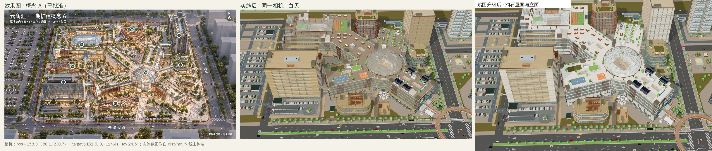
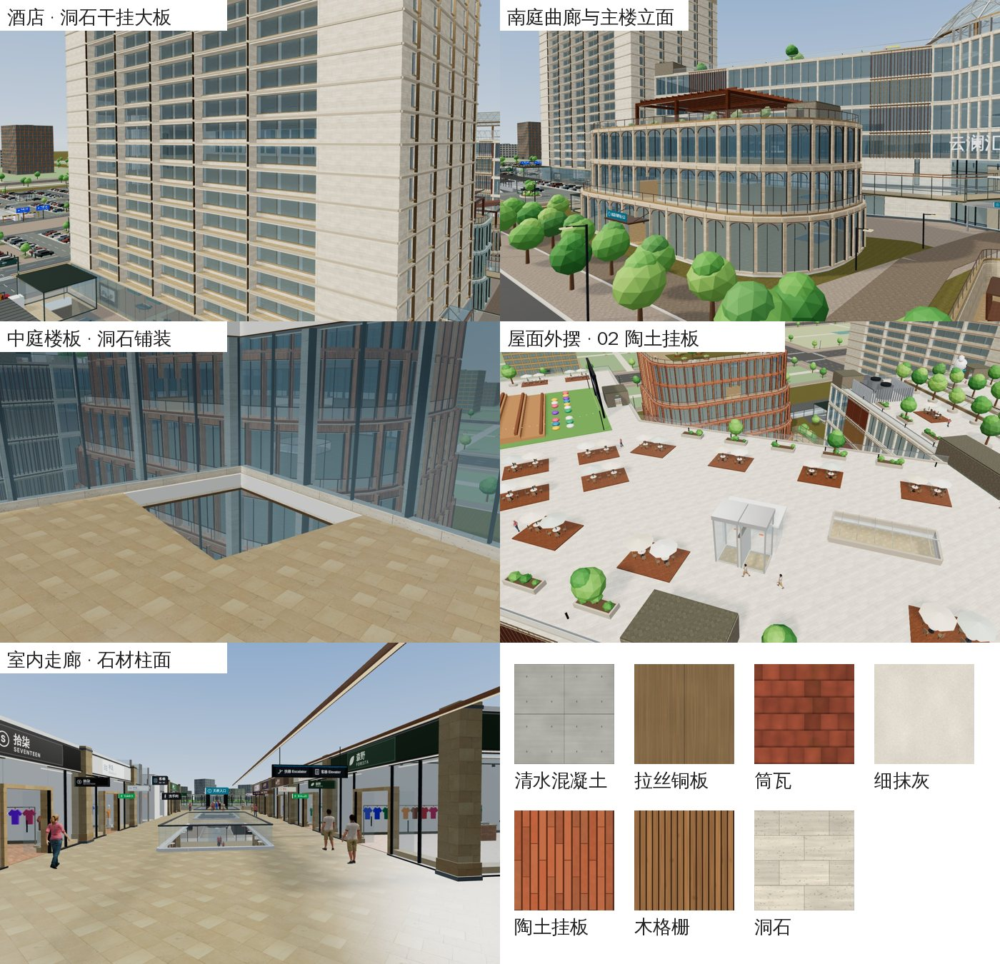

# 程序化面层贴图升级（2026-10-29）

目标：让房屋外墙、屋面和室内墙面的质感更接近概念 A 效果图（暖色洞石、陶土、铜木格栅、浅色石材屋面）。

## 新增 7 种面层

外网贴图站在本环境被网络策略拦截，所以全部在仓库内程序化生成：[scripts/procedural-surfaces.mjs](../scripts/procedural-surfaces.mjs) 定义像素，[scripts/procedural-textures.mjs](../scripts/procedural-textures.mjs) 渲染成 JPEG 写入 `assets/textures/procedural/`（颜色、法线、粗糙度各一张，可无缝平铺，共 1.35 MB）。`build.mjs` 与 CC0 贴图一样嵌入，运行时没有额外生成开销。

| 面层 | 一张图覆盖 | 用在 |
| --- | --- | --- |
| 洞石干挂大板（1.2 × 0.6m 错缝） | 2.4 × 2.4m | 一期主楼、餐饮翼、西里 W2 立面；酒店、公寓外墙；室内石材柱面与矮墙；屋面与楼板铺装 |
| 陶土挂板（0.1m 竖向陶棍） | 1.2 × 1.2m | 02 艺文馆立面与环带 |
| 拉丝铜板 | 1 × 1m | 穹顶与天幕结构、画屏框、屋顶玻璃亭、隔层铜木格栅、二期金色竖鳍、酒店大堂铜饰 |
| 筒瓦屋面 | 1.8 × 1.8m | 05 西里双坡屋顶 |
| 细抹灰 | 2 × 2m | 住宅墙体、西里 W4、店铺门头上墙、部分城市楼 |
| 清水混凝土（模板分缝 + 螺栓孔） | 2.4 × 1.2m | 花园馆、部分城市楼 |
| 木格栅墙板 | 1.2 × 1.2m | 西里 W3、创意馆立面、餐厅后墙 |

颜色图只带明度和轻微色相变化，色相仍由各楼的顶点色决定，所以同一张洞石能给不同楼栋上不同石色。

## 对比

## 验证

- `node --test tests/*.test.js`：325/325 通过；新增 `tests/procedural-textures.test.js` 校验文件哈希、可复现、平均明度和法线方向。
- 门洞矮墙测试的材质夹具补了 `travertine`（一期矮墙改用洞石），断言不变。
- 夜景：酒店、公寓外墙改为室外材质后不再整面自发光，夜间只有窗内灯光。
