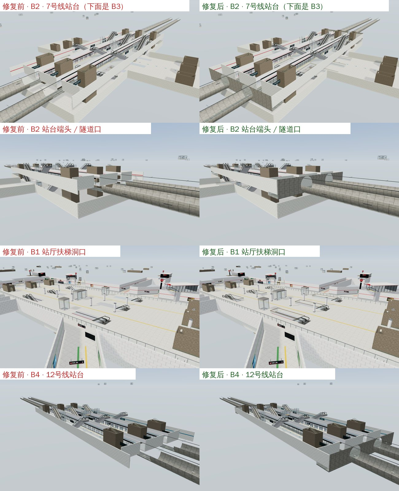

# 地铁站层透视漏洞修复（2026-11-02）

用户反馈：地铁站各层贴图之间有错，能从 B1 直接透过地面看到下层。

## 原因

- **站台层靠墙一条没有地面**：7 / 12 号线站台层（B2、B4）两侧上车站台的楼板只铺到 ±19m，外侧瓷砖墙在 ±20.8m，整条站台长度都留出 1.8m 宽的缝，直接看到下一层。
- **站台两端敞开**：站台止于 ±60m，隧道从 ±66m 开始，中间 6m 没有地面，端头也没有墙，能看穿到下层和地外。
- **轨行区侧面漏缝**：站台板底到道床之间没有侧墙，道床两侧各差 5cm，形成细缝。
- **扶梯洞口无护栏**：B1、B2、B3 的扶梯洞口没有玻璃护栏（护栏只给商场楼层生成），看起来像地面破洞。

## 修复

- 上车站台楼板延伸到墙面（20.66m），可行走范围仍止于 19m（`src/layout/metro-interchange.js`）。
- 轨行区两侧加侧墙，站内道床加宽压到侧墙下；站台端到隧道口铺道床层地面；站台端墙下延到道床；每个隧道口加带两个圆形隧道洞的端墙（`src/render/build/metro-interchange.js`）。
- 地铁各层扶梯洞口沿用商场玻璃护栏（`src/render/build/shell.js`）。

## 验证

- 新增 `tests/metro-closure.test.js`：两条线站台层靠墙处有楼板且不在行走网格内；端墙覆盖墙到墙、道床到吊顶，并留出两个隧道洞。
- `node --test tests/*.test.js`：349/349 通过。
