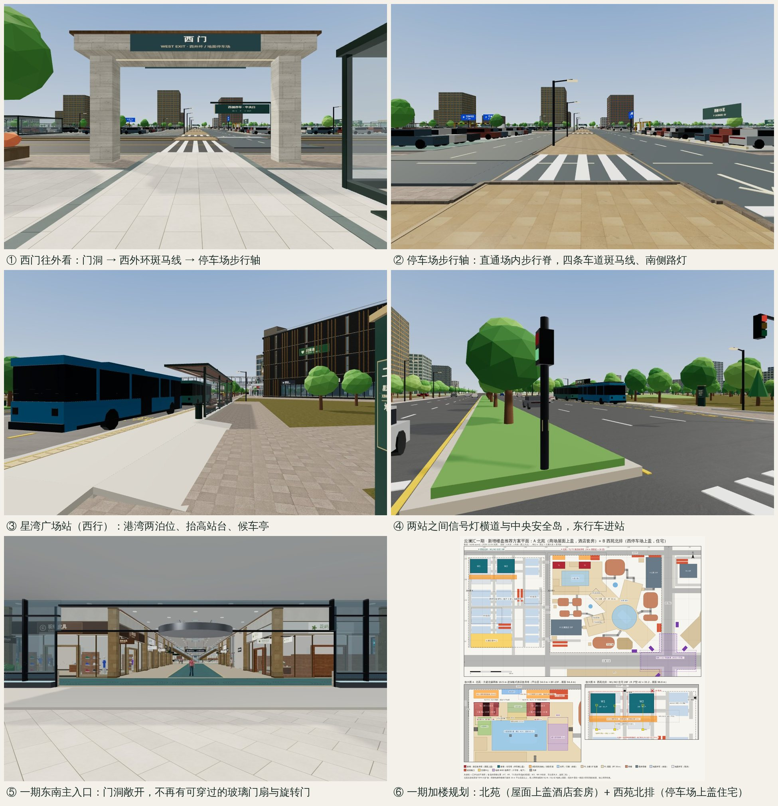

# 全园出入口排查、西门步行轴延伸与二期星湾广场站（2026-11-04）

用户要求：
- 除下沉广场以外，其他出入口逐个检查有没有问题；
- 一期停车场西面的口，通道延长到停车场里面；
- 二期加一个公交站；
- 一期加楼盘 / 上盖物业的规划分析（见 [规划决策文件](planning/2026-11-04-p1-air-rights/PLAN.md)）。

## 1. 出入口排查

### 检查方法

全园连接按四组检查：地铁八口与站厅、地下连廊与车库、地面门口、天桥与平台。

- 每组先由一个检查脚本跑一遍完整场景，四个检查项是：
  - 人体包络里有没有渲染体；
  - 视线会不会穿空；
  - 吊顶和边界有没有漏洞；
  - 导航能不能实走。
- 每条发现再交给另一个复核方，从头复现；复核不了的不修。

### 结果

| 组 | 发现 | 复核成立 | 已修 | 未修（均为低优先级） |
|---|---|---|---|---|
| 地铁八口 / 站厅 | 14 | 14 | 12（含 metro-9 随公交站修复） | metro-12：扶梯顶部扶手头伸进站厅地面，全园扶梯同类问题。metro-13：闸机门扇画成关闭状态，属于设计选择 |
| 地下连廊 / 车库 | 13 | 12（1 条误报） | 12 | — |
| 地面门口 | 13 | 13 | 10 | ground-11：侧门雨棚和门头之间有缝。ground-12：公寓花池贴着 ST1 楼梯亭玻璃。ground-13：NL5 铺位货架伸出 |
| 天桥 / 平台 | 13 | 13 | 11 | elevated-12：翼端休息区沙发靠近接驳门。elevated-13：NL5 铺位货架伸出 |

### 主要修复

**地铁**
- 线路图原来挂在加宽后的 PA/PB 通道口里，已改挂到实墙上。
- 站厅 14 根柱子由同一份布局记录生成，渲染和碰撞一致。
- A/C 梯井伸进扩大后的站厅角部，现在有墙封住。
- 以下几处的漏缝、露天和看见空洞都已补上：
  - PB 端 B 梯两侧的缝；
  - A/C/D 侧平台的吊顶；
  - 楼梯底口上方的门楣；
  - 楼梯、扶梯两侧的缝补上井底。
- 所有 M 标识柱都有碰撞，E–H 口的标识柱让开了引导步道。
- 楼梯按扶手限宽，上行扶梯单独作为 30° 坡道。
- P2-MT 坡板按坡道行走，不再在门线上突然跳高 0.3 m。

**地下**
- WPG-B1 挡土墙在西侧连廊处开口。
- 旧隧道墙和旧接驳厅原来留在扩建后的连续车库里，现在不再绘制。
- P1-B1 永久顶板为街道坡道和共享楼梯开洞，洞口四周封闭；车道灯不再挂在坡道净空里。
- 所有低吊顶的口部都有门楣。这也修好了今天早些时候二期住宅门（`residential-mall-metro-to`）修复后留下的门楣缝。
- 住宅车行主通道东端加了封墙。
- 从坡道下方横穿的漏洞已封住。
- 成对坡道的岗亭改到外侧；西侧隧道到达区让开储藏间；酒店接驳门前的沙发已移开。

**地面**
- 景观的花池、树、长椅和护柱避开所有街道门口和建筑轮廓。P1W3 茶舍室内原来有一棵树，P1W3-S 门口和住宅主入口原来有长椅，都已移走。
- 商场街道门按"开启"状态绘制：门扇收在门框后面，主入口只保留旋转门顶圈，玻璃气窗一直做到立面横带，中间不留缝。
- R1–R4 住宅主入口不再叠加占满门洞的旋转门。
- 门旁立面补石材，不再露出没有玻璃的缝；地面接驳厅屋顶以上的横缝已封上。
- 酒店 H-IN 道闸立柱移到两条车道中间，不再挡 ST2 共享楼梯亭出口。

**天桥**
- 附楼上层和一期 3F 以上的玻璃幕墙有碰撞。碰撞和渲染共用同一套门洞计算，门口照常可以通行。
- 十座艺术环廊天桥都改为垂直进出门洞，门宽等于桥宽：P1-ART-S/E 不再沿用 1F 的 7.1 m 弦线门，W4 和 W-RETURN 不再斜接。门洞上方都有门楣。
- 2F 立面只开门洞宽度，开到门楣高度为止。圆厅弧墙在门后的每一段都开洞，跨在两段弧墙接缝上的竖鳍也一起清掉。
- P1-BR / P2-BR 门宽与 5 m 连廊一致。云环外圈栏杆止于连廊侧玻璃线；雨棚立柱移到可走带以外。
- 休息区家具只摆在仍完整覆盖的步行区上。

**导航（合并时发现的问题）**

如果一步正好停在门线上，下一步会先切换楼层、又立刻切回原楼层。现在穿越判定改为半开区间（`segCross`），这个问题已解决。

## 2. 西门步行轴延伸到停车场

原状：西门艺术步道过西外环后，停在 x = −303 的停车场东侧人行道上，正对车头。末端还有四个问题：
- 门架立柱立在步道里，可以穿过去；
- 斑马线悬空约 18 cm；
- 路缘石横截步道口；
- 步道侵占了车行接入口。

修复：
- 轴线南移 1 m 到 z = −123.5。斑马线回到路面，也让开 WP-G2 车行接入口。
- 新增 5.6 m 石材步道 `west-gate-promenade`，从斑马线（x = −298）一直通到场内步行脊（x = −427），全长 129 m。
  - 穿过的四条场内车道都画了斑马线。
  - 南侧有 5 盏路灯，步行脊口有一块指示牌。
  - 沿步行脊往南 57 m 就是交通中心。
- C6/B6 北排拆了 25 个车位，西地面车位从 576 降到 551。原北排的充电位改到南排，充电位 57、无障碍位 10 不变。
- 停车场门架立柱都有碰撞。WP-G2 压在步道上的那根立柱取消，横梁改为悬臂。

## 3. 二期星湾广场站

- 位置：云澜大道北侧（二期一侧）和南侧（公园一侧）各一个港湾式车站，每个两个泊位，在二期星湾广场门前。
- 车站：
  - 抬高站台；
  - 22 m 候车亭，带玻璃挡风墙；
  - 座椅、站牌、线路图、导向牌、站灯。
  - 所有设施都有碰撞，候车亭前留出至少 2.1 m 净宽。
- 过街：两站之间有一条信号控制的人行横道，中央隔离带留出安全岛，并设停止线和信号灯。人行道路缘石、隔离带绿化和车道虚线在港湾和横道处都断开。
- 公交：12 路和 36 路共 4 辆（一个实例化网格）。车辆按时刻进出港湾，车门朝站台停靠 20 s 后驶离。
- 附带修复：一期大道 E 口旁原有的路边候车亭原来没有碰撞，横在南侧步道上。现在它向路缘移动 1.4 m 并加了碰撞，步道从它背后绕过。

## 4. 验证

- 新增或扩展的测试：
  - `bus-stops`（8 项）
  - `west-gate-walk`（3 项）
  - `metro-entrance-defects`（11 项）
  - `underground-connections`（9 项）
  - `elevated-connections`（4 项）
  - `ground-doors`（3 项）
  - `arc-doorway-walls`（扩展）
- 核心测试在修复前的代码上会失败。抽查过三项：
  - 去掉门口排除后，`ground-doors` 失败在 R1-MAIN 长椅；
  - 用旧的门扇绘制代码，失败在 P1-SE 门洞；
  - `nav` 测试按坡道门槛更新。
- 全量 `node --test tests/*.test.js`：**389/389 通过**（提交 `ab2882d`）。
- 第一人称实景截图：本地构建，Chromium 软件渲染。

单张截图：
- [西门往外看](qa/entrances-2026-11-04/west-gate-through-gate.jpg)
- [停车场步行轴](qa/entrances-2026-11-04/west-gate-walk-into-lot.jpg)
- [星湾广场站（西行）](qa/entrances-2026-11-04/bus-wb-platform.jpg)
- [横道安全岛](qa/entrances-2026-11-04/bus-crossing-eb.jpg)
- [一期东南主入口](qa/entrances-2026-11-04/p1-se-door.jpg)

## 5. 发布

本次云端会话没有 Netlify 部署凭据，代码已推送到 `claude/wonderful-thompson-olaaxb`，还没有上线。
