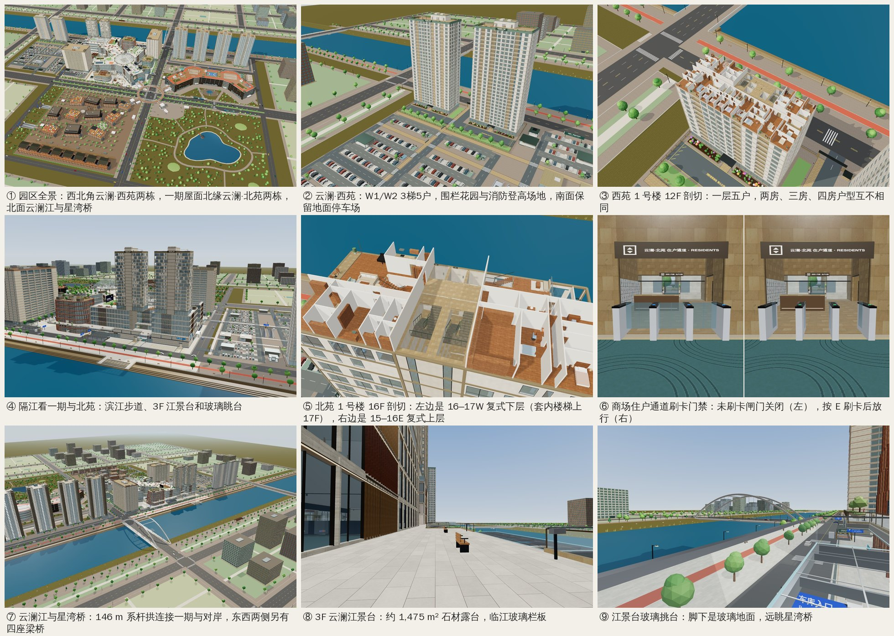

# 云澜物业西苑 / 北苑、云澜江与 3F 江景台（2026-11-04）

用户要求（用户写的是"云岚"，按项目品牌统一为 **云澜**：云澜物业、云澜·西苑、云澜·北苑）：
- 云澜物业开发两个小区：
  - **云澜·西苑**：在西停车场北排，3梯5户，两房、三房、四房各户型都不一样；
  - **云澜·北苑**：在一期屋面北缘，高端一梯一户大平层，加 15–16、16–17 这样交错的错层复式，每层两户，户型都不一样；
- 西停车场南面保留地面停车和地下停车；
- 一期和二期住宅北面加一条宽阔的江，中间一座桥通到对岸；
- 临江的商场做一个很大的北侧露台，带观景玻璃；
- 住宅电梯和商场分开，商场里另有一条刷卡门禁的住户通道；
- 做好之后截图。

## 1. 云澜·西苑（西停车场北排）

- **位置**：地块 x[−482, −368] × z[−250, −204]。两栋板楼：
  - W1 x[−480, −436.6]；
  - W2 x[−414, −370.6]；
  - 都在 z[−246, −226.8]，43.4 × 19.2 m。
- **竖向**：每栋 31 层：
  - B2 −8.4 m、B1 −4.5 m 是地库电梯厅；
  - 1F 是社区大堂，进门刷卡；
  - 2F–28F 每层 5 户；
  - RF 85.5 m 是屋顶花园。
- **3梯5户**：客梯 L1、L2，消防 / 担架梯 L3，两部防烟楼梯。三部梯都从 B2 停到 RF。
- **户型**：每栋 5 个户位，两栋共 10 种户型，每种 27 户，合计 270 户（两房 108、三房 108、四房 54）。

  | 户位 | 西苑 1 号楼 | 套内 m² | 西苑 2 号楼 | 套内 m² |
  |---|---|---:|---|---:|
  | 南·西端 | 四房一厅 | 153.0 | 三房一厅 | 131.4 |
  | 南·中间 | 两房一厅 | 95.4 | 两房一厅 | 100.8 |
  | 南·东端 | 三房一厅 | 142.2 | 四房一厅 | 158.4 |
  | 北·西端 | 三房一厅 | 140.3 | 两房一厅 | 97.4 |
  | 北·东端 | 两房一厅 | 92.4 | 三房一厅 | 135.2 |

- **室内**：家具按户型配：
  - 两房配双人沙发和圆几；
  - 三房配三人沙发、扶手椅和餐边柜；
  - 四房配 L 形沙发，或一对对坐的沙发。
  - 卧室都有衣柜。儿童房和次卧加书桌，老人房加阅读椅，主卧加梳妆台和床尾凳。
  - 沙发颜色按楼层和户位取，同一层五户互不相同。
- **场地**：
  - 围栏花园；
  - G4 北门门楼和岗亭（`云澜·西苑 · 北门`）；
  - 东西向消防车道，从 G4 进入；
  - HS-W1 / HS-W2 消防登高场地，z[−221.8, −211.8]，地面画有"消防登高场地 禁止占用"。
- **停车**：西停车场拆掉北排 A1/A2/B1/B2 四个车位区，A3/B3 的北排也拆掉。南面地面停车和地下车库保留。
  - 地面车位 551 → 427；
  - 车位区 24 → 20；
  - 充电位 57 → 51；
  - 无障碍位 10 → 9。
  - G5 车行口取消，G4 改作社区门。停车亭 ST1 拆除，L1 和 ST2 移位。
- **地库**：W-B1 / W-B2 电梯厅经门洞接西停车场 B1 / B2 车库。门洞往里 2.0 m 是刷卡玻璃门。
- **远景**：离塔楼中心 600 m 以外改画简化外立面（616 个三角形，2 次绘制调用）；回到 570 m 以内恢复完整外立面。

## 2. 云澜·北苑（一期屋面北缘）

- **位置**：两栋塔楼立在一期屋面（34.0 m）北缘：
  - 北苑 1 号楼 x[−278, −242]，东西两户各宽 14 m，每户每层 224 m²；
  - 北苑 2 号楼 x[−228, −196]，每户宽 12 m，每户每层 192 m²；
  - 都在 z[−240, −224]。
- **竖向**：每栋 19 层：
  - 7F（34.0 m）是空中会所，有休息区、图书室、餐厅和健身房；
  - 8F–13F 是大平层，层高 3.6 m；
  - 14F–24F 是错层复式，层高 3.3 m；
  - RF 96.9 m。
- **核心筒**：每栋一个 8 × 16 m 核心筒，占一期北排一个铺位，从一期 B2 一直通到塔顶。
  - 1 号楼在 SQ-N1 x[−264, −256]，2 号楼在 SQ-N5 x[−216, −208]。
  - 核心筒里有 3 部电梯、2 部楼梯。
- **一梯一户**：
  - **住户电梯 W** 只停西户的入户层：B2 B1 1F 7F 8F–14F 16F 18F 20F 22F 24F RF；
  - **住户电梯 E** 只停东户的入户层：B2 B1 1F 7F 8F–15F 17F 19F 21F 23F RF；
  - **消防电梯**每层都停。
- **户数**：每栋 24 户，即 14 套平层加 10 套复式，共 34 个层单元。两栋合计 48 户、68 个层单元。
  - 68 个层单元各有一张户型图，没有两张相同。
  - 平层是三房一厅或四房一厅，复式是四房或五房两厅。
- **复式交错**（两栋相同）：西户从 14F 起每两层一套，东户从 15F 起每两层一套。所以 15F–23F 每层都是一户的上层加另一户的下层，14F 东户和 24F 西户是平层。
  - 复式下层有入户门、客餐厅、厨房、一间卧室和套内楼梯，起居室窗边放三角钢琴（平层放一对休闲椅）；
  - 复式上层是三到四间卧室，没有入户门。

  | 层 | 西户 W | 东户 E |
  |---|---|---|
  | 14F | 14–15W 四房复式 · 下层 | 14E 三房平层 |
  | 15F | 14–15W · 上层 | 15–16E 四房复式 · 下层 |
  | 16F | 16–17W 五房复式 · 下层 | 15–16E · 上层 |
  | 17F | 16–17W · 上层 | 17–18E 五房复式 · 下层 |
  | 18F | 18–19W 四房复式 · 下层 | 17–18E · 上层 |
  | 19F | 18–19W · 上层 | 19–20E 四房复式 · 下层 |
  | 20F | 20–21W 五房复式 · 下层 | 19–20E · 上层 |
  | 21F | 20–21W · 上层 | 21–22E 五房复式 · 下层 |
  | 22F | 22–23W 四房复式 · 下层 | 21–22E · 上层 |
  | 23F | 22–23W · 上层 | 23–24E 四房复式 · 下层 |
  | 24F | 24W 四房平层 | 23–24E · 上层 |

- **门牌**：复式门牌写成 `16–17W` 这样的形式。代码里是 `T1-1617W-L` / `T1-1617W-U`，名称带"下层 / 上层"。

## 3. 住户电梯与刷卡通道

- **与商场分开**：北苑核心筒穿过一期 B2…6F，这几层只是"借道"。
  - 只在 B2、B1、1F 开门，B1M 和 2F–6F 的电梯井和楼梯间都是封死的。
  - 每个住宅电梯门、楼梯门离商场公共区可走到的地方都至少 2.84 m。
  - 商场自己的扶梯、电梯、楼梯不进住户区。
- **门禁**：一共 14 道门、12 个住户区。

  | 位置 | 门 | 形式 |
  |---|---|---|
  | 北苑 1 / 2 号楼街门（北外环） | `T1/T2-STREET-GATE` | 玻璃门，在门厅里 |
  | 商场 1F 住户通道（方庭北侧走廊） | `T1/T2-1F-GATE` | 三通道速通闸机，一条是无障碍宽通道 |
  | 一期 B1 / B2 地库电梯厅 | `T1/T2-B1-GATE`、`T1/T2-B2-GATE` | 玻璃门 |
  | 西苑 1F 大堂、B1 / B2 地库电梯厅 | `W1/W2-1F/B1/B2-GATE` | 玻璃门 |

- **门的行为**（"看得见的就是挡人的"）：
  - 门关着时，在导航里就是实墙。
  - 刷卡后开 4 s。
  - 从住户一侧出来时自动感应开门。
  - 有人还在通道里时不关门。
  - 每道门都离任何门洞至少 2.0 m，已有的出入口测试不受影响。
- **怎么用**：
  1. 漫游，走到一期 1F 方庭北侧走廊 (−220, −217)，面朝北，就能看到"云澜·北苑 住户通道 · RESIDENTS"。
  2. 走到闸机前，底部提示「E刷卡 · 北苑 2 号楼住户通道 · 刷卡」。
     - 电脑按 **E**。
     - 手机点提示里的 **「刷卡」**。
  3. 提示「刷卡成功 · 欢迎回家（4 秒后自动关闭）」，闸机打开，LED 由蓝变绿。
  4. 进入住户电梯厅，在电梯面板选层。
  - 没刷卡就往里走，会停在门线外，并提示「住户专用通道 · 请走到读卡器前按 E 刷卡」（手机上是「点「刷卡」开门」）。
  - 从街上回家：从北外环人行横道 `x-rn-sq` 过街，走到 2 号楼街门刷卡。
  - 从地库回家：在西停车场 B1 走到西苑 1 号楼门洞刷卡。
- **自动导览**：「云澜·北苑 · 商场住户通道（刷卡门禁）」三步。先在街上看方庭北门与北苑街门，再进 1F 走廊，最后停在闸机前。导览经过时闸机自动打开。

## 4. 云澜江、星湾桥与对岸

- **江**：
  - 河道 z[−436, −290]，宽 146 m；
  - 水面 z[−412, −300]，宽 112 m，标高 −5.0 m；
  - 两岸是台阶式驳岸、草坡、芦苇和亲水平台。
  - 水面不透明，夜里随夜景变暗。这样从一期玻璃幕墙里看出去，水面不会盖住玻璃。
- **星湾桥**（`XW-BR`）：在星湾路 x = 0。
  - 146 m 系杆拱，40 根吊杆，桥面 −0.12 m；
  - 跨中两侧各有一个玻璃挑台；
  - 夜里有 LED 灯带。
- **另外四座梁桥**：城西二桥 x −890、城西桥 x −540、城东桥 x 540、城东二桥 x 890。
- **两岸步道**：
  - 南岸滨江步道带骑行道；
  - 北岸滨江绿道；
  - 对岸滨江公园有观景亭（坡屋顶）。
  - 北面城市路网整体北移到 −500 / −650，城市建筑 84 → 82 栋，行道树 1,430 → 1,314 棵。
- **江景玻璃眺台**（`RV-LOOK-S`）：x[−244, −212]，在新方庭北门的轴线 x −228 上，过街横道 `x-rn-sq` 也在这条轴线上。
- **地名**：HUD 会报出云澜江景台、江景台玻璃挑台、星湾桥及跨中玻璃挑台、各座梁桥、江景玻璃眺台、观景亭、南岸滨江步道、北岸滨江绿道和南岸亲水平台。总览里点星湾桥、各座梁桥、眺台和观景亭，会弹出介绍卡。

## 5. 3F 云澜江景台

- **位置与面积**：一期 3F（12 m）北缘，长约 175 m。
  - 石材露台 1,390.7 m²；
  - 玻璃挑台 RT-PROW-1 x[−239, −231] 28 m²；
  - 玻璃挑台 RT-PROW-2 x[−182, −166] 56 m²；
  - 合计 **1,474.7 m²**。
- **栏杆与挑台**：
  - 临江是玻璃栏板，共 205.9 m。
  - 挑台是玻璃地面，有钢板拼缝，挑台口有一条灯线。
  - 挑台只是导航面（`navSurfaces`），走到端头就停住。
- **入口**：
  - 3F 环廊北侧的通道口 x[−224, −216] 直通露台，所以 SQ-ART-3F / 5F 两部扶梯移到 F_SQ 局部 x 4.8 起。
  - P1C 艺文馆 3F 有门通露台；
  - P1C 外挂"云澜汇 · 江景台"字。
- **消防约束**：在北苑消防登高面范围内，露台进深 ≤ 4 m（GB 50016 §7.2.1），HS1 / HS2 上空没有露台、挑台或楼板。

## 6. 一期的改动和代价

- **拆掉 16 个铺位**：一期铺位 383 → 367，共 2,104 m²，占一期 GLA 的 3.4 %。
  - SQ-N1 和 SQ-N5，B1M–6F 每层各一间，共 14 间，让给两个核心筒；
  - 1F 的 SQ-NW，改作 1 号楼住户大堂；
  - 1F 的 SQ-N3，改作新的方庭北门。
- **方庭北门西移 8 m** 到 SQ-N3 x[−232, −224]，门宽还是 8 m。原来的北门门厅 x[−224, −216] 整个改作 2 号楼住户大堂，有街门、门厅、礼宾台、快递柜和刷卡门。
- **6 组商场竖向交通止于 6F**：北苑底板压在它们上方。
  - 包括客梯 P1-SQ-W-L1/L2/L3、货梯 P1-SQ-F1、楼梯 P1-SQ-ST-W / ST-SV；
  - 屋面仍有 16 部楼梯、11 部客梯；
  - 商场楼梯层间线路 271 → 269；
  - 屋面农场移到 rect(−278, −222.5, −260, −211)，观景台移到 rect(−239, −228, −229, −219.5)。
- **2 号楼核心筒**立在 3F–6F 北侧凹口里，外露的柱面用石材包住。
- **地下**：B1/B2 机房改了形状，新增 SQ-EQ-1N、SQ-EQ-4E，B2 少 2 个车位。

## 7. 消防

- **北苑登高场地**：
  - HS1 x[−278, −242] × z[−255, −245]，HS2 x[−228, −196] × z[−255, −245]；
  - 都在已覆盖的一期北坡道上，坡道只在 x > −187.8 才开敞；
  - 上空完全露天，有测试覆盖。
  - 这一轮不设落客位，因为原规划的落客位和两块登高场地重叠。
- **西苑登高场地**：HS-W1 / HS-W2 和东西向消防车道。车道从 G4 进入，路面不画中心虚线。
- **疏散**：
  - 西停车场西北角的疏散，经 W-B 门洞走西苑塔楼的楼梯（GB 50067-2014 §6.0.3）。刷卡门在火警时应释放，游戏里只用出门感应来模拟。
  - 每个核心筒有一部消防电梯，每层都停。

## 8. 数量（游览布局，实测）

FPS 紧凑布局逐字节不变（`fps-frozen` 哈希）。

| | 之前 `dc4951d` | 之后 |
|---|---:|---:|
| 建筑 ID | 19 | 23 |
| 楼层 | 238 | **338**（西苑每栋 31 层，北苑每栋 19 层） |
| 电梯 | 64 | **76** |
| 楼梯 | 99 | **106** |
| 商铺 | 680（一期 383） | **664**（一期 367） |
| 住宅户数 / 记录 | 728 / 728 | **1,046 / 1,066**（西苑 270 户；北苑 48 户、68 个层单元） |
| 刷卡门 / 住户区 | 0 / 0 | 14 / 12 |
| 西停车场地面车位 / 车位区 / 充电 / 无障碍 | 551 / 24 / 57 / 10 | **427 / 20 / 51 / 9** |
| 西停车场停车亭 / 楼梯 | 9 / 9 | 8 / 8 |
| 城市建筑 / 行道树 | 84 / 1,430 | 82 / 1,314 |
| 商场楼梯层间线路（`mall-stairs`） | 271 | 269 |

## 9. 性能

按 HANDOFF §8 的方法测：`renderer.info.autoReset = false`。用 headless Chromium + SwiftShader，1280×800，画质"精细"。

- "常态帧"指主 pass 加标注 pass。阴影贴图只在视角、聚焦或画质变化时重画，所以单独计。
- 中间两列来自性能阶段，西苑远景 LOD 在 `a355b23` 加入。最后一列是本次提交的最终构建，包含之后的评审修复。

| 园区全景 V(110, 430, 480) → 原点 | 之前 `dc4951d` | 加 LOD 前 `34e3c44` | 加 LOD 后 `a355b23` | 最终构建（本次提交） | 预算 |
|---|---:|---:|---:|---:|---|
| 绘制调用，常态帧 | 2,866 | 2,923（+57，超） | 2,907（**+41**） | 2,852（主 pass +36；标注 −50） | ≤ +50 |
| 其中主 pass / 标注 | 2,781 / 85 | 2,833 / 90 | 2,817 / 90 | 2,817 / 35 | |
| 阴影重画一次的调用 | 1,319 | 1,357 | 1,351 | 1,351 | |
| 主 pass 三角形 | 3.672 M | 3.836 M | 3.751 M（**+0.079 M**） | 3.752 M（**+0.080 M**） | ≤ +0.40 M |
| 场景几何 | 271.80 MB | 284.13 MB | 284.22 MB（**+12.42 MB**） | 284.66 MB（**+12.85 MB**） | ≤ +15 MB |
| 显存贴图（不含渲染目标） | 645.57 MB | 653.41 MB | 653.41 MB | 652.22 MB | |

- **N1**：V(−150, 115, −380) → (−236, 55, −232)。常态帧 1,302 → 1,359（+57），主 pass 三角形 +0.143 M。西苑塔楼离这里只有 290–350 m，不换远景。最终构建：主 pass 1,312 次（+56）、标注 19 次，常态帧 1,331（+29）；主 pass 三角形 2.418 M（+0.144 M）。
- **R1**：V(260, 260, −760) → (−60, 0, −300)。常态帧 2,906 → 2,921（+15），主 pass 三角形 +0.082 M。最终构建：主 pass 2,833 次（+11）、标注 18 次，常态帧 2,851（−55）；主 pass 三角形 3.747 M（+0.083 M）。
- **标注变少**：评审修复里加了标注避让（被塔楼挡住的、和别的标注重叠的都隐藏），所以最终构建的标注 pass 比之前少，常态帧反而低于基线。真正新增的是主 pass：园区视角 +36 次，在 +50 以内。
- **含阴影重画的一帧**：加 LOD 后 +73 次，最终构建 4,203 次（+18，其中阴影 +32）。只在视角、聚焦或画质变化时出现，不是每帧都有。
- **"流畅"画质**（手机档，无阴影）：园区视角 2,866 / 3.672 M → 2,907 / 3.751 M。
- **页面加载**：之前 11.9–17.9 s（中位 16.5 s），加 LOD 后 12.9–18.4 s（中位 13.8 s），各 7 次；最终构建测了 1 次，13.9 s。`dist/mall.html` 77,202 KB → 77,794 KB。
- **北苑**：两栋都没有远景 LOD。如果阴影重画帧也要压到 +50 以内，下一步就是给北苑加同样的 LOD，园区视角约可省 18 次主 pass、6 次阴影。
- **两项预算**：
  - 社区塔楼几何 9.96 MB，预算 10 MB；
  - 西苑 12F 一层最多 1,034 个盒子，预算 1,500。

## 10. 测试

- 全量 `node --test --test-concurrency=3 tests/*.test.js`：**495/495 通过**。之前是 389 项。
- 新增测试文件：

  | 文件 | 项数 | 内容 |
  |---|---:|---|
  | `fps-frozen` | 2 | 紧凑 FPS 布局哈希 |
  | `community-contract` / `community-plans` | 5 / 5 | 塔楼契约、户型生成和校验 |
  | `community-render` | 19 | 外立面、室内、层门、LOD、几何预算 |
  | `west-garden` | 10 | 西苑场地、围栏、消防车道 |
  | `north-residences` / `residential-access` / `north-render` | 10 / 10 / 11 | 北苑塔楼、一期改造、门禁和独立核心筒 |
  | `river` / `river-terrace` / `river-render` | 10 / 5 / 9 | 江、桥、江景台 |
  | `riverside-integration` | 9 | 整合实走 |
  | `label-declutter` | 2 | 标注避让 |

- **`riverside-integration` 的实走**（门禁是真实的，不刷卡过不去）：
  - 地面 (−228, −262) → `x-rn-sq` → 2 号楼街门 → 刷卡 → 大堂 → 住户电梯 W → 16F 入户门；
  - 商场走廊 → 刷 `T2-1F-GATE` → 候梯厅；
  - 西停车场 B1 → 刷 `W1-B1-GATE` → 西苑 1 号楼 L1。
- 另外改了既有测试，每处都写在各自的提交里：`p1-access`、`ancillary-stairs`、`p1-expansion-layout`、`p1x`、`nav`、`ground-doors`、`mall-stairs`、`west-parking`、`west-gate-walk`、`hospitality-relocation`、`shared-garages`、`facade-materials`。没有删测试，也没有放宽断言。
- **最终阶段修的两个显示问题**（截图时发现）：
  - 社区电梯层门的材质克隆时复制了剪切平面，聚焦某层时，上方各层的层门还悬在空中。现在共用塔楼的剪切平面，新增测试，改动前失败、改动后通过。
  - 总览里聚焦复式下层时，同户上层的房间画在剖切面之上，盖住了聚焦层，上层候梯厅的指示牌也悬空。现在总览只显示聚焦层及其下方的同户楼层，漫游时照旧上下层都显示。这部分在 `app.js`，需要 DOM，只在浏览器里核对过。

## 11. 与需求 / 规格的出入和已知限制

- **品牌**：用户写"云岚"，项目里统一为"云澜"。
- **西停车场**：规格写 18 个车位区、49 个充电位，实测 20 和 51。A3/B3 的南排按规格保留，所以多出两个区。车位 427、无障碍 9 和规格一致。
- **门禁可以绕过**：传送、目录、飞行和自动导览都不经过门禁。退出漫游后门禁复位。
- **户型是生成的**：`scripts/prepare-community-plans.mjs` 生成并校验，不是逐套设计的。改户型要重新生成数据文件，见 HANDOFF。
- **复式上层**：没有走廊出口，经套内楼梯回到下层疏散（GB 50016 的跃层做法）。
- **北苑没有远景 LOD**：含阴影重画的一帧比之前多 73 次调用，超过 +50（见 §9）。
- **夜景**：塔楼窗帘每 7 扇亮 2 扇，没有加吊顶灯槽（几何预算已到 9.99 MB 上限附近）。
- **星湾桥铭牌**：是石柱加铜牌，没有文字，桥名靠标注显示。
- **门禁只做了通行**：没有访客对讲、住户专用车位和车行道闸。
- **截图环境**：headless Chromium + SwiftShader 软件渲染，不代表实体手机的帧率和内存。

## 12. 截图

都是 1280×800，用最终构建 `dist/mall.html` 截取。俯瞰图关掉了浮动标注。

- 西苑：
  - [西苑全景（H1）](qa/riverside-2026-11-04/west-h1.jpg)
  - [西苑 1 号楼 12F 剖切（H2）](qa/riverside-2026-11-04/west-h2-12f.jpg)
  - [西苑四房客厅（第一人称）](qa/riverside-2026-11-04/west-home.jpg)
- 北苑：
  - [隔江看一期与北苑（N1）](qa/riverside-2026-11-04/north-n1.jpg)
  - [商场住户通道 · 未刷卡](qa/riverside-2026-11-04/north-gate-closed.jpg)
  - [商场住户通道 · 刷卡后（N2）](qa/riverside-2026-11-04/north-gate-open.jpg)
  - [北苑 16F 复式剖切（N3）](qa/riverside-2026-11-04/north-duplex.jpg)
  - [北苑 10F 大平层看江](qa/riverside-2026-11-04/north-flat-view.jpg)
- 云澜江：
  - [云澜江与星湾桥（R1）](qa/riverside-2026-11-04/river-r1.jpg)
  - [3F 云澜江景台（R2）](qa/riverside-2026-11-04/terrace-r2.jpg)
  - [星湾桥人行道（R3）](qa/riverside-2026-11-04/bridge-r3.jpg)
  - [江景台玻璃挑台](qa/riverside-2026-11-04/prow.jpg)
  - [对岸看商场与北苑](qa/riverside-2026-11-04/farbank.jpg)
  - [星湾桥夜景](qa/riverside-2026-11-04/night.jpg)
- [园区全景](qa/riverside-2026-11-04/hero.jpg)

## 13. 发布

本次云端会话没有 Netlify 部署凭据。代码和重新构建的 `dist/` 已推送到 `claude/wonderful-thompson-olaaxb`，还没有上线。
