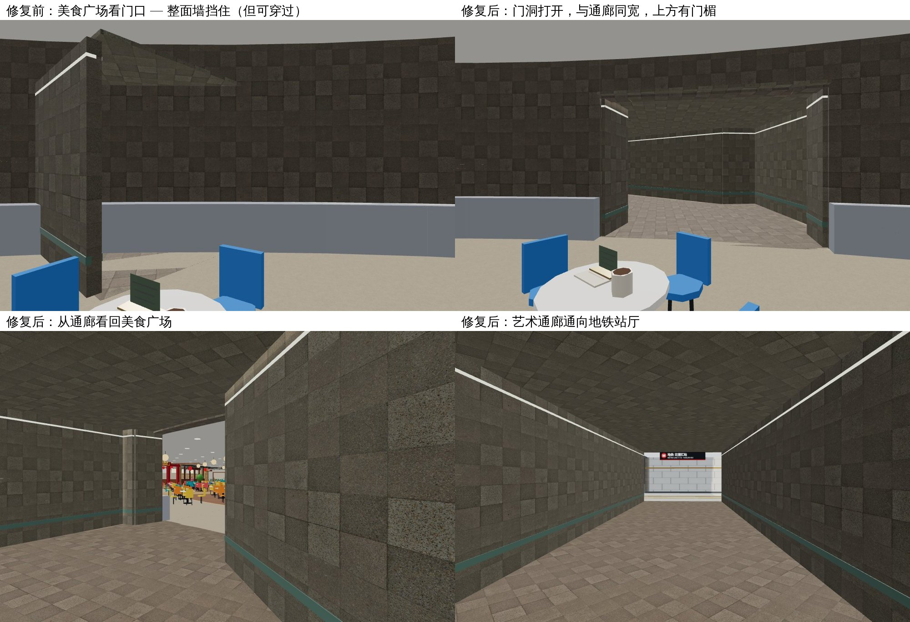
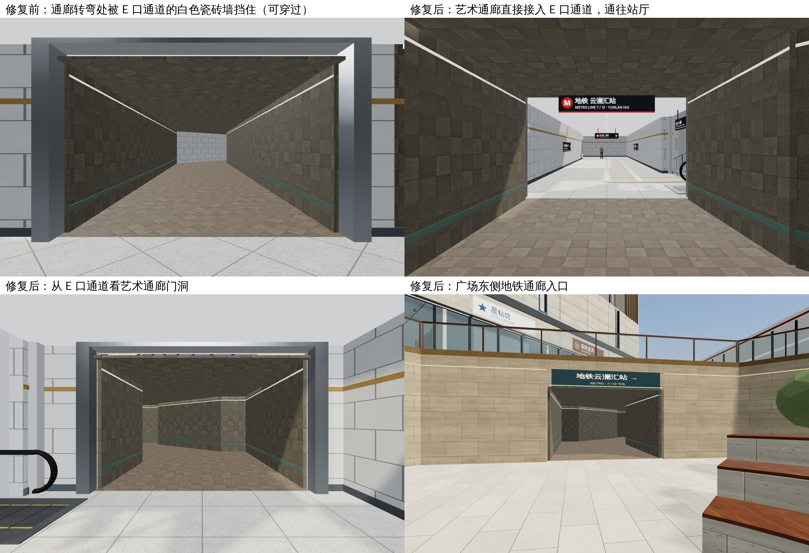

# 下沉广场连接处“虚拟墙”修复：B1M 美食广场门洞与地铁通廊（2026-11-04）

用户反馈：一期新建的下沉艺术广场和商场内部、地铁口连接处有贴图挡住，变成“虚拟墙”。人可以穿模走过去，后面实际是空的。

## 原因

- 美食通廊的 B1M 门（`P1-sunken-food-door`）开在一期圆厅外墙上。圆厅外墙由 1.78m 一段的短弧边拼成，门是一条横跨 4 段弧边的 7.1m 直弦。
- `shell.js` 的 `edgeSpans` 只认“两个端点都在同一条边线上”的门，所以没有任何一段弧边开洞。整片 4.5m 高的地下挡土墙和矮墙都画在门口，但导航允许通行，于是成了能穿过去的“虚拟墙”。
- 开洞后还暴露了两个问题：门宽 7.1m 而通廊只有 4.8m，通廊又是斜着离开圆厅，两侧能看到车库和外部；通廊吊顶只有 3.2m 高，门洞上方能看到天空。
- 地铁一侧：10-31 新增的地铁 E 口通道（`PE`）比艺术通廊晚建，正好横穿艺术通廊转弯处。PE 的瓷砖墙属于 M-B1 层（渲染和碰撞都在 M-B1），艺术通廊走在 P1-B1M 层，所以这些墙在通廊里“挡着但能穿过去”。

## 修复

- `src/render/build/shell.js`：圆厅弧边可以按门的弦线开洞（只处理离弦线不超过 1.5m、方向接近的弧边），矮墙和挡土墙都会生效。地下门洞可以带 `lintel`，挡土墙在通廊吊顶以上保留门楣。
- `src/layout/p1-public-realm.js`：美食通廊先垂直于圆厅弦线走出 3m 再转向广场。B1M 门洞改为与通廊同宽（4.8m），门楣高 3.2m。
- 同样的弧边逻辑也修好了二期 B1 `residential-mall-metro-to` 门口原本被墙挡住的问题。
- 地铁通廊：艺术通廊从广场东口出来后，斜向转北，在 E 口通道南侧墙上开 5.2m 门洞接入（`metroPassage: 'PE'`），不再横穿 E 口通道去 A 通道。`src/layout/metro-access.js` 生成 E 口墙体时扣除这个门洞，渲染和碰撞墙共用同一份记录。经 E 口通道可直达站厅，也可从 E 口楼梯上地面；原 A 通道侧墙恢复完整。

## 验证

- 新增 `tests/arc-doorway-walls.test.js`：用真实矮墙和挡土墙网格做射线检查，两个弧墙门口全宽、全高都没有遮挡；门外的弧墙仍在；美食门上方有门楣；通廊垂直离开弦线，门洞与通廊同宽。修复前这个测试失败在 `P1-sunken-food-door wall blocks doorway`。
- `tests/p1-public-realm.test.js` 改为检查艺术通廊与 E 口通道的重叠不超过门口 3cm 端头、不压任何出口楼梯、E 口墙在门洞处断开而门旁保留；旧布局下该测试失败。`tests/p1-metro-portal-render.test.js` 用真实地铁网格射线确认 E 口侧墙门洞净空。B1M 美食广场 → 广场 → E 口通道 → 站厅双向步行通过。
- `node --test tests/*.test.js`：350/350 通过。
- 第一人称实景截图（本地构建，Chromium 软件渲染）：

## 发布

- 本次云端会话没有 Netlify 部署凭据，代码已推送到 `claude/wonderful-thompson-olaaxb`，尚未上线。
