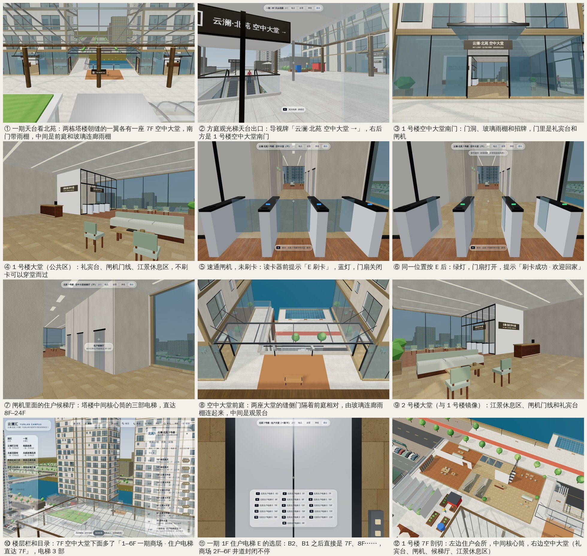
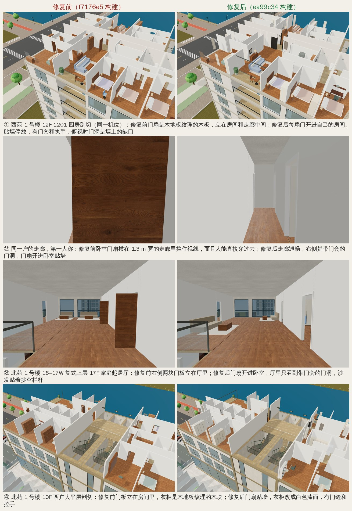
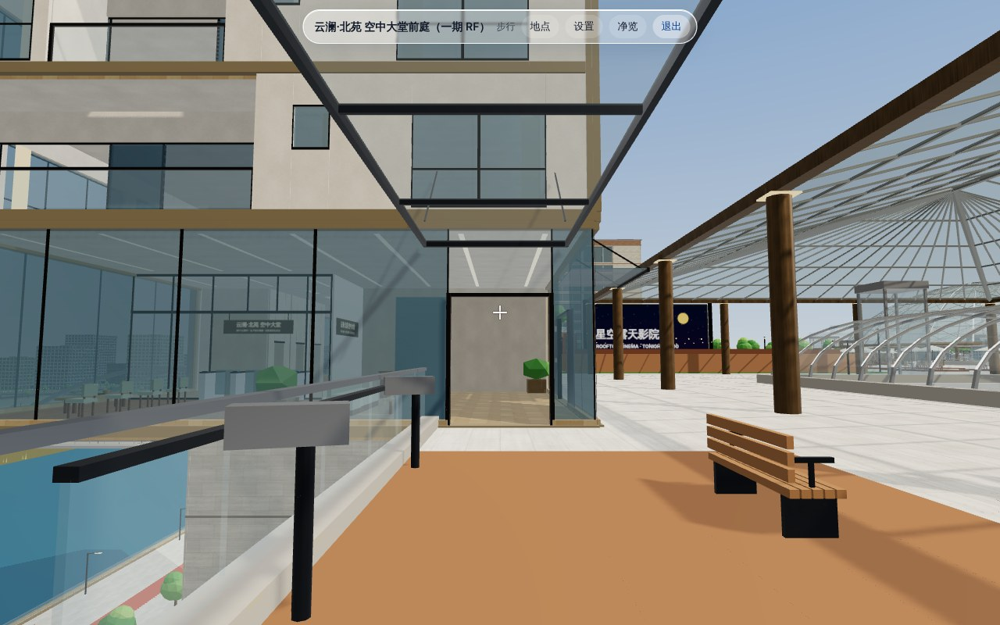

# 户内门扇与北苑 7F 空中大堂（2026-11-05）

分支 `claude/wonderful-thompson-olaaxb`。源码改动在 `4658dc3`（门扇）、`c82f17b`（空中大堂）、`8bc9336` / `f7a3655`（两次合并）和 `751386f`（评审修复），户型目录在 `3c0249f` 重拍，`dist/` 在 `ea99c34` 重新构建。本文截图都来自 `ea99c34` 的 `dist/mall.html`。线上新站 https://yunlan-mall-calvin-v2.netlify.app/ 还是修复前的 `4b94cbf`，这次没有发布。

用户的要求：
- 户型里那些 **“竖着的门板”** 要修好；
- 「我希望商场天台那个地方也可以有一个大堂，可以穿过去，也可以穿进住宅里面，并且可以从中间那里上住宅的电梯，直接上去」；
- 北苑楼层的疑问：「是直接从十几楼开始上吗？…六楼不是应该往上走，七、八、九、十吗？这些去哪里了？」（见 §3）。

## 1. “竖着的门板”：是什么，怎么修的

### 1.1 是什么

是社区户型（西苑 10 个户型、北苑 48 户）的**室内门扇**。原来 `residence-interiors.js` 的 `communityHome()` 把每扇门画成一块 0.04 m 厚、2.08 m 高的木板：
- 永远 90° 敞开，开向只看隔墙端点的顺序（横墙一律开向 −z，竖墙一律开向 +x），不看门服务的是哪个房间；
- 没有门套、没有执手；
- 用的 `wood` 材质其实是橡木**地板**贴图，竖起来像一块立着的地板。

所以一半多（378 扇）的门扇立在房间或走廊中间。入户门也一样，58 扇都立在玄关中间。门扇也不是导航障碍物，人能直接穿过去。

同样像“门板”的还有几类东西，一起改了：
- 没有柜门的高柜，也是地板贴图：鞋柜 58 个、储藏柜 111 个、衣帽间柜 137 个、书架 45 个；
- 160 个门洞的通行区里有家具，最常见的是挡在玄关和过厅之间的 2 m 鞋柜、挂在门洞上的玄关镜和冰箱；
- 边柜上方一块离墙 22 cm、悬空 7 cm 的灰色“挂画”；
- 阳台推拉门只有两根竖杆，没有上框。

### 1.2 前后对比（78 个户型层：西苑 W1/W2 12F、北苑 T1/T2 8F–24F，覆盖全部 58 户）

修复前的数字来自调查探针（`f7176e5` 构建），修复后的数字来自 `tests/community-doors.test.js` 和对 `ea99c34` 布局的统计。

| | 修复前 | 修复后 |
|---|---:|---:|
| 室内门扇 | 707 | 707 |
| 贴着一面墙停放 | 297（离墙 ≤ 20 cm 就算） | **695**（离墙 ≤ 5 cm） |
| 背后没有墙可靠 | 378 扇立在房间中间（离墙 > 15 cm） | **12**（见 1.4） |
| 开向走廊、客厅或餐厅，而不是开进它服务的房间 | 278 | **0**（也没有开进玄关的） |
| 横在走廊里、只剩不到 0.6 m | 152 | **0**（走廊留出 ≥ 0.75 m） |
| 压到床、床头柜或其他家具 | 54 | **0** |
| 和别的门扇重叠 | 7 | **0** |
| 入户门 | 58 扇立在玄关中间 | 58 扇向内折 180°，贴在玄关墙上 |
| 门扇是导航障碍物 | 否，能穿过去 | 是；每个门洞双向都走得过，每个房间都走得到 |
| 门洞通行区里有家具 | 160 个门洞（56 户） | **0** |
| 1.8 m 以上用地板贴图的盒体 | 鞋柜、储藏柜、衣帽间柜、书架等 | 只有电视背景墙 |

### 1.3 怎么修的

- **门扇由布局统一选定。** `src/layout/community-units.js` 的 `doorLeaves()` 给每扇门定一次铰链和开向，记录在 `partition.door.leaf`、`entryDoor.leaf` 和 `residence.doorLeaves` 上。渲染、漫游碰撞和户型目录的平面图读的是同一份记录。规则：
  - 开 90° 进它服务的房间（两边都是私密房间时，开进更深的那间）；
  - 铰链放在挨着垂直墙的那一侧门框，门扇平行贴墙，离墙 5 cm；生成器把门洞留在离墙角 0.15 m 或走廊正中的，门洞沿自己的隔墙挪到墙角（留 3 cm 墙垛）；
  - 避开床、家具、墙、窗、别的门扇和每个门洞的通行区；走廊至少留 0.75 m；立在房间里的门扇端头周围留 0.65 m 的走道；
  - 挡道几厘米的床横移最多 0.25 m（9 张床）；门洞或门扇扫过的范围里的床头柜换成窄的，放不下就不放；
  - 每扇门扇的矩形都写进 `residence.obstacles`，漫游时是实体。
- **门有门套、门头和执手。** 两面都有门套和门头线，门扇是 4 cm 暖白色漆面（`matte`），两面金属执手。入户门是深色钢门、深色门框。每扇门约 6 个盒体，都进已有的楼层批次，没有新增网格。
- **俯视能看出门洞。** 门洞上方那段墙和门头线单独放在 `lintel` 网格里，相机高过本层吊顶（总览剖切、俯视）时隐藏，所以俯视图里门洞是墙上的缺口；第一人称漫游时照常显示。加载的楼层多 1 个网格，仍 ≤ 8。
- **高柜是柜子，也是实体。** 衣柜、衣帽间柜、储藏柜、鞋柜、茶柜改成漆面，有门缝和拉手；书架有隔板和书。它们和冰箱、洗烘塔一起是漫游实体：`communitySolids(u)`（渲染器自己的摆放结果，按户型缓存）传给 `buildNav(layout, { unitSolids })`。为了不把床和衣柜之间 0.5 m 的过道堵死，实体在两端各内缩 5 cm、正面内缩 15 cm。
- **家具让开门洞。** 玄关鞋柜和镜子、书房、衣帽间、储藏间、家务间、厨房台面和冰箱、餐桌、家庭厅沙发、卫浴洁具都改用 `roomPlanner.onWall` 摆放，避开门洞区和停放的门扇。
- **其他：** 挂画挂到墙上，有画框和双色画布；阳台推拉门加了上框；梳妆镜和台盆镜加了深色镜框；加载楼层的窗帘画成三道前后错开的褶。

### 1.4 背后没有墙可靠的 12 扇

| 户 | 楼层 | 门 | 现在的样子 |
| --- | --- | --- | --- |
| W1-NE、W2-SW、W2-NW | 2F–28F | 客厅 / 主卧 | 主卧衣柜（2.5–2.8 m）移到门后，门扇靠在衣柜端头，相距 4 cm |
| T1-17E 上层、T1-22W 上层 | 18F、23F | 家庭起居厅 / 主卧套房 | 门后加了一个 0.5 m 宽的高柜，门扇靠在柜子端头 |
| T1-20W 上层、T2-20W 上层 | 21F | 家庭起居厅 / 次卧套房 | 门后加了一个 0.5–0.8 m 宽的高柜，门扇靠在柜子端头 |
| T2-14W、T2-18W、T2-21E、T2-23E 上层 | 15F、19F、22F、24F | 家庭起居厅 / 主卧套房 | 床头紧挨门边（0.2–0.3 m），门后放不下柜子，门扇立在床头旁 |
| T1-21E 上层 | 22F | 主卧套房 / 衣帽间 | 门扇离衣帽间外墙 7 cm，比 5 cm 的贴墙标准多 2 cm |

### 1.5 截图：同一机位前后对比

修复前的图是调查时（`f7176e5` 构建）拍的，修复后的图用同一机位、同一画质（均衡）从 `ea99c34` 的构建重拍。

| | 修复前 | 修复后 |
|---|---|---|
| 西苑 1 号楼 12F 1201 四房剖切 | [w1-1201-cut-before](qa/doors-2026-11-05/w1-1201-cut-before.jpg) | [w1-1201-cut-after](qa/doors-2026-11-05/w1-1201-cut-after.jpg) |
| 同一户走廊，第一人称 | [w1-1201-hall-before](qa/doors-2026-11-05/w1-1201-hall-before.jpg) | [w1-1201-hall-after](qa/doors-2026-11-05/w1-1201-hall-after.jpg) |
| 北苑 1 号楼 16–17W 复式上层 17F 家庭起居厅，第一人称 | [t1-16w-17f-family-before](qa/doors-2026-11-05/t1-16w-17f-family-before.jpg) | [t1-16w-17f-family-after](qa/doors-2026-11-05/t1-16w-17f-family-after.jpg) |
| 北苑 1 号楼 10F 西户大平层剖切 | [t1-10f-flat-cut-before](qa/doors-2026-11-05/t1-10f-flat-cut-before.jpg) | [t1-10f-flat-cut-after](qa/doors-2026-11-05/t1-10f-flat-cut-after.jpg) |

全部 58 户的平面图、俯视剖切和室内实景已按修复后的场景重拍，见[户型目录](unit-catalog-2026-11-05.md)。

## 2. 北苑 7F 空中大堂

### 2.1 为什么是两座大堂隔着前庭，而不是缝里一个大厅

北苑两栋塔楼立在一期屋面（RF，34.0 m）北缘：1 号楼 x[−278, −242]，2 号楼 x[−228, −196]，都在 z[−240, −224]。塔楼的 7F 和商场天台**同高**，都是 34.0 m。

两栋之间有 14 m 的缝（x[−242, −228]），但这条缝大部分不是屋面：
- 一期在这里从 4F 到 RF 往南退了一个 27 m × 12 m 的凹口（x[−239, −212]，z[−240, −228]）；
- 所以缝里是一个 22 m 深的空洞，一直下到 3F 江景台；
- 只有南边 4 m（z[−228, −224]）和贴着 1 号楼的一条 2.7 m 宽的窄条有屋面楼板。

要在缝里做一个大厅，就得在两栋高层之间新架一块约 11 m × 12 m 的楼板，盖掉这片屋面唯一敞开的江景，压在两塔之间 13 m 的防火间距上。即使这样，住户电梯也不在大厅里：电梯在塔楼中间的核心筒里，离缝 12–14 m。

所以做法是：**每栋塔楼朝缝的那一翼 7F 做一座空中大堂**（1 号楼东翼 x[−256, −242]，2 号楼西翼 x[−228, −216]），两座大堂在缝口南端的「空中大堂前庭」上隔着前庭相对，中间一道玻璃连廊雨棚，看上去是一组建筑。电梯在每栋塔楼的中间，候梯厅就贴着核心筒。

### 2.2 路线

- **从商场上来**：任何一部到 RF 的公共电梯、楼梯或扶梯都行，最近的是方庭观光梯 `P1-SQ-GW` / `GE`、方庭扶梯 `P1-SQ-P7-U`、`P1-SQ-E` 电梯和 `P1-SQ-ST-S4` 楼梯。从观光梯 GW 出来往北走约 24 m，就是 1 号楼空中大堂南门。
- **导视**：方庭观光梯 GW / GE、方庭扶梯顶、SQ-E 电梯和 SE / W / N / NW / C-GW / C-GE 几组天台电梯出口都有立杆双面箭头牌，箭头指向最近的大堂南门；方庭玻璃天幕北柱上一对牌写着「← 1 号楼 · 北苑空中大堂 · 2 号楼 →」。一期 RF 的目录里列出两座「7F 空中大堂（与天台同层）」，点进去落在南门内 1.6 m，面朝礼宾台和闸机。
- **不刷卡穿堂而过**（可以穿过去）：天台 → 1 号楼南门 → 大堂 → 缝侧门 → 空中大堂前庭（连廊雨棚下）→ 2 号楼缝侧门 → 大堂 → 南门 → 天台。整条路不进任何住户区，也不开任何闸机。
- **住户回家**（穿进住宅、从中间上电梯）：大堂 → 读卡器前按 E（手机点「刷卡」）→ 3 道速通闸机（一道无障碍）→ 住户候梯厅 → 核心筒候梯带。1 号楼最近的是住户电梯 E，2 号楼是住户电梯 W；另一部住户电梯从候梯带里两樘 0.9 m 的防火门过去；消防电梯每层都停。直达 8F–24F 和屋顶。
- **住户出门**：从候梯厅朝闸机走，出门感应自动开门；到时关上。

### 2.3 哪里公共，哪里要刷卡

| 部分 | 1 号楼（世界坐标） | 2 号楼 | 谁能进 |
|---|---|---|---|
| 南门 `Tn-SKY-S`，3.0 m，朝天台花园，带玻璃雨棚和招牌 | x[−250.5, −247.5]，z −224 | x[−223.5, −220.5]，z −224 | 公众，全天开 |
| 缝侧门 `Tn-SKY-GAP`，2.4 m，朝空中大堂前庭 | x −242，z[−227.4, −225.0] | x −228，z[−227.4, −225.0] | 公众，全天开 |
| 空中大堂（礼宾台）+ 江景休息区 | 191 m² | 159 m² | 公众 |
| 速通闸机 `T1-7F-GATE` / `T2-7F-GATE`，门线玻璃封到吊顶 | x −251.6 | x −220.4 | 刷卡线 |
| 住户候梯厅（33 m²）+ 核心筒候梯带 | 住户区 `T1-7F` | 住户区 `T2-7F` | 刷卡 |
| 住户会所（保留的一翼） | 西翼 | 东翼 | 住户，从候梯带进入 |

- 全园刷卡门 14 → **16**，住户区 12 → **14**。门禁引擎（`tapGate` / `updateGates` / `gateBlocking`）没改。
- “够不到”：闸机关着时，从大堂一侧能走到的每一点都在住户区外，离住户电梯和楼梯停靠点都在 2 m 以上（测试按网格逐点走）。
- 疏散：每座大堂两樘外门直通天台，中心相距 7.3 m；公共区任一点到外门直线 ≤ 20 m；住户一侧到核心筒疏散楼梯门 ≤ 25 m。火警时闸机常开（`buildNav(L, { gates: 'open' })`），消防员从南门不刷卡直达消防电梯前室。
- 位置提示：「云澜·北苑 1 号楼 · 空中大堂（7F）」「北苑 1 号楼 · 空中大堂候梯厅（7F）」「云澜·北苑 1 号楼 · 住户会所（7F）」「云澜·北苑 空中大堂前庭（一期 RF）」。

### 2.4 会所的变化

7F 原来整层是空中会所，两翼各两间。现在每栋一翼做大堂，会所只剩另一翼：

| | 保留 | 让给空中大堂 |
|---|---|---|
| 1 号楼 | 西翼：江景会客厅、住户阅览室 | 东翼：住户私宴厅、健身房 |
| 2 号楼 | 东翼：住户私宴厅、健身房 | 西翼：江景会客厅、住户阅览室 |

- 各栋住户用本栋的会所。7F 改名为「7F 空中大堂」，楼层说明是「空中大堂 · 刷卡乘梯 · 住户会所」。
- 2 号楼健身房的三台跑步机现在画出来了（原来是看不见、却挡路的障碍物）。

### 2.5 替用户做的三个默认选择，以及怎么改

| 问题 | 默认 | 要改的话 |
|---|---|---|
| 两樘外门全天开放，还是晚上只能刷卡？ | 全天开放，像 1F 一样以闸机为安防线 | 在 `src/layout/residential-access.js` 的 `skyLobbyAccessRecords()` 里给每座大堂的南门和缝侧门各加一条 `glass-door` 门禁记录（共 4 道，门禁 16 → 20），引擎不用改；`tests/sky-lobby.test.js` 的「穿堂而过」和门禁总数要跟着改 |
| “中间”是不是指两栋之间一个封闭大厅？ | 不是：两座大堂 + 前庭 + 连廊雨棚 | 需要在凹口上新架楼板（§2.1），是结构改动，要用户确认后再做 |
| 会所每栋少两间，可以吗？ | 接受，各栋保留一翼 | 7F 的组合在 `src/layout/north-towers.js` 的 `clubPlan()`：大堂在 `NORTH_SITE.towers[].skyLobby` 那一翼（`src/layout/community-sites.js`，1 号楼 `'E'`、2 号楼 `'W'`），另一翼由 `clubWing()` 生成。想换哪几间留下，改 `clubWing()`；四间都要的话得另找楼层 |

### 2.6 渲染和显示

- **外立面**（塔楼外壳批次，不加网格）：两樘门洞（门洞里没有玻璃）、南门玻璃雨棚和斜拉杆、门头招牌、停在门旁的推拉扇。
- **7F 室内组**（≤ 7 个网格）：礼宾台、江景休息区、花池、闸机静态件、闸机上方横梁和封到吊顶的玻璃亮子、门线玻璃竖梃、封到吊顶的接待背墙、招牌。闸机门扇和指示灯是 7F 的 2 个实例网格。
- **一期天台**（已有批次，不加网格）：玻璃连廊雨棚、平齐屋面的观景台（长椅和望远镜是实体）、导视牌立杆（实体）。
- **什么时候画出 7F 室内**（`explore-visibility.js` 的 `skyLobbyVisibility`）：漫游时站在一期天台或另一座空中大堂、离塔心 60 m 以内；俯瞰时选中一期或该塔、且没有聚焦楼层。其他时候不画，所以园区视角的调用数不变（§5）。
- **导览**：在「云澜·北苑 · 一梯一户江景大平层与错层复式」之后、1F 门禁三步之前加了两步「云澜·北苑 · 商场天台空中大堂（刷卡直达住宅电梯）」：天台人视看两座大堂隔着前庭相对，然后剖切俯看礼宾台 → 闸机 → 候梯厅。

## 3. 楼层问题：「是直接从十几楼开始上吗？七、八、九、十去哪里了？」

**没有缺层。**
- 商场是 1F–6F 加 RF，RF 标高 34.0 m。北苑塔楼立在商场屋面上，所以塔楼的第一层是 **7F**，和商场 RF 同高，就是现在的空中大堂。
- 8F–13F 是江景大平层（层高 3.6 m），14F–24F 是错层复式（层高 3.3 m），RF 96.9 m。每层两户，每栋 24 户。
- 住户电梯从一期 B2 / B1 / 1F 上来，穿过商场 2F–6F 时井道是封闭的，不开门，这是用户之前要的“住户电梯和商场分开”。所以 1F 电梯面板上 B2、B1 之后就是 7F、8F……（截图 ⑪）。

**为什么会觉得是从十几楼开始**：界面的问题。
- 楼层栏和目录都是从顶层往下排。1280×800 下楼层栏只露出「全楼、RF、24F–19F」，目录只露出 RF–16F，7F–18F 要往下滚，而且看不到滚动条。
- 每层的副标题都一样是「一梯一户」，看不出下面还有。
- 塔楼目录的电梯数显示 0（只数第一站在塔楼里的电梯，北苑电梯第一站在一期 B2）。

**界面改动**（`c82f17b`、`751386f`；截图 ⑩）：
- 叠在商场上的塔楼，楼层栏最下面加一行不可点的「1–6F 一期商场 · 住户电梯直达 7F」，目录里也有同样一行（「住户电梯不停商场楼层 · 刷卡乘梯」）。
- 楼层栏和目录打开时滚到底部，先看到 7F、8F–13F 和这一行；聚焦某层时把那一层滚进视野。
- 副标题分开：8F–13F「江景大平层 · 一梯一户 · 三房以上」，14F–24F「错层复式 · 一梯一户 · 上下两层」，7F「空中大堂 · 刷卡乘梯 · 住户会所」。
- 塔楼电梯数显示 3。
- 楼层行由 `src/render/floor-rows.js` 的 `floorRows()` 生成，有 Node 测试。

## 4. 测试

- 全量 `node --test --test-concurrency=3 tests/*.test.js`：**527/527 通过**（在 `ea99c34` 上重跑）。空中大堂和门扇之前是 495 项。
- 新增测试文件：

  | 文件 | 项数 | 内容 |
  |---|---:|---|
  | `community-doors` | 12 | 门扇记录与渲染一致、开向服务的房间、不压家具和墙、门洞通行区无家具、高柜不用地板贴图、导航（门扇是障碍、每个门洞双向走得过、每个房间走得到）、挂画、复式楼层预算、反证（旧规则通不过这些判据）、俯视门洞（lintel）、12 扇靠柜、镜框与窗帘、高柜是实体 |
  | `sky-lobby` | 18 | 记录、屋面墙只在门洞处断开、两栋住户回家实走（不刷卡被挡、刷卡、乘两部住户电梯）、扶梯上天台、不刷卡穿堂、出门感应、够不到、疏散、火警常开、位置提示、可见性规则、渲染（会所组网格、门洞无玻璃、横梁与亮子、背墙到吊顶、雨棚拉杆）、目录落点、天台导视、观景台实体 |
  | `ui-floor-rows` | 2 | 北苑楼层行（含 1–6F 说明行）、其他楼栋不变 |

- 改了的既有断言，每处都在代码里写了原因：`north-residences`（观景台挪位并改为平齐）、`riverside-integration`（门禁 / 住户区总数 14 → 16 / 12 → 14，导览标题）、`north-render`（7F 闸机静态件在会所组里）、`community-render`（`lobbySignSpot` 读 `plan.signSpot`）。没有删测试，也没有放宽判据。
- FPS 紧凑布局 `buildLayout({ expansion: false })` 逐字节不变（`fps-frozen` 哈希）。

## 5. 性能

**浏览器**（HANDOFF 的方法，`measure.cjs`：headless Chromium + SwiftShader，1280×800，画质“精细”，`renderer.info.autoReset = false`，一帧 `debugShot`）。左列是线上新站那一版（`4b94cbf`，滨江社区发布时测的），右列是本次在 `ea99c34` 上重测的：

| | `4b94cbf` | `ea99c34` | 差 |
|---|---:|---:|---:|
| 园区全景：主 pass 调用 / 三角形 | 2,817 / 3,751,901 | 2,817 / 3,752,647 | 0 / +746 |
| 园区全景：标注 / 阴影重画调用 | 35 / 1,351 | 35 / 1,351 | 0 / 0 |
| N1（隔江看北苑）：主 pass 调用 / 三角形 | 1,312 / 2,417,931 | 1,312 / 2,418,677 | 0 / +746 |
| R1（星湾桥）：主 pass 调用 / 三角形 | 2,833 / 3,746,551 | 2,833 / 3,747,297 | 0 / +746 |
| 场景几何（加载后） | 284.66 MB | 284.71 MB | +0.05 MB |
| 网格数 | 11,275 | 11,296 | +21 |
| 显存贴图（不含渲染目标） | 652.22 MB | 653.61 MB | +1.40 MB |
| 页面加载（1 次） | 13.9 s | 13.5 s | |

- 三个视角调用数都不变：7F 室内组只在天台附近或选中一期时画，门扇和户内家具只在加载楼层时建。三个视角都多出同样的 746 个三角形，来自始终可见的空中大堂外立面和天台构件（门洞、雨棚、招牌、连廊雨棚、导视牌），都进已有批次。
- 漫游时（`751386f` 的测量）：西苑 W1-12F 407 → 408 次调用，北苑 T1-16F 224 → 227 次（多了 `lintel` 网格）。

**Node 预算**（`community-render.test.js` 的方法，本次重算）：

| | 之前 | 现在 | 预算 |
|---|---:|---:|---:|
| 社区塔楼几何 | 9.9312 MB（551,735 顶点） | 9.9503 MB（552,797 顶点） | ≤ 10 MB |
| 7F 室内组 | 每栋 6 个网格、12,162 顶点 | 1 号楼 7 个网格、14,412 顶点；2 号楼 7 个、9,744 顶点 | ≤ 7 个网格 |
| 塔楼外壳 | 8 个网格 | 8 个网格 | ≤ 8 |
| 西苑 W1-12F 一层户内 | 最多 1,034 个盒体 | 1,364 个盒体、8 个网格 | ≤ 1,500、≤ 8 |
| 北苑 T1-10F / T1-16F / T1-17F | | 844 / 651 / 662 个盒体，各 8 个网格 | ≤ 1,500、≤ 8 |

## 6. 已知限制

- **还没上线**：线上新站仍是 `4b94cbf`，门扇和空中大堂都看不到。这次没有发布。
- **缝里没有封闭大厅**：两座大堂之间是露天前庭加玻璃连廊雨棚。要一个封闭大厅得新架楼板，见 §2.5。
- **外门全天开放**：没有夜间刷卡模式；需要的话见 §2.5。
- **会所每栋少两间**：1 号楼没有私宴厅和健身房，2 号楼没有会客厅和阅览室，见 §2.4。
- **12 扇门扇背后没有墙**：7 扇靠在门后高柜端头，4 扇立在床头旁，1 扇离外墙 7 cm（§1.4）。
- **门禁可以绕过**：传送、目录、飞行和自动导览都不经过闸机，和 1F 一样，是有意的。
- **防火**：闸机门线玻璃没有按防火玻璃建模；火警常开只在导航模式 `gates: 'open'` 里体现。
- **可见性的 60 m 半径不精确**：漫游位置按 24 m 分区更新，实际在 43–77 m 之间切换。站在天台近处时两座 7F 室内组都会画出来。
- **户型目录里的其他问题**（38 个储藏间只能穿过卫生间进入、储藏间偏大、复式上层的“入户廊”等）没有改，见[户型目录](unit-catalog-2026-11-05.md)。
- **截图环境**：SwiftShader 软件渲染，不代表实体手机的帧率和内存。

## 7. 截图

全部 1280×800，来自 `ea99c34` 的 `dist/mall.html`。俯瞰图关掉了浮动标注；带顶部栏的是整页截图，能看到位置提示、交互提示和弹出提示。

- 空中大堂（[总览拼图](qa/sky-lobby-2026-11-05/overview.jpg)）：
  1. [一期天台看两座空中大堂与前庭](qa/sky-lobby-2026-11-05/roof-overview.jpg)（另一个角度：[东南俯瞰](qa/sky-lobby-2026-11-05/roof-se.jpg)）
  2. [方庭观光梯天台出口与导视牌](qa/sky-lobby-2026-11-05/approach.jpg)
  3. [1 号楼南门：门洞、雨棚、招牌](qa/sky-lobby-2026-11-05/t1-entrance.jpg)
  4. [1 号楼大堂：礼宾台与江景休息区](qa/sky-lobby-2026-11-05/t1-hall.jpg)
  5. [闸机：未刷卡](qa/sky-lobby-2026-11-05/t1-gates-closed.jpg)
  6. [闸机：同一位置按 E 后](qa/sky-lobby-2026-11-05/t1-gates-open.jpg)
  7. [住户候梯厅：中间核心筒的电梯](qa/sky-lobby-2026-11-05/t1-lift-hall.jpg)
  8. [空中大堂前庭与玻璃连廊雨棚](qa/sky-lobby-2026-11-05/forecourt.jpg)（人视：[前庭里走向 2 号楼缝侧门](qa/sky-lobby-2026-11-05/forecourt-walk.jpg)）
  9. [2 号楼大堂](qa/sky-lobby-2026-11-05/t2-hall.jpg)
  10. [楼层栏：1–6F 一期商场与 7F 空中大堂](qa/sky-lobby-2026-11-05/floor-rail.jpg)
  11. [一期 1F 住户电梯面板：B2 B1 7F 8F…](qa/sky-lobby-2026-11-05/lift-panel.jpg)
  12. [1 号楼 7F 剖切：会所、核心筒、空中大堂](qa/sky-lobby-2026-11-05/t1-7f-cutaway.jpg)
- 门扇：[前后对比拼图](qa/doors-2026-11-05/compare.jpg)，单张见 §1.5。
