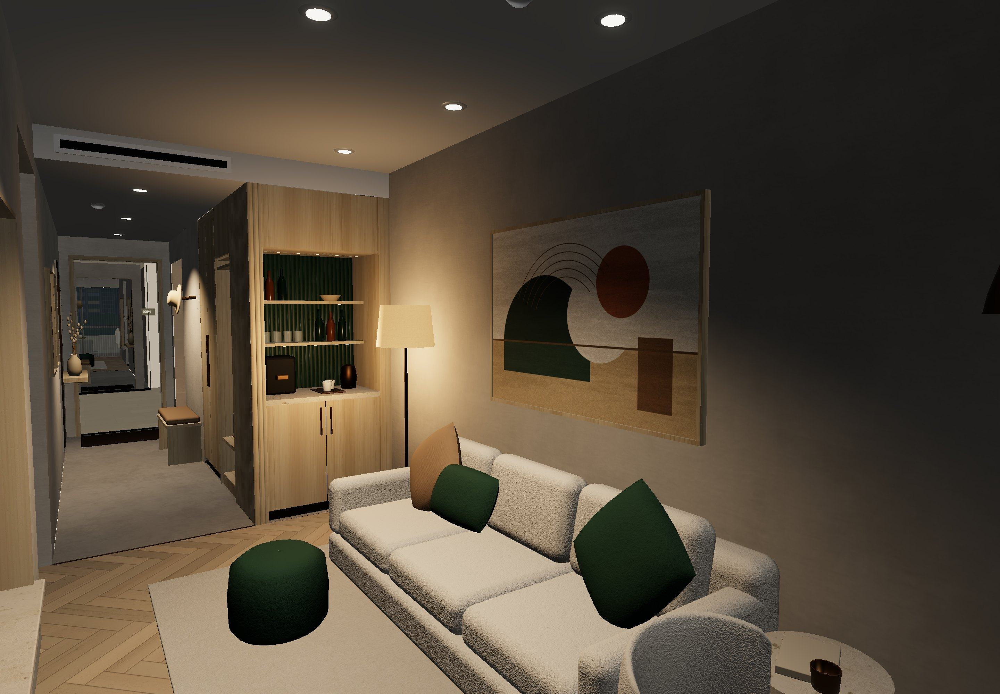
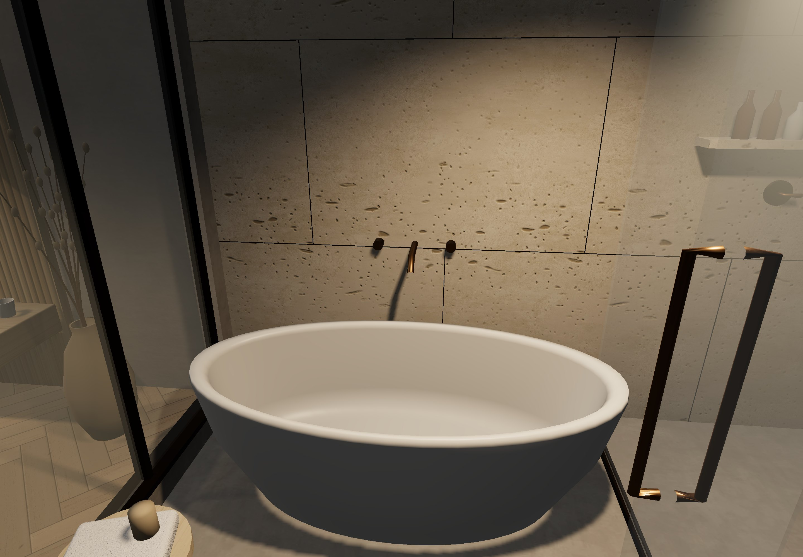
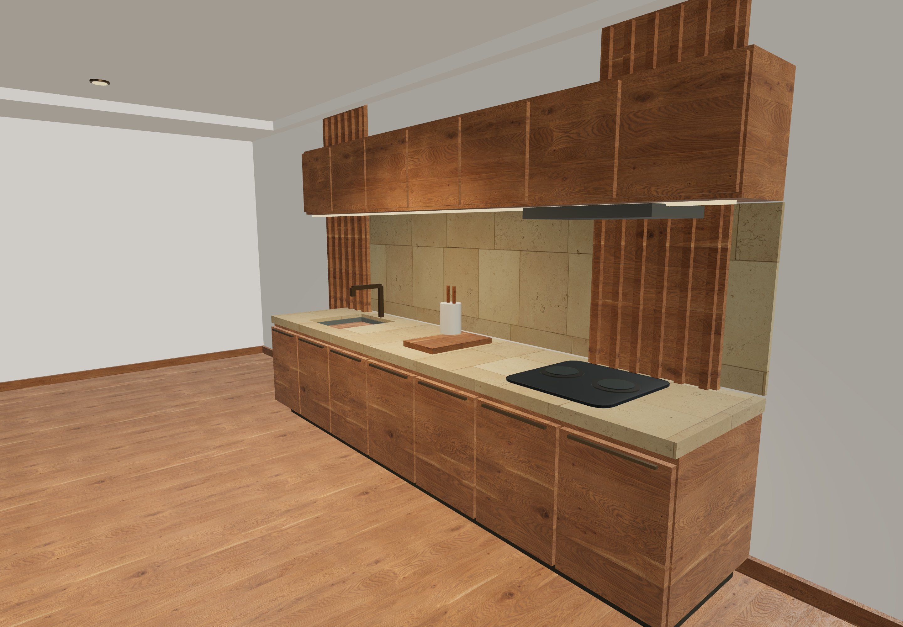
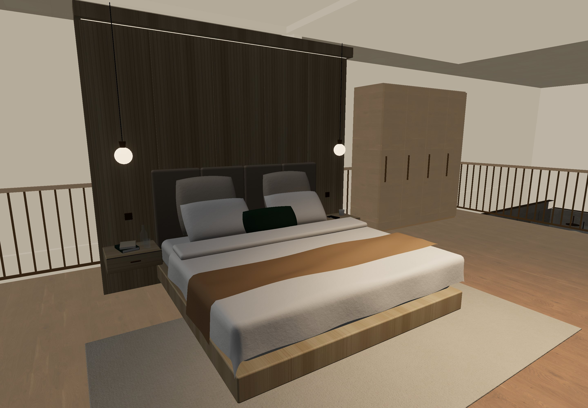
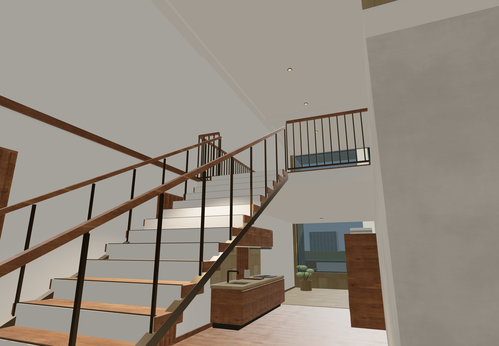

# 用户套房接入与公寓复式

更新日期：2026-10-07。本文记录套房接入的实现与交接约定；最终运行验收状态见文末。

## 接入范围

H 云澜酒店的 200 套、A 云澜服务公寓的 200 套，均使用用户提供的自制 `酒店套房_改造后.glb`。400 套复用同一源设计，并按现有房号和单元朝向实例化。原卧室、客厅、独卫、家具、装饰和贴图由源模型提供，尺寸保持 1:1。

A 栋仅 **1F 的 10 套**在原有 6.5 米层高内增加夹层。上下层仍属于同一住户，园区保持 760 个单元、原有楼层数量及 12 部塔楼电梯。R1–R4 的 360 户继续使用原住宅户型，三期商场的 407 家商铺不变。

## 来源和许可

| 文件 | 责任 |
|---|---|
| `assets/models/user-suite-original.glb` | 用户源模型的原始字节；不覆盖、不手工修改 |
| `assets/models/user-suite-processed.glb` | 由预处理脚本生成的园区版本 |
| `assets/models/manifest.json` | 原件及处理结果 SHA-256、来源、23 张内嵌图片的校验值、门窗检查、灯光及变更记录 |
| `scripts/prepare-suite-asset.mjs` | 可重复执行的几何预处理，输出处理模型及清单 |

该模型来自用户自制资产，**不是 CC0**。其中的内嵌图片保留源文件字节，不能因为园区使用了 Poly Haven 而把整份模型标为 CC0。已有六套 Poly Haven 材质的来源与许可仍在[贴图来源](texture-sources.md)和[贴图清单](../assets/textures/manifest.json)中独立记录。

原模型文件是内容来源。预处理后的模型会保留主要家具及材质，同时针对园区通行处理门窗，因此不是原 GLB 的逐字节副本。

## 坐标和空间

单元占地仍为 11×15 米，`u.frame` 表示单元的世界位置和朝向。源模型使用米制、Y 轴向上；放置时只旋转和平移，不缩放：

```text
unitX = sourceZ + 1.45
unitZ = 10.35 - sourceX
worldY = sourceY + lv.elev + 0.035
```

水平坐标通过 `toW(u.frame, unitX, unitZ)` 转到园区。等效 Y 轴旋转为 `Math.PI / 2`。3.5 厘米的垂直偏移用于避免原地面与园区楼板共面，不能据此改变导航楼层高度或家具尺寸。

| 位置 | 当前约定 |
|---|---|
| 原入户门 | 单元 `(5.5, 0)`；净宽 0.91 米 |
| 附翼新侧门 | 源坐标 `x=9.20..10.20, z=4.65`；单元 `x=6.1, z=0.15..1.15` |
| 原主要落地窗 | 源 `x=0` 对应单元 `z=10.35`；保留面向后庭的视线 |
| 右翼附加空间 | 主要在单元 `x=7.5..10.8`；源侧门连接此处 |
| 后庭休闲区 | 单元 `z=10.5..14.8`；从右翼绕行进入 |
| A1F 楼梯 | 中线由 `(9.55, 1)` 到 `(9.55, 6.4)`，宽 1.5 米，18 级，总高 3.05 米 |
| A1F 夹层 | `x=1.3..10.8, z=6.4..14.8`；前护栏在 `x=8.8..10.3` 留楼梯出口 |

公寓普通层厨房、洗烘和储物沿右翼布置；A1F 厨房移到楼梯后侧，避免占用上行通道。酒店附翼布置茶水台、衣柜与行李凳。后庭使用低沙发、圆桌及植物，保留窗前视线。夹层床、床头和床边家具继续使用原模型，新增工作桌椅、柜体、书架、楼板及扶手由合批构建器生成。

`suite-plan.js` 记录源模型测量得到的隔墙、门洞、源家具障碍及附加家具占地。导航中的楼梯坡道连接同层的独立夹层支撑面；夹层下方行走仍在原楼面，上层护栏和各户边界阻止横穿或侧向跌落。可视阶梯有独立踏步和踢面，人物高度使用连续坡道近似。

## 预处理与构建

普通源码修改直接执行：

```sh
npm ci
npm test
npm run build
npm run serve
```

只有调整源模型处理规则或重建模型资产时，才先运行：

```sh
node scripts/prepare-suite-asset.mjs
npm test
npm run build
```

脚本默认读取仓库内的原始 GLB；也接受一个源文件路径参数。首次导入时保存原件，若仓库已有不同字节的原件则拒绝覆盖，以免丢失来源证据。它不依赖下载目录中的 HTML 或截图。

当前处理包括：切开入户和附翼门洞，静态打开湿区及 WC 玻璃门，移动影响侧门的玄关镜面，移除窗外夜景背景板，清除窗前不透明遮挡并调整玻璃透明度。外墙部分改为暖色抹灰，原有室内黑色金属等材质保持独立；同时生成有限强度的顶点接触阴影，并向独立 GLB 写入 8 盏暖光 `KHR_lights_punctual` 灯。门洞和窗外视线会对处理后真实三角形执行射线检查。

`build.mjs` 将处理后的 GLB 编成 data URL，生成 `src/render/suite-data.js`，再与 Three.js、园区 PBR 素材一起打包到 `dist/mall.html` 和 `dist/artifact.html`。`suite-data.js`、`pbr-data.js`、`index.html` 与 `dist/` 都不应手工编辑。构建成功只表示产物生成，离线可用性仍需浏览器验证。

## 运行时资源责任

| 模块 | 职责 |
|---|---|
| `src/layout/suite-plan.js` | 源模型坐标合同、户内隔墙/门洞、家具障碍、复式楼梯和夹层 |
| `src/layout/hospitality.js` | 把套房计划赋给 400 套 H/A 单元，只给 A1F 10 套增加复式 |
| `src/layout/nav.js` | 门、家具、边界及护栏碰撞，楼梯坡道、夹层支撑和落地 |
| `src/render/suite-asset.js` | `GLTFLoader` 单次解析、Promise 缓存；共享几何/材质/贴图；移动端将较大贴图缩到最长边 512 |
| `src/render/build/suite-models.js` | 用 `InstancedMesh` 按访问楼层放置源模型，并创建夹层的源卧室家具实例 |
| `src/render/build/suite-interiors.js` | 生成附翼、厨房、洗烘、后庭、复式楼板和楼梯等本层合批几何 |
| `src/render/build/residence-interiors.js` | H/A 跳过旧占位室内，挂接新套房，仍生成公共楼梯与候梯厅；R 住宅沿用原构建 |
| `src/render/suite-lighting.js` | 固定近景灯池，随当前选中/所在套房更新位置和强度 |
| `src/render/app.js` | 加载源资源，并管理最多 3 个访问楼层的 `residenceCache` |

共享源资源标记为 `userData.sharedSuite`。退层时可以释放该层的实例缓冲及附加几何，**不能调用共享源几何、材质或纹理的 `dispose()`**。`suite-models` 释放实例；`suite-interiors` 在创建结束时快照其自有几何，后续挂入的源模型克隆不属于它的释放范围。仅整体卸载源资产时调用 loader 返回的 `dispose()`；材质和贴图不归楼层缓存所有。

新增构建器返回 `group`、`lowerGroup`、`upperGroup`、`ceilingGroup`、`metadata` 和幂等 `dispose()`。`metadata` 包含家具占地、夹层床位置及建议灯位；运行时真正启用的灯光以 `suite-lighting.js` 为准，不能把这些建议灯位再为每户创建一遍。

## 灯光与显示边界

园区运行时使用 **桌面 10 盏、移动端 8 盏**固定灯池；其中附翼灯及复式灯包含在总数内。未进入复式时，复式灯强度为 0。灯池根据当前套房移动，保留卧室、起居、入户、卫浴和床头的暖色补光。桌面有两盏局部投影灯，阴影图为 1024；移动端关闭这些局部投影。其余套房仍由环境光、接触阴影和材质发光参与显示。室内泛光强度为 `0.10×night`、阈值1.25、曝光0.94；离开房间恢复园区参数，以免木纹和白色床品过曝。

处理后 GLB 自带的 8 盏灯用于该模型被单独导入的情形。园区 loader 提取共享网格和灯位说明，由固定灯池统一驱动，不会为 400 套叠加 3200 盏实时灯。原独立 HTML 的渲染参数与园区环境并不完全相同，导入原几何不意味着两者截图逐像素相同。

当前边界：

- 400 套重复使用一个源设计，附翼按酒店/公寓用途区分；不是 400 套独立装修。
- 主要家具采用平面包围范围碰撞，不做所有装饰品、抽屉、玻璃门的物理模拟；门扇保持处理后的固定开启状态。
- 源玄关柜与换鞋凳转角净距较紧，导航人物半径为 0.3 米；改变这两件家具、门洞或人物半径后，应重新验证玄关路径。
- 上下层切剖与天花显隐由运行时组控制；可视楼梯采用 18 级台阶，行走高度采用连续坡道。
- 首次解析和首次进入新楼层仍需上传资源；现有限流与缓存不能替代实体手机性能验证。
- 家具碰撞增强限于本次 H/A 套房，不能推定商铺、R 住宅、树木和车辆也新增了相同碰撞。
- 本轮尚无实体 iPhone 验收记录；没有据此宣称已发布新的在线体验站点。

## 验证状态

本轮 **95/95 自动化测试通过**，`npm run build` 成功。实际浏览器和断网交互结果见[本轮验收记录](qa-2026-10-07-suite.md)。

- `tests/suite-asset.test.js` 覆盖原件/图片校验、处理模型属性及索引、接触阴影、门洞多高度射线、相邻实墙、8 盏 GLB 灯及窗外视线。
- `tests/suite-nav.test.js` 覆盖 400 套接入、10 套复式上下楼、夹层支撑与落地、护栏/楼梯/家具碰撞、户间隔离和卫浴通行；`residence-access.test.js` 保留全部 760 套的入户和套内可达检查。
- 附加几何已独立检查 H2F、A2F、A1F 的两个单元朝向，共 6 套：坐标有限且不超出单元与层高，18 级踏步/3.05 米高度匹配；两次卸载不会重复释放自有几何，不释放共享材质及后挂源网格。
- 实测桌面及iPhone UA模拟离线页：进入酒店20F套房、绕过家具、进入公寓首层并步行上下夹层；HTTP请求、页面异常、控制台错误均为0。移动共享源贴图最长边512；移动摇杆手势及实体Safari不在本轮验证范围内。
- 浏览器反复进入H1/H20/A20/H2/A1/H20，缓存始终不超过3层，源几何、材质、纹理未被误释放；旧选房不再锁住漫游灯池，跨南北朝向房间照明正确跟随。

2026-10-06 的 [83 项测试及浏览器验收](qa-2026-10-06.md)属于本次套房接入之前，只作为原园区功能的历史基线。

## 实际场景截图










