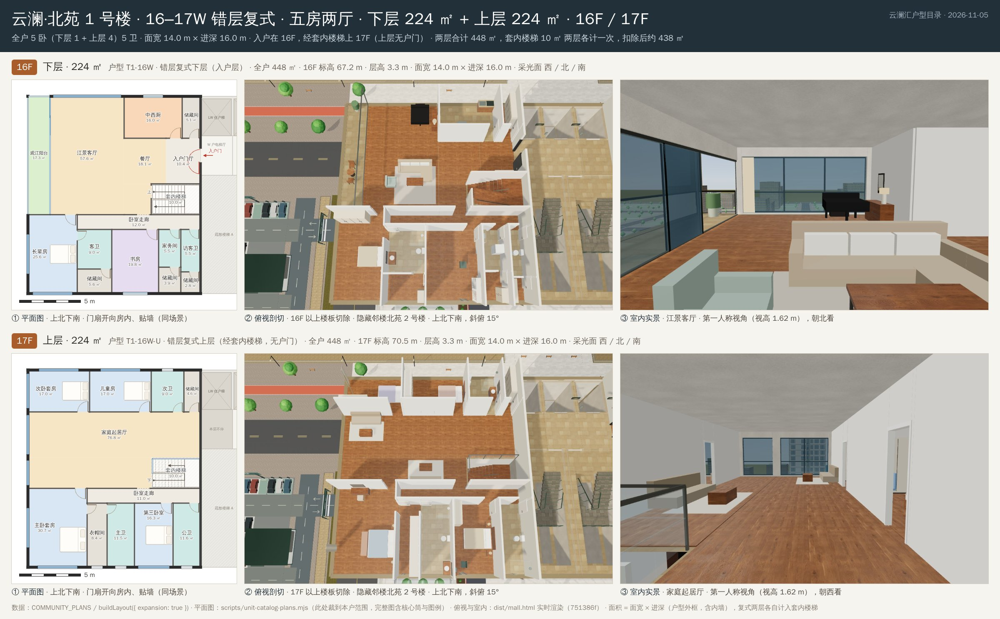
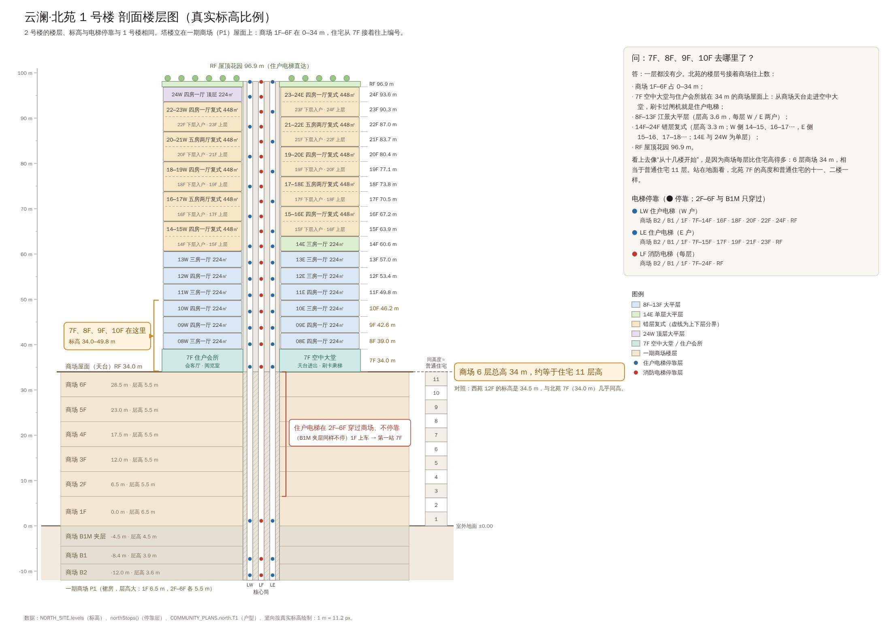

# 云澜社区户型目录（2026-11-05）

按用户要求，把每个户型分别截图：一户一张拼图，每张都有**布局图（平面图）**、**俯视图**和**室内实景**。共 58 户：

- 云澜·西苑：10 个户型（1 号楼、2 号楼各 5 户，2F–28F 每层同一位置同一户型）。
- 云澜·北苑：1 号楼、2 号楼各 24 户，共 48 户。其中 20 户是上下两层的错层复式，所以北苑一共 68 个层单元，复式的拼图有两行。

所有图片在 [`docs/qa/unit-catalog-2026-11-05/`](qa/unit-catalog-2026-11-05/)。截图在门扇修复之后重新拍过，来自分支 `claude/wonderful-thompson-olaaxb` 的 `751386f`，平面图、俯视剖切和室内实景都和当前场景一致。线上新站 https://yunlan-mall-calvin-v2.netlify.app/ 还是修复前的 `4b94cbf`，没有重新发布。

## 怎么看图

每张拼图最上面是标题栏：楼栋、户号、户型、面积和楼层。下面每一行是一个楼层，单层户型一行，复式两行（下层入户层在上，上层在下）。行首的橙色标签是楼层，后面是这一层的标高、层高、面宽 × 进深和采光面。面宽是东西向（图上横向），进深是南北向（图上竖向）：北苑 1 号楼每户 14 m × 16 m，2 号楼每户 12 m × 16 m。户型数据里北苑的 `width` / `depth` 以户门所在的南北向核心筒墙为宽（16 × 14、16 × 12），和图上的方向正好相反，所以拼图按图上的东西 × 南北来写。每行三幅图高度相同：

1. **① 平面图（布局图）**：上北下南、左西右东，和俯视图同一个方向。图已裁到本户范围，左下角是 5 m 比例尺。每个房间标了名称和面积。
   - 颜色：米黄是起居和餐厅，浅蓝是卧室，淡紫是书房、影音室和茶室，橙色是厨房，青色是卫浴和家务间，浅绿是阳台，灰色是储藏和衣帽间，浅灰是玄关和走廊。斜线是套内楼梯，白底虚线叉是挑空。
   - 红箭头是入户门。弧线和短粗线是门扇：室内门开 90° 进它服务的房间（卧室、卫生间、储藏间等），贴墙停放；入户门向内折 180°，贴在玄关墙上。和场景里的画法一致，见下文“已修复：竖着的门板”。
   - 未裁切的平面图（带核心筒和邻户）见三张索引图。
2. **② 俯视剖切**：游戏场景实拍。本层以上的楼板全部切掉，相邻那栋楼临时隐藏，所以能直接看到家具和隔墙。画面上北下南，相机从南侧斜俯约 15°，所以北墙墙顶会略往上偏。复式上层如果有挑空，能透过挑空看到下层客厅。
3. **③ 室内实景**：第一人称视角，视线高 1.62 m。说明里写了站在哪个房间、朝哪个方向看。
   - 西苑站在客厅，北苑大平层和复式下层站在江景客厅，复式上层站在家庭起居厅。
   - 北苑 2 号楼 08E、11E 站在餐厅望向江景客厅，因为客厅里原定的站位正好贴着沙发背。

另有三张户型索引图（一张图看全一栋楼的所有户型，统一比例）和两张剖面楼层图：

| 图 | 内容 |
| --- | --- |
| [index-west.jpg](qa/unit-catalog-2026-11-05/index-west.jpg) | 西苑 10 个户型 |
| [index-T1.jpg](qa/unit-catalog-2026-11-05/index-T1.jpg) | 北苑 1 号楼 24 户，复式按下层 + 上层成对排列 |
| [index-T2.jpg](qa/unit-catalog-2026-11-05/index-T2.jpg) | 北苑 2 号楼 24 户 |
| [north-section.jpg](qa/unit-catalog-2026-11-05/north-section.jpg) | 北苑剖面：商场与塔楼的真实标高、每户所在楼层、三部电梯的停靠层 |
| [west-section.jpg](qa/unit-catalog-2026-11-05/west-section.jpg) | 西苑剖面：两栋 28 层板楼，每层 5 户 |

## 北苑的 7、8、9、10 楼在哪里

用户问：北苑是不是直接从十几楼开始？商场是六层，那往上应该是七、八、九、十楼，这些楼层去哪了？

**答：一层都没有少。北苑的楼层号是接着商场往上数的，7F 就在商场天台上。**

| 楼层 | 标高 | 层高 | 用途 |
| --- | --- | --- | --- |
| 1F–6F | 0–34.0 m | 1F 6.5 m，2F–6F 各 5.5 m | 一期商场 P1，北苑塔楼就立在它的屋面（天台）上 |
| 7F | 34.0 m | 5.0 m | 空中会所，两栋各有会客厅、阅览室、私宴厅、健身房，地面就是商场天台 |
| 8F–13F | 39.0–57.0 m | 3.6 m | 江景大平层，每层东西两户（W / E），一梯一户 |
| 14F–24F | 60.6–93.6 m | 3.3 m | 错层复式：西侧 14–15、16–17 … 22–23，东侧 15–16、17–18 … 23–24；14E 和 24W 是单层端户 |
| RF | 96.9 m | — | 屋顶花园 |

为什么看起来像是“从十几楼开始”：

- **商场每层比住宅高很多。** 商场 6 层一共 34 m，按普通住宅 3 m 一层算，相当于 11 层楼。所以北苑 7F 离地面的高度，和普通住宅的十一、二楼差不多。对照一下：西苑 12F 的标高是 34.5 m，和北苑 7F（34.0 m）几乎一样高。
- **住户电梯在商场里不停。** 住户电梯在独立的核心筒里，只在商场的 B2、B1、1F 开门；穿过 B1M 夹层和 2F–6F 时不停，出了商场第一站就是 7F。住户电梯的停靠层里没有 2F–6F，因为这几层是商场，不属于住宅。

三部电梯的停靠层（来自 `northStops()`，两栋相同）：

| 电梯 | 停靠 |
| --- | --- |
| LW 住户电梯（西侧户） | 商场 B2 / B1 / 1F → 7F–14F → 16F、18F、20F、22F、24F → RF |
| LE 住户电梯（东侧户） | 商场 B2 / B1 / 1F → 7F–15F → 17F、19F、21F、23F → RF |
| LF 消防电梯 | 商场 B2 / B1 / 1F → 7F–24F 每层 → RF |

7F–14F 两部住户电梯都停。14F 往上，复式的上层没有户门，要从下层经套内楼梯上去，所以 LW 只停西侧复式的入户层 16、18、20、22F 和 24W 所在的 24F，LE 只停东侧复式的入户层 15、17、19、21、23F。

用户同时提出要在商场天台做一个大堂，可以穿行、可以进住宅，并从中间直接上住宅电梯。这一项另行实施，不在本目录里。

## 户型一览

面积口径：每个层单元的面积 = 面宽 × 进深（户型外框，含内墙）。复式每一层都把 10 ㎡ 的套内楼梯算了进去，带挑空的上层还算了挑空面积，所以复式“两层合计”偏大，详见“已知问题”。

### 云澜·西苑 1 号楼（3 梯 5 户，2F–28F）

| 户号 | 户型 | 面积 | 卧室 / 卫生间 | 楼层 | 图 |
| --- | --- | --- | --- | --- | --- |
| W1-SW（SW 户） | 四房一厅 | 153 ㎡ | 4 卧 2 卫 | 2F–28F（图为 12F） | [W1-SW.jpg](qa/unit-catalog-2026-11-05/W1-SW.jpg) |
| W1-S（S 户） | 两房一厅 | 95.4 ㎡ | 2 卧 1 卫 | 2F–28F（图为 12F） | [W1-S.jpg](qa/unit-catalog-2026-11-05/W1-S.jpg) |
| W1-SE（SE 户） | 三房一厅 | 142.2 ㎡ | 3 卧 2 卫 | 2F–28F（图为 12F） | [W1-SE.jpg](qa/unit-catalog-2026-11-05/W1-SE.jpg) |
| W1-NW（NW 户） | 三房一厅 | 140.3 ㎡ | 3 卧 2 卫 | 2F–28F（图为 12F） | [W1-NW.jpg](qa/unit-catalog-2026-11-05/W1-NW.jpg) |
| W1-NE（NE 户） | 两房一厅 | 92.4 ㎡ | 2 卧 1 卫 | 2F–28F（图为 12F） | [W1-NE.jpg](qa/unit-catalog-2026-11-05/W1-NE.jpg) |

### 云澜·西苑 2 号楼（3 梯 5 户，2F–28F）

| 户号 | 户型 | 面积 | 卧室 / 卫生间 | 楼层 | 图 |
| --- | --- | --- | --- | --- | --- |
| W2-SW（SW 户） | 三房一厅 | 131.4 ㎡ | 3 卧 2 卫 | 2F–28F（图为 12F） | [W2-SW.jpg](qa/unit-catalog-2026-11-05/W2-SW.jpg) |
| W2-S（S 户） | 两房一厅 | 100.8 ㎡ | 2 卧 1 卫 | 2F–28F（图为 12F） | [W2-S.jpg](qa/unit-catalog-2026-11-05/W2-S.jpg) |
| W2-SE（SE 户） | 四房一厅 | 158.4 ㎡ | 4 卧 2 卫 | 2F–28F（图为 12F） | [W2-SE.jpg](qa/unit-catalog-2026-11-05/W2-SE.jpg) |
| W2-NW（NW 户） | 两房一厅 | 97.4 ㎡ | 2 卧 1 卫 | 2F–28F（图为 12F） | [W2-NW.jpg](qa/unit-catalog-2026-11-05/W2-NW.jpg) |
| W2-NE（NE 户） | 三房一厅 | 135.2 ㎡ | 3 卧 2 卫 | 2F–28F（图为 12F） | [W2-NE.jpg](qa/unit-catalog-2026-11-05/W2-NE.jpg) |

### 云澜·北苑 1 号楼（每户面宽 14 m × 进深 16 m）

| 户号 | 户型 | 面积 | 卧室 / 卫生间 | 楼层 | 图 |
| --- | --- | --- | --- | --- | --- |
| T1-08W | 08W 大平层 · 三房一厅 | 224 ㎡ | 3 卧 2 卫 | 8F | [T1-08W.jpg](qa/unit-catalog-2026-11-05/T1-08W.jpg) |
| T1-08E | 08E 大平层 · 四房一厅 | 224 ㎡ | 4 卧 3 卫 | 8F | [T1-08E.jpg](qa/unit-catalog-2026-11-05/T1-08E.jpg) |
| T1-09W | 09W 大平层 · 四房一厅 | 224 ㎡ | 4 卧 3 卫 | 9F | [T1-09W.jpg](qa/unit-catalog-2026-11-05/T1-09W.jpg) |
| T1-09E | 09E 大平层 · 四房一厅 | 224 ㎡ | 4 卧 3 卫 | 9F | [T1-09E.jpg](qa/unit-catalog-2026-11-05/T1-09E.jpg) |
| T1-10W | 10W 大平层 · 四房一厅 | 224 ㎡ | 4 卧 3 卫 | 10F | [T1-10W.jpg](qa/unit-catalog-2026-11-05/T1-10W.jpg) |
| T1-10E | 10E 大平层 · 三房一厅 | 224 ㎡ | 3 卧 2 卫 | 10F | [T1-10E.jpg](qa/unit-catalog-2026-11-05/T1-10E.jpg) |
| T1-11W | 11W 大平层 · 三房一厅 | 224 ㎡ | 3 卧 2 卫 | 11F | [T1-11W.jpg](qa/unit-catalog-2026-11-05/T1-11W.jpg) |
| T1-11E | 11E 大平层 · 四房一厅 | 224 ㎡ | 4 卧 3 卫 | 11F | [T1-11E.jpg](qa/unit-catalog-2026-11-05/T1-11E.jpg) |
| T1-12W | 12W 大平层 · 四房一厅 | 224 ㎡ | 4 卧 3 卫 | 12F | [T1-12W.jpg](qa/unit-catalog-2026-11-05/T1-12W.jpg) |
| T1-12E | 12E 大平层 · 三房一厅 | 224 ㎡ | 3 卧 2 卫 | 12F | [T1-12E.jpg](qa/unit-catalog-2026-11-05/T1-12E.jpg) |
| T1-13W | 13W 大平层 · 三房一厅 | 224 ㎡ | 3 卧 2 卫 | 13F | [T1-13W.jpg](qa/unit-catalog-2026-11-05/T1-13W.jpg) |
| T1-13E | 13E 大平层 · 三房一厅 | 224 ㎡ | 3 卧 2 卫 | 13F | [T1-13E.jpg](qa/unit-catalog-2026-11-05/T1-13E.jpg) |
| T1-14W | 14–15W 错层复式 · 四房一厅 | 下层 224 + 上层 224（含挑空 31） ㎡ | 4 卧（下 1 + 上 3）4 卫 | 14F 下层入户 / 15F 上层 | [T1-14W.jpg](qa/unit-catalog-2026-11-05/T1-14W.jpg) |
| T1-14E | 14E 大平层 · 三房一厅 | 224 ㎡ | 3 卧 2 卫 | 14F | [T1-14E.jpg](qa/unit-catalog-2026-11-05/T1-14E.jpg) |
| T1-15E | 15–16E 错层复式 · 四房一厅 | 下层 224 + 上层 224（含挑空 31） ㎡ | 4 卧（下 1 + 上 3）4 卫 | 15F 下层入户 / 16F 上层 | [T1-15E.jpg](qa/unit-catalog-2026-11-05/T1-15E.jpg) |
| T1-16W | 16–17W 错层复式 · 五房两厅 | 下层 224 + 上层 224 ㎡ | 5 卧（下 1 + 上 4）5 卫 | 16F 下层入户 / 17F 上层 | [T1-16W.jpg](qa/unit-catalog-2026-11-05/T1-16W.jpg) |
| T1-17E | 17–18E 错层复式 · 五房两厅 | 下层 224 + 上层 224 ㎡ | 5 卧（下 1 + 上 4）5 卫 | 17F 下层入户 / 18F 上层 | [T1-17E.jpg](qa/unit-catalog-2026-11-05/T1-17E.jpg) |
| T1-18W | 18–19W 错层复式 · 四房一厅 | 下层 224 + 上层 224（含挑空 28） ㎡ | 4 卧（下 1 + 上 3）4 卫 | 18F 下层入户 / 19F 上层 | [T1-18W.jpg](qa/unit-catalog-2026-11-05/T1-18W.jpg) |
| T1-19E | 19–20E 错层复式 · 四房一厅 | 下层 224 + 上层 224（含挑空 31） ㎡ | 4 卧（下 1 + 上 3）4 卫 | 19F 下层入户 / 20F 上层 | [T1-19E.jpg](qa/unit-catalog-2026-11-05/T1-19E.jpg) |
| T1-20W | 20–21W 错层复式 · 五房两厅 | 下层 224 + 上层 224 ㎡ | 5 卧（下 1 + 上 4）5 卫 | 20F 下层入户 / 21F 上层 | [T1-20W.jpg](qa/unit-catalog-2026-11-05/T1-20W.jpg) |
| T1-21E | 21–22E 错层复式 · 五房两厅 | 下层 224 + 上层 224 ㎡ | 5 卧（下 1 + 上 4）5 卫 | 21F 下层入户 / 22F 上层 | [T1-21E.jpg](qa/unit-catalog-2026-11-05/T1-21E.jpg) |
| T1-22W | 22–23W 错层复式 · 四房一厅 | 下层 224 + 上层 224 ㎡ | 4 卧（下 1 + 上 3）4 卫 | 22F 下层入户 / 23F 上层 | [T1-22W.jpg](qa/unit-catalog-2026-11-05/T1-22W.jpg) |
| T1-23E | 23–24E 错层复式 · 四房一厅 | 下层 224 + 上层 224（含挑空 31） ㎡ | 4 卧（下 1 + 上 3）4 卫 | 23F 下层入户 / 24F 上层 | [T1-23E.jpg](qa/unit-catalog-2026-11-05/T1-23E.jpg) |
| T1-24W | 24W 顶层大平层 · 四房一厅 | 224 ㎡ | 4 卧 3 卫 | 24F | [T1-24W.jpg](qa/unit-catalog-2026-11-05/T1-24W.jpg) |

### 云澜·北苑 2 号楼（每户面宽 12 m × 进深 16 m）

| 户号 | 户型 | 面积 | 卧室 / 卫生间 | 楼层 | 图 |
| --- | --- | --- | --- | --- | --- |
| T2-08W | 08W 大平层 · 三房一厅 | 192 ㎡ | 3 卧 2 卫 | 8F | [T2-08W.jpg](qa/unit-catalog-2026-11-05/T2-08W.jpg) |
| T2-08E | 08E 大平层 · 四房一厅 | 192 ㎡ | 4 卧 3 卫 | 8F | [T2-08E.jpg](qa/unit-catalog-2026-11-05/T2-08E.jpg) |
| T2-09W | 09W 大平层 · 四房一厅 | 192 ㎡ | 4 卧 3 卫 | 9F | [T2-09W.jpg](qa/unit-catalog-2026-11-05/T2-09W.jpg) |
| T2-09E | 09E 大平层 · 四房一厅 | 192 ㎡ | 4 卧 3 卫 | 9F | [T2-09E.jpg](qa/unit-catalog-2026-11-05/T2-09E.jpg) |
| T2-10W | 10W 大平层 · 四房一厅 | 192 ㎡ | 4 卧 3 卫 | 10F | [T2-10W.jpg](qa/unit-catalog-2026-11-05/T2-10W.jpg) |
| T2-10E | 10E 大平层 · 三房一厅 | 192 ㎡ | 3 卧 2 卫 | 10F | [T2-10E.jpg](qa/unit-catalog-2026-11-05/T2-10E.jpg) |
| T2-11W | 11W 大平层 · 三房一厅 | 192 ㎡ | 3 卧 2 卫 | 11F | [T2-11W.jpg](qa/unit-catalog-2026-11-05/T2-11W.jpg) |
| T2-11E | 11E 大平层 · 四房一厅 | 192 ㎡ | 4 卧 3 卫 | 11F | [T2-11E.jpg](qa/unit-catalog-2026-11-05/T2-11E.jpg) |
| T2-12W | 12W 大平层 · 四房一厅 | 192 ㎡ | 4 卧 3 卫 | 12F | [T2-12W.jpg](qa/unit-catalog-2026-11-05/T2-12W.jpg) |
| T2-12E | 12E 大平层 · 三房一厅 | 192 ㎡ | 3 卧 2 卫 | 12F | [T2-12E.jpg](qa/unit-catalog-2026-11-05/T2-12E.jpg) |
| T2-13W | 13W 大平层 · 三房一厅 | 192 ㎡ | 3 卧 2 卫 | 13F | [T2-13W.jpg](qa/unit-catalog-2026-11-05/T2-13W.jpg) |
| T2-13E | 13E 大平层 · 三房一厅 | 192 ㎡ | 3 卧 2 卫 | 13F | [T2-13E.jpg](qa/unit-catalog-2026-11-05/T2-13E.jpg) |
| T2-14W | 14–15W 错层复式 · 四房一厅 | 下层 192 + 上层 192 ㎡ | 4 卧（下 1 + 上 3）4 卫 | 14F 下层入户 / 15F 上层 | [T2-14W.jpg](qa/unit-catalog-2026-11-05/T2-14W.jpg) |
| T2-14E | 14E 大平层 · 三房一厅 | 192 ㎡ | 3 卧 2 卫 | 14F | [T2-14E.jpg](qa/unit-catalog-2026-11-05/T2-14E.jpg) |
| T2-15E | 15–16E 错层复式 · 四房一厅 | 下层 192 + 上层 192 ㎡ | 4 卧（下 1 + 上 3）4 卫 | 15F 下层入户 / 16F 上层 | [T2-15E.jpg](qa/unit-catalog-2026-11-05/T2-15E.jpg) |
| T2-16W | 16–17W 错层复式 · 五房两厅 | 下层 192 + 上层 192 ㎡ | 5 卧（下 1 + 上 4）5 卫 | 16F 下层入户 / 17F 上层 | [T2-16W.jpg](qa/unit-catalog-2026-11-05/T2-16W.jpg) |
| T2-17E | 17–18E 错层复式 · 五房两厅 | 下层 192 + 上层 192 ㎡ | 5 卧（下 1 + 上 4）5 卫 | 17F 下层入户 / 18F 上层 | [T2-17E.jpg](qa/unit-catalog-2026-11-05/T2-17E.jpg) |
| T2-18W | 18–19W 错层复式 · 四房一厅 | 下层 192 + 上层 192 ㎡ | 4 卧（下 1 + 上 3）4 卫 | 18F 下层入户 / 19F 上层 | [T2-18W.jpg](qa/unit-catalog-2026-11-05/T2-18W.jpg) |
| T2-19E | 19–20E 错层复式 · 四房一厅 | 下层 192 + 上层 192 ㎡ | 4 卧（下 1 + 上 3）4 卫 | 19F 下层入户 / 20F 上层 | [T2-19E.jpg](qa/unit-catalog-2026-11-05/T2-19E.jpg) |
| T2-20W | 20–21W 错层复式 · 五房两厅 | 下层 192 + 上层 192 ㎡ | 5 卧（下 1 + 上 4）5 卫 | 20F 下层入户 / 21F 上层 | [T2-20W.jpg](qa/unit-catalog-2026-11-05/T2-20W.jpg) |
| T2-21E | 21–22E 错层复式 · 五房两厅 | 下层 192 + 上层 192 ㎡ | 5 卧（下 1 + 上 4）5 卫 | 21F 下层入户 / 22F 上层 | [T2-21E.jpg](qa/unit-catalog-2026-11-05/T2-21E.jpg) |
| T2-22W | 22–23W 错层复式 · 四房一厅 | 下层 192 + 上层 192 ㎡ | 4 卧（下 1 + 上 3）4 卫 | 22F 下层入户 / 23F 上层 | [T2-22W.jpg](qa/unit-catalog-2026-11-05/T2-22W.jpg) |
| T2-23E | 23–24E 错层复式 · 四房一厅 | 下层 192 + 上层 192 ㎡ | 4 卧（下 1 + 上 3）4 卫 | 23F 下层入户 / 24F 上层 | [T2-23E.jpg](qa/unit-catalog-2026-11-05/T2-23E.jpg) |
| T2-24W | 24W 顶层大平层 · 四房一厅 | 192 ㎡ | 4 卧 3 卫 | 24F | [T2-24W.jpg](qa/unit-catalog-2026-11-05/T2-24W.jpg) |

## 已知问题与户型异常

平面图校核结果：78 个层单元的房间面积之和都等于户型面积（误差 0.0 %），房间没有重叠，标注没有出框。门扇没有穿墙、没有伸出户外，也没有开到挑空或楼梯上。没有完全进不去的房间。下面是查出来的问题。

### 1. 已修复：“竖着的门板”

用户说的“竖着的门板”是室内门的门扇。原来 `communityHome()` 把每扇门都画成 90° 敞开、用木地板纹理的木板，开启方向只看隔墙端点的顺序，所以将近一半立在房间或走廊中间，还有不少开进走廊和客厅。修复在 `4658dc3` 和 `751386f`：

- 门扇改由布局统一选定（`src/layout/community-units.js` 的 `doorLeaves()`），渲染、漫游碰撞和平面图读同一份记录。全部 78 个层单元共 707 扇室内门：
  - 695 扇开进它服务的房间，贴一面墙停放（离墙不超过 5 cm）；
  - 12 扇开进它服务的房间，但门扇背后没有墙可靠，见下表；
  - 没有一扇开向走廊、客厅、餐厅或玄关；58 扇入户门都折贴在玄关墙上。
- 门扇是暖白色漆面门板，有门套、门头和执手，漫游时是障碍物。每个门洞都能双向走过，每个房间都走得到。
- 俯视剖切时，门洞上方那段墙和门头套会隐藏，门洞在俯视图里是墙上的缺口；第一人称漫游时照常显示。
- 原来可能也被看成“竖板”的两处一起改了：梳妆镜和台盆镜加了深色镜框；加载楼层时，窗内侧拉开的窗帘画成三道前后错开的褶。
- 衣柜、衣帽间柜、储藏柜、鞋柜、茶柜、书架、冰箱和洗烘塔现在是实体，漫游时走不进去。

背后没有墙可靠的 12 扇门扇：

| 户 | 楼层 | 门 | 现在的样子 |
| --- | --- | --- | --- |
| W1-NE、W2-SW、W2-NW | 2F–28F | 客厅 / 主卧 | 主卧衣柜（2.5–2.8 m）移到门后，门扇靠在衣柜端头，相距 4 cm |
| T1-17E 上层、T1-22W 上层 | 18F、23F | 家庭起居厅 / 主卧套房 | 门后加了一个 0.5 m 宽的高柜，门扇靠在柜子端头 |
| T1-20W 上层、T2-20W 上层 | 21F | 家庭起居厅 / 次卧套房 | 门后加了一个 0.5–0.8 m 宽的高柜，门扇靠在柜子端头 |
| T2-14W、T2-18W、T2-21E、T2-23E 上层 | 15F、19F、22F、24F | 家庭起居厅 / 主卧套房 | 床头紧挨门边（0.2–0.3 m），门后放不下柜子，门扇立在床头旁 |
| T1-21E 上层 | 22F | 主卧套房 / 衣帽间 | 门扇离衣帽间外墙 7 cm，比 5 cm 的贴墙标准多 2 cm |

### 2. 38 个储藏间只能穿过卫生间进入

| 位置 | 情况 |
| --- | --- |
| 西苑 | 主卫后面的储藏间：W1-SW、W1-SE、W1-NW、W2-SW、W2-SE、W2-NE；公卫后面的储藏间：W1-SE、W1-NW、W2-SW、W2-NE |
| 北苑复式下层 | 访客卫后面的储藏间：1 号楼 14W、15E、16W、17E、18W、19E、20W、22W、23E，2 号楼 14W、15E、16W、17E、18W、19E、20W、21E、23E；客卫后面的储藏间：T1-16W、T1-20W、T2-22W |
| 北苑 2 号楼复式上层 | 主卫或次卫后面的储藏间：T2-15E、16W、17E、19E、20W、21E、22W |

### 3. 储藏间偏大

全部 111 间储藏间平均每间 7.7 ㎡（平均每个层单元 10.9 ㎡），其中 16 间 ≥ 10 ㎡，9 间还带窗。看起来是户型生成器把剩余面积都标成了储藏。最大的几间：

| 户 | 楼层 | 房间 | 面积 |
| --- | --- | --- | --- |
| T1-18W 下层 | 18F | 储藏间（带窗） | 40.7 ㎡ |
| T1-20W 上层 | 21F | 储藏间（带窗） | 38.8 ㎡ |
| T1-15E 下层 | 15F | 储藏间（带窗） | 35.8 ㎡ |
| T1-19E 下层 | 19F | 储藏间（带窗） | 35.8 ㎡ |
| T1-22W 上层 | 23F | 书房储藏（带窗） | 35.8 ㎡ |
| T1-14W 上层、T1-23E 上层 | 15F、24F | 储藏间 | 20.3 ㎡ |

T1-15E 上层（16F）还有一间 33.9 ㎡ 的衣帽间。

### 4. 复式上层出现“入户廊”

上层没有户门，但有 4 个上层单元里有名为“入户廊”的房间：T1-14W（15F）、T1-18W（19F）、T1-19E（20F）、T1-23E（24F）。

### 5. 面积口径

`plan.area` 在每个层单元上都等于面宽 × 进深。复式每层都计入 10 ㎡ 套内楼梯，楼梯算了两次；带挑空的上层（T1 的 14W、15E、19E、23E 各 31 ㎡，18W 28 ㎡）还计入了挑空。所以：

- 1 号楼复式合计 448 ㎡，扣掉重复的楼梯和挑空后约 407–438 ㎡（有挑空的 407 或 410 ㎡，无挑空的 438 ㎡）。
- 2 号楼复式合计 384 ㎡，扣掉重复的楼梯后约 374 ㎡（2 号楼复式没有挑空）。

拼图标题栏里写的是数据中的原值，第二行给出扣除后的数。

### 6. 同名房间被拆成几块

数据里有些开敞空间被拆成同名的几块，中间没有墙，例如“餐厅”（dining + dining_1）、“家庭起居厅”（family + family_1）。平面图只标一次，面积是合计值。

### 7. 复式的“几厅”写法不一致

20 户复式都是下层一个江景客厅、上层一个家庭起居厅。其中 8 户五房复式（两栋的 16W、17E、20W、21E）标为“五房两厅”，12 户四房复式（两栋的 14W、15E、18W、19E、22W、23E）却标为“四房一厅”。拼图标题栏照抄数据里的写法，没有改。

## 重新生成

- 平面图、索引图和剖面图：`node scripts/unit-catalog-plans.mjs <输出目录>`，需要 Node 和 Playwright（Chromium）。几何直接取自 `buildLayout({ expansion: true })`，约 25 s。
- 俯视剖切、室内实景和拼图是用本轮的临时脚本，在本地打开 `dist/mall.html`（`window.__mall`）拍的，脚本没有入库。拼图宽 2400 px，每张不超过 450 KB。
